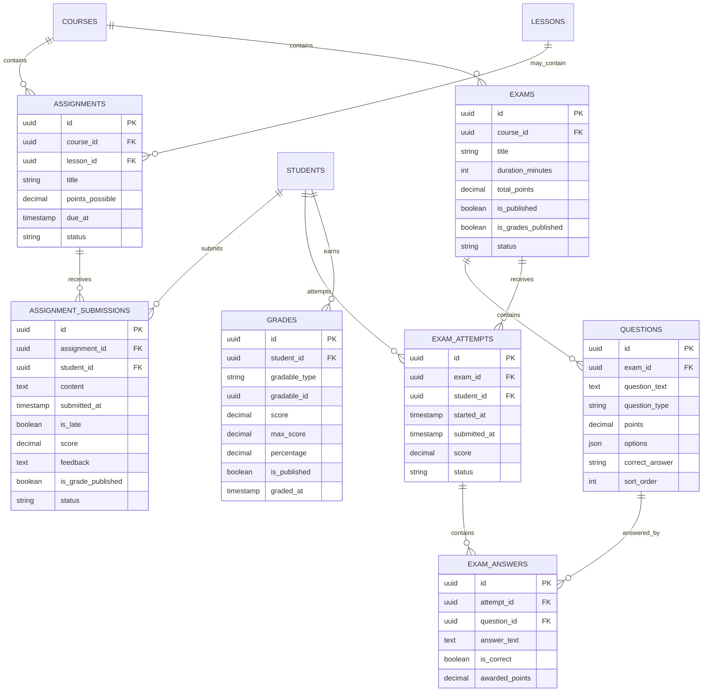

# Assessment Domain

## Overview

The Assessment domain manages student evaluations through assignments and exams, preserving submission timelines, late arrival tracking, attempt lifecycles, grading, and controlled grade publication.

The domain strictly follows platform invariants:
- **`Assessment Ownership belongs to Tenant`**: All assessments, questions, submissions, and grades are strictly tenant-scoped (`connection = 'tenant'`).
- **`Grade Model Independence`**: Grades are modeled independently (`Grade` entity) and support polymorphic references (`gradable_type`, `gradable_id`).
- **`Controlled Grade Publication`**: Grades remain hidden from students until explicitly published by instructors or automated policies.
- **`Duplicate Prevention`**: Students cannot create multiple active attempts or duplicate submissions unless explicitly configured.
- **`Failures Default to Deny`** (SEC-INV-009): Missing permissions default strictly to 403 Forbidden.
- **`Cross-Tenant Isolation`** (SEC-INV-001): Submissions, attempts, and grades from Tenant A are strictly inaccessible to Tenant B.

---

## Domain Model

### Entities & Relationships (Tenant Database)

---

## API Endpoints

All endpoints require tenant context (`tenant` middleware) and authentication (`tenant.auth` middleware):

| Method | Endpoint | Description | Permissions Required |
|---|---|---|---|
| `GET` | `/api/v1/courses/{courseId}/assignments` | List assignments | Authenticated user |
| `POST` | `/api/v1/courses/{courseId}/assignments` | Create assignment | `assignments.create` |
| `GET` | `/api/v1/courses/{courseId}/assignments/{id}` | View assignment | Authenticated user |
| `POST` | `/api/v1/courses/{courseId}/assignments/{id}/submit` | Submit assignment | Student profile |
| `POST` | `/api/v1/courses/{courseId}/assignments/{id}/submissions/{subId}/grade` | Grade submission | `assignments.grade` |
| `POST` | `/api/v1/courses/{courseId}/assignments/{id}/publish-grades` | Publish assignment grades | `assignments.grade` |
| `GET` | `/api/v1/courses/{courseId}/exams` | List exams | Authenticated user |
| `POST` | `/api/v1/courses/{courseId}/exams` | Create exam | `exams.create` |
| `POST` | `/api/v1/courses/{courseId}/exams/{id}/questions` | Add question | `exams.create` |
| `POST` | `/api/v1/courses/{courseId}/exams/{id}/start` | Start exam attempt | Student profile |
| `POST` | `/api/v1/courses/{courseId}/exams/{id}/attempts/{attemptId}/answers` | Save question answer | Attempt owner |
| `POST` | `/api/v1/courses/{courseId}/exams/{id}/attempts/{attemptId}/submit` | Submit exam attempt | Attempt owner |
| `POST` | `/api/v1/courses/{courseId}/exams/{id}/attempts/{attemptId}/grade` | Grade attempt | `exams.grade` |
| `POST` | `/api/v1/courses/{courseId}/exams/{id}/publish-grades` | Publish exam grades | `exams.grade` |
| `GET` | `/api/v1/students/{studentId}/grades` | View student grades | Student (self, published) OR `grades.view` |

---

## Verification (Assessment Gate)

The Assessment Gate (`Phase J §30`) is verified in `apps/api/tests/Feature/AssessmentGateTest.php`:
- `[PASS]` Assignment creation with deadline
- `[PASS]` Student assignment submission within deadline (`is_late = false`)
- `[PASS]` Late assignment submission after deadline (`is_late = true`)
- `[PASS]` Duplicate assignment submission blocked (`422 DUPLICATE_SUBMISSION`)
- `[PASS]` Teacher grading of assignment
- `[PASS]` Grade publication control (grades hidden before publication, visible after)
- `[PASS]` Exam creation and question configuration
- `[PASS]` Student exam start (`status: in_progress`)
- `[PASS]` Duplicate exam attempt blocked (`422 DUPLICATE_ATTEMPT`)
- `[PASS]` Student exam answer recording and scoring
- `[PASS]` Student exam submit (`status: submitted`)
- `[PASS]` Teacher grading and publication of exam grades
- `[PASS]` Authorization enforcement (student cannot grade: `403 FORBIDDEN`)
- `[PASS]` Tenant isolation (cross-tenant assignment/exam submission returns 404 / 401)
