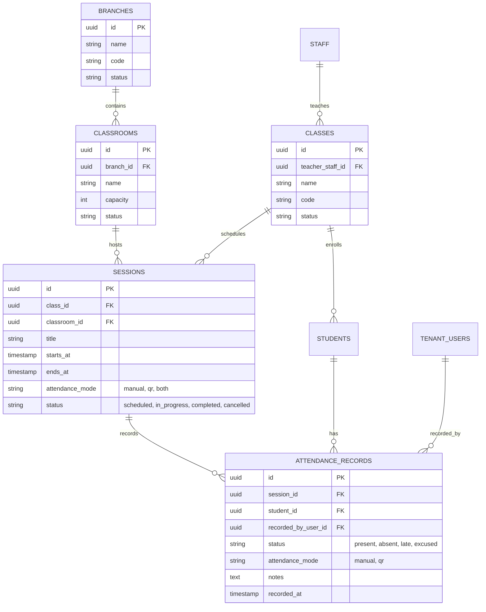

# Attendance & Classroom Domain

## Overview

The Classroom & Attendance domain manages offline/physical educational structures (Branches, Classrooms, Classes, Sessions) and the attendance tracking lifecycle (manual attendance, QR code scanning, and reporting).

The domain strictly adheres to platform invariants:
- **`Attendance ≠ Session`**: A session represents a scheduled educational meeting of a class; attendance records individual student participation within that session.
- **`Classes belong to Tenant`**: Classes are taught by `Staff` (teacher profile) and contain enrolled `Student`s.
- **`Failures Default to Deny`** (SEC-INV-009): Missing permissions default strictly to 403 Forbidden.
- **`Cross-Tenant Isolation`** (SEC-INV-001): Sessions, classes, and attendance records from Tenant A are strictly inaccessible to Tenant B.

---

## Domain Model

### Entities & Relationships (Tenant Database)

---

## API Endpoints

All endpoints require tenant context (`tenant` middleware) and authentication (`tenant.auth` middleware):

| Method | Endpoint | Description | Permissions Required |
|---|---|---|---|
| `GET` | `/api/v1/classes` | List classes | Authenticated user |
| `POST` | `/api/v1/classes` | Create class | `classes.create` |
| `GET` | `/api/v1/classes/{id}` | View class details, students, and sessions | Authenticated user |
| `POST` | `/api/v1/classes/{id}/students` | Enroll student into class | `classes.manage_students` |
| `GET` | `/api/v1/classes/{classId}/sessions` | List sessions of class | Authenticated user |
| `POST` | `/api/v1/classes/{classId}/sessions` | Create a session | `sessions.create` |
| `GET` | `/api/v1/classes/{classId}/sessions/{id}` | View session details | Authenticated user |
| `POST` | `/api/v1/sessions/{sessionId}/attendance` | Record manual attendance for student | `attendance.record` |
| `POST` | `/api/v1/sessions/{sessionId}/attendance/scan` | Record attendance via QR scan | `attendance.record` |
| `GET` | `/api/v1/sessions/{sessionId}/attendance/report` | View attendance summary and rates | `attendance.view` |

---

## Authorization & Security

1. **Role-Based Permissions**:
   - `classes.create`: Create academic classes.
   - `classes.manage_students`: Add or remove students from classes.
   - `sessions.create`: Schedule class sessions.
   - `attendance.record`: Record manual attendance or scan student QR codes.
   - `attendance.view`: Generate and view attendance reports and rates.
2. **Default Deny Policy**:
   - Unauthorized attempts by students or staff without explicit permissions return `403 FORBIDDEN`.
3. **QR Attendance Security**:
   - QR scanner checks assistant authorization before recording.
   - Resolves student via code or identifier without leaking unauthorized sensitive data.
4. **Tenant Isolation**:
   - Cross-tenant session/attendance operations return `404` (within tenant context) or `401` (invalid tenant token).

---

## Verification (Attendance Gate)

The Attendance Gate (`Phase J §27`) is verified in `apps/api/tests/Feature/AttendanceGateTest.php`:
- `[PASS]` Teacher creates class in Tenant A
- `[PASS]` Students enrolled in class
- `[PASS]` Teacher creates session in class
- `[PASS]` Manual student attendance recorded
- `[PASS]` QR attendance check verified via assistant scanning
- `[PASS]` Unauthorized student attendance attempt denied (403 FORBIDDEN)
- `[PASS]` Attendance report generates accurate summary (enrolled count, present count, attendance rate %)
- `[PASS]` Tenant isolation verified (cross-tenant session access returns 404, cross-tenant token returns 401)
