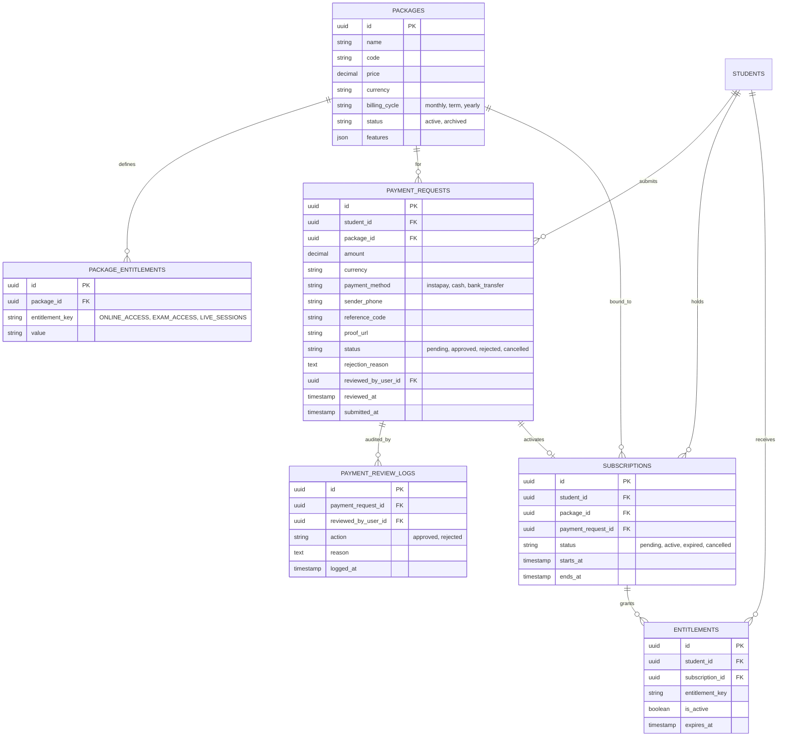

# Billing & Entitlements Domain

## Overview

The Billing & Entitlements domain manages commercial packages, student payment requests, review/approval workflows, activated subscriptions, and concrete granular entitlements.

This is one of the most critical and sensitive domains on the platform, governed by strict non-negotiable invariants:
- **`Payment ≠ Subscription`**: A payment request is an exchange of monetary proof; a subscription represents a temporal entitlement agreement.
- **`Subscription ≠ Entitlement`**: A subscription grants a bundle of concrete entitlements; access checks evaluate concrete entitlements, not raw subscription rows.
- **`Payment Approval ≠ Authentication`**: Payment approval does not alter authentication identity or credentials.
- **`Never Collapse into Student.is_paid`**: No shortcut flag or column such as `student.is_paid` shall exist or be used as an access control source of truth.
- **`Failures Default to Deny`** (SEC-INV-009): Missing permissions default strictly to 403 Forbidden.
- **`Cross-Tenant Isolation`** (SEC-INV-001): Payment requests, subscriptions, and entitlements from Tenant A are completely isolated from Tenant B.

---

## Domain Model

### Entities & Relationships (Tenant Database)

---

## API Endpoints

All endpoints require tenant context (`tenant` middleware) and authentication (`tenant.auth` middleware):

| Method | Endpoint | Description | Permissions Required |
|---|---|---|---|
| `GET` | `/api/v1/packages` | List available packages | Authenticated user |
| `POST` | `/api/v1/packages` | Create a commercial package | `packages.create` |
| `GET` | `/api/v1/packages/{id}` | View package details | Authenticated user |
| `GET` | `/api/v1/payment-requests` | List payment requests | `payments.view` (or self for students) |
| `POST` | `/api/v1/payment-requests` | Submit payment request | Student profile |
| `GET` | `/api/v1/payment-requests/{id}` | View payment request & audit logs | `payments.view` (or self for student owner) |
| `POST` | `/api/v1/payment-requests/{id}/approve` | Approve payment, activate subscription, grant entitlements | `payments.approve` |
| `POST` | `/api/v1/payment-requests/{id}/reject` | Reject payment request with reason | `payments.reject` |
| `GET` | `/api/v1/students/{studentId}/subscriptions` | View student subscriptions | Student self OR `subscriptions.view` |
| `GET` | `/api/v1/students/{studentId}/entitlements` | View student active entitlements | Student self OR `entitlements.view` |

---

## Verification (Billing Gate)

The Billing Gate (`Phase J §33`) is verified in `apps/api/tests/Feature/BillingGateTest.php`:
- `[PASS]` Package creation with granular entitlement keys
- `[PASS]` Student payment request submission (`status: pending`)
- `[PASS]` Verification that student has NO active entitlements prior to approval
- `[PASS]` Payment review list retrieval
- `[PASS]` Wrong reviewer check (staff without `payments.approve` denied with `403 FORBIDDEN`)
- `[PASS]` Payment request approval by authorized billing administrator
- `[PASS]` Subscription activation (`Payment ≠ Subscription`)
- `[PASS]` Entitlement grant (`Subscription ≠ Entitlement`, `hasEntitlement()` returns true)
- `[PASS]` Verification that NO `student.is_paid` shortcut exists
- `[PASS]` Audit log recorded in `payment_review_logs`
- `[PASS]` Duplicate approval prevention (`422 ALREADY_PROCESSED`)
- `[PASS]` Payment request rejection workflow with reason logged
- `[PASS]` Cross-tenant isolation (payment request queries and approvals across tenants return 404 / 401)
