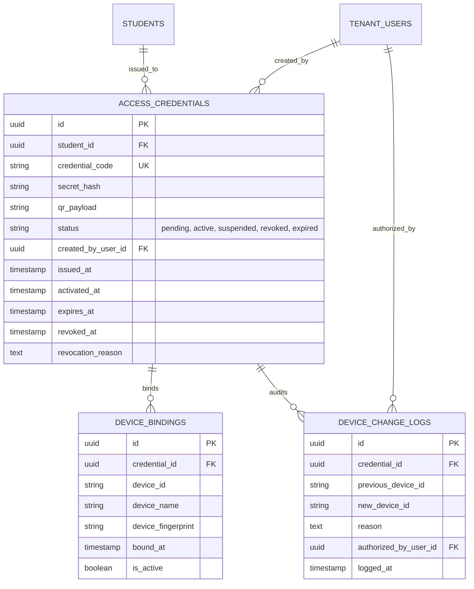

# Credentials & Devices Domain

## Overview

The Credentials & Devices domain manages student access credentials, cryptographic secret storage, device binding, authorized device replacement, lifecycle transitions (pending, active, suspended, revoked, expired), and secure QR representations.

The domain strictly follows platform invariants:
- **`Raw Secret Hashed`**: Plain-text credential secrets are generated once and hashed with SHA-256 before storage; the secret is never persisted in plain text or logged.
- **`Credential ≠ Session`**: A credential represents durable client authentication capability, distinct from a temporal session token.
- **`Device Binding Enforcement`**: On activation, a credential is bound to a single device fingerprint. Second device access is prohibited without authorized device replacement.
- **`Auditability of Device Replacement`**: Any change or reset of a bound device requires authorized administrative credentials and produces an immutable audit record in `device_change_logs`.
- **`Failures Default to Deny`** (SEC-INV-009): Missing permissions or credential status failures default strictly to 403 Forbidden.
- **`Cross-Tenant Isolation`** (SEC-INV-001): Credentials issued in Tenant A cannot be verified, activated, or used in Tenant B.

---

## Domain Model

### Entities & Relationships (Tenant Database)

---

## API Endpoints

All endpoints require tenant context (`tenant` middleware) and authentication (`tenant.auth` middleware):

| Method | Endpoint | Description | Permissions Required |
|---|---|---|---|
| `GET` | `/api/v1/students/{studentId}/credentials` | List student credentials | Student self OR `credentials.view` |
| `POST` | `/api/v1/credentials` | Issue new credential (returns secret once) | `credentials.create` |
| `POST` | `/api/v1/credentials/{id}/activate` | Activate credential & bind initial device | Authenticated student / owner |
| `POST` | `/api/v1/credentials/verify` | Verify credential & enforce device policy | Public / client verification |
| `POST` | `/api/v1/credentials/{id}/replace-device` | Authorize replacement of bound device | `credentials.manage_devices` |
| `POST` | `/api/v1/credentials/{id}/revoke` | Revoke credential | `credentials.revoke` |

---

## Verification (Credential Gate)

The Credential Gate (`Phase J §37`) is verified in `apps/api/tests/Feature/CredentialGateTest.php`:
- `[PASS]` Raw secret hashed (SHA-256, 64 hex characters)
- `[PASS]` Secret not logged / hidden from model serialization
- `[PASS]` Credential activation transitions status to active
- `[PASS]` Device binding recorded on activation
- `[PASS]` Second device policy enforced (`403 SECOND_DEVICE_PROHIBITED`)
- `[PASS]` Device replacement authorized and audited in `device_change_logs`
- `[PASS]` Revocation transitions credential to revoked and prohibits subsequent verification (`403 CREDENTIAL_REVOKED`)
- `[PASS]` Expired credentials rejected with `403 CREDENTIAL_EXPIRED`
- `[PASS]` Cross-tenant credential rejected (401 / 404)
