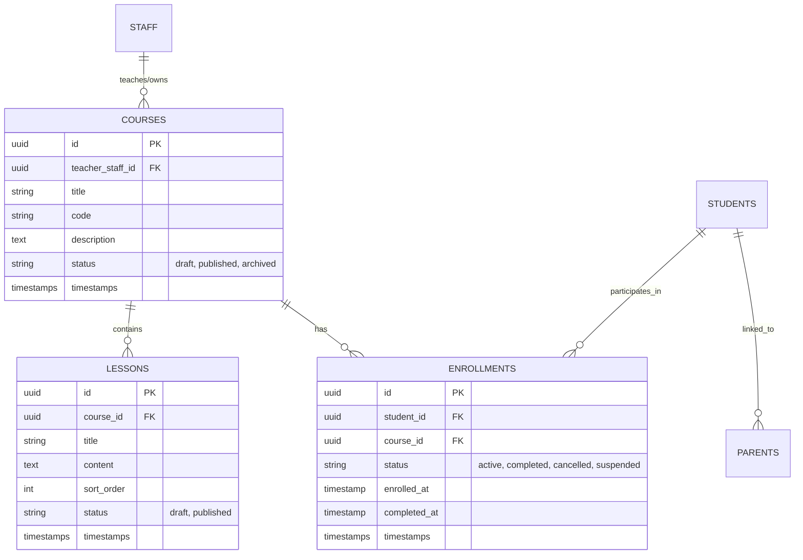

# Education Domain

## Overview

The Education domain models educational structures and student participation in learning resources within a tenant.

The domain strictly abides by the approved core platform invariants:
- **`User ≠ Student`**: A tenant user account is distinct from an educational student profile (`Student`).
- **`Teacher ≠ Role`**: A teacher is a staff member profile (`Staff` with `staff_type = 'teacher'`), not merely an authorization role.
- **`Parent ≠ Student`**: Parents (`ParentProfile`) maintain distinct relationships with students.
- **`Course ≠ Subscription`**: A course is an educational resource; access or enrollment is separate from commercial subscription.
- **`Enrollment ≠ Payment`**: Enrollment represents participation in an educational resource; it is distinct from payment or subscription entitlement.
- **`Failures Default to Deny`** (SEC-INV-009): Missing permissions default strictly to 403 Forbidden.

---

## Domain Model

### Entities & Relationships (Tenant Database)

---

## API Endpoints

All endpoints require tenant context (`tenant` middleware) and authentication (`tenant.auth` middleware):

| Method | Endpoint | Description | Permissions Required |
|---|---|---|---|
| `GET` | `/api/v1/courses` | List accessible courses | Open to enrolled students; `courses.view` for staff |
| `POST` | `/api/v1/courses` | Create a course | `courses.create` |
| `GET` | `/api/v1/courses/{id}` | View course details & lessons | Course enrollment OR published course OR `courses.view` |
| `PUT` | `/api/v1/courses/{id}` | Update course | `courses.update` |
| `DELETE` | `/api/v1/courses/{id}` | Delete course | `courses.delete` |
| `GET` | `/api/v1/courses/{id}/lessons` | List lessons of course | Course enrollment OR published course OR `courses.view` |
| `POST` | `/api/v1/courses/{id}/lessons` | Create a lesson | `lessons.create` |
| `GET` | `/api/v1/courses/{id}/lessons/{lessonId}` | View lesson | Course enrollment OR published course OR `courses.view` |
| `POST` | `/api/v1/courses/{id}/enroll` | Self-enroll or enroll student | Self (if student profile); `enrollments.create` for staff |
| `GET` | `/api/v1/courses/{id}/enrollments` | List course enrollments | `enrollments.view` |
| `GET` | `/api/v1/students/{id}/enrollments` | List student enrollments | Self (student) OR staff with `students.view` |
| `GET` | `/api/v1/students/{id}` | View student profile & enrollments | Self (student) OR staff with `students.view` |

---

## Authorization & Security

1. **Role-Based Permissions**:
   - `courses.create`: Can create courses.
   - `courses.view`: Can view all courses across the tenant.
   - `courses.update`: Can modify courses.
   - `courses.delete`: Can delete courses.
   - `lessons.create`: Can add lessons to courses.
   - `enrollments.create`: Can enroll students on their behalf.
   - `students.view`: Can view student educational profiles and enrollments.
2. **Student Access**:
   - Students cannot view unpublished draft courses unless authorized.
   - Students can only view their own student profile and enrollments.
3. **Assistant Access Boundary**:
   - An assistant can only see student details and enrollments if granted `students.view`.
   - Without `students.view`, all student queries return `403 FORBIDDEN` (SEC-INV-009 default deny).
4. **Cross-Tenant Isolation (SEC-INV-001)**:
   - Tenant A users/students cannot view or enroll in Tenant B courses.

---

## Verification (Education Gate)

The Education Gate (`Phase J §24`) is verified in `apps/api/tests/Feature/EducationGateTest.php`:
- `[PASS]` Teacher creates course in Tenant A
- `[PASS]` Teacher creates lesson in course
- `[PASS]` Student enrolls in course
- `[PASS]` Student views authorized course and lessons
- `[PASS]` Student cannot see another tenant's course (cross-tenant isolation: 404 query, 401 cross-tenant token)
- `[PASS]` Assistant sees only permitted student data (lead assistant allowed, basic assistant denied with 403 FORBIDDEN)
