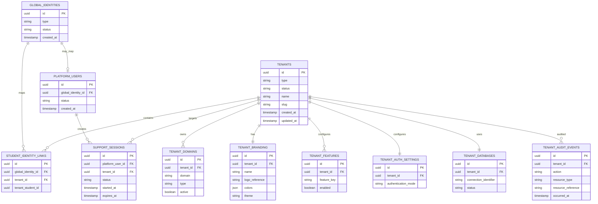
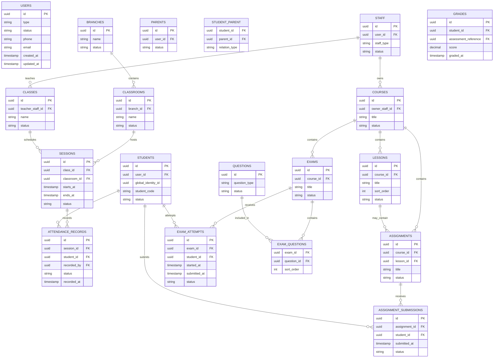

تمام. بما إن **Phase C اتقفلت**، فـPhase D هتبني عليها مباشرة. هنا هنحوّل الـArchitecture إلى **Domain/Data Model** واضح، ونحدد العلاقة بين الـControl Database والـTenant Databases، ونضع ERD مبدئي، قواعد الملكية والعزل، الـindexes، والـaudit model.

أنا هعتبر أي Schema أو Field تفصيلي هنا **Specification مبدئية** وليس Migration نهائية؛ الـMigration الفعلية لن تأتي إلا بعد تثبيت المرحلة.

:::writing{variant="document" id="26497" title="Phase D — Domain Model, ERD & Database Specification"}
# Phase D — Domain Model, ERD & Database Specification

**Document Status:** Draft — Pending Review  
**Previous Baseline:** Phase C — Architecture — Approved  
**Implementation Status:** Not Started  
**Database Engine:** PostgreSQL  
**Database Strategy:** Control Database + Database per Tenant  
**Domain Style:** Domain-Oriented Modular Architecture  
**Primary Data Principle:** Tenant-owned data remains inside the tenant database.

---

# 1. Purpose

This document defines the initial Domain Model and Database Architecture for the educational SaaS platform.

It covers:

- Domain boundaries
- Aggregate roots
- Core entities
- Relationships
- Control Database responsibilities
- Tenant Database responsibilities
- ERD
- Data ownership
- Data isolation
- Integrity constraints
- Indexing
- Audit architecture
- Cross-tenant data access rules
- Global Student Identity mapping

This document intentionally does not define final migration syntax or framework-specific ORM implementation.

---

# 2. Database Architecture

The platform uses two logical database layers.

```text
                    PLATFORM
                       │
                ┌──────┴──────┐
                │             │
           CONTROL DB     TENANT DBs
                │             │
             Global        Tenant A
             Metadata      Tenant B
                           Tenant C
                           Tenant N
```

---

# 3. Control Database

The Control Database stores platform-owned data only.

It must not become a general-purpose repository for tenant educational data.

## 3.1 Control Database Responsibilities

The Control Database may contain:

```text
Tenants
Tenant Registry
Tenant Type
Tenant Status
Tenant Database Metadata
Tenant Domains
Tenant Branding Metadata
Tenant Feature Configuration
Tenant Authentication Configuration
Platform Users
Global Identity Registry
Student Identity Mappings
Platform Roles
Platform Permissions
Support Sessions
Platform Audit Logs
Global Usage Metrics
Platform Configuration
```

---

# 4. Tenant Database

Each tenant receives its own database.

A tenant database contains only business data belonging to that tenant.

Examples:

```text
Teacher Accounts
Assistant Accounts
Student Accounts
Parent Accounts
Courses
Lessons
Assignments
Exams
Attendance
Branches
Classrooms
Classes
Sessions
Payments
Subscriptions
Entitlements
Access Credentials
Device Bindings
Meetings
Analytics
Reports
Notifications
Tenant Audit
```

---

# 5. Control Database ERD

The following is a conceptual ERD.



---

# 6. Tenant Database ERD — Core

Each tenant database follows the same logical model.



---

# 7. Identity Domain

## 7.1 User

`User` represents an authenticated local tenant account.

It may represent:

- Teacher
- Assistant
- Student
- Parent
- Other future tenant users

The User entity is not responsible for business behavior belonging to other domains.

---

## 7.2 Staff

`Staff` represents an employee/user working inside a tenant.

A staff member may represent:

- Teacher
- Assistant

The exact capabilities are determined through authorization.

The architecture must not use the staff type alone as an authorization mechanism.

---

## 7.3 Student

`Student` represents the tenant-specific student account.

Important:

A Student record belongs to exactly one tenant database.

A student can have multiple Student records across different tenant databases.

---

# 8. Global Student Identity

The platform requires a controlled global identity mapping to support the unified student experience.

Conceptually:

```text
GLOBAL IDENTITY
       │
       ├── Tenant A → Student Account A
       ├── Tenant B → Student Account B
       └── Tenant C → Student Account C
```

The Global Identity must not own:

- Grades
- Attendance
- Assignments
- Courses
- Exams
- Private teacher data

Those remain tenant-owned.

The Global Identity provides identity continuity only.

---

# 9. Identity Mapping Rule

The Control Database may maintain:

```text
global_identity_id
tenant_id
tenant_student_reference
```

However, there must be no uncontrolled foreign-key assumption between the Control Database and tenant databases.

The mapping is application-managed.

---

# 10. Parent Domain

## Parent

A Parent is a tenant-scoped user.

A Parent can have relationships to multiple students.

Example:

```text
Parent
├── Student A
├── Student B
└── Student C
```

---

# 11. Parent Relationship

The relationship between Parent and Student shall be represented explicitly.

It may include:

```text
Father
Mother
Guardian
Other authorized relationship
```

The exact relation catalog remains configurable.

---

# 12. Parent Isolation

A Parent record in Tenant A must not grant access to students in Tenant B.

A matching phone number across tenants does not create an automatic cross-tenant relationship.

---

# 13. Authorization Domain

The tenant database shall contain authorization data required for tenant users.

Core concepts:

```text
Roles
Permissions
Role Permissions
User Roles
Policy Rules
Scopes
Attribute Rules
```

Conceptual model:

```text
User
 ↓
Role
 ↓
Permissions
 ↓
Policies
 ↓
Scope
 ↓
Resource Authorization
```

---

# 14. Role Model

The system must support:

### System Roles

Predefined by the platform.

### Custom Roles

Created/configured by authorized tenant users.

A role must not itself define tenant ownership.

---

# 15. Permission Model

A permission should conceptually identify:

```text
Resource
+
Action
```

Examples:

```text
students.view
students.create
students.update
students.delete

payments.view
payments.approve
payments.reject

attendance.view
attendance.create
attendance.update
attendance.delete
```

---

# 16. ABAC Model

Authorization may also depend on:

```text
Actor Attributes
Resource Attributes
Tenant Attributes
Context Attributes
Action
Scope
```

Examples:

```text
Assistant can view assigned students.
Assistant can approve payments only within authorized classes.
Teacher can manage own resources.
```

Exact attributes will be finalized in the Security Specification.

---

# 17. Education Domain

Core entities:

```text
Course
Lesson
Educational Resource
Enrollment
```

The domain represents educational structures and learning access.

It must not contain payment-provider implementation.

---

# 18. Course

A Course represents a structured educational offering.

It may contain:

- Lessons
- Video resources
- Files
- Assignments
- Exams

---

# 19. Lesson

A Lesson belongs to a Course.

It should have an explicit sequence/order.

Lesson access may later depend on:

- Enrollment
- Subscription
- Entitlement
- Teacher configuration
- Release schedule

---

# 20. Enrollment

Enrollment represents the student's participation in an educational resource.

Enrollment must remain distinct from:

- Authentication
- Subscription
- Credential
- Payment

---

# 21. Classroom and Attendance Domain

Core entities:

```text
Branch
Classroom
Class
Session
Attendance Record
```

For an individual teacher tenant, Branch may be optional.

For larger organizations, multiple branches may exist.

---

# 22. Session

A Session represents a specific occurrence of a class.

A Session may have:

```text
Class
Classroom
Teacher
Schedule
Start Time
End Time
Attendance Mode
Status
```

---

# 23. Attendance Record

An Attendance Record identifies:

```text
Student
Session
Recorded By
Timestamp
Attendance Status
```

A normal session should not create duplicate active attendance records for the same student.

The exact behavior for corrections, late arrivals, and multiple scans will be finalized later.

---

# 24. QR Attendance

The student QR representation must resolve to the appropriate student identity/access context.

The assistant scanning the QR must be authorized before attendance is recorded.

QR data must not expose unnecessary sensitive data.

---

# 25. Assessment Domain

Assessment consists of:

```text
Assignments
Submissions
Exams
Questions
Attempts
Answers
Grades
```

Assessment ownership belongs to the tenant.

---

# 26. Assignment

An Assignment may belong to a Course and optionally a Lesson.

Students may submit assignments.

The system must preserve:

- submission time
- status
- grading state
- feedback where supported

---

# 27. Exam

An Exam belongs to a tenant and may belong to a Course.

An Exam may contain:

- Questions
- Timing configuration
- Attempts
- Scoring configuration

---

# 28. Exam Attempt

An Exam Attempt belongs to:

```text
Student
Exam
```

It must preserve lifecycle information such as:

```text
Started
In Progress
Submitted
Graded
```

---

# 29. Grade Model

Grades should be represented independently from the UI dashboard.

A grade may reference:

- Exam attempt
- Assignment submission
- Other supported assessment

The final generic assessment-reference strategy must be decided before database implementation.

---

# 30. Access Credential Domain

The core entity is:

**Access Credential**

The commercial term "Coupon" is not the architectural identity.

A credential belongs to:

```text
Tenant
+
Tenant Student Account
```

It may also reference the applicable subscription/access context.

---

# 31. Credential Data

Conceptually:

```text
Credential ID
Credential Secret Hash
Student Reference
Status
Issued At
Activated At
Expires At
Revoked At
Created By
```

The actual secret must not be stored in plain text.

---

# 32. Credential QR

The platform may render a credential as QR.

The QR should reference a secure representation rather than expose:

- Passwords
- Raw secrets
- Private student information

---

# 33. Device Binding

A Credential may have an associated device binding.

Conceptually:

```text
Credential
   │
   └── Device Binding
          │
          └── Device
```

Only authorized actors can replace the binding.

---

# 34. Device Change

Device replacement must:

1. Verify actor authorization.
2. Record the change.
3. Invalidate or replace the previous binding.
4. Bind the authorized replacement.
5. Record an audit event.

---

# 35. Credential State

Initial conceptual lifecycle:

```text
Generated
   ↓
Assigned
   ↓
Issued
   ↓
Pending Activation
   ↓
Activated
   ↓
Device Bound
   ↓
Active
   ↓
Suspended / Revoked / Expired
```

The final state-transition matrix belongs to the downstream Security/Domain Specification.

---

# 36. Subscription Domain

The Subscription domain is separate from the Credential domain.

A Subscription represents educational access purchased/activated for a student.

---

# 37. Educational Package

The platform must support packages such as:

```text
Online
Offline
Online + Offline
```

A package may define a collection of entitlements.

---

# 38. Entitlement

Entitlements represent concrete capabilities granted through a subscription.

Examples:

```text
ONLINE_ACCESS
OFFLINE_ACCESS
COURSE_ACCESS
EXAM_ACCESS
ASSIGNMENT_ACCESS
LIVE_MEETING_ACCESS
```

The final entitlement catalog is a later specification.

---

# 39. Subscription Relationship

Conceptually:

```text
Payment
    ↓
Subscription
    ↓
Entitlement
    ↓
Access
```

Subscription must not become an authentication object.

---

# 40. Billing Domain

The current billing system is manually verified.

Core concepts:

```text
Payment Request
Payment Proof
Payment Method
Review
Approval / Rejection
```

Initial methods:

```text
InstaPay
Cash
```

---

# 41. Payment Request

A Payment Request may contain:

```text
Student
Package / Subscription Context
Payment Method
Sender Phone
Payment Reference
Payment Proof
Submitted At
Status
Reviewed By
Reviewed At
Rejection Reason
```

---

# 42. Payment States

Initial conceptual state model:

```text
Draft
   ↓
Submitted
   ↓
Pending Review
   ├── Approved
   └── Rejected
```

Future states may include:

```text
Needs Correction
Cancelled
Expired
Refunded
```

These remain open until the Billing Specification.

---

# 43. Payment Does Not Automatically Grant Access

The database model must allow:

```text
Payment Request = Approved
Subscription = Pending
Credential = Pending
```

when business workflow requires additional processing.

No shortcut field such as:

```text
student.is_paid
```

shall become the source of truth for access control.

---

# 44. Analytics Domain

The Analytics domain contains:

```text
Metric Definitions
Metric Configurations
Metric Values
Performance Snapshots
```

---

# 45. Standard Metrics

Examples:

```text
Attendance %
Video Completion %
Assignment Completion %
Assignment Delay
Exam Performance
Course Progress
Improvement Rate
```

---

# 46. Custom Metrics

Teachers may define custom metrics.

A Metric Definition should conceptually include:

```text
Name
Key
Description
Type
Unit
Scoring Model
Calculation Definition
Status
```

Example:

```text
accuracy
speed
speaking
writing
reading
listening
```

Custom metrics must be validated and versionable.

---

# 47. Metric Versioning

If a teacher changes the definition of a metric, historical values should not be silently reinterpreted.

Therefore metric definitions should support versioning.

Conceptually:

```text
Metric
 ├── Version 1
 ├── Version 2
 └── Version 3
```

This ensures historical analytics remain explainable.

---

# 48. Reporting Domain

Core concepts:

```text
Report Definition
Report Instance
Report Recipient
Report Delivery
```

Reports must be generated from authorized data.

The Report domain must not bypass authorization.

---

# 49. Notification Domain

Notifications are represented separately from their delivery channels.

Conceptually:

```text
Notification
      ↓
Delivery
      ├── In-App
      ├── Email
      └── WhatsApp
```

The exact provider implementation belongs to Infrastructure.

---

# 50. Meeting Domain

A Meeting belongs to a tenant.

The internal model should be provider-neutral.

Conceptually:

```text
Meeting
   ↓
Meeting Provider Reference
   ↓
Google Meet
```

The Meeting record should store provider metadata and meeting identifiers, not depend on Google-specific concepts throughout the domain.

---

# 51. Media Domain

The system shall represent externally hosted media.

Conceptually:

```text
Video Resource
     ↓
Provider
     ↓
External Resource
```

Providers may include:

```text
Google Drive
Vimeo
Future Providers
```

The tenant database should store provider references and access metadata rather than assuming the platform owns the original video bytes.

---

# 52. Video Tracking Domain

Video tracking should be separated into:

```text
Playback Events
Learning Progress
Completion
Analytics
```

A possible conceptual model:

```text
Video
 ↓
Playback Event
 ↓
Progress Aggregation
 ↓
Learning Progress
 ↓
Analytics
```

Raw playback events should not be used directly as final dashboard calculations.

---

# 53. Audit Domain

Audit data must be immutable from normal business workflows.

Each audit event should contain, where applicable:

```text
Event ID
Actor
Actor Type
Action
Resource Type
Resource Reference
Outcome
Occurred At
Correlation ID
IP / Request Context
User Agent where appropriate
Redacted Metadata
```

---

# 54. Audit Separation

## Platform Audit

Stored in the Control Database.

Examples:

- Tenant creation
- Tenant configuration
- Platform administrative actions
- Support sessions
- Platform-level permission changes

## Tenant Audit

Stored in each Tenant Database.

Examples:

- Payment approval
- Payment rejection
- Credential activation
- Device change
- Attendance changes
- Staff permission changes
- Sensitive tenant configuration changes

---

# 55. Audit Privacy

Audit logs must not unnecessarily copy sensitive tenant data.

For example:

Payment proof images must not be copied into audit metadata.

The audit record should reference the action/resource while the sensitive document remains in its controlled storage location.

---

# 56. Ownership Model

Every entity must have explicit ownership.

## Platform-Owned

Examples:

```text
Tenant Registry
Platform Users
Global Identity Registry
Tenant DB Metadata
Platform Configuration
```

## Tenant-Owned

Examples:

```text
Teacher
Assistant
Student
Parent
Course
Attendance
Payment
Subscription
Credential
Reports
Analytics
```

---

# 57. Cross-Database Foreign Key Rule

Native relational foreign keys must not be assumed across separate tenant databases.

The Control Database may hold references to tenant records using application-level mapping.

The application is responsible for validating that mapped tenant references remain valid.

---

# 58. Tenant Database Locality

A tenant business entity must not be stored in another tenant database merely to simplify a query.

Example:

Student A belonging to Tenant A must not be copied into Tenant B's database simply because a shared report needs the data.

---

# 59. Unified Student Dashboard Data Strategy

The unified student dashboard cannot rely on a cross-database SQL join.

Instead:

```text
Student Global Identity
       ↓
Tenant Membership Registry
       ↓
Tenant APIs / Application Layer
       ↓
Tenant-specific Data
       ↓
Unified Student Read Model / Response
```

The aggregation layer must preserve tenant-specific authorization.

---

# 60. Cross-Tenant Student Rule

The fact that the same Global Identity maps to two tenant students does not merge:

- Courses
- Grades
- Attendance
- Payments
- Credentials
- Parent relationships
- Teacher notes
- Private reports

These remain tenant-specific.

---

# 61. Database Integrity

The system shall prefer database constraints for structural integrity where possible.

Examples:

- Unique identifiers
- Foreign keys within the same database
- Unique email/phone rules where appropriate
- Unique credential hash
- Unique session/student attendance record
- Valid status values
- Check constraints where practical

Business rules that cross aggregates should remain in the domain/application layer.

---

# 62. Tenant Database Naming

Tenant databases should use stable platform-generated identifiers.

Avoid using user-entered tenant names as physical database names.

Example conceptual strategy:

```text
tenant_<stable_identifier>
```

The exact naming convention remains an Infrastructure concern.

---

# 63. Connection Security

Tenant database credentials must not be stored inside business records or source code.

Database credentials must be handled by secure configuration/secrets management.

Business domains must not know the credentials or physical connection details.

---

# 64. Database Provisioning

Tenant provisioning should create:

```text
Tenant Registry
      ↓
Database Allocation
      ↓
Database Initialization
      ↓
Schema Version
      ↓
Tenant Ready
```

Provisioning must be repeatable and observable.

---

# 65. Migration Strategy

Tenant database migrations must be version controlled.

The platform must be capable of determining:

```text
Tenant Database Version
```

and applying required schema changes safely.

Migration execution must not leave tenants unknowingly on incompatible versions.

---

# 66. Indexing Principles

Every frequently queried foreign key should receive an appropriate index unless a documented reason exists not to.

Common indexed dimensions:

```text
status
created_at
updated_at
user_id
student_id
teacher_id
course_id
session_id
subscription_id
credential_id
```

---

# 67. Composite Indexing

Composite indexes should support actual query patterns.

Examples:

```text
attendance_records
(session_id, student_id)

payment_requests
(status, submitted_at)

notifications
(user_id, status, created_at)

video_events
(student_id, video_id, occurred_at)

metric_values
(student_id, metric_id, recorded_at)
```

Exact indexes will be finalized after query/API design.

---

# 68. Unique Constraints

Potential unique constraints include:

```text
Credential Secret Hash
Tenant Domain
Tenant Slug
Student Code within Tenant
Attendance Session + Student
Parent/Student relationship
User contact identity where applicable
```

The exact uniqueness semantics must consider disabled/deleted records and historical state.

---

# 69. Soft Delete Policy

Soft deletion shall not be applied to every entity automatically.

It should be used where historical/audit requirements make deletion inappropriate.

Examples likely to require historical preservation:

```text
Payments
Attendance
Grades
Exam Attempts
Audit Events
Subscription History
Credential History
```

Permanent deletion must be governed by retention/privacy rules.

---

# 70. Temporal Data

Important business events should preserve historical timestamps.

Examples:

```text
Payment Submitted At
Payment Reviewed At
Subscription Started At
Subscription Ended At
Credential Activated At
Device Bound At
Attendance Recorded At
Exam Submitted At
Grade Published At
```

---

# 71. Data Retention

Retention policies shall eventually be defined by data category.

At minimum:

```text
Operational Data
Financial Records
Educational Records
Security Logs
Audit Logs
Video Events
Notifications
```

The retention period is intentionally deferred to the Security/Compliance specification.

---

# 72. Sensitive Data Classification

Data should be classified by sensitivity.

Possible levels:

```text
Public
Tenant Internal
Sensitive
Highly Sensitive
Security Secret
```

Examples:

### Security Secret

Credential secret hash / session secrets.

### Sensitive

Student contact data, parent data, grades.

### Highly Sensitive

Private authentication information and selected security records.

The final classification catalog belongs to the Security Specification.

---

# 73. Payment Proof Storage

Payment screenshots/proof files must not be stored as arbitrary database blobs by default.

The preferred conceptual model is:

```text
Payment Request
    ↓
Secure File Reference
    ↓
Protected Storage
```

Access must require authorization.

---

# 74. File Reference Model

Tenant-owned files should be represented through a controlled reference model.

Possible metadata:

```text
File ID
Storage Provider
Storage Key
Original Filename
Mime Type
Size
Checksum
Uploaded By
Created At
```

The actual storage mechanism belongs to Infrastructure.

---

# 75. Data Consistency

Transactions must be used for operations where multiple related records must change atomically.

Examples:

```text
Payment Approval
Subscription Activation
Credential Activation
Device Replacement
Attendance Correction
Exam Submission
Grade Publication
```

External provider calls should not be held inside long-running database transactions unnecessarily.

---

# 76. Idempotency

Critical operations should support idempotency where duplicate requests could cause incorrect state.

Examples:

```text
Payment Approval
Credential Activation
Device Binding
Attendance Scan
Exam Submission
Notification Dispatch
External Meeting Creation
```

---

# 77. Event and History Data

State-changing operations may generate domain events.

Events may be stored or processed asynchronously depending on the use case.

Critical event delivery should be reliable.

The architecture may use an Outbox-style model where required.

---

# 78. Large-Table Strategy

Potentially high-volume tables include:

```text
Video Playback Events
Notifications
Audit Events
Attendance Events
Analytics Measurements
```

These should be designed so future partitioning or archival can be introduced without redesigning core business entities.

---

# 79. Database Evolution

The database architecture must support future evolution based on tenant size.

Example:

```text
Small Tenant
     ↓
Normal Tenant Database

Large Tenant
     ↓
Dedicated Database

Very Large Tenant
     ↓
Dedicated Cluster / Infrastructure
```

Business logic must remain unaware of these physical differences.

---

# 80. Data Isolation Test Requirement

The following must eventually be tested automatically:

```text
Tenant A user
    ↓
Attempt to access Tenant B student
    ↓
DENIED
```

Likewise:

```text
Tenant A assistant
    ↓
Attempt to bypass scope
    ↓
DENIED
```

---

# 81. Global Identity Security Rule

The existence of a Global Identity mapping must not become an authorization bypass.

Example:

```text
Global Student Identity X
     ↳ Tenant A Student
     ↳ Tenant B Student
```

The application must never infer:

```text
Access to Tenant A
=
Access to Tenant B
```

---

# 82. Parent Security Rule

Parent access is tenant-local.

Even if:

```text
Same Phone Number
Same Parent Name
Same Student Name
```

exists in another tenant, the parent must not receive access there without an explicit tenant relationship.

---

# 83. Credential Database Security

Credential secrets must be:

- Hashed
- Rotatable/revocable where applicable
- Audited
- Protected from logging
- Validated server-side

Raw credential secrets must not appear in application logs.

---

# 84. Data Access Abstraction

Domain/application services should request data through domain/application contracts rather than directly manipulating database connection selection.

Example:

```text
StudentService
      ↓
Student Repository Contract
      ↓
Tenant Persistence
      ↓
Current Tenant Database
```

The repository/persistence implementation determines physical storage.

---

# 85. Database as Source of Truth

The database should remain authoritative for persistent system state.

Frontend state, cache, analytics read models, and notifications must not become authoritative sources for:

- Subscription state
- Credential state
- Device state
- Authorization
- Payment approval
- Attendance integrity

---

# 86. Domain Ownership Summary

| Domain | Primary Aggregate Concepts |
|---|---|
| Identity | User, Student, Parent, Staff |
| Tenancy | Tenant metadata, configuration |
| Authorization | Role, Permission, Policy, Scope |
| Education | Course, Lesson, Enrollment |
| Classroom | Branch, Classroom, Class, Session |
| Attendance | Attendance Record |
| Assessment | Assignment, Exam, Attempt, Grade |
| Credentials | Access Credential, Device Binding |
| Billing | Payment Request, Subscription |
| Entitlements | Package, Entitlement |
| Analytics | Metric Definition, Metric Value |
| Reporting | Report Definition, Report Instance |
| Communication | Notification, Delivery |
| Meetings | Meeting, Provider Reference |
| Media | Video Resource, Provider Reference |
| Audit | Audit Event |

---

# 87. Core Relationship Map

The most important business relationships are:

```text
Tenant
 │
 ├── Staff
 │    ├── Teachers
 │    └── Assistants
 │
 ├── Students
 │
 ├── Parents
 │    └── Student Relationships
 │
 ├── Courses
 │    └── Lessons
 │
 ├── Classes
 │    └── Sessions
 │          └── Attendance
 │
 ├── Assignments
 │    └── Submissions
 │
 ├── Exams
 │    └── Attempts
 │
 ├── Packages
 │    └── Entitlements
 │
 ├── Payment Requests
 │
 ├── Subscriptions
 │
 ├── Access Credentials
 │    └── Device Binding
 │
 ├── Meetings
 │
 ├── Analytics
 │
 └── Reports
```

---

# 88. Critical Separation Rules

The following concepts must never be collapsed into one database concept merely for convenience:

```text
User ≠ Student
Student ≠ Credential
Credential ≠ Session
Payment ≠ Subscription
Subscription ≠ Entitlement
Entitlement ≠ Authentication
Authentication ≠ Authorization
Teacher ≠ Role
Role ≠ Permission
Parent ≠ Student
Course ≠ Subscription
Attendance ≠ Session
Video Event ≠ Learning Progress
```

---

# 89. ERD Design Principles

The final ERD shall prioritize:

- Clear ownership
- Referential integrity
- Explicit relationships
- Historical traceability
- Security boundaries
- Query efficiency
- Future evolution
- Avoidance of polymorphic ambiguity where it creates integrity problems

---

# 90. Avoid Over-Generic Schemas

The system should not create one giant generic table such as:

```text
entities
```

for unrelated domain objects merely to reduce table count.

Likewise, the system should avoid:

```text
settings
metadata
data
```

tables with arbitrary JSON replacing proper domain models when strong relational structure is required.

JSON may be used intentionally for genuinely flexible configurations.

---

# 91. JSON Usage Rule

JSON/JSONB may be appropriate for:

- Branding configuration
- Flexible metric configuration
- Provider metadata
- Non-relational integration payloads
- Feature configuration

It must not replace relational structure for core entities such as:

- Students
- Payments
- Subscriptions
- Attendance
- Exams
- Courses
- Credentials

---

# 92. Database Performance Principle

Database optimization must follow real query patterns.

The project must avoid speculative indexes everywhere.

Query-heavy paths should be measured before adding complex indexing strategies.

---

# 93. Data Migration Principle

Any destructive schema migration must include:

```text
Impact Analysis
Backup Consideration
Migration Plan
Rollback Strategy
Tenant Compatibility Check
Documentation Update
```

---

# 94. Domain Model Review Requirement

Before implementation, every aggregate must define:

```text
Purpose
Ownership
Identity
Lifecycle
Invariants
Relationships
Commands
Events
Authorization Boundary
Persistence Boundary
```

---

# 95. Phase D Open Decisions

The following remain intentionally open:

1. Exact User/Student authentication storage model.
2. Exact global identity persistence structure.
3. Exact student membership synchronization process.
4. Exact Role/Permission/Policy tables.
5. Exact ABAC attribute schema.
6. Exact package/entitlement schema.
7. Exact subscription state machine.
8. Exact credential state machine.
9. Exact device schema and device fingerprint strategy.
10. Exact payment proof storage provider.
11. Exact assessment/grade polymorphism strategy.
12. Exact analytics event schema.
13. Exact metric calculation model.
14. Exact reporting persistence strategy.
15. Exact notification persistence model.
16. Exact file reference model.
17. Exact soft-delete/retention policies.
18. Exact database partitioning policy.
19. Exact migration orchestration for hundreds/thousands of tenant databases.
20. Exact API query patterns required for final indexing.

---

# 96. Phase D Completion Criteria

Phase D becomes approved when:

- Control Database responsibilities are accepted.
- Tenant Database responsibilities are accepted.
- Domain boundaries are accepted.
- Core aggregates are accepted.
- Student Global Identity model is accepted.
- Parent tenant scope is accepted.
- Credential data model is accepted.
- Payment/Subscription/Entitlement separation is accepted.
- Attendance model is accepted.
- Analytics model is accepted.
- Audit separation is accepted.
- Data isolation rules are accepted.
- Indexing principles are accepted.
- Open decisions are explicitly tracked.

No implementation should begin from this document until unresolved schema decisions have been closed in later specifications or explicitly deferred by architecture decision.
:::

**أهم حاجة في Phase D** إننا ثبتنا الـData Architecture على مبدأين:  
**الـTenant Database هي مصدر بيانات العملية التعليمية نفسها، والـControl Database يدير الـPlatform Metadata والـGlobal Identity Mapping فقط.** وبالتالي الـUnified Student Dashboard مش محتاج نكسر الـMulti-Database بعلاقات SQL مباشرة بين قواعد مختلفة.

كمان فصلنا بشكل صريح جدًا:

`Payment → Subscription → Entitlement → Access Credential → Session`

وده هيمنع واحدة من أخطر مشاكل الأنظمة التعليمية: إن حالة دفع أو كود دخول تتحول بالغلط إلى مصدر حقيقة لكل الـAccess.

وثبتُّ كذلك إن **Parent Account Tenant-Scoped**، وإن الطالب عند كل Tenant له Student Account مستقل، بينما الـGlobal Identity مجرد طبقة ربط للتجربة الموحدة. memcite

**Phase D حالتها الآن Draft — Pending Review.** بمجرد اعتمادها، ننتقل إلى **Phase E — Security & Scalability Specification**، وهناك هنقفل Threat Model، Security Controls، الـRBAC/ABAC بالتفصيل، Credential Security، Device Security، Tenant Isolation، ثم Scalability وInfrastructure وBackup/DR وObservability.