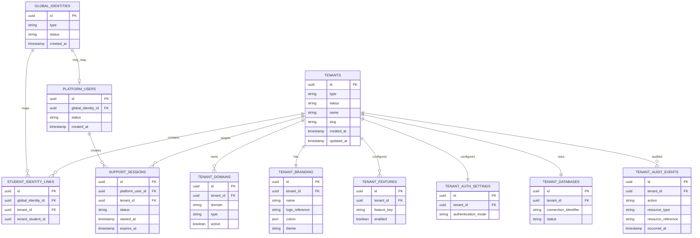
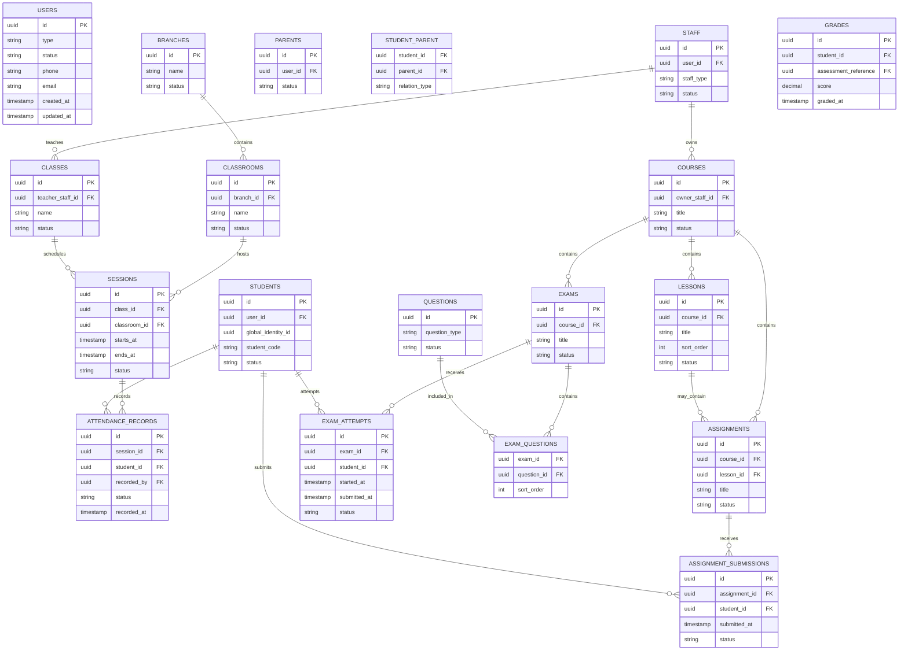

# Hidden Conversation Content — Complete Long Payload Extraction

This file preserves every long text payload recovered from the page's embedded conversation data, in source order.


---

## Payload 01_16775_3748.txt

أيوه، **أنت جاهز تبدأ مع الـAI**، لكن قبل ما تبدأ أنا أنصحك تعمل **5 حاجات بسيطة جدًا** عشان البداية تبقى نظيفة وما نضطرش نرجع نصلح الأساس بعدين.

### 1. اعمل Repository فاضي

مثلاً على GitHub/GitLab:

```text
lms-platform
```

ويكون فاضي تمامًا أو فيه `.gitignore` فقط.

---

### 2. فك الـZIP داخله

[تحميل الـLMS AI Project Bootstrap](sandbox:/mnt/data/LMS_AI_Project_Bootstrap.zip)

بعد فك الضغط، تأكد إن:

```text
AGENTS.md
README.md
docs/
prompts/
apps/
packages/
...
```

موجودين **في root المشروع**، مش داخل فولدر إضافي اسمه `lms_ai_project_bootstrap`.

---

### 3. اعمل أول Commit

قبل ما الـAI يلمس أي حاجة:

```bash
git add .
git commit -m "docs: initialize project specification and AI operating baseline"
git push
```

وده مهم جدًا؛ يبقى عندك **نقطة بداية نظيفة** تقدر ترجع لها.

---

### 4. ادّي الـAI الـRepository كله

لو الأداة اللي هتستخدمها تقدر تشتغل على Git repository، خليه يفتح الـrepository مباشرة.

**ما تبعتش له الـZIP كـprompt.**

الأفضل:

```text
AI
 ↓
Repository
 ↓
AGENTS.md
 ↓
docs/
 ↓
MASTER-SPECIFICATION
 ↓
Implementation
```

---

### 5. أول Prompt فقط

بعد ما الـAI يكون شايف الـrepository، ابعت له:

```text
Read AGENTS.md and docs/master/MASTER-SPECIFICATION.md.

Start the current implementation task defined in:
docs/phase-zero/PHASE-0-M0-REPOSITORY-BOOTSTRAP.md

Execute M0-001 only.

Follow the approved architecture.
Do not invent requirements.
Do not implement business features yet.

Verify the work, update the project documentation and status,
and report exact evidence when finished.
```

وده كفاية كبداية.

---

## لكن في نقطة مهمة جدًا

**ما تبدأش دلوقتي تطلب منه M1 أو M2.**

خليه يخلص:

```text
M0
Repository Bootstrap
```

وبعدها يثبت لنا إن الأساس سليم:

```text
Laravel ✓
Next.js ✓
TypeScript ✓
Testing ✓
Linting ✓
Environment ✓
CI ✓
Documentation ✓
Git ✓
```

وبعدها ندخل:

```text
M1 — Runtime Foundation
```

ثم:

```text
M2 — Tenancy
```

وهكذا.

---

# هل ناقصنا شيء في الـArchitecture؟

**لا، من ناحية التخطيط المعماري الأساسي إحنا خلصنا.**

أنت عندك الآن:

```text
A  Business Foundation       ✓
B  Requirements              ✓
C  Architecture              ✓
D  Domain + Database         ✓
E  Security + Scalability    ✓
F  API Contracts             ✓
G  Frontend Architecture    ✓
H  Testing                   ✓
I  DevOps                    ✓
J  Implementation Plan       ✓
K  AI Handoff                ✓
```

والـPackage اللي عملناه هو **الجسر بين الكلام ده وبين الـRepository الفعلي**.

---

## الحاجة الوحيدة اللي مش محتاج تعملها بنفسك

**ما تبدأش تعمل folders أو Laravel أو Next.js يدويًا.**

خلّي الـAI ينفذ M0.

لأن M0 نفسه معمول علشان يحول:

```text
Empty Repository
```

إلى:

```text
AI-Ready Engineering Repository
```

---

# وخلّي بالك من فرق مهم

إحنا دلوقتي عندنا:

```text
             DOCUMENTATION
                   │
                   ▼
        MASTER SPECIFICATION
                   │
                   ▼
            IMPLEMENTATION
                   │
                   ▼
              TESTING
                   │
                   ▼
             VERIFICATION
```

فلو الـAI قال لك:

> "أنا خلصت المشروع."

ما نعتبرش كده المشروع خلص.

هو خلص **Task** فقط لو عنده evidence.

---

## إذن Checklist قبل ما تروح للـAI

```text
[✓] Repository created
[✓] Bootstrap ZIP downloaded
[✓] Files extracted to repository root
[✓] AGENTS.md موجود
[✓] MASTER-SPECIFICATION موجود
[✓] Phases A–K موجودة
[✓] Phase 0 موجودة
[✓] Project management موجود
[✓] Git initial commit
[✓] AI has repository access
[✓] Start M0-001
```

**بعد النقطة دي، أنت فعليًا بدأت Implementation Mode.**

وأنا أنصحك ما تغيرش أي حاجة في الـarchitecture أو تضيف requirements من نفسك أثناء أول M0. خلّي أول جلسة للـAI تبني الـfoundation فقط، وبعد ما يخلصها نراجع **M0 evidence** قبل ما نسمح له يدخل M1.

---

## Payload 02_23719_2609.txt

أيوه، **ده بالضبط اللي هنستخدمه**.

جهزت لك Package مبدئي للمشروع يحتوي على الـdocumentation structure، الـMaster Specification، الـPhases A–K، `AGENTS.md`، إدارة حالة المشروع، Phase 0 / M0، وقالب الـtasks والـPrompt الأول.

### الملف الجاهز

[تحميل LMS AI Project Bootstrap](sandbox:/mnt/data/LMS_AI_Project_Bootstrap.zip)

### بعد ما تحمله، تعمل إيه؟

فك الضغط داخل الـrepository الفاضي، فيبقى عندك تقريبًا:

```text
project/
├── AGENTS.md
├── README.md
├── .env.example
│
├── docs/
│   ├── master/
│   │   └── MASTER-SPECIFICATION.md
│   │
│   ├── phases/
│   │   ├── phase-a.md
│   │   ├── phase-b.md
│   │   ├── phase-c.md
│   │   ├── phase-d.md
│   │   ├── phase-e.md
│   │   ├── phase-f.md
│   │   ├── phase-g.md
│   │   ├── phase-h.md
│   │   ├── phase-i.md
│   │   ├── phase-j.md
│   │   └── phase-k.md
│   │
│   ├── phase-zero/
│   ├── architecture/
│   ├── domains/
│   ├── api/
│   ├── frontend/
│   ├── testing/
│   ├── infrastructure/
│   └── project-management/
│
├── prompts/
│   ├── START-M0.md
│   └── GENERIC-TASK-TEMPLATE.md
│
├── apps/
├── packages/
├── infrastructure/
├── scripts/
└── tests/
```

**مهم جدًا:** الـPackage ده لا يحتوي على Laravel أو Next.js جاهزين كـimplementation، وده مقصود. الـrepository يبدأ فاضي، وأول AI Task هو اللي ينفذ **M0 — Repository Bootstrap** طبقًا للتوثيق.

يعني أنت بعد كده مش محتاج تشرح للـAI المشروع كله.

كل اللي هتعمله هو تديه الـrepository وتقول له مثلًا:

```text
Read AGENTS.md and docs/master/MASTER-SPECIFICATION.md.

Start the current task defined in:
docs/phase-zero/PHASE-0-M0-REPOSITORY-BOOTSTRAP.md

Execute M0-001 only.

Follow the approved architecture.
Do not invent requirements.
Verify the work.
Update the documentation and project status.
Report exact evidence when finished.
```

والـAI المفروض من هنا:

```text
AGENTS.md
      ↓
MASTER-SPECIFICATION
      ↓
Phase J
      ↓
Phase 0 / M0
      ↓
ينفذ
      ↓
يختبر
      ↓
يحدث docs
      ↓
ينتقل للتاسك التالي
```

**والأهم:** لا تبعت له كل الـPhases في كل مرة. الـPhases موجودة داخل المشروع، والـAI يقرأ الـMaster + الـdocumentation المتعلقة بالتاسك الحالي.

ملاحظة واحدة مهمة: الملفات الموجودة في الـPackage هي **نسخة bootstrap/consolidated من الـbaseline الذي اعتمدناه**؛ بعض مجلدات الـdomains والتخصصات فيها ملفات README تمهيدية لكي يملأها التنفيذ والتوثيق التفصيلي تدريجيًا، وليست نسخًا حرفية من كل نص طويل ظهر في المحادثة. ده مقصود حتى ما نخلطش بين الـMaster Reference وبين الـimplementation artifacts.

**الخطوة الفعلية التالية الآن هي M0-001**: تجهيز الـrepository نفسه، Laravel، Next.js، tooling، CI foundation، والـdocumentation structure، وليس بناء أي business feature.

---

## Payload 03_27127_25808.txt

from pathlib import Path
import zipfile, textwrap, shutil

root = Path("/mnt/data/lms_ai_project_bootstrap")
if root.exists():
    shutil.rmtree(root)
root.mkdir(parents=True)

def add(path, content):
    p = root / path
    p.parent.mkdir(parents=True, exist_ok=True)
    p.write_text(textwrap.dedent(content).lstrip(), encoding="utf-8")

# Root files
add("README.md", """
# LMS AI-Ready Project Bootstrap

This package is the starting point for implementing the approved multi-tenant SaaS LMS & Education Management Platform.

## Contains

- `AGENTS.md` — global AI operating rules
- `docs/master/MASTER-SPECIFICATION.md` — consolidated source of truth
- `docs/phases/` — approved Phase A through Phase K specifications
- `docs/phase-zero/PHASE-0-M0-REPOSITORY-BOOTSTRAP.md` — first implementation milestone
- `docs/project-management/` — state, roadmap, milestones, ledger, risks and changelog
- `docs/architecture/`, `docs/domains/`, `docs/api/`, `docs/frontend/`, `docs/testing/`, `docs/infrastructure/`
- `prompts/START-M0.md` — the first implementation prompt
- `prompts/GENERIC-TASK-TEMPLATE.md` — reusable task prompt

## Starting rule

The repository is intentionally empty of business implementation.

The first AI task is M0 — Repository Bootstrap.

Do not ask an AI agent to "build the whole LMS" in one prompt.
Use the documentation + AGENTS rules + one bounded task at a time.
""")

add("AGENTS.md", """
# AGENTS.md — Global AI Operating Rules

## Source of Truth

Read:
1. `docs/master/MASTER-SPECIFICATION.md`
2. Relevant specialized documentation
3. Relevant ADRs
4. Current project status
5. Current task

Approved documentation is authoritative.

## Before Coding

- Identify the domain owner.
- Identify dependencies.
- Identify tenant scope.
- Identify authentication and authorization requirements.
- Identify API/UI contracts.
- Inspect existing code before creating new files.
- Do not invent undocumented business rules.

## During Coding

- Preserve approved architecture.
- Keep domain boundaries explicit.
- Keep controllers/pages thin.
- Avoid God Classes, God Components and giant files.
- Never trust client-supplied tenant IDs as authorization.
- Never bypass backend authorization.
- Keep provider SDKs behind adapters/interfaces.
- Keep Payment, Subscription, Entitlement, Credential, Authentication and Authorization separate.
- Avoid unnecessary abstractions.
- Do not make unrelated refactors.

## After Coding

- Run required tests/checks.
- Report what actually ran.
- Update relevant documentation.
- Update project status.
- Update changelog when appropriate.
- Record limitations and Open Decisions.
- Create an ADR when architecture changes.

## Verification

`IMPLEMENTED` = code exists.
`VERIFIED` = required verification passed.
`PRODUCTION_READY` = implementation + verification + security + documentation + observability + release requirements are satisfied.

Never claim a stronger status without evidence.

## Architecture Changes

If implementation conflicts with an approved decision:

Problem -> ADR -> Impact Analysis -> Decision -> Documentation Update -> Implementation.

Do not silently redesign the architecture.

## Security Invariants

- No unauthorized cross-tenant access.
- Frontend authorization is not the security boundary.
- Global identity does not imply cross-tenant authorization.
- Credential is not a permanent session.
- Payment is not entitlement.
- Subscription is not authentication.
- Support access is temporary and auditable.
- Secrets never enter logs.
- Failures default to deny.
- Tenant context must exist before tenant data access.

## Documentation Rule

Documentation is part of implementation.
A meaningful code change must produce the corresponding documentation/status change.

## Task Scope

Implement only the current task and necessary dependencies.
If a required architecture decision is unresolved, stop that change, document the issue, and create an ADR proposal.
""")

add(".env.example", """
APP_ENV=local
APP_DEBUG=true
APP_URL=http://localhost

DB_CONNECTION=pgsql
DB_HOST=localhost
DB_PORT=5432
DB_DATABASE=
DB_USERNAME=
DB_PASSWORD=

# Never commit real secrets.
""")

add(".gitignore", """
.env
.env.*
!.env.example
node_modules/
vendor/
.next/
dist/
build/
coverage/
storage/logs/
""")

# Index
add("docs/00-INDEX.md", """
# Documentation Index

## Master
- `master/MASTER-SPECIFICATION.md`

## Phases
- `phases/phase-a.md`
- `phases/phase-b.md`
- `phases/phase-c.md`
- `phases/phase-d.md`
- `phases/phase-e.md`
- `phases/phase-f.md`
- `phases/phase-g.md`
- `phases/phase-h.md`
- `phases/phase-i.md`
- `phases/phase-j.md`
- `phases/phase-k.md`

## Phase Zero
- `phase-zero/PHASE-0-M0-REPOSITORY-BOOTSTRAP.md`

## Architecture
- `architecture/architecture.md`
- `architecture/system-context.md`
- `architecture/tenancy.md`
- `architecture/identity.md`
- `architecture/authorization.md`
- `architecture/security.md`
- `architecture/scalability.md`
- `architecture/observability.md`

## Domains
- `domains/`

## Contracts
- `api/`
- `frontend/`
- `testing/`
- `infrastructure/`

## Project Management
- `project-management/current-state.md`
- `project-management/roadmap.md`
- `project-management/milestones.md`
- `project-management/implementation-ledger.md`
- `project-management/pending.md`
- `project-management/blocked.md`
- `project-management/deferred.md`
- `project-management/risks.md`
- `project-management/changelog.md`
""")

# Phase Zero
add("docs/phase-zero/PHASE-0-M0-REPOSITORY-BOOTSTRAP.md", """
# PHASE 0 / M0 — REPOSITORY BOOTSTRAP

Status: READY TO IMPLEMENT

## Objective
Initialize the empty repository according to the approved A–K baseline.

## Scope
Create:
- repository structure
- documentation structure
- Laravel backend application
- Next.js + React + TypeScript web application
- environment templates
- basic lint/type/test tooling
- initial CI validation
- root README
- AGENTS.md
- project status tracking

## Do NOT
- implement business domains
- implement payment logic
- implement authentication logic
- implement student management
- invent a database model
- change tenant architecture
- add production secrets
- deploy production

## Verification
Prove:
- backend boots
- frontend boots
- tests/checks execute
- type checking works
- linting works
- structure matches the master specification

## Documentation
Update project-management, backend/frontend and infrastructure docs as applicable.

## Exit Criteria
M0 is complete only when the repository foundation exists and verification evidence is recorded.
""")

# Project management
add("docs/project-management/current-state.md", """
# Current Project State

Planning/documentation Phases A–K are APPROVED.

## Current Mode
IMPLEMENTATION MODE — starting from an empty repository.

## Current Milestone
M0 — Repository Bootstrap

## Current Task
M0-001 — Bootstrap the project repository.

## Completed
- Phases A–K approved
- Master Specification defined
- AI Operating Rules defined
- Implementation sequence defined

## In Progress
- M0 repository bootstrap

## Pending
M1 Runtime Foundation
M2 Tenancy
M3 Identity / Authentication / Authorization
M4 Education Core
M5 Attendance
M6 Assessment
M7 Billing / Entitlements
M8 Credentials / Devices
M9 Meetings / Media / Communication
M10 Analytics / Reporting
M11 Full Frontend
M12 Full Verification
M13 Production Hardening
M14 Production Readiness

## Blocked
None at bootstrap time.
""")

add("docs/project-management/roadmap.md", """
# Implementation Roadmap

M0 — Repository Bootstrap
M1 — Runtime Foundation
M2 — Tenancy
M3 — Identity / Authentication / Authorization
M4 — Education Core
M5 — Attendance
M6 — Assessment
M7 — Billing / Entitlements
M8 — Credentials / Devices
M9 — Meetings / Media / Communication
M10 — Analytics / Reporting
M11 — Full Frontend
M12 — Full Verification
M13 — Production Hardening
M14 — Production Readiness
""")

add("docs/project-management/milestones.md", """
# Milestones

## M0 — Repository Bootstrap
Repository, docs, backend/frontend bootstrap, tooling, env templates, CI skeleton.

## M1 — Runtime Foundation
Configuration, logging, errors, queue, cache, storage, health.

## M2 — Tenancy
Registry, context, resolver, tenant DB resolution, provisioning, migrations, isolation tests.

## M3 — Identity / Authentication / Authorization
Global identity, tenant accounts, sessions, auth modes, roles, permissions, policies, scopes.

## M4 — Education Core
Students, parents, staff, courses, lessons, enrollments.

## M5 — Attendance
Branches, classrooms, classes, sessions, QR attendance, corrections.

## M6 — Assessment
Assignments, submissions, exams, attempts, answers, grades, publication.

## M7 — Billing / Entitlements
Packages, payments, manual review, subscriptions, entitlements, idempotency, audit.

## M8 — Credentials / Devices
Credential lifecycle, QR, activation, device binding/replacement.

## M9 — Integrations
Meetings, media providers, email, future WhatsApp abstraction.

## M10 — Analytics / Reporting
Metrics, versions, events, aggregations, dashboards, reports.

## M11 — Full Frontend
Student, teacher, assistant, parent, platform, support; RTL, responsive, dark/light, white-label, PWA.

## M12 — Full Verification
Unit, integration, API, contract, security, tenant isolation, E2E, accessibility, performance, resilience.

## M13 — Production Hardening
Monitoring, alerting, backup/restore, scaling, secrets, deployment, rollback, runbooks.

## M14 — Production Readiness
All critical release gates passed.
""")

add("docs/project-management/implementation-ledger.md", """
# Implementation Ledger

| Task ID | Milestone | Status | Tests | Docs | Notes |
|---|---|---|---|---|---|
| M0-001 | M0 | READY | Pending | Pending | Bootstrap empty repository |
""")

for filename, title in [
    ("pending.md","Pending Work"),
    ("blocked.md","Blocked Work"),
    ("deferred.md","Deferred Work"),
    ("risks.md","Risks"),
    ("changelog.md","Changelog")
]:
    add(f"docs/project-management/{filename}", f"# {title}\n\nNo entries recorded yet.\n")

add("docs/decisions/README.md", """
# Architecture Decision Records

Create `ADR-XXX-*.md` when changing an approved architectural decision.

Required sections:
- Context
- Problem
- Options
- Decision
- Consequences
- Status
- Date
""")

# Architecture
architecture_docs = {
"architecture.md": """
# Architecture

Modular Monolith first.
Control Plane + Tenant Data Plane.
Clean/Hexagonal-style boundaries.
Domain-oriented modules.
Application / Domain / Infrastructure layers.

Use Strategy, Factory, Adapter, State and Policy patterns where justified.
Use domain events and outbox-style reliability where needed.
Use repositories intentionally, not mechanically.
Keep controllers/pages thin.
No circular dependencies.
No direct provider calls from domain.
No initial microservices.
""",
"system-context.md": """
# System Context

Actors:
- Platform Super Admin
- Platform Support
- Tenant Owner / Teacher
- Assistant
- Student
- Parent

Major systems:
- Next.js web app
- Laravel API
- Control DB
- Tenant DBs
- queue/cache/storage
- video, meeting and communication providers
""",
"tenancy.md": """
# Tenancy

Control Database + one Tenant Database per tenant.

Tenant may be an individual teacher or education center/institution.

Tenant context is trusted/server-resolved.
Business code never chooses a database from arbitrary client input.

Provisioning:
Registry -> Allocate DB -> Initialize -> Migrate -> Configure -> Ready
""",
"identity.md": """
# Identity

Global Student Identity is separate from tenant-specific Student Accounts.

A student may map to multiple tenants.

Global identity does not imply cross-tenant authorization.

Parent accounts are tenant-scoped.
""",
"authorization.md": """
# Authorization

RBAC + ABAC/policy + scopes + attributes.

Decision inputs:
Actor + Role + Action + Resource + Tenant + Attributes + Scope + Context + Policy

Backend is authoritative.
Default deny.
""",
"security.md": """
# Security

Zero Trust, defense in depth, least privilege, fail closed and auditability.

Protect against:
auth/authz bypass, IDOR/BOLA, cross-tenant access, credential/session theft,
device abuse, privilege escalation, XSS/SQLi/SSRF, file upload abuse,
rate-limit/replay/webhook abuse, payment fraud, video extraction and support abuse.

Web screenshot prevention cannot be guaranteed. Use access controls, watermarking, device controls and abuse detection.
""",
"scalability.md": """
# Scalability

Stateless application, horizontal scaling, independently scalable workers, async analytics/reporting.

Large tenants can evolve from shared resources to dedicated databases/infrastructure.

No generic sharding in phase zero.
""",
"observability.md": """
# Observability

Use structured logs, metrics, traces, correlation/request IDs and audit.

Never log secrets.
"""
}
for fn, content in architecture_docs.items():
    add(f"docs/architecture/{fn}", content)

# Phases A-K
phases = {
"a": """# Phase A — Business / Product Foundation\n\nStatus: APPROVED\n\nMulti-tenant SaaS LMS + education management platform for the Gulf/Saudi market.\n\nSupports individual teachers and education centers/institutions; online, offline and combined operation.\n\nArabic RTL, IBM Sans, light/dark, responsive/mobile-first web, PWA-capable and white-label tenant branding.\n""",
"b": """# Phase B — Business Requirements & Functional Specification\n\nStatus: APPROVED\n\nCore scope: teachers/centers, students, tenant-scoped parents, online learning, offline classroom management, QR attendance, assignments, exams, grades, analytics, manual payments, subscriptions, entitlements, access credentials, device binding, Google Meet, external video providers, email, planned WhatsApp, platform administration and temporary support access.\n\nCritical separations include Payment != Subscription != Entitlement != Authentication and Student != Credential.\n""",
"c": """# Phase C — Architecture Specification\n\nStatus: APPROVED\n\nModular Monolith first. Control Plane + Tenant Data Plane. Clean/Hexagonal-style boundaries. Domain-oriented modules. Application/Domain/Infrastructure layers. Strategy/Factory/Adapter/State/Policy where justified. Domain events + outbox-style reliability where needed. Provider abstractions. No initial microservices. ADR governance is mandatory.\n""",
"d": """# Phase D — Domain Model / ERD / Database Specification\n\nStatus: APPROVED\n\nControl DB + one Tenant DB per tenant. Application-managed cross-database mappings. Versioned tenant migrations.\n\nControl DB: tenant registry, tenant metadata/config, platform users/permissions, global identity and mappings, support sessions, audit and usage metrics.\n\nTenant DB: staff, students, parents, education, attendance, assessment, billing, credentials/devices, meetings, analytics, reports, notifications and tenant audit.\n""",
"e": """# Phase E — Security / Scalability / Resilience / Operations\n\nStatus: APPROVED\n\nZero trust, defense in depth, least privilege, fail closed, tenant isolation, secure auth/session/credentials, rate limiting, secure files, webhook validation, support controls, audit, horizontal scaling, async workloads, external-provider failure isolation, backups and restore testing, observability.\n""",
"f": """# Phase F — API & Application Contract Specification\n\nStatus: APPROVED\n\nVersioned REST API `/api/v1` with OpenAPI target. Flow: authentication -> tenant resolution -> authorization -> validation -> DTO -> application use case -> domain/infrastructure.\n\nExplicit errors, pagination/filtering/sorting, idempotency for critical operations, provider-neutral interfaces and secure webhooks.\n""",
"g": """# Phase G — Frontend Application Architecture & UX/System Contract\n\nStatus: APPROVED\n\nNext.js + React + TypeScript. Feature-oriented architecture. Separate Student, Parent, Teacher, Assistant, Platform and Support experiences. Thin pages. Shared design system. Arabic RTL, IBM Sans, light/dark, mobile-first responsive, white-label and PWA-capable. Backend authorization remains authoritative.\n""",
"h": """# Phase H — Testing, Quality Engineering & Verification Architecture\n\nStatus: APPROVED\n\nLayered verification: static analysis, unit, domain, application, integration, API, contract, component, feature, E2E, security, tenant isolation, performance, resilience, accessibility, migration, backup/restore and release verification.\n\nCritical testing areas: tenant isolation, authorization, auth, payments, credentials, exams, integrity, idempotency and concurrency.\n""",
"i": """# Phase I — DevOps / CI/CD / Infrastructure / Deployment\n\nStatus: APPROVED\n\nContainer-ready, isolated environments, automated CI/CD, PostgreSQL, queues, cache, object storage, observability, backups, IaC, tenant provisioning/migrations, horizontal scaling, controlled deployment and rollback/recovery planning.\n""",
"j": """# Phase J — Implementation & Delivery Master Plan\n\nStatus: APPROVED\n\nImplementation order:\nM0 Bootstrap -> M1 Runtime -> M2 Tenancy -> M3 Identity/Auth/Authz -> M4 Education -> M5 Attendance -> M6 Assessment -> M7 Billing -> M8 Credentials -> M9 Integrations -> M10 Analytics/Reporting -> M11 Frontend -> M12 Verification -> M13 Production Hardening -> M14 Production Readiness.\n\nUse foundation-first for tenancy/identity/auth/authz, then vertical slices for business workflows. AI tasks must be bounded and evidence-driven.\n""",
"k": """# Phase K — Final Master Specification & AI Handoff\n\nStatus: APPROVED / FINAL DOCUMENTATION BASELINE\n\nThe master specification is the canonical project reference. Specialized docs hold detail. AGENTS.md defines AI behavior. Project-management docs define current state. ADRs handle architecture changes. Tests are evidence. Implemented, Verified and Production Ready are distinct states. Documentation is part of implementation.\n\nImplementation now begins from the empty repository through M0.\n"""
}
for k, content in phases.items():
    add(f"docs/phases/phase-{k}.md", content)

# Master
add("docs/master/MASTER-SPECIFICATION.md", """
# MASTER SPECIFICATION — MULTI-TENANT SAAS LMS

Status: APPROVED / AUTHORITATIVE

## Product
Multi-tenant SaaS LMS and education-management platform for the Gulf/Saudi market.

Supports:
- individual teacher tenants
- education center/institution tenants
- online
- offline
- combined online + offline

## UX
- Arabic RTL
- IBM Sans
- light/dark
- responsive/mobile-first
- web application
- PWA-capable
- white-label tenant branding

## Tenancy
Control Database + one Tenant Database per tenant.

Tenant context is resolved server-side.
Client-supplied tenant IDs are never trusted as authorization.

## Identity
Global Student Identity maps to tenant-specific Student Accounts.
A student may work with multiple teachers/tenants.
Global identity does not automatically grant cross-tenant access.
Parent accounts are tenant-scoped.

## Authentication
Tenant-configurable:
- password/contact
- credential-only
- combined

Credential is not a permanent session.

## Authorization
RBAC + ABAC/policy + scopes + attributes.
Backend is authoritative.
Fail closed.

## Domains
Identity, Tenancy, Authorization, Education, Classroom/Attendance, Assessment,
Credentials, Billing/Entitlements, Analytics, Reporting, Communication,
Meetings, Media, Platform Administration, Support, Audit.

## Critical Separations
User != Student
Student != Credential
Credential != Session
Payment != Subscription
Subscription != Entitlement
Entitlement != Authentication
Authentication != Authorization
Teacher != Role
Role != Permission
Parent != Student
Course != Subscription
Attendance != Session
Video Event != Learning Progress

## Billing
Initial methods: InstaPay and Cash.
Flow: Payment -> Review -> Subscription -> Entitlement -> Access.
Do not use `student.is_paid` as the source of truth.

## Credentials
Lifecycle: Generated -> Assigned -> Issued -> Pending Activation -> Activated -> Device Bound -> Active -> Suspended/Revoked/Expired.
Secrets are hashed and never logged.

## Online
External video providers behind adapters; Google Meet behind provider abstraction; playback events separate from learning progress; dynamic watermark may show student name, ID and contact.

## Offline
Branches, classrooms, classes, sessions, QR attendance and performance/assessment.

## Analytics
Standard KPIs plus versioned custom metrics.
Analytics should not block transactional operations.

## API
REST `/api/v1`, explicit DTOs, stable error codes, pagination, idempotency and secure webhooks.

## Frontend
Next.js + React + TypeScript, feature-oriented architecture, separate role experiences, RTL, responsive, dark/light, white-label and PWA boundaries.

## Testing
Layered testing with explicit tenant-isolation, security, concurrency, idempotency, integration and E2E coverage.

## Infrastructure
Container-ready, scalable application tier, tenant DB provisioning/migration orchestration, queues, cache, storage, observability, backups and controlled deployments.

## Implementation Order
M0 -> M1 -> M2 -> M3 -> M4 -> M5 -> M6 -> M7 -> M8 -> M9 -> M10 -> M11 -> M12 -> M13 -> M14

## AI Governance
Before coding: read master + relevant docs, inspect current implementation and identify dependencies/scope.
During coding: preserve architecture/security/tenant boundaries and avoid invention.
After coding: test, verify, update docs/status and report evidence.

## Completion
IMPLEMENTED != VERIFIED != PRODUCTION_READY.
""")

# Specialized README files
for path, title in [
    ("docs/api/README.md","API"),
    ("docs/frontend/README.md","Frontend"),
    ("docs/testing/README.md","Testing"),
    ("docs/infrastructure/README.md","Infrastructure"),
    ("docs/requirements/README.md","Requirements"),
    ("docs/backend/README.md","Backend"),
    ("docs/security/README.md","Security")
]:
    add(path, f"# {title} Documentation\n\nUse this directory for detailed {title.lower()} contracts and implementation guidance.\n")

# Domain folders
domain_names = [
    "identity","tenancy","authorization","education","classroom","attendance",
    "assessment","billing","credentials","analytics","meetings","media",
    "communication","reporting","platform","support"
]
for d in domain_names:
    add(f"docs/domains/{d}/README.md", f"""
# {d.title()} Domain

This directory is the home for the detailed {d} domain specification.

Before implementation, read:
- `docs/master/MASTER-SPECIFICATION.md`
- this domain documentation
- relevant security/API/testing docs
- relevant ADRs

Document:
- domain model
- invariants
- use cases
- state transitions
- authorization
- API mapping
- events
- tests
- known limitations
""")

# Start prompts
add("prompts/START-M0.md", """
# START PROMPT — M0-001

You are the implementation AI agent for this repository.

The repository is intentionally starting from an empty implementation.

FIRST READ:
1. `AGENTS.md`
2. `docs/master/MASTER-SPECIFICATION.md`
3. `docs/phases/phase-j.md`
4. `docs/phase-zero/PHASE-0-M0-REPOSITORY-BOOTSTRAP.md`
5. `docs/project-management/current-state.md`

TASK:
Implement M0-001 — Repository Bootstrap.

OBJECTIVE:
Initialize the repository according to the approved architecture and prepare it for subsequent implementation.

MUST:
- create the approved repository structure
- initialize Laravel backend
- initialize Next.js + React + TypeScript frontend
- establish documentation structure
- establish environment templates
- establish basic lint/type/test tooling
- establish initial CI validation
- preserve AGENTS.md and master documentation
- update project status and implementation ledger
- verify backend and frontend boot

MUST NOT:
- implement business domains
- implement payments
- implement authentication
- implement student management
- invent new architecture
- add production secrets
- deploy production

VERIFICATION:
Run the appropriate checks and report exactly what was executed and whether it passed.

DOCUMENTATION:
Update the relevant project-management, backend, frontend and infrastructure documentation.

FINAL REPORT:
- Status
- Files created/changed
- Commands run
- Tests/checks run
- Passed
- Failed
- Known limitations
- Open decisions
- Documentation updated
""")

add("prompts/GENERIC-TASK-TEMPLATE.md", """
# Generic AI Task Template

TASK-ID:

TITLE:

OBJECTIVE:

READ FIRST:
- `AGENTS.md`
- `docs/master/MASTER-SPECIFICATION.md`
- relevant phase
- relevant domain docs
- relevant security/API/frontend/testing/infrastructure docs
- relevant ADRs
- current project status

DEPENDENCIES:

SCOPE:

NON-SCOPE:

MUST:

MUST NOT:

ACCEPTANCE CRITERIA:

SECURITY REQUIREMENTS:

TEST REQUIREMENTS:

DOCUMENTATION REQUIREMENTS:

FINAL REPORT:
- Status
- Files Changed
- Tests Added
- Tests Executed
- Passed
- Failed
- Security Verification
- Documentation Updated
- Known Limitations
- Open Decisions
""")

# Planned structure markers
for d in [
    "apps/api", "apps/web", "packages", "infrastructure", "scripts", "tests",
    "docs/decisions"
]:
    p = root / d / ".gitkeep"
    p.parent.mkdir(parents=True, exist_ok=True)
    p.write_text("", encoding="utf-8")

# File list
file_list = sorted(str(p.relative_to(root)) for p in root.rglob("*") if p.is_file())
(root / "PROJECT-FILE-LIST.txt").write_text("\n".join(file_list) + "\n", encoding="utf-8")

# Zip
zip_path = Path("/mnt/data/LMS_AI_Project_Bootstrap.zip")
if zip_path.exists():
    zip_path.unlink()
with zipfile.ZipFile(zip_path, "w", zipfile.ZIP_DEFLATED) as z:
    for p in root.rglob("*"):
        if p.is_file():
            z.write(p, p.relative_to(root))

print("PACKAGE_CREATED")
print(f"ZIP: {zip_path}")
print(f"PACKAGE_DIR: {root}")
print(f"FILE_COUNT: {len(file_list)}")
print("\nFIRST FILES:")
for name in file_list[:20]:
    print(name)


---

## Payload 04_54762_620.txt

PACKAGE_CREATED
ZIP: /mnt/data/LMS_AI_Project_Bootstrap.zip
PACKAGE_DIR: /mnt/data/lms_ai_project_bootstrap
FILE_COUNT: 68

FIRST FILES:
.env.example
.gitignore
AGENTS.md
README.md
apps/api/.gitkeep
apps/web/.gitkeep
docs/00-INDEX.md
docs/api/README.md
docs/architecture/architecture.md
docs/architecture/authorization.md
docs/architecture/identity.md
docs/architecture/observability.md
docs/architecture/scalability.md
docs/architecture/security.md
docs/architecture/system-context.md
docs/architecture/tenancy.md
docs/backend/README.md
docs/decisions/.gitkeep
docs/decisions/README.md
docs/domains/analytics/README.md


---

## Payload 05_57545_30726.txt

from pathlib import Path
import zipfile, textwrap, json, os, shutil

root = Path("/mnt/data/lms_ai_project_bootstrap")
if root.exists():
    shutil.rmtree(root)
root.mkdir(parents=True)

files = {}

def add(path, content):
    p = root / path
    p.parent.mkdir(parents=True, exist_ok=True)
    p.write_text(textwrap.dedent(content).lstrip(), encoding="utf-8")
    files[path] = p

# ---------- Root ----------
add("README.md", """
# LMS AI-Ready Project Bootstrap

This package is the starting point for implementing the approved multi-tenant SaaS LMS & Education Management Platform.

## What this package contains

- `AGENTS.md` — global AI operating rules
- `docs/master/MASTER-SPECIFICATION.md` — consolidated source of truth
- `docs/phases/` — approved Phase A through Phase J specifications + Phase K master handoff
- `docs/phase-zero/PHASE-0-M0-REPOSITORY-BOOTSTRAP.md` — first implementation milestone
- `docs/project-management/` — current status, roadmap, task ledger, blockers, decisions
- `docs/domains/` — domain documentation placeholders and indexes
- `docs/api/`, `docs/frontend/`, `docs/testing/`, `docs/infrastructure/` — specialized contract locations
- `prompts/START-M0.md` — the first prompt to give the AI agent
- `prompts/GENERIC-TASK-TEMPLATE.md` — reusable task prompt template

## Important

The repository starts intentionally without business implementation.

The first AI task is M0 — Repository Bootstrap.

Do not ask the AI to "build the whole LMS" in one prompt.

Use the documentation + AGENTS rules + one bounded task at a time.
""")

add("AGENTS.md", """
# AGENTS.md — Global AI Operating Rules

## 1. Source of Truth

Read:

1. `docs/master/MASTER-SPECIFICATION.md`
2. The relevant specialized documentation
3. The relevant ADRs
4. The current project status
5. The current task

Approved documentation is authoritative.

## 2. Before Coding

- Identify the domain owner.
- Identify dependencies.
- Identify tenant scope.
- Identify authentication and authorization requirements.
- Identify API/UI contracts.
- Inspect existing code before creating new files.
- Do not invent undocumented business rules.

## 3. During Coding

- Preserve the approved architecture.
- Keep domain boundaries explicit.
- Keep controllers/pages thin.
- Avoid God Classes, God Components, and giant files.
- Do not trust client-supplied tenant IDs.
- Never bypass backend authorization.
- Keep provider SDKs behind adapters/interfaces.
- Keep Payment, Subscription, Entitlement, Credential, Authentication, and Authorization separate.
- Avoid unnecessary abstractions.
- Do not make unrelated refactors.

## 4. After Coding

- Run the required tests.
- Report what actually ran.
- Update relevant documentation.
- Update project status.
- Update the changelog when appropriate.
- Record known limitations.
- Record Open Decisions.
- Create an ADR when architecture changes.

## 5. Verification

`IMPLEMENTED` means code exists.

`VERIFIED` means required verification passed.

`PRODUCTION_READY` means implementation + verification + security + documentation + observability + release requirements are satisfied.

Never claim a stronger status without evidence.

## 6. Architecture Change Rule

If implementation conflicts with an approved decision:

Problem -> ADR -> Impact Analysis -> Decision -> Documentation Update -> Implementation.

Do not silently redesign the architecture.

## 7. Security Invariants

- No unauthorized cross-tenant access.
- Frontend authorization is not the security boundary.
- Global identity does not imply cross-tenant authorization.
- Credential is not a permanent session.
- Payment is not entitlement.
- Subscription is not authentication.
- Support access is temporary and auditable.
- Secrets never enter logs.
- Failures default to deny.
- Tenant context must exist before tenant data access.

## 8. Documentation Rule

Documentation is part of implementation.

A meaningful code change must produce the corresponding documentation/status change.

## 9. Task Scope

Implement only the current task and its necessary dependencies.

If the task cannot be safely completed without an unresolved architectural decision, stop that change, document the issue, and create an ADR proposal.
""")

add("docs/00-INDEX.md", """
# Documentation Index

## Master
- `master/MASTER-SPECIFICATION.md`

## Phases
- `phases/phase-a.md`
- `phases/phase-b.md`
- `phases/phase-c.md`
- `phases/phase-d.md`
- `phases/phase-e.md`
- `phases/phase-f.md`
- `phases/phase-g.md`
- `phases/phase-h.md`
- `phases/phase-i.md`
- `phases/phase-j.md`
- `phases/phase-k.md`

## Phase Zero
- `phase-zero/PHASE-0-M0-REPOSITORY-BOOTSTRAP.md`

## Architecture
- `architecture/architecture.md`
- `architecture/system-context.md`
- `architecture/tenancy.md`
- `architecture/identity.md`
- `architecture/authorization.md`
- `architecture/security.md`
- `architecture/scalability.md`
- `architecture/observability.md`

## Contracts
- `api/`
- `frontend/`
- `testing/`
- `infrastructure/`

## Domains
- `domains/`

## Project Management
- `project-management/current-state.md`
- `project-management/roadmap.md`
- `project-management/milestones.md`
- `project-management/implementation-ledger.md`
- `project-management/pending.md`
- `project-management/blocked.md`
- `project-management/deferred.md`
- `project-management/risks.md`
- `project-management/changelog.md`

## Decisions
- `decisions/`

The AI should load the master specification plus only the documentation relevant to its current task.
""")

# ---------- Phase 0 ----------
add("docs/phase-zero/PHASE-0-M0-REPOSITORY-BOOTSTRAP.md", """
# PHASE 0 / M0 — REPOSITORY BOOTSTRAP

Status: READY TO IMPLEMENT

## Objective

Initialize the empty repository according to the approved A–K architecture baseline.

## Scope

Create:

- repository structure
- documentation structure
- Laravel backend application
- Next.js web application
- environment templates
- basic lint/type/test tooling
- initial CI foundation
- root README
- AGENTS.md
- project status tracking

## Do NOT

- build business domains
- build payment logic
- build authentication logic
- build student management
- invent a database model
- change the tenant architecture
- add production secrets
- deploy production

## Verification

The AI must prove:

- backend boots
- frontend boots
- basic tests execute
- type checking works
- linting works
- repository structure matches the master specification

## Documentation

Update:

- `docs/project-management/current-state.md`
- `docs/project-management/implementation-ledger.md`
- `docs/project-management/changelog.md`
- relevant infrastructure/frontend/backend documentation

## Exit Criteria

M0 is complete only when the repository foundation exists and the verification evidence is recorded.
""")

# ---------- Project management ----------
add("docs/project-management/current-state.md", """
# Current Project State

Planning/documentation phases A–K have been approved.

## Current Mode

IMPLEMENTATION MODE — Starting from an empty repository.

## Current Milestone

M0 — Repository Bootstrap

## Current Task

M0-001 — Bootstrap the project repository.

## Completed

- Phases A–K approved
- Master Specification defined
- AI Operating Rules defined
- Implementation sequence defined

## In Progress

- M0 repository bootstrap

## Pending

- M1 Runtime Foundation
- M2 Tenancy
- M3 Identity / Authentication / Authorization
- M4 Education Core
- M5 Attendance
- M6 Assessment
- M7 Billing / Entitlements
- M8 Credentials / Devices
- M9 Integrations
- M10 Analytics / Reporting
- M11 Full Frontend
- M12 Full Verification
- M13 Production Hardening
- M14 Production Readiness

## Blocked

None at bootstrap time.

## Important

Do not mark M0 complete until actual verification evidence is recorded.
""")

add("docs/project-management/roadmap.md", """
# Implementation Roadmap

1. M0 — Repository Bootstrap
2. M1 — Runtime Foundation
3. M2 — Tenancy
4. M3 — Identity / Authentication / Authorization
5. M4 — Education Core
6. M5 — Attendance
7. M6 — Assessment
8. M7 — Billing / Entitlements
9. M8 — Credentials / Devices
10. M9 — Meetings / Media / Communication
11. M10 — Analytics / Reporting
12. M11 — Full Frontend
13. M12 — Full Verification
14. M13 — Production Hardening
15. M14 — Production Readiness
""")

add("docs/project-management/milestones.md", """
# Milestones

## M0 — Repository Bootstrap
Repository, documentation, backend/frontend bootstrap, tooling, environment templates, CI skeleton.

## M1 — Runtime Foundation
Configuration, logging, errors, queues, cache, storage, health checks.

## M2 — Tenancy
Tenant registry, tenant context/resolution, tenant DB resolution, provisioning, migration orchestration, isolation tests.

## M3 — Identity / Authentication / Authorization
Global identity, tenant accounts, sessions, auth modes, roles, permissions, policies, scopes.

## M4 — Education Core
Students, parents, staff, courses, lessons, enrollments, basic API/frontend.

## M5 — Attendance
Branches, classrooms, classes, sessions, QR attendance, corrections.

## M6 — Assessment
Assignments, submissions, exams, attempts, answers, grades, publishing.

## M7 — Billing / Entitlements
Packages, payments, manual review, subscriptions, entitlements, idempotency, audit.

## M8 — Credentials / Devices
Credential lifecycle, QR, activation, device binding/replacement, security controls.

## M9 — Integrations
Meetings, media providers, email, future WhatsApp provider abstraction.

## M10 — Analytics / Reporting
Metrics, versions, events, aggregations, dashboards, report jobs.

## M11 — Full Frontend
Student, teacher, assistant, parent, platform, support experiences; RTL, responsive, dark/light, white-label, PWA as approved.

## M12 — Full Verification
Unit, integration, API, contract, security, tenant isolation, E2E, accessibility, performance, resilience.

## M13 — Production Hardening
Monitoring, alerting, backup/restore, scaling, secrets, deployment, rollback, runbooks.

## M14 — Production Readiness
All critical gates passed; release ready.
""")

add("docs/project-management/implementation-ledger.md", """
# Implementation Ledger

| Task ID | Milestone | Status | Owner | Tests | Docs | Notes |
|---|---|---|---|---|---|---|
| M0-001 | M0 | READY | AI Agent | Pending | Pending | Bootstrap empty repository |

Use this file as the authoritative implementation memory.
""")

for name, title, body in {
    "pending.md":"Pending Work","blocked.md":"Blocked Work","deferred.md":"Deferred Work","risks.md":"Risks","changelog.md":"Changelog"
}.items():
    add(f"docs/project-management/{name}", f"# {title}\n\nNo entries recorded yet.\n")

# ---------- Decisions ----------
add("docs/decisions/README.md", """
# ADR Directory

Create `ADR-XXX-*.md` for architectural decisions that change an approved baseline.

Required sections:

- Context
- Problem
- Options
- Decision
- Consequences
- Status
- Date
""")

# ---------- Architecture docs ----------
arch_docs = {
"architecture.md": """
# Architecture

Approved baseline: Modular Monolith + Control Plane / Tenant Data Plane + Clean/Hexagonal-style boundaries.

Core layers:

Presentation -> Application -> Domain -> Infrastructure

Core principles:

- feature/domain-oriented modules
- composition over unnecessary inheritance
- provider abstraction
- Strategy where behavior is interchangeable
- Adapter for external providers
- State pattern for lifecycle-heavy objects
- Policy-based authorization
- Domain events
- outbox-style reliability where needed
- repositories intentionally, not mechanically
- thin controllers/pages
- no circular module dependencies
- no direct provider calls from domain
""",
"system-context.md": """
# System Context

Actors:

- Platform Super Admin
- Platform Support
- Tenant Owner / Teacher
- Assistant
- Student
- Parent
- External Providers

Major systems:

- Next.js web app
- Laravel API
- Control DB
- Tenant DBs
- Queue/cache/storage
- Google Meet / video / email / future WhatsApp providers
""",
"tenancy.md": """
# Tenancy

Control DB + one Tenant DB per tenant.

Tenant resolution is server-side and trusted.

Business code never chooses a database from arbitrary client input.

Tenant provisioning:

Registry -> Allocate DB -> Initialize -> Migrate -> Configure -> Ready

Tenant isolation is required across application, auth, DB, cache, queue, storage, logs and reporting.
""",
"identity.md": """
# Identity

Global Student Identity is separate from tenant-specific Student Accounts.

A student may map to multiple tenants.

Global identity does not imply cross-tenant authorization.

Parent accounts remain tenant-scoped.
""",
"authorization.md": """
# Authorization

RBAC + ABAC/policy + scopes + attributes.

Conceptual decision inputs:

Actor + Role + Action + Resource + Tenant + Attributes + Scope + Context + Policy

Backend is authoritative.

Default-deny security posture is required.
""",
"security.md": """
# Security

Core model: Zero Trust, defense in depth, least privilege, fail closed, auditability.

Threat areas:

- auth/authz bypass
- IDOR/BOLA
- cross-tenant access
- credential/session theft
- device abuse
- privilege escalation
- XSS/SQLi/SSRF/file upload abuse
- rate limit/replay/webhook abuse
- payment fraud
- video extraction
- support abuse

Web screenshot prevention cannot be guaranteed; use deterrence, watermarking, access control and abuse detection.
""",
"scalability.md": """
# Scalability

The application tier is horizontally scalable.

Large tenants may evolve from shared infrastructure to dedicated DB/infrastructure.

Async workloads scale independently.

Analytics/reporting must not block transactional workloads.

No generic sharding in phase zero.
""",
"observability.md": """
# Observability

Use logs, metrics, traces and audit.

Use correlation/request IDs across request, application, queue and provider calls where applicable.

Never log secrets.
"""
}
for fn, content in arch_docs.items():
    add(f"docs/architecture/{fn}", content)

# ---------- Phase docs ----------
phase_summaries = {
"a": """
# Phase A — Business / Product Foundation

Status: APPROVED

The product is a multi-tenant SaaS LMS and education-center management platform for the Gulf/Saudi market.

Core modes:
- online
- offline
- online + offline

Primary experience:
- Arabic RTL
- IBM Sans
- responsive/mobile-first
- web only
- PWA-capable
- light/dark
- white-label per tenant

The tenant can represent an individual teacher or a larger education center/institution.
""",
"b": """
# Phase B — Business Requirements & Functional Specification

Status: APPROVED

The approved requirements cover:

- multi-tenant LMS/education management
- teacher/center operations
- students and tenant-scoped parents
- online learning
- offline classroom management
- attendance and QR scanning
- assignments and exams
- grades and performance
- manual payments using InstaPay and Cash
- subscriptions and entitlements
- access credentials
- device binding
- analytics and custom metrics
- Google Meet
- external video providers
- email and planned WhatsApp integration
- platform administration
- temporary support access

Critical conceptual separations:
Payment != Subscription != Entitlement != Authentication
Student != Credential
Session != Attendance
Video Event != Learning Progress
""",
"c": """
# Phase C — Architecture Specification

Status: APPROVED

Architecture:
- Modular Monolith first
- Control Plane + Tenant Data Plane
- Clean/Hexagonal-style dependency boundaries
- domain-oriented modules
- Application / Domain / Infrastructure layers
- Strategy / Factory / Adapter / State / Policy patterns where justified
- Domain Events + outbox-style reliability where needed
- provider abstraction
- no initial microservices
- future selective extraction only when justified

Documentation-first development and ADR governance are mandatory.
""",
"d": """
# Phase D — Domain Model / ERD / Database Specification

Status: APPROVED

Database:
- Control Database
- one Tenant Database per tenant
- application-managed cross-database mappings
- versioned tenant migrations

Control DB includes tenant registry, global identity, mappings, platform users/permissions, support sessions, audit and usage metrics.

Tenant DB includes staff, students, parents, courses, lessons, attendance, assessments, billing, credentials, devices, meetings, analytics, reports, notifications and tenant audit.

Core entity distinctions and transactional/idempotency requirements are mandatory.
""",
"e": """
# Phase E — Security / Scalability / Resilience / Operations

Status: APPROVED

Security:
- zero trust
- defense in depth
- least privilege
- fail closed
- tenant isolation
- backend authorization
- secure credentials/sessions
- device security
- rate limiting
- secure files
- webhook validation
- support session controls
- audit

Scalability:
- stateless application
- horizontal scaling
- async workloads
- analytics/read models
- infrastructure evolution for large tenants

Resilience:
- timeout/retry/idempotency
- provider failure isolation
- backups/PITR where supported
- restore testing
- observability
""",
"f": """
# Phase F — API & Application Contract Specification

Status: APPROVED

API:
- versioned REST API
- `/api/v1`
- OpenAPI 3.1 target
- tenant context resolved server-side
- authentication -> tenant resolution -> authorization -> validation -> DTO -> application use case -> domain/infrastructure
- machine-readable error codes
- explicit response contracts
- pagination/filtering/sorting allow-lists
- idempotency for critical operations
- explicit state-transition endpoints where appropriate
- provider-neutral interfaces
- webhook security/idempotency
""",
"g": """
# Phase G — Frontend Architecture & UX/System Contract

Status: APPROVED

Frontend:
- Next.js + React + TypeScript
- feature-oriented architecture
- separate Student, Parent, Teacher, Assistant, Platform and Support experiences
- thin pages
- shared design system
- IBM Sans
- Arabic RTL
- light/dark
- mobile-first responsive
- white-label
- PWA-capable
- server state separate from UI/form state
- backend authorization remains authoritative
- dedicated student dashboard
- loading/empty/error/success/accessibility states required
""",
"h": """
# Phase H — Testing / Quality / Verification Architecture

Status: APPROVED

Verification layers:
- static analysis
- unit
- domain
- application
- integration
- API
- contract
- component
- feature
- E2E
- security
- tenant isolation
- performance
- resilience
- accessibility
- migration
- backup/restore
- release verification

High-risk areas require stronger tests:
tenant isolation, authorization, auth, payment, credentials, exams, data integrity, idempotency, concurrency.

AI-generated code is subject to the same verification requirements.
""",
"i": """
# Phase I — DevOps / Infrastructure / Deployment Architecture

Status: APPROVED

Target:
- container-ready
- isolated environments
- automated CI/CD
- managed PostgreSQL
- queue workers
- cache
- object storage
- monitoring
- backup/restore
- infrastructure as code
- tenant DB provisioning
- tenant DB migration orchestration
- horizontal scaling
- controlled deployments
- rollback/recovery planning
- production access least-privilege and auditable
""",
"j": """
# Phase J — Implementation & Delivery Master Plan

Status: APPROVED

Implementation milestones:

M0 Repository Bootstrap
M1 Runtime Foundation
M2 Tenancy
M3 Identity / Authentication / Authorization
M4 Education Core
M5 Attendance
M6 Assessment
M7 Billing / Entitlements
M8 Credentials / Devices
M9 Meetings / Media / Communication
M10 Analytics / Reporting
M11 Full Frontend
M12 Full Verification
M13 Production Hardening
M14 Production Readiness

Use foundation-first for tenancy/identity/auth/authz, then vertical slices for business workflows.

AI tasks must be bounded and evidence-driven.
""",
"k": """
# Phase K — Final Master Specification & AI Handoff

Status: APPROVED / FINAL DOCUMENTATION BASELINE

This is the consolidated AI handoff layer.

Rules:
- master specification is the canonical project reference
- specialized documentation holds deeper detail
- AGENTS.md defines AI operating behavior
- current project-management docs define implementation state
- ADRs handle architectural changes
- tests are evidence
- implementation status and verification status are distinct
- documentation is part of implementation
- no silent architecture drift

Implementation now begins from the empty repository through M0.
"""
}
for k, content in phase_summaries.items():
    add(f"docs/phases/phase-{k}.md", content)

# ---------- Master specification ----------
add("docs/master/MASTER-SPECIFICATION.md", """
# MASTER SPECIFICATION — LMS PLATFORM

Status: APPROVED / AUTHORITATIVE

## 1. Product

Multi-tenant SaaS LMS + education management platform for the Gulf/Saudi market.

It supports:
- individual teachers
- educational centers/institutions
- online
- offline
- combined online + offline

## 2. UX

- Arabic RTL
- IBM Sans
- light/dark
- responsive/mobile-first
- web only
- PWA-capable
- white-label per tenant

## 3. Tenancy

Control Database + one Tenant Database per tenant.

Tenant is primarily a teacher or education center.

Tenant context is always trusted/server-resolved.

No client-supplied tenant identifier is trusted as authorization.

## 4. Identity

Global Student Identity maps to tenant-specific Student Accounts.

A student can work with multiple teachers/tenants.

Global identity does not grant cross-tenant access.

Parent accounts are tenant-scoped.

## 5. Authentication

Supported tenant-configurable modes:
- password/contact
- credential-only
- combined

Credential is not a permanent session.

## 6. Authorization

RBAC + ABAC/policy + scopes + attributes.

Backend is authoritative.

Fail closed.

## 7. Core Domains

- Identity
- Tenancy
- Authorization
- Education
- Classroom / Attendance
- Assessment
- Credentials
- Billing / Entitlements
- Analytics
- Reporting
- Communication
- Meetings
- Media
- Platform Admin
- Support
- Audit

## 8. Critical Separations

User != Student
Student != Credential
Credential != Session
Payment != Subscription
Subscription != Entitlement
Entitlement != Authentication
Authentication != Authorization
Teacher != Role
Role != Permission
Parent != Student
Course != Subscription
Attendance != Session
Video Event != Learning Progress

## 9. Billing

Initial payment methods:
- InstaPay
- Cash

Payment workflow:
Payment -> Review -> Subscription -> Entitlement -> Access

Do not use a simple `student.is_paid` flag as the source of truth.

## 10. Credentials

Credential lifecycle:
Generated -> Assigned -> Issued -> Pending Activation -> Activated -> Device Bound -> Active -> Suspended/Revoked/Expired

Secrets are hashed and never logged.

QR is an opaque representation.

## 11. Online Learning

- external video providers through adapters
- Google Meet through a provider abstraction
- video playback events separate from derived progress
- dynamic watermark may show student name, ID and contact
- web screenshot prevention is not guaranteed

## 12. Offline Learning

- branches
- classrooms
- classes
- sessions
- attendance
- QR scanning
- performance/assessment

## 13. Analytics

Standard KPIs can include:
- attendance %
- video completion
- assignment completion/delay
- exam performance
- course progress
- improvement

Custom metrics require versioned definitions.

## 14. API

REST `/api/v1`, OpenAPI target, explicit DTOs, machine-readable errors, idempotency for critical operations, provider abstraction, secure webhooks.

## 15. Frontend

Next.js + React + TypeScript.

Feature-oriented architecture.

Separate role experiences.

Thin pages, shared design system, RTL, responsive, theme, PWA boundaries, accessibility.

## 16. Testing

Layered verification with explicit tenant-isolation, security, concurrency, idempotency and critical-flow coverage.

## 17. Infrastructure

Container-ready, horizontally scalable app tier, queue workers, cache, storage, tenant DB provisioning/migrations, backups, observability and controlled deployment.

## 18. Implementation Order

M0 -> M1 -> M2 -> M3 -> M4 -> M5 -> M6 -> M7 -> M8 -> M9 -> M10 -> M11 -> M12 -> M13 -> M14

## 19. AI Governance

Before coding:
- read master + relevant docs
- inspect current implementation
- identify dependencies and scope

During:
- preserve architecture
- preserve tenant isolation
- preserve security
- avoid giant files
- no silent business-rule invention

After:
- test
- verify
- update documentation/status
- report evidence
- create ADR for architecture changes

## 20. Definition of Done

A feature is complete only when the applicable business, architecture, security, tenancy, API, frontend, testing and documentation requirements are satisfied.

IMPLEMENTED != VERIFIED != PRODUCTION_READY
""")

# ---------- Domain indexes / specialized placeholders ----------
domains = [
"identity","tenancy","authorization","education","classroom","attendance",
"assessment","billing","credentials","analytics","meetings","media",
"communication","reporting","platform","support"
]
for d in domains:
    add(f"docs/domains/{d}/README.md", f"""
# {d.title()} Domain

This directory is reserved for the detailed {d} domain specification.

The AI must read the master specification plus this domain documentation before implementing functionality in this domain.

Add:
- domain model
- invariants
- use cases
- state transitions
- authorization
- API mapping
- events
- tests
- known limitations
""")

# specialized folders
specialized = {
    "docs/api/README.md": "# API Documentation\n\nUse for resource contracts, DTOs, errors, OpenAPI notes, idempotency and webhooks.\n",
    "docs/frontend/README.md": "# Frontend Documentation\n\nUse for routing, layouts, state/data fetching, design system, RTL, PWA, accessibility and role experiences.\n",
    "docs/testing/README.md": "# Testing Documentation\n\nUse for test strategy, tenant isolation, security, E2E, performance, resilience and release gates.\n",
    "docs/infrastructure/README.md": "# Infrastructure Documentation\n\nUse for environments, CI/CD, containers, networking, tenant provisioning, DBs, queues, storage, secrets, backups, deployment and rollback.\n",
    "docs/requirements/README.md": "# Requirements Documentation\n\nUse for BRD, functional requirements, non-functional requirements and acceptance criteria.\n",
    "docs/backend/README.md": "# Backend Documentation\n\nUse for Laravel module structure, application/domain/infrastructure rules, persistence and backend conventions.\n",
    "docs/security/README.md": "# Security Documentation\n\nUse for security policies, threats, invariants, auth, authz, tenant isolation, secrets and support security.\n"
}
for path, content in specialized.items():
    add(path, content)

# Prompts
add("prompts/START-M0.md", """
# START PROMPT — M0-001

You are the implementation AI agent for this repository.

The repository is intentionally starting from an empty implementation.

FIRST, read:
1. `AGENTS.md`
2. `docs/master/MASTER-SPECIFICATION.md`
3. `docs/phases/phase-j.md`
4. `docs/phase-zero/PHASE-0-M0-REPOSITORY-BOOTSTRAP.md`
5. `docs/project-management/current-state.md`

TASK:
Implement M0-001 — Repository Bootstrap.

OBJECTIVE:
Initialize the repository according to the approved architecture and prepare the project for subsequent implementation.

MUST:
- create the approved repository structure
- initialize Laravel backend
- initialize Next.js + React + TypeScript frontend
- establish documentation structure
- establish environment templates
- establish basic lint/type/test tooling
- establish initial CI validation
- preserve AGENTS.md and master documentation
- update project status and implementation ledger
- verify backend and frontend boot

MUST NOT:
- implement business domains
- implement payments
- implement authentication
- implement student management
- invent new architecture
- add production secrets
- deploy production

VERIFICATION:
Run the appropriate checks and report exactly what was executed and whether it passed.

DOCUMENTATION:
Update the relevant project-management, backend, frontend and infrastructure documentation.

FINAL REPORT:
- Status
- Files created/changed
- Commands run
- Tests/checks run
- Passed
- Failed
- Known limitations
- Open decisions
- Documentation updated
""")

add("prompts/GENERIC-TASK-TEMPLATE.md", """
# Generic AI Task Template

TASK-ID:

TITLE:

OBJECTIVE:

READ FIRST:
- `docs/master/MASTER-SPECIFICATION.md`
- relevant phase
- relevant domain docs
- relevant security/API/frontend/testing/infrastructure docs
- relevant ADRs
- current project status

DEPENDENCIES:

SCOPE:

NON-SCOPE:

MUST:

MUST NOT:

ACCEPTANCE CRITERIA:

SECURITY REQUIREMENTS:

TEST REQUIREMENTS:

DOCUMENTATION REQUIREMENTS:

FINAL REPORT:
- Status
- Files Changed
- Tests Added
- Tests Executed
- Passed
- Failed
- Security Verification
- Documentation Updated
- Known Limitations
- Open Decisions
""")

# Useful root files
add(".gitignore", """
# Add framework-specific ignores during M0.
.env
.env.*
!.env.example
node_modules/
vendor/
.next/
dist/
build/
coverage/
storage/logs/
""")

add(".env.example", """
# Application
APP_ENV=local
APP_DEBUG=true
APP_URL=http://localhost

# Database
DB_CONNECTION=pgsql
DB_HOST=localhost
DB_PORT=5432
DB_DATABASE=
DB_USERNAME=
DB_PASSWORD=

# Never commit real secrets.
""")

# Create directory markers for empty planned dirs
empty_dirs = [
    "apps", "apps/api", "apps/web", "packages", "infrastructure", "scripts", "tests",
    "docs/architecture", "docs/decisions"
]
for d in empty_dirs:
    p = root / d / ".gitkeep"
    p.parent.mkdir(parents=True, exist_ok=True)
    p.write_text("", encoding="utf-8")

# Create zip
zip_path = Path("/mnt/data/LMS_AI_Project_Bootstrap.zip")
if zip_path.exists():
    zip_path.unlink()

with zipfile.ZipFile(zip_path, "w", zipfile.ZIP_DEFLATED) as z:
    for p in root.rglob("*"):
        if p.is_file():
            z.write(p, p.relative_to(root))

# Create tree manifest
tree_lines = []
for p in sorted(root.rglob("*")):
    rel = p.relative_to(root)
    if p.is_dir():
        continue
    tree_lines.append(str(rel))
(root / "PROJECT-FILE-LIST.txt").write_text("\n".join(tree_lines) + "\n", encoding="utf-8")

# Rebuild zip to include manifest
with zipfile.ZipFile(zip_path, "w", zipfile.ZIP_DEFLATED) as z:
    for p in root.rglob("*"):
        if p.is_file():
            z.write(p, p.relative_to(root))

print(f"Created: {zip_path}")
print(f"Files in package: {len([p for p in root.rglob('*') if p.is_file()])}")
print("Top-level:")
for item in sorted(root.iterdir()):
    print(" -", item.name)


---

## Payload 06_90490_662.txt

Cell In[1], line 392
    388 
    389 Use this file as the authoritative implementation memory.
    390 """)
    391 
--> 392 for name, title, body in {
    393     "pending.md":"Pending Work","blocked.md":"Blocked Work","deferred.md":"Deferred Work","risks.md":"Risks","changelog.md":"Changelog"
    394 }.items():
    395     add(f"docs/project-management/{name}", f"# {title}\n\nNo entries recorded yet.\n")


---

## Payload 07_91821_412.txt

Cell In[1], line 392
    388 
    389 Use this file as the authoritative implementation memory.
    390 """)
    391 
--> 392 for name, title, body in {
    393     "pending.md":"Pending Work","blocked.md":"Blocked Work","deferred.md":"Deferred Work","risks.md":"Risks","changelog.md":"Changelog"
    394 }.items():
    395     add(f"docs/project-management/{name}", f"# {title}\n\nNo entries recorded yet.\n")


---

## Payload 08_92340_624.txt

---------------------------------------------------------------------------
ValueError                                Traceback (most recent call last)
Cell In[1], line 392
    388 
    389 Use this file as the authoritative implementation memory.
    390 """)
    391 
--> 392 for name, title, body in {
    393     "pending.md":"Pending Work","blocked.md":"Blocked Work","deferred.md":"Deferred Work","risks.md":"Risks","changelog.md":"Changelog"
    394 }.items():
    395     add(f"docs/project-management/{name}", f"# {title}\n\nNo entries recorded yet.\n")

ValueError: not enough values to unpack (expected 3, got 2)


---

## Payload 09_97648_576.txt

أنا مش فاهم بالضبط إنت عاوز تعمل إيه دلوقتي، أو مش فاهم بالضبط هنعمل إيه، فعاوزك تفهمني. هل دلوقتي هنبني الـstructure ولا هنبنيها بالضبط؟ ده رقم واحد. رقم اتنين، هل تقدر إن إنت تبعتلي فايل أو فولدر فيه كل الفايلات وكل الـphases وكل الملفات اللي أنا أخدها من عندي وأبدأ أنا بس بـprompt بسيط إن أنا مثلاً أقوله ابدأ حالياً التسكات اللي موجودة في phase zero ويبدأ هو بنفسه ويشوف تعليمات الـagent والكلام ده كله ولا لأ؟ يعني عاوز بس أنا أديله prompt بسيط ويفهم هو بقى من الـdocumentation وتبعتلي ملف documentation أو معنى صح فولدر documentation فيه كل الكلام اللي إنت قلت عليه ده.

---

## Payload 10_101867_14823.txt

بالضبط. دلوقتي أهم حاجة نفهم الفرق بين **الـPhases** وبين **الـPrompts**، لأن ده هيحدد هل المشروع هيطلع منظم جدًا ولا بعد أول شهر الـAI يبدأ يخترع حاجات من نفسه.

## أول حاجة: الـPhases اللي عملناها مش Prompts

اللي عملناه من A إلى K هو **Software Specification / Documentation**.

يعني:

```text
Phase A
Business Foundation

Phase B
Requirements

Phase C
Architecture

Phase D
Domain + ERD + Database

Phase E
Security + Scalability

Phase F
API Contract

Phase G
Frontend Architecture

Phase H
Testing

Phase I
Infrastructure

Phase J
Implementation Plan

Phase K
Master Specification / AI Handoff
```

دي **مش حاجة المفروض تنسخها وتبعتها للـAI في كل رسالة**.

دي المفروض تتحط **جوه المشروع نفسه كملفات Documentation**.

يعني المشروع يبقى عارف نفسه.

---

# الصورة الصح للمشروع

أنت هتبدأ من Repository فاضي تمامًا.

في البداية **مش هنبدأ بالكود مباشرة**.

هنبدأ بتحويل الـdocumentation اللي عملناها إلى filesystem فعلي.

يعني أول شكل للمشروع يكون تقريبًا:

```text
project-root/
│
├── docs/
│   │
│   ├── master/
│   │   └── MASTER-SPECIFICATION.md
│   │
│   ├── phases/
│   │   ├── phase-a.md
│   │   ├── phase-b.md
│   │   ├── phase-c.md
│   │   ├── phase-d.md
│   │   ├── phase-e.md
│   │   ├── phase-f.md
│   │   ├── phase-g.md
│   │   ├── phase-h.md
│   │   ├── phase-i.md
│   │   └── phase-j.md
│   │
│   ├── architecture/
│   ├── requirements/
│   ├── domains/
│   ├── api/
│   ├── frontend/
│   ├── testing/
│   ├── infrastructure/
│   ├── decisions/
│   └── project-management/
│
├── apps/
│   ├── api/
│   └── web/
│
├── packages/
│
├── infrastructure/
│
├── scripts/
│
├── tests/
│
├── README.md
├── AGENTS.md
└── .env.example
```

وده مهم جدًا.

لأن الـAI بعد كده لما يدخل المشروع مش هيبقى محتاج "تفتكره" المشروع من الصفر كل مرة.

---

# طيب K بالذات نستخدمها إزاي؟

الـK هي **الـMaster Reference**.

يعني:

```text
MASTER-SPECIFICATION.md
        ↓
references
        ↓
Phase A-J
        ↓
specialized documentation
        ↓
actual code
```

فمثلًا لو الـAI شغال على Payment:

مش هتقوله:

> فاكر إن عندنا Payment وSubscription وEntitlement والموضوع بتاع الـRBAC؟

لأ.

هتقوله:

```text
Read:
- docs/master/MASTER-SPECIFICATION.md
- docs/phases/phase-f.md
- docs/domains/billing/...
- docs/security/...
- docs/api/...
```

وهو يشتغل بناءً عليهم.

---

# يعني إيه Prompt بقى؟

الـPrompt هنا بيكون **تعليمة تشغيل للـAI**، مش مكان تخزين المعرفة.

يعني عندك حاجتين مختلفتين:

### 1. Documentation

دي:

```text
ما هو النظام؟
ما هي القواعد؟
ما هي الـarchitecture؟
ما هو الـdatabase؟
ما هي الـsecurity؟
```

### 2. AI Operating Instructions

دي بتقول للـAI:

```text
اقرأ الـdocumentation
نفذ التاسك
ما تخترعش architecture
اختبر
حدث الـdocs
حدث الـstatus
```

---

# أحسن Structure ليك

أنا أنصح إننا نعمل 3 مستويات.

## المستوى الأول: Master Specification

وده:

```text
docs/master/MASTER-SPECIFICATION.md
```

وهو الملخص النهائي لكل المشروع.

---

## المستوى الثاني: Specialized Documentation

مثلاً:

```text
docs/domains/billing/
docs/domains/credentials/
docs/domains/attendance/
docs/api/
docs/frontend/
docs/testing/
docs/infrastructure/
```

ودي التفاصيل.

---

## المستوى الثالث: AI Operating Rules

وده ملف مهم جدًا:

```text
AGENTS.md
```

أو أي ملف instruction مناسب للأداة اللي هتستخدمها.

وده بيحتوي على **قواعد التعامل مع المشروع**.

مثلاً:

```text
Before coding:
- Read master specification.
- Read relevant domain specification.
- Read relevant API contract.
- Read security requirements.
- Inspect existing implementation.
- Check dependencies.

During coding:
- Preserve architecture.
- Do not invent requirements.
- Do not bypass authorization.
- Do not bypass tenant isolation.
- Keep modules isolated.
- Keep controllers and pages thin.

After coding:
- Run tests.
- Report evidence.
- Update documentation.
- Update project status.
- Record open decisions.
```

يعني الـ`AGENTS.md` مش بيشرح المشروع بالكامل.

هو بيشرح **إزاي الـAI يتعامل مع المشروع**.

---

# طيب إحنا هنبدأ منين بما إن المشروع فاضي؟

دي أهم نقطة.

**مش هنبدأ بإنشاء Student Page.**

ومش هنبدأ بـDashboard.

ومش هنبدأ بـLaravel controllers.

ومش هنبدأ بـDatabase tables عشوائية.

هنبدأ بـ:

# M0 — Repository Bootstrap

وده أول milestone فعلي.

---

# M0 — Repository Bootstrap

الـAI في أول Task له هيعمل الآتي:

```text
Empty Repository
      ↓
Create Documentation Structure
      ↓
Create Backend Application
      ↓
Create Frontend Application
      ↓
Configure Type/Lint/Test tooling
      ↓
Create Environment Structure
      ↓
Create Basic CI
      ↓
Verify Everything Boots
      ↓
Update Documentation
```

---

# يعني أول AI Task فعلي هيكون إيه؟

مش:

> Build my LMS.

لأن ده Prompt سيئ جدًا.

هنعمل Task محددة جدًا.

مثلًا:

```text
TASK-ID: M0-001

TITLE:
Bootstrap Project Repository

OBJECTIVE:
Initialize the empty repository according to the approved
Master Specification and Phase J implementation plan.

READ FIRST:
- docs/master/MASTER-SPECIFICATION.md
- docs/phases/phase-j.md
- docs/architecture/architecture.md
- docs/infrastructure/infrastructure.md

SCOPE:
- Initialize repository structure.
- Initialize Laravel backend.
- Initialize Next.js frontend.
- Establish documentation directories.
- Establish environment configuration templates.
- Establish basic testing/lint/type-check tooling.
- Establish initial CI validation.
- Create project README.
- Create/update AGENTS.md.

DO NOT:
- Implement business domains.
- Create payment logic.
- Create authentication logic.
- Create student management.
- Invent architecture.
- Change approved database architecture.

VERIFICATION:
- Backend boots.
- Frontend boots.
- Tests execute.
- Type checking works.
- Lint works.
- Repository structure matches specification.

DOCUMENTATION:
Update:
- docs/master/MASTER-SPECIFICATION.md if needed
- docs/project-management/
- docs/infrastructure/
- changelog/status
```

ده هو النوع الصح من الـPrompts.

---

# وبعد M0؟

بعدها نبدأ:

## M1 — Runtime Foundation

ثم:

```text
M2 — Tenancy
M3 — Identity/Auth/Authz
M4 — Education
M5 — Attendance
M6 — Assessment
M7 — Billing
M8 — Credentials
M9 — Integrations
M10 — Analytics/Reporting
M11 — Full Frontend
M12 — Verification
M13 — Production Hardening
M14 — Production Ready
```

وكل Milestone يتقسم إلى Tasks صغيرة.

---

# يعني الـAI مش هياخد Phase J ويروح ينفذها مرة واحدة

دي غلطة كبيرة.

Phase J بتقول:

```text
إيه الترتيب؟
```

لكن التنفيذ الفعلي يبقى:

```text
Milestone
   ↓
Workstream
   ↓
Task
   ↓
Subtask
```

مثلاً:

```text
M2 Tenancy
│
├── TEN-001 Tenant Registry
├── TEN-002 Tenant Context
├── TEN-003 Tenant Resolver
├── TEN-004 Tenant DB Resolver
├── TEN-005 Tenant Provisioning
├── TEN-006 Tenant Migration Orchestrator
└── TEN-007 Tenant Isolation Tests
```

كده الـAI بقى بيتحرك بخطوات يمكن مراجعتها.

---

# وهل كل مرة أبعت للـAI كل الـPhases؟

**لا.**

دي نقطة مهمة جدًا.

مش كل مرة تبعت:

```text
A
B
C
D
E
F
G
H
I
J
K
```

لأن ده هيبقى مرهق جدًا ومش عملي.

بدل كده:

### دائمًا

```text
MASTER-SPECIFICATION.md
+
AGENTS.md
+
Current Task
```

### ومعاهم فقط المستندات المرتبطة بالـTask

مثلاً Payment:

```text
Master
+
Billing Domain
+
Security
+
API
+
Testing
+
Current Task
```

مثلاً Attendance:

```text
Master
+
Attendance Domain
+
Authorization
+
API
+
Testing
+
Current Task
```

---

# يبقى عندنا Context Loading ذكي

وده من أهم الحاجات اللي عملناها في K.

الـAI مش لازم يقرأ كل حاجة كل مرة.

مثلاً:

```text
Task = Credential Activation
```

يبقى يقرأ:

```text
Master
↓
Identity
↓
Authentication
↓
Authorization
↓
Credentials
↓
Security
↓
API
↓
Testing
```

لكن لو Task تخص Button في Student Dashboard:

مش محتاج تقرأ Billing Architecture كلها.

---

# طيب مين اللي بيقول للـAI "إقرأ إيه"؟

عندك مستويين.

### AGENTS.md

يحط القاعدة العامة:

```text
Before implementation,
identify and read all documentation relevant
to the current task.
```

### Task Prompt

يحدد:

```text
اقرأ الملفات دي تحديدًا.
```

---

# وأهم حاجة: المشروع نفسه لازم يعرف حالته

نعمل:

```text
docs/project-management/
```

وفيها مثلًا:

```text
roadmap.md
milestones.md
implementation-ledger.md
completed.md
pending.md
blocked.md
deferred.md
risks.md
changelog.md
```

فلو AI جديد دخل بعد أسبوعين:

يقرأ:

```text
MASTER-SPECIFICATION
+
implementation-ledger
+
current milestone
```

ويعرف:

```text
إيه اللي اتعمل
إيه اللي لسه
إيه اللي اتوقف
إيه اللي متحجز
إيه الـnext task
```

---

# وهنا تظهر قوة النظام كله

تخيل عندنا:

```text
100 AI Sessions
```

أو حتى:

```text
10 Developers
+
5 AI Agents
```

مش مهم مين اشتغل قبل مين.

كل واحد داخل على:

```text
Documentation
+
Current Code
+
Status
+
Task
```

فالمعرفة مش موجودة في دماغ شخص واحد.

المعرفة موجودة في المشروع نفسه.

---

# طب والـAI لما يخلص Task؟

مش يقول:

> Done.

وخلاص.

لا.

يعمل:

```text
Code
↓
Tests
↓
Verification
↓
Documentation Update
↓
Status Update
```

ويكتب مثلًا:

```text
TASK: TEN-003

Status:
VERIFIED

Implemented:
- TenantResolver

Tests:
- TenantResolutionTest
- CrossTenantAccessTest

Passed:
27

Failed:
0

Documentation:
Updated tenancy.md
Updated implementation-ledger.md

Open Issues:
None
```

---

# ودي نقطة مهمة جدًا

إحنا مش عايزين الـAI يبقى مجرد:

```text
Code Generator
```

إحنا عايزينه يبقى:

```text
Specification-driven Engineering Agent
```

يعني:

```text
Read
→ Understand
→ Implement
→ Verify
→ Document
```

---

# طيب إيه اللي يحصل لو الـAI لقى مشكلة في الـArchitecture؟

مايعملش:

```text
"أنا هتصرف"
```

يعمل:

```text
Problem Found
      ↓
ADR Proposal
      ↓
Impact
      ↓
Decision
      ↓
Update Documentation
      ↓
Continue
```

دي نقطة K الأساسية.

---

# دلوقتي شكل المشروع الحقيقي هيبقى إزاي؟

في البداية:

```text
project/
│
├── AGENTS.md
├── README.md
│
├── docs/
│   ├── master/
│   │   └── MASTER-SPECIFICATION.md
│   │
│   ├── phases/
│   │   ├── phase-a.md
│   │   ├── phase-b.md
│   │   ├── ...
│   │   └── phase-j.md
│   │
│   ├── architecture/
│   ├── requirements/
│   ├── domains/
│   ├── api/
│   ├── frontend/
│   ├── testing/
│   ├── infrastructure/
│   ├── decisions/
│   └── project-management/
│
├── apps/
│   ├── api/
│   └── web/
│
├── packages/
├── infrastructure/
├── scripts/
└── tests/
```

وبعد ما نبدأ التنفيذ، الملفات الفعلية تمتلئ تدريجيًا.

---

# هل نحتاج نحط الـPhases كلها في Prompt واحد؟

**لا.**

الأصح:

```text
Phases = Knowledge
Master Specification = Canonical Reference
AGENTS.md = AI Behavior Rules
Task Prompt = Current Instruction
Repository = Current Reality
Tests = Evidence
Status Docs = Memory
ADRs = Architecture Changes
```

ودي أهم معادلة في المشروع كله.

---

# وبالتالي أنت هتتعامل مع الـAI كده

مش:

```text
"اعمللي المشروع"
```

لكن:

```text
Here is the repository.
Read the master specification.
Read the relevant documentation.
Here is TASK-XXX.
Implement only this task.
Verify it.
Update documentation.
Report evidence.
```

---

# طيب نبدأ فعليًا من هنا إزاي؟

أنا شايف إن أول تنفيذ حقيقي عندنا لازم يكون **مشروع Bootstrap كامل**.

يعني الخطوة التالية مش إننا نبدأ Student أو Login.

الخطوة التالية هي إنشاء **M0 Repository Bootstrap Package**، واللي هيتضمن:

```text
Repository Structure
+
AGENTS.md
+
README.md
+
Master Docs Placement
+
Phase Docs Placement
+
Laravel Bootstrap
+
Next.js Bootstrap
+
Environment Templates
+
Testing Foundation
+
CI Foundation
+
Documentation Tracking
+
First AI Task Prompt
```

وبعدها يبقى عندك **مشروع فاضي لكن منظم بالكامل**، والـAI يبدأ منه تنفيذ M0 ثم M1 ثم M2... حسب Phase J.

:::writing{variant="document" id="48216" title="AI Operating Model — How This Project Will Be Implemented"}
# AI OPERATING MODEL

## 1. Source of Truth

The repository documentation is the authoritative source of truth.

Primary reference:

`docs/master/MASTER-SPECIFICATION.md`

Supporting specifications:

- `docs/architecture/`
- `docs/requirements/`
- `docs/domains/`
- `docs/api/`
- `docs/frontend/`
- `docs/testing/`
- `docs/infrastructure/`
- `docs/decisions/`
- `docs/project-management/`

---

## 2. AI Must Not Treat the Project as a Blank-Slate Coding Task

The repository contains an approved architecture.

AI agents must implement the approved architecture rather than redesigning the application independently.

---

## 3. Required AI Workflow

Every implementation task follows:

READ
→ UNDERSTAND
→ CHECK DEPENDENCIES
→ IMPLEMENT
→ TEST
→ VERIFY
→ DOCUMENT
→ UPDATE STATUS
→ REPORT EVIDENCE

---

## 4. Before Coding

The AI must:

1. Read `MASTER-SPECIFICATION.md`.
2. Identify the relevant domain.
3. Read the relevant domain documentation.
4. Read relevant security rules.
5. Read relevant API/frontend/infrastructure contracts.
6. Read relevant ADRs.
7. Inspect existing implementation.
8. Inspect existing tests.
9. Identify dependencies.
10. Identify the exact task scope.

---

## 5. During Coding

The AI must:

- preserve approved architecture
- respect tenant isolation
- respect authorization
- keep business logic in appropriate layers
- avoid God Classes
- avoid God Components
- avoid God Controllers
- avoid direct provider coupling
- avoid unnecessary abstractions
- avoid inventing undocumented business rules
- avoid modifying unrelated features
- preserve API contracts

---

## 6. After Coding

The AI must:

- execute required tests
- inspect failures
- fix valid failures
- rerun verification
- update documentation
- update project status
- update changelog when applicable
- record known limitations
- record open decisions
- create ADRs for architectural changes

---

## 7. Status Rules

`IMPLEMENTED` means code exists.

`VERIFIED` means required verification passed.

`PRODUCTION_READY` means implementation, verification, security, documentation, observability, and release requirements are complete.

These statuses must never be treated as equivalent.

---

## 8. Architecture Change Rule

If implementation conflicts with an approved architectural decision:

Do not silently work around the architecture.

Instead:

Problem
→ ADR Proposal
→ Impact Analysis
→ Decision
→ Documentation Update
→ Implementation

---

## 9. AI Evidence Rule

AI must never claim that:

- tests passed
- deployment succeeded
- migration succeeded
- provider integration works
- production is healthy

unless actual evidence exists.

---

## 10. Documentation Rule

Documentation is part of the implementation.

A meaningful code change must produce the required documentation change.

---

## 11. Task Scope Rule

AI must implement only the requested task and its necessary dependencies.

Unrelated refactoring is not allowed unless explicitly justified.

---

## 12. Final Principle

The AI is an implementation agent.

The documentation is the source of truth.

The tests are evidence.

The project status is the memory.

The ADRs are the architecture-change mechanism.
:::

وده **أهم ملف تشغيل** هنحطه جنب الـMaster Specification.

بعد كده الخطوة المنطقية جدًا هي إننا ننفذ **M0 — Repository Bootstrap** ونجهز لك بالضبط **أول Prompt تنسخه للـAI على مشروع فاضي + شجرة الملفات التي يجب أن ينشئها + ترتيب أول Tasks**.

---

## Payload 11_120058_673.txt

جميل جدًا. دلوقتي أنا معتمد الـK واعتمدت كل الخطط اللي إنت قلتيلي عليها الـphases اللي فوق كلها. دلوقتي بقى عاوزين نبدأ التطبيق الفعلي للـmaster specification، وعاوزين تقولي بعدين إزاي أقدر بقى إن أنا أستخدم الـphases دي كلها في المشروع، يعني بمعنى أصح هبعتله إيه، هحط الحاجات دي كلها إزاي، ولا هل فقط دي عبارة عن prompts، آخد الـprompts دي وأبعتها على طول، ولا إيه بالضبط؟ عاوز تفهمني بالضبط يعني أعمل إيه بقى كله. يعني إحنا دلوقتي حددنا كل الـphases، عاوز بقى تعرفني إيه اللي هيتم، وعرفني إزاي أبدأ المشروع. للعلم أنا يعتبر هاخد منك الكلام ده كله، والمشروع هيكون fully empty، مفيش أي folder، مفيش أي ملف، مفيش أي حاجة اتنزلت ولا أي حاجة، تمام؟ فقولي دلوقتي بقى هنعمل إيه.

---

## Payload 12_133911_46672.txt

أيوه، دي **Phase K**، وهي آخر مرحلة في دورة **التخطيط والتوثيق المعماري** اللي بنبنيها دلوقتي.  
بعدها مايبقاش عندنا Phase L للتصميم النظري؛ ننتقل للتنفيذ الفعلي، والـK تبقى المرجع الرئيسي اللي أي AI Agent يرجع له.

:::writing{variant="document" id="67143" title="Phase K — Final Master Specification & AI Handoff"}
# PHASE K — FINAL MASTER SPECIFICATION & AI HANDOFF

**Project:** Multi-Tenant SaaS LMS & Education Management Platform  
**Document Type:** Final Master Specification  
**Status:** Draft — Pending Final Approval  
**Purpose:** Single Source of Truth for AI-Assisted Implementation  
**Architecture Baseline:** Phases A–J Approved  
**Current Phase:** K — Final Documentation Phase  
**Implementation Status:** Planning / Specification Complete — Implementation Not Yet Started

---

# 1. Document Purpose

This document is the master handoff specification for the entire platform.

Its purpose is to allow a new developer, technical lead, engineering team, or AI coding agent to enter the project and understand:

```text
What the system is
Why it exists
How it is structured
What has been approved
What has been decided
What remains open
How tenant isolation works
How identity works
How authentication works
How authorization works
How billing works
How credentials work
How education works
How attendance works
How assessment works
How analytics works
How integrations work
How the API works
How the frontend works
How testing works
How infrastructure works
How implementation must proceed
How AI agents must behave
How completion is verified
```

This document is intended to prevent architectural memory loss between AI sessions, developers, repositories, and implementation phases.

---

# 2. Master Principle

The project follows:

```text
Specification
      ↓
Architecture
      ↓
Domain
      ↓
Contracts
      ↓
Implementation
      ↓
Verification
      ↓
Documentation
      ↓
Release
```

No implementation should bypass these relationships.

---

# 3. Single Source of Truth

The project must have a single authoritative documentation root.

Recommended:

```text
docs/
```

The master reference is:

```text
docs/master/
└── MASTER-SPECIFICATION.md
```

This document represents the consolidated architectural baseline.

However, the master document does not replace specialized documents.

Instead:

```text
MASTER SPECIFICATION
        ↓
Specialized Specification
        ↓
Implementation
```

---

# 4. Documentation Hierarchy

Recommended final structure:

```text
docs/
├── master/
│   └── MASTER-SPECIFICATION.md
│
├── requirements/
│   ├── brd.md
│   ├── functional-requirements.md
│   └── non-functional-requirements.md
│
├── architecture/
│   ├── architecture.md
│   ├── system-context.md
│   ├── backend.md
│   ├── frontend.md
│   ├── tenancy.md
│   ├── identity.md
│   ├── authorization.md
│   ├── credentials.md
│   ├── billing.md
│   ├── integrations.md
│   ├── security.md
│   ├── scalability.md
│   └── observability.md
│
├── domains/
│   ├── identity/
│   ├── tenancy/
│   ├── education/
│   ├── classroom/
│   ├── attendance/
│   ├── assessment/
│   ├── billing/
│   ├── credentials/
│   ├── analytics/
│   ├── meetings/
│   ├── media/
│   ├── communication/
│   ├── reporting/
│   ├── platform/
│   └── support/
│
├── api/
├── frontend/
├── testing/
├── infrastructure/
├── decisions/
└── project-management/
```

---

# 5. Approved Phase Baseline

The authoritative project status is:

```text
Phase A — APPROVED
Phase B — APPROVED
Phase C — APPROVED
Phase D — APPROVED
Phase E — APPROVED
Phase F — APPROVED
Phase G — APPROVED
Phase H — APPROVED
Phase I — APPROVED
Phase J — APPROVED
Phase K — FINAL MASTER SPECIFICATION
```

No previous approved phase may be silently rewritten.

If implementation requires a change:

```text
Problem
   ↓
ADR
   ↓
Impact Analysis
   ↓
Approval
   ↓
Specification Update
   ↓
Implementation
```

---

# 6. Business/Product Summary

The platform is a multi-tenant SaaS LMS and education management system targeting the Gulf/Saudi market.

It supports both:

```text
Individual Teacher
Educational Center / Institution
```

and both:

```text
Online
Offline
Online + Offline
```

within the same tenant model.

---

# 7. Product Experience

The primary application is:

```text
Web Application
+
Responsive
+
Mobile-First
+
PWA-capable
```

Primary language:

```text
Arabic
```

Direction:

```text
RTL
```

Typography:

```text
IBM Sans
```

Themes:

```text
Light
Dark
```

Branding:

```text
White-Label per Tenant
```

No native mobile application is required as part of the current baseline.

---

# 8. Tenant Model

The platform is multi-tenant.

A tenant may represent:

```text
Teacher
or
Education Center / Institution
```

Each tenant has:

```text
teachers
assistants
students
parents
courses
lessons
classes
payments
subscriptions
entitlements
credentials
analytics
reports
```

Tenant boundaries are mandatory.

---

# 9. Control Plane / Tenant Data Plane

The platform uses:

```text
Control Plane
+
Tenant Data Plane
```

Conceptually:

```text
                    CONTROL PLANE
                         │
                         ▼
                  Control Database
                         │
          ┌──────────────┼───────────────┐
          ▼              ▼               ▼
      Tenant A       Tenant B        Tenant C
       Database       Database        Database
```

---

# 10. Control Database

The Control DB contains platform/global infrastructure information.

Examples:

```text
tenants
tenant registry
tenant type/status
tenant DB metadata
tenant domains
tenant branding metadata
tenant feature configuration
tenant authentication configuration

platform users
platform roles
platform permissions

global student identities
student identity mappings

support sessions
platform audit logs
global usage metrics
platform configuration
```

---

# 11. Tenant Database

Each tenant database contains tenant business data.

Examples:

```text
teachers
staff
assistants
students
parents
parent relationships

courses
lessons
assignments
submissions

branches
classrooms
classes
sessions
attendance

exams
questions
attempts
answers
grades

packages
payments
subscriptions
entitlements

credentials
device bindings

meetings
media references

analytics
reports
notifications

tenant audit
```

---

# 12. Tenant Isolation Rule

The system must preserve tenant isolation across:

```text
Application
Authentication
Authorization
Database
Cache
Queue
Storage
Logging
Reporting
Analytics
```

A tenant identifier supplied by a client is never trusted as the authority for tenant access.

Tenant context is resolved server-side.

---

# 13. Student Identity Architecture

There are two levels:

```text
Global Student Identity
```

and:

```text
Tenant Student Account
```

Conceptually:

```text
GlobalStudentIdentity
       │
       ├── Tenant A Student Account
       ├── Tenant B Student Account
       └── Tenant C Student Account
```

A student may therefore learn with multiple teachers/tenants.

---

# 14. Global Identity Rule

The following invariant is mandatory:

```text
Global Identity
      ≠
Cross-Tenant Authorization
```

A shared identity does not automatically grant access to another tenant.

---

# 15. Parent Architecture

Parent accounts are tenant-scoped.

A parent may have multiple children in the same tenant.

The system explicitly models:

```text
Parent
+
Student
+
Parent-Student Relationship
```

The relationship may support configurable roles such as:

```text
Father
Mother
Guardian
```

where needed.

---

# 16. Authentication Architecture

Supported tenant authentication modes:

```text
PASSWORD / CONTACT
CREDENTIAL ONLY
COMBINED
```

Authentication is separate from:

```text
Authorization
Subscription
Entitlement
Credential
```

---

# 17. Credential Architecture

The platform uses Access Credentials as a security/authentication mechanism.

Credential lifecycle:

```text
GENERATED
   ↓
ASSIGNED
   ↓
ISSUED
   ↓
PENDING ACTIVATION
   ↓
ACTIVATED
   ↓
DEVICE BOUND
   ↓
ACTIVE
   ↓
SUSPENDED / REVOKED / EXPIRED
```

Exact transitions are governed by the Credentials domain specification.

---

# 18. Credential Security

Raw credential secrets must never be:

```text
stored in plaintext
logged
returned through normal API responses
exposed unnecessarily to frontend code
```

Credential possession is not equivalent to an everlasting session.

---

# 19. Device Binding

Credential access may be bound to a device.

Device binding is treated as a security object.

The system must support:

```text
initial binding
additional/replacement policy
device revocation
credential revocation
```

Device fingerprinting alone is not considered perfect security.

---

# 20. QR Code Architecture

QR representations may be used for:

```text
student credential
attendance
identity/access workflows
```

QR values must use safe opaque representations.

Secrets must not be exposed simply because a QR is displayed.

---

# 21. Screenshot Prevention

The web platform cannot guarantee prevention of screenshots or external camera recording.

The security model therefore relies on:

```text
authentication
authorization
device controls
short-lived access where applicable
dynamic watermark
usage tracking
abuse detection
audit
```

---

# 22. Video Watermark

Video playback may display:

```text
Student Name
Student ID
Student Contact Number
```

as a dynamic watermark.

Purpose:

```text
deterrence
traceability
abuse reduction
```

It is not represented as absolute screenshot prevention.

---

# 23. Authorization Architecture

Authorization uses:

```text
RBAC
+
ABAC / Policy
+
Scope
+
Attributes
```

Conceptually:

```text
Actor
+
Role
+
Action
+
Resource
+
Tenant
+
Attributes
+
Scope
+
Context
+
Policy
```

produces:

```text
ALLOW
or
DENY
```

---

# 24. Permission Model

Permissions are granular.

Examples:

```text
students.view
students.create
students.update
students.delete

payments.view
payments.create
payments.approve
payments.reject

credentials.view
credentials.issue
credentials.activate
credentials.revoke

attendance.view
attendance.record
attendance.correct
```

---

# 25. Dynamic Authorization

The system supports:

```text
system roles
custom roles
permissions
rules
scopes
attributes
allow
deny
inheritance
```

Authorization is not hardcoded as scattered role checks.

---

# 26. Authorization Invariant

Frontend visibility is not security.

The backend must independently enforce:

```text
authentication
authorization
tenant scope
resource scope
business policy
```

---

# 27. Core Domain Separation

The system explicitly distinguishes:

```text
User ≠ Student
Student ≠ Credential
Credential ≠ Session
Payment ≠ Subscription
Subscription ≠ Entitlement
Entitlement ≠ Authentication
Authentication ≠ Authorization
Teacher ≠ Role
Role ≠ Permission
Parent ≠ Student
Course ≠ Subscription
Attendance ≠ Session
Video Event ≠ Learning Progress
```

These are architectural invariants.

---

# 28. Education Domain

Core education model:

```text
Tenant
  ↓
Teachers / Staff
  ↓
Students
  ↓
Courses
  ↓
Lessons
  ↓
Enrollments
```

Courses may contain:

```text
lessons
videos
files
assignments
exams
meetings
```

according to product rules.

---

# 29. Offline Education

Offline education supports physical learning environments:

```text
Branches
Classrooms
Classes
Sessions
Teachers
Assistants
Students
Attendance
Assessment
Performance
```

---

# 30. Attendance

Attendance is tied to:

```text
Student
+
Session
+
Recorded By
+
Timestamp
+
Status
```

A scanner may be an authorized assistant or teacher.

---

# 31. QR Attendance

Conceptual workflow:

```text
Student QR
     ↓
Assistant Scanner
     ↓
Attendance API
     ↓
Tenant Resolution
     ↓
Authorization
     ↓
Session Validation
     ↓
Student Resolution
     ↓
Attendance Record
     ↓
Audit/Event
```

---

# 32. Attendance Integrity

The system must prevent unintended duplicate attendance for the same:

```text
Session
+
Student
```

Repeated scans must produce deterministic behavior.

---

# 33. Assessment

Assessment includes:

```text
Assignments
Submissions
Exams
Questions
Attempts
Answers
Grades
Publication
```

Exam attempts are stateful objects.

---

# 34. Exam Attempt Lifecycle

Conceptually:

```text
CREATED
   ↓
STARTED
   ↓
IN PROGRESS
   ↓
SUBMITTED
   ↓
GRADED
   ↓
PUBLISHED
```

Illegal transitions must fail.

---

# 35. Exam Integrity

Exam submission must account for:

```text
timing
session validity
authorization
duplicate submission
concurrent submission
network failure
```

The server is authoritative.

---

# 36. Billing Architecture

The billing model is:

```text
Package
   ↓
Payment
   ↓
Review
   ↓
Subscription
   ↓
Entitlement
   ↓
Access
```

Not:

```text
Student.is_paid
```

---

# 37. Package Types

Current conceptual packages:

```text
ONLINE
OFFLINE
ONLINE_AND_OFFLINE
```

Packages are tenant-owned.

---

# 38. Manual Payment Workflow

Student submits:

```text
Name
Email
Phone / Sender Number
Payment Method
Payment Proof
```

Initial payment methods:

```text
InstaPay
Cash
```

Payment is initially manually reviewed.

---

# 39. Payment State

Conceptual:

```text
DRAFT
SUBMITTED
UNDER_REVIEW
APPROVED
REJECTED
CANCELLED
```

Final state transitions are controlled by Billing specification.

---

# 40. Payment Approval

Payment approval may trigger:

```text
Payment State Change
+
Subscription
+
Entitlement
+
Credential action when configured
+
Notification
+
Audit
```

The exact synchronous/async split is defined by implementation contract.

---

# 41. Billing Invariants

Mandatory:

```text
Payment ≠ Subscription
Subscription ≠ Entitlement
Payment ≠ Authentication
Payment Approval ≠ Permanent Access by itself
```

Access is determined through the approved entitlement/access model.

---

# 42. Analytics Architecture

Analytics uses:

```text
Raw Events
+
Metric Definitions
+
Metric Versions
+
Measurements
+
Aggregations
+
Read Models
```

Dashboards should not process huge raw event sets synchronously.

---

# 43. Learning Analytics

Standard learning KPIs may include:

```text
video completion
video engagement
attendance %
assignment completion
assignment delay
exam performance
course progress
improvement
```

---

# 44. Custom Metrics

Teachers may define custom metrics.

Examples:

```text
Math:
accuracy
speed
homework
attendance
exam

Language:
speaking
writing
reading
listening
```

Custom metric definitions must support versioning.

---

# 45. Historical Analytics Integrity

A historical measurement associated with Metric Version 1 must remain interpretable even if Metric Version 2 is later introduced.

No silent recalculation that changes historical meaning.

---

# 46. Meetings

Meetings use provider abstraction.

Conceptual:

```text
Meeting
   ↓
MeetingProvider
   ↓
GoogleMeetAdapter
```

The core domain does not depend directly on Google-specific SDK structures.

---

# 47. Media

Video/content providers use the same abstraction principle:

```text
VideoProvider
   ↓
Provider Adapter
```

Potential providers:

```text
Google Drive
Vimeo
Future Providers
```

External provider replacement should not require rewriting core domain logic.

---

# 48. Communication

Communication separates:

```text
Notification
```

from:

```text
Delivery Channel
```

Potential channels:

```text
In-App
Email
WhatsApp
SMS
```

WhatsApp remains future scope unless explicitly promoted.

---

# 49. Reporting

Reports should be domain-neutral where practical.

Large reports should be asynchronous:

```text
Generate
   ↓
Queue
   ↓
Process
   ↓
Store
   ↓
Ready
   ↓
Download / Deliver
```

---

# 50. Platform Administration

Platform administration is separate from tenant administration.

Roles include:

```text
Super Admin
Support
```

Platform admin can have global aggregate visibility.

---

# 51. Platform Privacy

Platform visibility includes:

```text
usage
consumption
counts
aggregate metrics
infrastructure indicators
```

Private tenant data is not automatically exposed simply because a user is a platform administrator.

---

# 52. Support Access

Support users may temporarily enter a tenant only through an explicit support session.

Support session requires:

```text
actor
tenant
reason
authorization
expiration
audit
```

---

# 53. Support Invariant

When support session ends:

```text
tenant access ends
```

Support sessions are:

```text
temporary
auditable
revocable
tenant-scoped
```

---

# 54. API Architecture

The platform exposes:

```text
/api/v1
```

The API is a stable contract.

The API should use:

```text
authentication
tenant resolution
authorization
validation
DTOs
application use cases
domain
infrastructure
```

---

# 55. API Layering

Expected:

```text
HTTP
 ↓
Authentication
 ↓
Tenant Resolution
 ↓
Authorization
 ↓
Validation
 ↓
DTO
 ↓
Application Use Case
 ↓
Domain
 ↓
Repository / Provider
```

---

# 56. API Rules

The API must not:

```text
contain large business workflows inside controllers
trust client tenant IDs
serialize entire models automatically
call vendor SDKs directly from domain logic
allow unbounded collections
use frontend authorization as security
```

---

# 57. API Errors

Errors use stable machine-readable codes.

Example:

```json
{
  "error": {
    "code": "PAYMENT_NOT_APPROVABLE",
    "message": "The payment cannot be approved in its current state.",
    "details": {}
  }
}
```

---

# 58. API Idempotency

Critical operations use:

```text
Idempotency-Key
```

where applicable.

Examples:

```text
Payment approval
Credential activation
Device binding
Device replacement
Attendance scan
Exam submission
Meeting creation
```

---

# 59. API Contract Documentation

OpenAPI is the API contract reference.

Every important endpoint must document:

```text
authentication
authorization
tenant scope
request
response
validation
errors
idempotency
side effects
```

---

# 60. Frontend Architecture

Frontend uses:

```text
Next.js
React
TypeScript
```

and follows feature-oriented architecture.

---

# 61. Frontend Experience Boundaries

Separate experiences:

```text
Student
Parent
Teacher
Assistant
Platform
Support
```

They may share primitives, but not one giant dashboard implementation.

---

# 62. Frontend Structure

Conceptually:

```text
App
 ↓
Layout
 ↓
Feature
 ↓
Application Hook
 ↓
API Client
 ↓
API
```

Shared:

```text
Design System
Auth
Tenant
Permissions
Theme
RTL/i18n
Telemetry
Error Handling
```

---

# 63. Frontend Anti-God-File Rule

Avoid:

```text
Dashboard.tsx
Students.tsx
Teachers.tsx
api.ts
utils.ts
permissions.ts
```

containing unrelated functionality across the system.

Large features should be broken into purpose-driven modules.

---

# 64. Design System

Levels:

```text
Tokens
 ↓
UI Primitives
 ↓
Patterns
 ↓
Feature Components
 ↓
Pages
```

---

# 65. Design Tokens

Semantic tokens should include concepts such as:

```text
background
surface
foreground
muted
primary
success
warning
danger
border
spacing
radius
typography
```

---

# 66. RTL

Arabic is the first-class layout direction.

The system must support RTL across:

```text
forms
tables
navigation
dialogs
breadcrumbs
charts
pagination
mobile layouts
```

---

# 67. Responsive Architecture

Mobile-first.

Major flows must work across:

```text
mobile
tablet
desktop
large desktop
```

Mobile is not just a compressed desktop layout.

---

# 68. PWA

The application should be PWA-capable.

Expected:

```text
installable
Add to Home Screen
application shell
icons
manifest
service worker
```

Full offline LMS behavior is not automatically assumed.

---

# 69. PWA Security

Sensitive data must not be casually cached by service workers.

Especially:

```text
payment proofs
credentials
private reports
support session data
tenant-private API responses
```

---

# 70. Student Dashboard

The student dashboard is a major product surface.

It should clearly expose:

```text
current learning
upcoming sessions
assignments
exams
progress
attendance
grades
meetings
notifications
```

The final visual hierarchy is a UX design decision, not a domain rule.

---

# 71. Teacher Dashboard

Potential information:

```text
students
courses
today's sessions
pending payments
attendance
assignments
exams
analytics
reports
notifications
```

---

# 72. Assistant Dashboard

Potential:

```text
today's sessions
attendance scanner
assigned students
payment review
tasks
notifications
```

Actual visibility follows permissions.

---

# 73. Parent Dashboard

Potential:

```text
children
attendance
progress
grades
reports
upcoming activities
notifications
```

---

# 74. Platform Dashboard

Potential:

```text
tenant count
active students
platform usage
infrastructure health
queue health
integration health
storage consumption
support activity
```

---

# 75. Testing Architecture

The project uses layered verification:

```text
Static Analysis
 ↓
Unit
 ↓
Domain
 ↓
Application
 ↓
Integration
 ↓
API
 ↓
Contract
 ↓
Component
 ↓
Feature
 ↓
E2E
 ↓
Security
 ↓
Performance
 ↓
Resilience
 ↓
Release Verification
```

---

# 76. Highest-Priority Test Areas

The most critical test categories are:

```text
Tenant Isolation
Authorization
Authentication
Payment Integrity
Credential Security
Exam Integrity
Data Integrity
Idempotency
Concurrency
```

---

# 77. Tenant Isolation Tests

For every important resource:

```text
Tenant A actor
→ attempts Tenant B resource
→ DENIED
```

Test this at:

```text
API
Database access
cache
storage
queues
frontend data cache
E2E
```

where relevant.

---

# 78. Security Test Categories

Required coverage includes:

```text
authentication
authorization
IDOR/BOLA
cross-tenant access
credential abuse
session security
rate limits
file uploads
webhooks
SSRF
XSS
SQL injection
secret leakage
support access
```

---

# 79. Performance

Performance tests must consider:

```text
small tenant
medium tenant
large tenant
very large tenant
```

and realistic behaviors:

```text
login bursts
attendance bursts
exam submission bursts
dashboard traffic
video event ingestion
report generation
notifications
```

---

# 80. Resilience

The system must be tested against failure of:

```text
database
queue
cache
storage
email
Google Meet
video provider
network
```

Business state must remain safe according to each dependency's failure contract.

---

# 81. Infrastructure

The platform is designed for:

```text
containerized runtime
horizontal scaling
managed PostgreSQL
queue workers
cache
object storage
monitoring
CI/CD
```

The exact cloud provider/tooling remains implementation-specific until selected.

---

# 82. Deployment

Target flow:

```text
Git
 ↓
CI
 ↓
Static Verification
 ↓
Tests
 ↓
Security
 ↓
Build Artifact
 ↓
Staging
 ↓
Verification
 ↓
Production
 ↓
Smoke Tests
```

---

# 83. Infrastructure Scaling

The application tier should be horizontally scalable.

Tenant databases can evolve:

```text
shared
 ↓
dedicated DB
 ↓
dedicated DB infrastructure
 ↓
dedicated cluster/infrastructure
```

as tenant size requires.

---

# 84. Database Migration

Tenant migrations must be centrally orchestrated.

Status should distinguish:

```text
pending
running
success
failed
retryable
blocked
```

A failed tenant migration must not silently appear as successful.

---

# 85. Backups

Backup coverage includes:

```text
Control DB
Tenant DBs
Critical storage
Configuration
```

Restore testing is required.

---

# 86. Tenant-Level Recovery

The architecture should support individual tenant restoration where technically feasible.

This preserves one of the main benefits of the database-per-tenant model.

---

# 87. Observability

Observability includes:

```text
logs
metrics
traces
audit
health checks
alerts
```

---

# 88. Request Correlation

A request identifier should trace important operations across:

```text
HTTP
Application
Queue
Integration
Audit
```

where applicable.

---

# 89. AI Implementation Governance

This project is explicitly designed to be implemented with AI assistance.

AI is therefore treated as an engineering execution tool, not as the source of truth.

The source of truth remains:

```text
Approved Documentation
```

---

# 90. AI Onboarding Protocol

A new AI agent entering the repository must read:

```text
1. MASTER-SPECIFICATION.md
2. architecture.md
3. relevant domain specification
4. security requirements
5. API specification
6. frontend specification if relevant
7. testing specification
8. infrastructure specification if relevant
9. current project status
10. relevant ADRs
```

It should not start coding immediately.

---

# 91. AI Context Loading Order

Recommended:

```text
Master
 ↓
Architecture
 ↓
Domain
 ↓
Contract
 ↓
Current Implementation
 ↓
Tests
 ↓
Task
```

---

# 92. AI Task Definition

Every implementation task should have:

```text
Task ID
Objective
Context
Required Documents
Dependencies
Scope
Non-Scope
Acceptance Criteria
Security Requirements
Test Requirements
Documentation Requirements
```

---

# 93. AI Task Example

```text
TASK-ID:
BILL-APPROVE-001

OBJECTIVE:
Implement Payment Approval Use Case.

READ:
Master Specification
Billing Domain
Security
API Contract
Testing Contract

DEPENDENCIES:
Payment
Subscription
Entitlement
Authorization
Audit

MUST:
- validate state
- validate tenant
- authorize reviewer
- maintain idempotency
- grant correct entitlement
- audit operation
- emit required event

MUST NOT:
- grant access from payment submission
- bypass authorization
- create duplicate subscriptions
- access another tenant

TEST:
unit
integration
authorization
cross-tenant
idempotency
concurrency

DOCS:
billing
API
project status
changelog
```

---

# 94. AI Read Before Write Rule

Before modifying any file, the AI must determine:

```text
What owns this code?
What contract does it implement?
What dependencies exist?
What architecture rules apply?
What tests already exist?
What documentation must change?
```

---

# 95. AI Scope Control

AI tasks should explicitly define:

```text
Allowed Areas
Forbidden Areas
```

AI must not expand task scope silently.

---

# 96. AI Architecture Change Rule

If the AI discovers an architectural problem:

```text
Do not silently patch around it.
```

Instead:

```text
Document problem
+
Create ADR proposal
+
Explain impact
+
Pause affected design change
+
Update approved docs after decision
```

---

# 97. AI Verification Rule

The AI must distinguish:

```text
IMPLEMENTED
```

from:

```text
VERIFIED
```

and:

```text
PRODUCTION READY
```

---

# 98. Implementation Evidence

For each significant task:

```text
Task ID
Files Changed
Tests Added
Tests Executed
Tests Passed
Tests Failed
Security Review
API Impact
Database Impact
Documentation Updated
Known Limitations
Open Decisions
```

---

# 99. No Fake Evidence

AI must never claim:

```text
tests passed
deployment succeeded
provider works
migration completed
```

unless it actually has evidence.

---

# 100. Documentation Synchronization

Every meaningful implementation change must update relevant documentation.

Potential:

```text
architecture
domain
API
frontend
testing
infrastructure
project status
changelog
```

---

# 101. Status Synchronization

The AI must keep:

```text
PLANNED
READY
IN_PROGRESS
IMPLEMENTED
VERIFIED
BLOCKED
DEFERRED
PRODUCTION_READY
```

accurate.

---

# 102. Requirement Traceability

Every significant capability should trace:

```text
Requirement
 ↓
Use Case
 ↓
Domain
 ↓
API / UI
 ↓
Implementation
 ↓
Test
 ↓
Evidence
```

---

# 103. Security Invariants

The platform must preserve:

```text
SEC-INV-001
No unauthorized cross-tenant access.

SEC-INV-002
Frontend authorization never replaces backend authorization.

SEC-INV-003
Credential ≠ permanent session.

SEC-INV-004
Payment ≠ entitlement.

SEC-INV-005
Subscription ≠ authentication.

SEC-INV-006
Global identity ≠ automatic cross-tenant access.

SEC-INV-007
Support access is temporary and auditable.

SEC-INV-008
Secrets never appear in logs.

SEC-INV-009
Security failures default to deny.

SEC-INV-010
Tenant context is required before tenant data access.
```

---

# 104. Scalability Invariants

```text
SCALE-INV-001
Application tier can scale horizontally.

SCALE-INV-002
Business logic is independent of physical DB location.

SCALE-INV-003
Large tenants can move to dedicated infrastructure.

SCALE-INV-004
Async workloads scale independently.

SCALE-INV-005
Analytics does not block transactional workloads.

SCALE-INV-006
External provider failure cannot corrupt core state.
```

---

# 105. Frontend Security Invariants

```text
FE-SEC-INV-001
Frontend is never the final authorization boundary.

FE-SEC-INV-002
Tenant context comes from trusted auth/application context.

FE-SEC-INV-003
Sensitive secrets are not unnecessarily stored client-side.

FE-SEC-INV-004
Tenant-scoped caches are isolated.

FE-SEC-INV-005
Support context is visibly temporary.

FE-SEC-INV-006
Critical mutations do not rely on optimistic state as truth.

FE-SEC-INV-007
Credential secrets do not enter ordinary client state.

FE-SEC-INV-008
PWA caching does not leak private tenant data.

FE-SEC-INV-009
Screenshot prevention is not guaranteed.

FE-SEC-INV-010
Server state is authoritative.
```

---

# 106. Infrastructure Security Invariants

```text
INF-SEC-INV-001
Production secrets are never committed.

INF-SEC-INV-002
Tenant DBs are resolved through trusted context.

INF-SEC-INV-003
Tenant data cannot be crossed using resource IDs alone.

INF-SEC-INV-004
Private storage is not publicly readable.

INF-SEC-INV-005
Queue workers preserve tenant boundaries.

INF-SEC-INV-006
Cache namespaces preserve tenant isolation.

INF-SEC-INV-007
Production access is least-privilege and auditable.

INF-SEC-INV-008
Infrastructure logs do not contain secrets.

INF-SEC-INV-009
Backups are protected as production data.

INF-SEC-INV-010
External failures cannot corrupt core transactions.
```

---

# 107. Architectural Anti-Patterns

The following are prohibited or strongly discouraged:

```text
God Classes
God Components
God Controllers
God Services
giant API files
giant dashboard files
direct DB access from frontend
domain code calling vendor SDKs
hardcoded role checks everywhere
client-trusted tenant IDs
payment = is_paid shortcut
global identity = global access
unbounded API lists
non-idempotent critical operations
silent state changes
secrets in logs
production secrets in Git
business logic in UI components
```

---

# 108. Architecture Dependency Direction

Backend:

```text
Presentation
   ↓
Application
   ↓
Domain
   ↓
Infrastructure
```

Frontend:

```text
Page
   ↓
Feature
   ↓
Data Layer
   ↓
API Contract
```

External providers:

```text
Domain Contract
   ↓
Provider Interface
   ↓
Adapter
   ↓
External System
```

---

# 109. Implementation Order

The approved implementation sequence is:

```text
01 Repository / Tooling
02 Runtime Foundation
03 Tenancy
04 Identity
05 Authentication
06 Authorization
07 Education
08 Attendance
09 Assessment
10 Billing / Entitlements
11 Credentials / Devices
12 Meetings / Media
13 Communication
14 Analytics
15 Reporting
16 Platform Administration
17 Support
18 Frontend Integration
19 Full Verification
20 Production Hardening
21 Production Release
```

---

# 110. Foundation-First Domains

The following must precede broad business implementation:

```text
Tenant
Identity
Authentication
Authorization
Core Infrastructure
```

---

# 111. Vertical Slice Strategy

After foundational boundaries stabilize, business capabilities should be implemented vertically.

Example:

```text
Student Creation
```

may include:

```text
Domain
Application
Persistence
API
Authorization
Frontend
Tests
Documentation
```

before moving endlessly to unrelated work.

---

# 112. Freeze Points

Major architecture freeze points:

```text
Freeze 1 — Tenancy
Freeze 2 — Identity / Auth
Freeze 3 — Authorization
Freeze 4 — API v1
Freeze 5 — Database Core
Freeze 6 — Frontend Shell
Freeze 7 — Production Infrastructure
```

Breaking changes after a freeze require explicit review/ADR.

---

# 113. MVP Principle

MVP should be explicitly defined before implementation expands.

Candidate core:

```text
Tenancy
Students
Parents
Teachers
Assistants
Courses
Lessons
Attendance
Assignments
Exams
Grades
Manual Payments
Subscriptions
Entitlements
Credentials
Meetings
Basic Analytics
Notifications
Dashboards
```

The exact MVP boundary remains subject to the approved Business Requirements.

---

# 114. Post-MVP Principle

Possible later capabilities:

```text
automated payments
official WhatsApp integration
advanced analytics
advanced abuse detection
additional providers
custom domains
advanced reporting
advanced automation
advanced offline/PWA
```

They should not silently enter MVP.

---

# 115. Open Decision Registry

The following categories remain open until explicitly finalized:

```text
Identifier format
API response envelope
Pagination standard
Concurrency mechanism
Authentication transport
Webhook model

Server-state library
Client-state library
Form library
UI library
PWA offline matrix
Exact routes
Navigation hierarchy
Timezone policy

Cloud provider
Container orchestration
PostgreSQL infrastructure
Cache
Object storage
CDN
Infrastructure as Code
CI/CD
Secrets management
Observability tooling
Deployment strategy
Tenant-size scaling thresholds
RPO / RTO
Backup retention

MVP boundary
Release strategy
Pilot strategy
```

Open Decisions must never be silently converted into assumptions by AI agents.

---

# 116. ADR Governance

Architecture Decision Records are required for meaningful architectural changes.

Recommended:

```text
docs/decisions/
├── ADR-001-...
├── ADR-002-...
├── ADR-003-...
```

Each ADR should include:

```text
Context
Problem
Options
Decision
Consequences
Status
Date
```

---

# 117. Definition of Done

A feature is considered:

### IMPLEMENTED

when code exists.

### VERIFIED

when required tests and validation pass.

### PRODUCTION READY

when:

```text
implementation
+
verification
+
security
+
tenant isolation
+
documentation
+
observability
+
deployment readiness
```

are complete.

---

# 118. Release Gate

Production release requires at minimum:

```text
critical requirements verified
critical tests pass
critical security findings resolved
tenant isolation verified
API contract verified
frontend verified
migrations verified
backup/recovery posture verified
observability active
deployment verified
rollback/recovery plan known
documentation complete
```

---

# 119. Project Completion Definition

The planning/documentation project is complete when:

```text
Phases A–K Approved
Master Specification finalized
Open Decisions identified
Implementation roadmap defined
AI handoff protocol defined
Documentation hierarchy defined
Traceability model defined
Verification model defined
Architecture invariants defined
```

At that point:

```text
Planning
=
Complete
```

and:

```text
Implementation
=
Begins
```

---

# 120. What AI Should Do on First Repository Entry

The very first AI session should execute conceptually:

```text
1. Read MASTER-SPECIFICATION.md
2. Inspect repository structure
3. Inspect documentation
4. Inspect existing implementation status
5. Read relevant ADRs
6. Identify approved architecture
7. Identify current milestone
8. Identify current task
9. Identify dependencies
10. Identify forbidden scope
11. Plan task
12. Implement only approved scope
13. Run required verification
14. Update documentation
15. Update project status
16. Report evidence
```

---

# 121. What AI Should Never Do on First Entry

Never:

```text
start rewriting architecture
generate random folder structure
create generic enterprise abstractions without need
replace approved database model
invent authentication behavior
invent authorization rules
collapse payment/subscription/entitlement
build all dashboards first
replace the provider architecture
skip tests because "the code is simple"
declare completion without verification
```

---

# 122. Master Prompt Behavior

A future AI agent can be instructed conceptually:

```text
You are implementing an existing approved architecture.

Do not redesign the project unless an explicit architecture issue is identified.

Treat MASTER-SPECIFICATION.md and approved specialized specifications as authoritative.

Before coding:
- read relevant documentation
- identify domain ownership
- identify dependencies
- identify authorization rules
- identify tenant boundaries
- identify API contract
- identify test requirements

During coding:
- preserve architecture
- keep modules isolated
- keep controllers/pages thin
- avoid God Classes
- preserve security invariants
- do not invent requirements

After coding:
- run verification
- report exact evidence
- update documentation
- update implementation status
- record open decisions
- create ADR when architecture changes
```

---

# 123. Master AI Safety Rule

The AI is an implementation agent.

It is not authorized to independently redefine:

```text
business strategy
tenant architecture
security model
identity model
authorization model
core domain boundaries
payment architecture
credential architecture
API versioning
```

without the project's architecture-change process.

---

# 124. Master AI Context Rule

When an AI agent's context window is limited, it should load documentation in this order:

```text
Master Specification
        ↓
Relevant Architecture
        ↓
Relevant Domain
        ↓
Relevant API
        ↓
Relevant Frontend
        ↓
Relevant Testing
        ↓
Relevant Infrastructure
        ↓
Relevant ADRs
```

It does not need to read every file for every small task.

---

# 125. Master Documentation Rule

Documentation is not a report about the project.

It is part of the project itself.

Therefore:

```text
Code Change
    ↓
Documentation Impact
    ↓
Documentation Update
```

is mandatory.

---

# 126. Master Traceability Rule

Every important business capability should eventually have a trace chain:

```text
BR
 ↓
FR
 ↓
Use Case
 ↓
Domain
 ↓
API
 ↓
Frontend
 ↓
Test
 ↓
Evidence
```

This is the final mechanism for reducing ambiguity for future AI agents.

---

# 127. Master Architecture Diagram

```text
                         ┌───────────────────────┐
                         │      PLATFORM         │
                         │       CONTROL         │
                         └──────────┬────────────┘
                                    │
                            Tenant Registry
                                    │
              ┌─────────────────────┼─────────────────────┐
              ▼                     ▼                     ▼
         Tenant A DB           Tenant B DB           Tenant C DB
              │                     │                     │
              └──────────────┬──────┴──────┬──────────────┘
                             ▼             ▼
                         DOMAIN / APP LAYERS
                             │
        ┌────────────────────┼─────────────────────┐
        ▼                    ▼                     ▼
   Identity/Auth        Education/Billing      Analytics
        │                    │                     │
        └────────────────────┼─────────────────────┘
                             ▼
                        APPLICATION API
                             │
                ┌────────────┴────────────┐
                ▼                         ▼
            Next.js Web              External Providers
                │                  ┌────────┼─────────┐
                ▼                  ▼        ▼         ▼
          Role Experiences      Meet     Video     Email
                │
       ┌────────┼─────────┬─────────┬────────┐
       ▼        ▼         ▼         ▼        ▼
    Student   Teacher   Assistant  Parent  Platform
```

---

# 128. Master Security Architecture

```text
Internet
   ↓
TLS / Gateway
   ↓
Authentication
   ↓
Tenant Resolution
   ↓
Authorization
   ↓
Application
   ↓
Domain
   ↓
Tenant Data
```

Cross-cutting:

```text
Rate Limiting
Audit
Logging
Tracing
Secret Management
Monitoring
Abuse Detection
```

---

# 129. Master Business Access Architecture

```text
Payment
   ↓
Review
   ↓
Subscription
   ↓
Entitlement
   ↓
Authorized Capability
   ↓
Application Feature
```

Authentication remains separate.

---

# 130. Master Learning Architecture

```text
Student
  ↓
Enrollment
  ↓
Course
  ↓
Lesson
  ├── Video
  ├── File
  ├── Assignment
  ├── Exam
  └── Meeting
        ↓
Learning Events
        ↓
Progress
        ↓
Analytics
        ↓
Reports
```

---

# 131. Master Offline Architecture

```text
Tenant
 ↓
Branch
 ↓
Classroom
 ↓
Class
 ↓
Session
 ↓
Attendance
 ↓
Assessment
 ↓
Performance
 ↓
Parent / Teacher Reports
```

---

# 132. Master Operational Architecture

```text
Developer
   ↓
Git
   ↓
CI
   ↓
Build
   ↓
Test
   ↓
Security
   ↓
Artifact
   ↓
Staging
   ↓
Verification
   ↓
Production
   ↓
Monitoring
   ↓
Incident / Feedback
   ↓
Regression / Improvement
```

---

# 133. Final Non-Negotiable Invariants

The following must remain true throughout implementation:

```text
1. Tenant isolation is mandatory.
2. Backend authorization is authoritative.
3. Global identity does not grant cross-tenant access.
4. Credential is not a permanent session.
5. Payment is not entitlement.
6. Subscription is not authentication.
7. External provider failure must not corrupt core state.
8. Secrets never enter logs.
9. Critical operations are idempotent where required.
10. Critical state transitions are explicit.
11. Analytics must not block core transactions.
12. Large tenants must be able to evolve infrastructure.
13. Support access is temporary and auditable.
14. Frontend is not the security boundary.
15. AI cannot silently change approved architecture.
16. Documentation must stay synchronized with implementation.
17. Implemented ≠ Verified.
18. Verified ≠ Production Ready.
```

---

# 134. Final Implementation Philosophy

The system should be:

```text
Modular
Secure
Tenant-Isolated
Observable
Testable
Scalable
Maintainable
Provider-Agnostic
AI-Friendly
Human-Understandable
```

without introducing complexity that has no architectural value.

The goal is not to maximize the number of patterns.

The goal is to make every important responsibility explicit.

---

# 135. Final Design Principle

The architecture should remain understandable to a new engineer.

A developer should be able to answer:

```text
Where does this data belong?
Who owns this behavior?
Who can access it?
Which tenant is involved?
Which API exposes it?
Which state transitions are legal?
What happens when the provider fails?
How is it tested?
Where is it documented?
```

without opening dozens of unrelated files.

---

# 136. Final AI Delivery Principle

The correct question for the AI is not:

> "Can I write this code?"

The correct sequence is:

```text
Is this requirement defined?
        ↓
Is ownership defined?
        ↓
Is the contract defined?
        ↓
Is security defined?
        ↓
Is tenant scope defined?
        ↓
Is the implementation boundary defined?
        ↓
Is verification defined?
        ↓
Then implement.
```

---

# 137. Final Project Lifecycle

The complete project lifecycle is now:

```text
A — Business/Product Foundation
        ↓
B — Business Requirements
        ↓
C — Architecture
        ↓
D — Domain / ERD / Database
        ↓
E — Security / Scalability / Resilience
        ↓
F — API & Application Contracts
        ↓
G — Frontend Architecture & UX
        ↓
H — Testing / Quality / Verification
        ↓
I — DevOps / Infrastructure / Deployment
        ↓
J — Implementation & Delivery Plan
        ↓
K — Final Master Specification / AI Handoff
        ↓
==============================
        IMPLEMENTATION
==============================
        ↓
Continuous Verification
        ↓
Release
        ↓
Operations
        ↓
Continuous Improvement
```

---

# 138. Final Status

```text
Phase A — APPROVED
Phase B — APPROVED
Phase C — APPROVED
Phase D — APPROVED
Phase E — APPROVED
Phase F — APPROVED
Phase G — APPROVED
Phase H — APPROVED
Phase I — APPROVED
Phase J — APPROVED
Phase K — FINAL MASTER SPECIFICATION
```

---

# 139. Planning Completion

The architecture/documentation cycle is now considered complete once Phase K is approved.

After that, the project enters:

# IMPLEMENTATION MODE

There is no need to invent another architecture phase merely to continue working.

Implementation proceeds through the Master Specification and the Phase J delivery plan.

---

# 140. Final Handoff Package

The intended final AI package is:

```text
MASTER-SPECIFICATION.md

+
architecture/
requirements/
domains/
api/
frontend/
testing/
infrastructure/
decisions/
project-management/
```

An AI agent receiving this package plus the repository should be able to understand the project without relying on undocumented conversational memory.

---

# 141. Final AI Instruction

```text
This repository contains an approved architecture for a
multi-tenant SaaS LMS and education management platform.

Treat the documentation as the source of truth.

Do not redesign approved architecture without an explicit
architecture-change process.

Before implementation:
- read the relevant documentation
- identify ownership
- identify dependencies
- identify tenant scope
- identify authorization
- identify API/UI contracts
- identify tests

During implementation:
- preserve domain boundaries
- preserve security invariants
- preserve tenant isolation
- preserve provider abstractions
- keep code modular
- avoid God Classes / Components / Controllers
- do not invent requirements

After implementation:
- run required verification
- document evidence
- update relevant documentation
- update status
- record limitations
- record open decisions
- create ADRs for architectural changes

Never claim verification without evidence.

Never claim production readiness without passing the required release gates.
```

---

# 142. FINAL DECLARATION

This Master Specification represents the consolidated architectural direction of the project across Phases A–J.

Phase K exists to ensure that the accumulated project knowledge survives:

```text
AI Context Changes
Developer Changes
Repository Changes
Implementation Sessions
Model Changes
Time
```

The project is intentionally designed so that implementation can proceed incrementally without losing the original architectural intent.

**Status: FINAL DOCUMENTATION BASELINE — PENDING APPROVAL**
:::

كده وصلنا لنهاية دورة الـ**Architecture & Documentation** فعلًا.

التسلسل النهائي عندنا أصبح:

**A ✅ → B ✅ → C ✅ → D ✅ → E ✅ → F ✅ → G ✅ → H ✅ → I ✅ → J ✅ → K ⏳**

وبمجرد اعتماد K، يبقى الخطوة التالية مش Phase L؛ **نبدأ التنفيذ الفعلي** طبقًا لـJ والـMaster Specification.

---

## Payload 13_196585_39421.txt

تمام. كده كل المراحل من **A إلى I** أصبحت Approved، وندخل الآن في **Phase J — Implementation & Delivery Master Plan**.

المرحلة دي مهمة جدًا لأنها بتحوّل كل الـdocumentation السابقة من "تصميم معماري" إلى **خريطة تنفيذ فعلية للـAI**: إيه يتعمل الأول، وإيه يعتمد على إيه، وإيه ممنوع يتعمل قبل إيه، وإزاي نعرف إن كل milestone خلص فعلًا.

:::writing{variant="document" id="90417" title="Phase J — Implementation & Delivery Master Plan"}
# PHASE J — IMPLEMENTATION & DELIVERY MASTER PLAN

**Project:** Multi-Tenant SaaS LMS & Education Management Platform  
**Architecture Baseline:** Phases A–I Approved  
**Current Phase:** J  
**Status:** Draft — Pending Approval  
**Implementation Status:** Planning Only — No Implementation  
**Primary Backend:** Laravel  
**Primary Frontend:** Next.js + React + TypeScript  
**Database:** PostgreSQL  
**Architecture:** Modular Monolith  
**Tenant Architecture:** Control Database + Tenant Database per Tenant  
**API:** REST API v1 + OpenAPI  
**Frontend:** Responsive Web + PWA  
**Primary UX:** Arabic RTL + IBM Sans + Light/Dark + White-Label

---

# 1. Purpose

Phase J converts all approved architecture and requirements into an executable implementation roadmap.

It defines:

- implementation sequence
- dependency graph
- milestones
- workstreams
- implementation units
- module ownership
- AI-agent boundaries
- delivery gates
- dependency rules
- integration order
- database implementation order
- frontend implementation order
- test implementation order
- deployment order
- documentation synchronization
- branch/PR expectations
- rollback expectations
- completion criteria

This phase does **not** implement the application.

It establishes the exact path by which implementation should happen.

---

# 2. Fundamental Implementation Principle

The implementation must follow:

```text id="yd2h46"
Architecture
    ↓
Foundation
    ↓
Core Platform
    ↓
Business Domains
    ↓
API
    ↓
Frontend
    ↓
Integrations
    ↓
Testing
    ↓
Infrastructure Hardening
    ↓
Release
```

AI agents must not jump randomly between unrelated modules.

---

# 3. Source of Truth Hierarchy

When implementation questions arise, the AI must use this priority:

```text id="5wrv9w"
1. Approved Business Requirements
2. Approved Architecture
3. Approved Domain / Database Specification
4. Approved Security Rules
5. Approved API Contract
6. Approved Frontend Contract
7. Approved Testing Contract
8. Approved Infrastructure Contract
9. ADRs
10. Implementation Details
```

An implementation detail must never silently override an approved architectural rule.

---

# 4. Implementation State Model

Every work item must have a state:

```text id="xcth4x"
PLANNED
READY
IN_PROGRESS
IMPLEMENTED
VERIFIED
BLOCKED
DEFERRED
CANCELLED
PRODUCTION_READY
```

---

# 5. Difference Between Statuses

## PLANNED

Defined but not ready to implement.

## READY

Dependencies and required specifications exist.

## IN_PROGRESS

Implementation currently underway.

## IMPLEMENTED

Code exists.

## VERIFIED

Required verification has passed.

## PRODUCTION_READY

Implementation + verification + documentation + release requirements are complete.

This distinction is mandatory.

---

# 6. Master Implementation Streams

The project should be divided into:

```text id="y4jv2b"
STREAM 01 — Repository & Tooling
STREAM 02 — Runtime Foundation
STREAM 03 — Tenancy
STREAM 04 — Identity & Authentication
STREAM 05 — Authorization
STREAM 06 — Education Core
STREAM 07 — Classroom & Attendance
STREAM 08 — Assessment
STREAM 09 — Billing & Entitlements
STREAM 10 — Credentials & Devices
STREAM 11 — Meetings & Media
STREAM 12 — Analytics
STREAM 13 — Communication
STREAM 14 — Reporting
STREAM 15 — Platform Administration
STREAM 16 — Support
STREAM 17 — Frontend Experience
STREAM 18 — Testing & Quality
STREAM 19 — Infrastructure & Deployment
STREAM 20 — Production Readiness
```

---

# 7. Phase J Dependency Graph

High-level dependency order:

```text id="i7c6qf"
Repository / Tooling
        ↓
Runtime Foundation
        ↓
Tenancy
        ↓
Identity
        ↓
Authentication
        ↓
Authorization
        ↓
Core Domain Infrastructure
        ↓
Education
        ↓
Classroom
        ↓
Assessment
        ↓
Billing
        ↓
Credentials
        ↓
Meetings / Media / Communication
        ↓
Analytics / Reporting
        ↓
Platform Admin / Support
        ↓
Frontend Integration
        ↓
Full Verification
        ↓
Production Hardening
        ↓
Release
```

Some streams can run in parallel after their dependencies are stable.

---

# 8. Critical Dependency Rule

No implementation task may begin if its required dependency is still architecturally undefined.

Example:

```text id="0g4vck"
Credential Login
```

depends on:

```text id="8xsp5q"
Tenant Resolution
+
Identity
+
Authentication
+
Authorization
+
Credential Domain
+
Device Binding
```

The AI must not implement Credential Login as an isolated feature.

---

# 9. Stream 01 — Repository & Tooling Foundation

First implementation stream.

Deliverables:

```text id="3q9j1y"
repository structure
backend project
frontend project
documentation structure
shared configuration
formatting/linting
type checking
basic testing framework
environment templates
Git conventions
CI skeleton
```

No business functionality should be implemented here beyond framework bootstrap.

---

# 10. Stream 01 Definition of Done

```text id="9qs0pb"
Backend boots
Frontend boots
Tests execute
Lint executes
Type check executes
Documentation is accessible
Environment configuration works
CI validates basic build
Repository structure matches architecture
```

---

# 11. Stream 02 — Runtime Foundation

Establish:

```text id="qgbc8l"
Laravel runtime
Next.js runtime
PostgreSQL connectivity
queue foundation
cache foundation
storage foundation
logging foundation
request correlation
error handling
configuration system
```

---

# 12. Runtime Foundation Principle

Before business modules are built, the application should already know how to:

```text id="swh63c"
start
configure
log
connect
handle errors
run tests
run queues
access storage
```

This prevents every domain from inventing its own infrastructure behavior.

---

# 13. Stream 03 — Tenancy Foundation

This is one of the highest-priority implementation streams.

Implement conceptually:

```text id="6vafhr"
Tenant Registry
Tenant Context
Tenant Resolver
Tenant DB Resolver
Tenant Provisioning
Tenant Configuration
Tenant Status
Tenant Domain Mapping
```

---

# 14. Tenant Implementation Order

```text id="9xzv2j"
Tenant Registry
    ↓
Tenant Context
    ↓
Tenant Resolution
    ↓
Tenant DB Allocation
    ↓
Tenant DB Connection
    ↓
Tenant Provisioning
    ↓
Tenant Migration Orchestration
    ↓
Tenant Status / Lifecycle
```

---

# 15. Tenant Gate

Before proceeding to large business domains, the system must demonstrate:

```text id="g4h7wt"
Tenant A request
→ Tenant A data

Tenant B request
→ Tenant B data

Tenant A request for Tenant B resource
→ DENIED
```

This is a mandatory architecture gate.

---

# 16. Stream 04 — Identity

Implement:

```text id="38xj1o"
Global Identity
Tenant User / Account
Student Identity Mapping
Teacher Identity
Assistant Identity
Parent Identity
Platform User Identity
```

Maintain:

```text id="i5rt8o"
User ≠ Student
Student ≠ Parent
Global Identity ≠ Tenant Authorization
```

---

# 17. Identity Gate

Verify:

```text id="j7x46t"
Global student maps to Tenant A
Global student maps to Tenant B
Tenant A access does not automatically grant Tenant B access
Parent relationship remains tenant-local
```

---

# 18. Stream 05 — Authentication

Implement authentication according to the finalized Phase F architecture.

Support tenant-configurable modes:

```text id="izik39"
PASSWORD / CONTACT
CREDENTIAL
COMBINED
```

Required concepts:

```text id="0ma7hl"
session
login
logout
session expiration
session revocation
contact verification where applicable
credential authentication
```

---

# 19. Authentication Gate

Verify:

```text id="vkwd5c"
valid login
invalid login
expired session
revoked session
wrong tenant
credential authentication
rate limiting
session security
```

---

# 20. Stream 06 — Authorization

Implement:

```text id="u1rymy"
Permission Registry
Roles
Custom Roles
Role Assignment
Policy Engine
Scope
Attributes
Allow
Deny
Inheritance
Default Deny
```

The final precedence must match the approved Security Policy.

---

# 21. Authorization Gate

Before continuing to high-value business operations:

```text id="8br5uw"
Teacher access
Assistant access
Student access
Parent access
Platform access
Support access
```

must be demonstrably enforced.

---

# 22. Stream 07 — Core Education

First major business domain.

Implement:

```text id="30g8gy"
Staff
Teachers
Assistants
Students
Parents
Parent Relationships

Courses
Lessons
Enrollments
Packages
```

---

# 23. Education Implementation Dependency

```text id="7v2x3t"
Tenancy
   ↓
Identity
   ↓
Authorization
   ↓
Students / Staff
   ↓
Courses
   ↓
Lessons
   ↓
Enrollments
```

---

# 24. Education Gate

Verify:

```text id="e9r8xl"
teacher creates course
teacher creates lesson
student enrollment
student sees authorized course
student cannot see another tenant course
assistant sees only permitted student data
```

---

# 25. Stream 08 — Classroom & Attendance

Implement:

```text id="wwwl6b"
Branches
Classrooms
Classes
Sessions
Attendance
QR Attendance
Attendance Policies
Attendance Corrections
```

---

# 26. Attendance Dependency

```text id="db3d3o"
Students
+
Classes
+
Sessions
+
Authorization
+
QR/Credential Context
```

---

# 27. Attendance Gate

Verify:

```text id="at0o6x"
valid scan
duplicate scan
invalid QR
wrong tenant
unauthorized assistant
closed session
manual correction
concurrent scans
```

---

# 28. Stream 09 — Assessment

Implement:

```text id="a9eqj4"
Assignments
Submissions
Exams
Questions
Attempts
Answers
Grades
Grade Publication
```

---

# 29. Assessment Dependency

```text id="m1g3w1"
Students
Courses
Lessons
Enrollment
Authorization
Time
```

---

# 30. Assessment Gate

Verify:

```text id="p5am5h"
assignment submission
deadline
late submission
exam start
exam answer
exam submit
duplicate submission
grading
grade publication
authorization
tenant isolation
```

---

# 31. Stream 10 — Billing & Entitlements

This is one of the most sensitive domains.

Implement separately:

```text id="8yf3kt"
Packages
Payment Requests
Payment Proof
Payment Review
Subscriptions
Entitlements
```

Never collapse them into:

```text id="3e5l8g"
Student.is_paid
```

---

# 32. Billing Dependency

```text id="b9kdj0"
Student
+
Package
+
Payment
    ↓
Review
    ↓
Subscription
    ↓
Entitlement
```

---

# 33. Billing Gate

Verify:

```text id="vbkrd7"
submit payment
review
approve
reject
duplicate approval
wrong reviewer
wrong tenant
subscription activation
entitlement grant
notification
audit
```

---

# 34. Critical Billing Invariants

```text id="j4j6h8"
Payment ≠ Subscription
Subscription ≠ Entitlement
Payment Approval ≠ Authentication
```

---

# 35. Stream 11 — Credentials & Devices

Implement after identity/authentication/authorization are stable.

Components:

```text id="co6p1a"
Credential generation
assignment
issuance
activation
state machine
device binding
device replacement
suspension
revocation
expiration
QR representation
```

---

# 36. Credential Dependency

```text id="g4r8q7"
Tenant
+
Student
+
Identity
+
Authentication
+
Authorization
+
Security
```

---

# 37. Credential Gate

Verify:

```text id="c0u9fd"
raw secret hashed
secret not logged
activation works
device binding works
second device policy enforced
replacement works
revoke works
expired credential rejected
cross-tenant credential rejected
```

---

# 38. Stream 12 — Meetings & Media

Implement provider abstractions first.

```text id="p5dy5e"
MeetingProvider
VideoProvider
```

Then adapters:

```text id="j8qa4v"
Google Meet
Google Drive / Vimeo / other approved providers
```

---

# 39. Provider Implementation Rule

The order must be:

```text id="qv3w8f"
Domain Contract
    ↓
Application Interface
    ↓
Provider Adapter
    ↓
External SDK/API
```

Never:

```text id="zqns7v"
Google SDK
    ↓
Domain
```

---

# 40. Media / Meeting Gate

Verify:

```text id="tnc2ou"
provider success
provider timeout
provider failure
duplicate request
external ID mapping
tenant isolation
authorization
```

---

# 41. Stream 13 — Communication

Implement communication abstraction:

```text id="0k0c2r"
Notification
Delivery Channel
Email Adapter
Future WhatsApp Adapter
```

Email is initial.

WhatsApp remains future unless separately activated.

---

# 42. Communication Gate

Verify:

```text id="n3l3po"
notification created
queued
sent
failed
retry
tenant isolation
user targeting
```

---

# 43. Stream 14 — Analytics

Analytics must be implemented after core transactional data exists.

Order:

```text id="8q2y3j"
Metric Definitions
Metric Versions
Raw Events
Measurements
Aggregations
Read Models
Dashboards
```

---

# 44. Analytics Dependency

```text id="n4f4cr"
Education
+
Attendance
+
Assessment
+
Video Events
+
Progress
        ↓
Analytics
```

---

# 45. Analytics Gate

Verify:

```text id="6wgrhf"
correct tenant
correct student
correct metric version
correct calculation
historical stability
no synchronous heavy calculation on dashboard
```

---

# 46. Stream 15 — Reporting

Reporting builds after analytics and domain reporting sources exist.

Implement:

```text id="j9h5g6"
Report Definitions
Report Instances
Report Generation Jobs
Report Storage
Report Delivery
```

Large reports should be asynchronous.

---

# 47. Reporting Gate

Verify:

```text id="qf64zo"
report generation
job tracking
failure handling
tenant isolation
download authorization
```

---

# 48. Stream 16 — Platform Administration

Implement:

```text id="lxqg8x"
Tenant Management
Platform Users
Platform Permissions
Aggregate Usage
Platform Metrics
Platform Configuration
```

---

# 49. Platform Admin Gate

Verify:

```text id="t8r2j2"
global access
tenant privacy
aggregate visibility
administrative authorization
audit
```

---

# 50. Stream 17 — Support

Implement after platform authorization is mature.

Components:

```text id="qth07e"
Support Session
Tenant Entry
Temporary Permissions
Expiration
Audit
Exit
```

---

# 51. Support Gate

Verify:

```text id="ctbtyj"
authorized support
reason required
tenant context
time expiration
manual end
post-expiration denial
audit
```

---

# 52. Stream 18 — Frontend Foundation

Frontend implementation should begin after the core API contracts are stable, but much of the design system can be developed in parallel.

Foundation:

```text id="gsxjdr"
App Shell
Layouts
Routing
Theme
RTL
Typography
Design Tokens
UI Primitives
Error Boundaries
API Client
Authentication Shell
```

---

# 53. Frontend Implementation Order

```text id="ihdjz4"
Design System
    ↓
Application Shell
    ↓
Authentication
    ↓
Tenant Context
    ↓
Role-Based Experience Shells
    ↓
Shared Data Layer
    ↓
Student Experience
    ↓
Teacher Experience
    ↓
Assistant Experience
    ↓
Parent Experience
    ↓
Platform Experience
```

---

# 54. Student Frontend Order

```text id="b0l74b"
Login
↓
Dashboard
↓
Courses
↓
Lessons
↓
Video
↓
Assignments
↓
Exams
↓
Grades
↓
Attendance
↓
Meetings
↓
Notifications
↓
Profile
```

---

# 55. Teacher Frontend Order

```text id="j2w0wk"
Login
↓
Dashboard
↓
Students
↓
Courses
↓
Lessons
↓
Attendance
↓
Assignments
↓
Exams
↓
Payments
↓
Subscriptions
↓
Credentials
↓
Analytics
↓
Reports
↓
Settings
```

---

# 56. Assistant Frontend Order

```text id="74gml0"
Dashboard
↓
Assigned Students
↓
Attendance Scanner
↓
Authorized Payments
↓
Reports / Operations
```

Only features permitted by actual policy should appear.

---

# 57. Parent Frontend Order

```text id="3j20zc"
Dashboard
↓
Children
↓
Attendance
↓
Progress
↓
Grades
↓
Reports
↓
Notifications
```

---

# 58. Platform Frontend Order

```text id="nkhh01"
Platform Dashboard
↓
Tenants
↓
Usage
↓
Metrics
↓
Support
↓
Configuration
```

---

# 59. PWA Implementation Position

PWA should be finalized after:

```text id="byqzwa"
authentication
tenant context
frontend cache model
routing
service worker boundaries
```

have stabilized.

This reduces risk of caching sensitive data incorrectly.

---

# 60. Security Implementation Order

Security controls must not be postponed to the end.

Security must be implemented progressively:

```text id="j1op7a"
Tenant Isolation
    ↓
Authentication
    ↓
Authorization
    ↓
Input Validation
    ↓
Rate Limiting
    ↓
Audit
    ↓
Secure Storage
    ↓
Security Headers
    ↓
Abuse Detection
    ↓
Security Verification
```

---

# 61. Testing Implementation Order

Testing must begin with the first domain rather than after the entire product is built.

For every module:

```text id="ywl8wr"
Implement
→ Unit Tests
→ Integration Tests
→ API Tests
→ Security Tests
→ Documentation
→ Mark Verified
```

---

# 62. Vertical Slice Rule

Where practical, implementation should favor vertical slices.

Example:

```text id="u02dcb"
Student Creation

Domain
↓
Application
↓
Repository
↓
API
↓
Authorization
↓
Frontend
↓
Tests
↓
Documentation
```

rather than implementing every repository in the entire system before exposing any working feature.

---

# 63. Foundation vs Vertical Slice

Use both approaches appropriately.

### Foundation-first

For:

```text id="shmykh"
tenancy
identity
auth
authorization
infrastructure
```

### Vertical Slice

For:

```text id="u8iibn"
student workflow
course workflow
payment workflow
attendance
assessment
```

---

# 64. AI Agent Task Boundaries

An AI agent should receive bounded tasks.

Good:

```text id="6ko82l"
Implement Payment Approval Use Case according to Phase F and Billing specification.
```

Bad:

```text id="03i4c2"
Build the entire payment system.
```

unless the task is explicitly decomposed internally and all boundaries are controlled.

---

# 65. AI Agent Context Package

Every AI task should receive or reference:

```text id="lufq2l"
Relevant Phase Documents
Architecture
Domain Specification
API Contract
Security Rules
Existing Code
Existing Tests
Current Status
Task Definition
Acceptance Criteria
```

---

# 66. AI Agent Required Workflow

Every AI implementation task:

```text id="6t7wlx"
READ
 ↓
UNDERSTAND
 ↓
CHECK DEPENDENCIES
 ↓
PLAN LOCALLY
 ↓
IMPLEMENT
 ↓
TEST
 ↓
REVIEW
 ↓
DOCUMENT
 ↓
UPDATE STATUS
```

---

# 67. AI Forbidden Behavior

An AI agent must not:

```text id="9i10n9"
invent missing requirements
change domain ownership silently
bypass architecture
remove security controls
merge unrelated features
delete tests just to pass CI
mark unverified work as complete
create fake test results
silently alter approved contracts
```

---

# 68. AI Change Scope

Every task should define:

```text id="adq4bc"
Allowed Areas
Expected Files/Modules
Forbidden Areas
Dependencies
Acceptance Criteria
```

This reduces accidental architectural drift.

---

# 69. Architecture Change Rule

If implementation reveals that an approved design does not work:

```text id="vc3n8h"
STOP
↓
document problem
↓
create ADR
↓
propose change
↓
approve
↓
update affected specifications
↓
resume implementation
```

Do not silently work around architecture.

---

# 70. ADR Trigger Conditions

An ADR is required when changing:

```text id="z7epcc"
tenant architecture
database topology
authentication model
authorization model
API versioning
provider abstraction
major frontend architecture
deployment topology
data ownership
critical state machine
```

---

# 71. Documentation Synchronization

After every meaningful implementation step update:

```text id="h1o3d5"
docs/architecture/architecture.md
relevant domain docs
API docs
frontend docs
testing docs
project status
changelog
```

only where applicable.

---

# 72. Implementation Ledger

The project should maintain an implementation ledger.

Example:

```text id="wa5yjg"
TASK-ID
Domain
Description
Dependency
Status
Files
Tests
Docs
Owner/AI Agent
Started
Completed
Verification
```

---

# 73. Milestone Model

Recommended milestones:

```text id="beypml"
M0 — Repository Bootstrap
M1 — Platform Foundation
M2 — Tenancy
M3 — Identity / Auth / Authorization
M4 — Education Core
M5 — Attendance
M6 — Assessment
M7 — Billing / Entitlements
M8 — Credentials / Devices
M9 — Integrations
M10 — Analytics / Reporting
M11 — Full Frontend
M12 — Full Verification
M13 — Production Hardening
M14 — Production Readiness
```

---

# 74. Milestone M0 — Repository Bootstrap

Exit criteria:

```text id="p8e7po"
repository ready
backend boots
frontend boots
docs structure ready
CI skeleton ready
basic tests ready
```

---

# 75. Milestone M1 — Platform Foundation

Exit criteria:

```text id="m6i6jf"
configuration
logging
error handling
queues
cache
storage
database foundation
health checks
```

---

# 76. Milestone M2 — Tenancy

Exit criteria:

```text id="f1wyzr"
tenant registry
tenant resolution
tenant DB resolution
tenant provisioning
tenant migrations
tenant isolation tests
```

---

# 77. Milestone M3 — Identity/Auth/Authz

Exit criteria:

```text id="9p6p5m"
global identity
tenant accounts
authentication
sessions
roles
permissions
policies
scope
security tests
```

---

# 78. Milestone M4 — Education Core

Exit criteria:

```text id="x4d7gy"
students
parents
staff
courses
lessons
enrollment
API
frontend basics
tests
```

---

# 79. Milestone M5 — Attendance

Exit criteria:

```text id="q9krin"
branches
classes
sessions
QR
attendance
correction
concurrency tests
```

---

# 80. Milestone M6 — Assessment

Exit criteria:

```text id="x0m4d4"
assignments
submissions
exams
attempts
answers
grades
publication
concurrency
```

---

# 81. Milestone M7 — Billing

Exit criteria:

```text id="7v4eji"
packages
payment submission
review
approval
rejection
subscriptions
entitlements
idempotency
audit
```

---

# 82. Milestone M8 — Credentials

Exit criteria:

```text id="q3o7h6"
credential lifecycle
device binding
replacement
QR
authentication
security controls
abuse/rate testing
```

---

# 83. Milestone M9 — Integrations

Exit criteria:

```text id="8k6h5q"
Google Meet
Video Providers
Email
integration failure handling
retries
idempotency
webhooks where applicable
```

---

# 84. Milestone M10 — Analytics & Reporting

Exit criteria:

```text id="k2d8br"
metrics
versions
events
aggregations
dashboards
reports
async processing
performance tests
```

---

# 85. Milestone M11 — Full Frontend

Exit criteria:

```text id="er1x8x"
student
teacher
assistant
parent
platform
support
responsive
RTL
dark mode
white-label
PWA where approved
```

---

# 86. Milestone M12 — Full Verification

Exit criteria:

```text id="q6x6g4"
unit
integration
API
contract
security
tenant isolation
E2E
accessibility
performance
resilience
migration
backup/restore verification
```

---

# 87. Milestone M13 — Production Hardening

Exit criteria:

```text id="jeqxy7"
monitoring
alerting
backup
restore
scaling
security hardening
deployment
rollback
runbooks
incident procedures
```

---

# 88. Milestone M14 — Production Readiness

Final gates:

```text id="p33wq7"
all critical requirements verified
critical defects closed
security verified
tenant isolation verified
API stable
frontend stable
backups verified
deployment verified
rollback understood
observability active
documentation complete
```

---

# 89. Parallel Workstreams

After M3, selected streams can run in parallel.

Example:

```text id="v60s9k"
                 ┌── Education
                 │
M3 ──────────────┼── Attendance
                 │
                 ├── Assessment
                 │
                 ├── Billing
                 │
                 └── Frontend Foundation
```

However, each stream maintains its domain boundaries.

---

# 90. Backend/Frontend Parallelism

Frontend can proceed in parallel when:

```text id="5u6fci"
API contract is stable enough
```

The frontend should not wait for the entire backend to finish.

Use:

```text id="h36bgm"
OpenAPI contract
mock/test responses
typed client
```

where appropriate.

---

# 91. Integration Parallelism

Provider adapters may be developed in parallel with domain implementation if their interfaces are already locked.

For example:

```text id="sxy0na"
MeetingProvider interface
```

can be developed before final Google Meet implementation.

---

# 92. Documentation Parallelism

Documentation is continuous, not a final phase.

It must evolve with implementation.

---

# 93. Branch / PR Dependency Rules

High-risk domain changes should not be bundled with unrelated frontend refactors.

Prefer:

```text id="zhui2f"
Tenant change
```

separate from:

```text id="pmm2lf"
UI redesign
```

unless there is a real dependency.

---

# 94. Release Train

Potential release structure:

```text id="3z6qpc"
Foundation Releases
↓
Internal Alpha
↓
Tenant Pilot
↓
Controlled Beta
↓
Production Release
```

Exact release strategy remains an Open Decision.

---

# 95. Internal Alpha

Alpha should validate:

```text id="bx9t1u"
architecture
tenant isolation
authentication
core education
API contracts
```

before expanding to broader workflows.

---

# 96. Tenant Pilot

A controlled small set of representative tenant scenarios should verify:

```text id="1c2rzk"
individual teacher
small center
larger center
student with multiple teachers
online-only
offline-only
combined mode
```

Pilot criteria should be finalized before actual pilot use.

---

# 97. Production Rollout

Production rollout should be controlled.

Potential strategy:

```text id="wmikgk"
limited tenants
→ observe
→ expand
→ broader rollout
```

Exact rollout strategy is an Open Decision.

---

# 98. Feature Flags During Delivery

Feature flags may protect unfinished/experimental functionality.

But:

```text id="2sgz5v"
feature flag ≠ authorization
```

Both product availability and backend authorization remain required.

---

# 99. Database Delivery Strategy

Database changes should follow:

```text id="8z5o9d"
schema
→ migration
→ verification
→ application compatibility
→ deployment
```

Tenant DB migrations must remain centrally orchestrated.

---

# 100. Queue Delivery Strategy

Queue payload compatibility must be maintained during releases.

Workers must be able to safely handle supported prior-version jobs.

---

# 101. API Delivery Strategy

API version `/v1` should remain stable through normal feature additions.

Breaking changes require explicit versioning strategy.

---

# 102. Frontend Delivery Strategy

Frontend deployment must account for:

```text id="dg8jxr"
API compatibility
PWA cache
service worker
static assets
browser cache
```

---

# 103. Security Delivery Strategy

Security-critical code should not be merged purely because functional tests pass.

Required:

```text id="g6nlvl"
functional
negative
security
tenant isolation
concurrency where applicable
```

---

# 104. Performance Delivery Strategy

Performance work should target real bottlenecks.

Sequence:

```text id="4kr3u4"
Implement
→ measure
→ identify bottleneck
→ optimize
→ remeasure
```

Avoid speculative optimization.

---

# 105. Technical Debt

Technical debt should be explicitly recorded.

Each item should have:

```text id="j3q4vw"
description
impact
risk
owner
priority
planned resolution
```

---

# 106. Deferred Features

A feature may be deferred if it is not required for initial production.

But it must be documented as:

```text id="di99m5"
DEFERRED
```

not silently forgotten.

---

# 107. MVP Boundary

The MVP boundary must be established explicitly before implementation expands indefinitely.

Candidate MVP capabilities:

```text id="q54r2s"
Tenant creation
Teacher/center management
Students
Parents
Courses
Lessons
Attendance
Assignments
Exams
Grades
Manual Payments
Subscriptions
Entitlements
Credentials
Basic Meetings
Basic Analytics
Notifications
Core dashboards
```

The exact MVP boundary remains a product decision if not already fixed in Phase B.

---

# 108. Post-MVP Capability

Potential post-MVP capabilities:

```text id="kz4e1q"
automated payments
WhatsApp integration
advanced analytics
advanced abuse detection
additional providers
custom domains
advanced reporting
deeper automation
dedicated infrastructure automation
advanced offline/PWA capabilities
```

These must remain outside MVP unless explicitly promoted.

---

# 109. Implementation Risk Categories

Track:

```text id="qwxouj"
ARCHITECTURAL
SECURITY
DATA
INTEGRATION
PERFORMANCE
UX
OPERATIONAL
DEPENDENCY
```

---

# 110. Risk Escalation

A risk becomes an escalation when it may affect:

```text id="fz3h3c"
tenant isolation
data integrity
authentication
authorization
payment integrity
credential security
production availability
```

---

# 111. Critical Blocker Rule

An implementation task must be marked:

```text id="u7ddqd"
BLOCKED
```

rather than hacked around when its prerequisite is unresolved.

---

# 112. AI Agent Handoff Structure

Each task given to an AI should contain:

```text id="jrl8ey"
TASK ID
Objective
Context
Required Documents
Dependencies
Scope
Non-Scope
Acceptance Criteria
Security Requirements
Test Requirements
Documentation Requirements
Expected Output
```

---

# 113. Example AI Task

```text id="cqm9cw"
TASK:
BILL-APPROVE-001

Objective:
Implement Payment Approval application use case.

Read:
Phase B
Phase D
Phase E
Phase F
Billing documentation

Dependencies:
Payment entity
Subscription
Entitlement
Authorization
Audit
Transaction infrastructure

Must:
- validate state
- authorize reviewer
- maintain tenant scope
- be idempotent
- create expected subscription/entitlement
- emit required event
- audit action

Must Not:
- grant access from payment submission
- bypass policy
- directly access another tenant

Verification:
unit
integration
authorization
tenant isolation
idempotency
concurrency

Documentation:
Billing docs
API docs
status/changelog
```

---

# 114. AI Output Contract

Every completed implementation task should return structured evidence:

```text id="1vcd6x"
TASK ID
Status
Files Changed
Architecture Impact
API Impact
Database Impact
Tests Added
Tests Executed
Tests Passed
Tests Failed
Security Verification
Documentation Updated
Known Limitations
Open Decisions
Next Dependency
```

---

# 115. AI Cannot Self-Certify Without Evidence

The AI may report:

```text id="9u4nj5"
IMPLEMENTED
```

based on code changes.

But:

```text id="m8n4e0"
VERIFIED
```

requires actual verification evidence.

---

# 116. Completion Gate Per Feature

Every feature must pass:

```text id="q4h0bk"
BUSINESS
ARCHITECTURE
SECURITY
TENANCY
API
FRONTEND
TESTING
DOCUMENTATION
```

where applicable.

---

# 117. Production Gate

Production release requires:

```text id="e6dcx6"
all critical milestones complete
critical defects = 0
critical security issues = 0
tenant isolation verified
backup verified
deployment verified
rollback plan validated
observability active
documentation complete
```

---

# 118. Final Project Status Model

The project master tracker should expose:

```text id="e4gqdr"
Phase
Milestone
Feature
Task
Status
Progress
Dependencies
Blockers
Tests
Security
Docs
Release
```

---

# 119. Recommended Documentation Structure After Implementation Starts

```text id="v5x2o4"
docs/
├── architecture/
├── decisions/
├── requirements/
├── api/
├── frontend/
├── backend/
├── database/
├── security/
├── testing/
├── infrastructure/
├── domains/
│   ├── identity/
│   ├── tenancy/
│   ├── education/
│   ├── attendance/
│   ├── assessment/
│   ├── billing/
│   ├── credentials/
│   ├── analytics/
│   ├── meetings/
│   ├── media/
│   ├── communication/
│   ├── reporting/
│   ├── platform/
│   └── support/
└── project-management/
```

---

# 120. Master Project Tracker

Recommended:

```text id="ntnmsx"
docs/project-management/
├── roadmap.md
├── milestones.md
├── backlog.md
├── completed.md
├── pending.md
├── blocked.md
├── deferred.md
├── risks.md
├── implementation-ledger.md
├── changelog.md
└── release-notes.md
```

---

# 121. AI Documentation Rule

At the end of each implementation operation, AI must update:

```text id="c89tmn"
What was completed
What remains
What failed
What is blocked
What was tested
What was not tested
What changed architecturally
What decision remains open
```

---

# 122. No Silent Drift Rule

If actual implementation differs from documentation:

```text id="dd0gnh"
documentation must be updated
```

or:

```text id="eb3l24"
implementation must be corrected
```

depending on which represents the approved architecture.

---

# 123. Architecture Freeze Points

Certain points should be treated as freeze points.

Recommended:

```text id="z1myxf"
Freeze 1 — Tenancy
Freeze 2 — Identity/Auth
Freeze 3 — Authorization
Freeze 4 — API v1
Freeze 5 — Database Core
Freeze 6 — Frontend Shell
Freeze 7 — Production Infrastructure
```

After each freeze, breaking changes require stronger review/ADR.

---

# 124. Freeze 1 — Tenancy

Before large data domains:

```text id="mm7x5a"
Control DB
Tenant DB
Tenant Resolution
Tenant Provisioning
```

must be stable.

---

# 125. Freeze 2 — Identity/Auth

Before business authorization-heavy workflows:

```text id="nrm1hr"
identity
authentication
sessions
credential model
```

must be stable enough.

---

# 126. Freeze 3 — Authorization

Before broad role-specific frontend/API implementation:

```text id="38tl0z"
permissions
policy
scope
precedence
```

must be stable.

---

# 127. Freeze 4 — API v1

Before frontend development becomes extensive:

```text id="ao42jt"
major resource contracts
errors
pagination
authentication
authorization
```

must be stable enough.

---

# 128. Freeze 5 — Database Core

Before high-volume production-like testing:

```text id="2wm0le"
critical entities
relationships
indexes
transaction rules
```

must be reviewed.

---

# 129. Freeze 6 — Frontend Shell

Before building dozens of pages:

```text id="p8xjef"
routing
layout
design system
theme
RTL
API client
auth shell
```

must be stabilized.

---

# 130. Freeze 7 — Production Infrastructure

Before production:

```text id="vw4zdt"
deployment
secrets
database
backup
monitoring
rollback
```

must be verified.

---

# 131. Implementation Order — Compact View

```text id="p3t1dn"
01 Repository
02 Runtime
03 Tenancy
04 Identity
05 Authentication
06 Authorization
07 Education
08 Attendance
09 Assessment
10 Billing
11 Credentials
12 Meetings/Media
13 Communication
14 Analytics
15 Reporting
16 Platform Admin
17 Support
18 Frontend Integration
19 Full Testing
20 Production Hardening
21 Production Release
```

---

# 132. What Must Never Happen

The implementation must not start with:

```text id="1bpg7t"
beautiful dashboard
```

while:

```text id="hvf9vl"
tenancy
auth
authorization
API contract
security
```

remain undefined.

Likewise, it must not begin with:

```text id="9g3k4n"
all database tables
```

without application/domain ownership.

---

# 133. Architecture-First Delivery Rule

The order of work is determined by dependencies, not by what looks visually impressive.

The technically least visible work may be the most important.

Examples:

```text id="x2d1rx"
Tenant resolver
Authorization
Migration orchestration
Idempotency
Audit
```

are foundational even if they have little visible UI.

---

# 134. Business-Visible Delivery Rule

After the foundational platform is stable, delivery should increasingly produce vertical slices that users can actually exercise.

This lets the team validate architecture against real workflows early.

---

# 135. Final Implementation Strategy

The project should therefore follow:

```text id="n4scpr"
FOUNDATION
     ↓
SECURITY BOUNDARY
     ↓
CORE DOMAIN
     ↓
REAL BUSINESS WORKFLOW
     ↓
API
     ↓
FRONTEND
     ↓
VERIFICATION
     ↓
INTEGRATION
     ↓
PRODUCTION HARDENING
```

with documentation updated continuously.

---

# 136. Phase J Acceptance Criteria

## J-AC-001

All implementation streams are explicitly defined.

## J-AC-002

Dependencies between major streams are documented.

## J-AC-003

Milestones have clear exit criteria.

## J-AC-004

AI work is decomposed into bounded tasks.

## J-AC-005

Security-sensitive work has stronger verification requirements.

## J-AC-006

Tenant architecture is implemented before broad tenant business data.

## J-AC-007

Authorization is implemented before sensitive business workflows.

## J-AC-008

API contracts guide frontend implementation.

## J-AC-009

Testing begins with implementation rather than at the end.

## J-AC-010

Infrastructure work is integrated into delivery rather than postponed indefinitely.

## J-AC-011

AI agents cannot silently change approved architecture.

## J-AC-012

Every meaningful implementation task updates documentation.

## J-AC-013

Implementation and verification statuses remain distinct.

## J-AC-014

Production readiness has explicit gates.

## J-AC-015

The project can be executed incrementally without losing architectural coherence.

---

# 137. Open Decisions

### J-OD-001
Final MVP boundary.

### J-OD-002
Exact milestone dates.

### J-OD-003
Team/AI-agent parallelism model.

### J-OD-004
Exact repository strategy.

### J-OD-005
Exact release strategy.

### J-OD-006
Pilot tenant profile.

### J-OD-007
Exact production rollout strategy.

### J-OD-008
Final prioritization of post-MVP features.

These should not be silently invented during implementation.

---

# 138. Explicit Non-Goals

Phase J does not:

```text id="1la8j1"
write application code
create migrations
create infrastructure
create UI
configure providers
deploy production
```

It defines how those activities should be executed.

---

# 139. Relationship to Previous Phases

```text id="1zz4ha"
A — Business Foundation
B — Requirements
C — Architecture
D — Domain / ERD / Database
E — Security / Scalability / Resilience
F — API Contract
G — Frontend Architecture
H — Testing / Quality
I — DevOps / Infrastructure
J — Implementation & Delivery Master Plan
```

Phase J is the execution bridge between architecture and actual implementation.

---

# 140. Phase Status

```text id="t4wz1h"
Phase A — Approved
Phase B — Approved
Phase C — Approved
Phase D — Approved
Phase E — Approved
Phase F — Approved
Phase G — Approved
Phase H — Approved
Phase I — Approved
Phase J — Draft / Pending Approval
```

---

# 141. Next Phase

After approval of Phase J:

# PHASE K — FINAL MASTER SPECIFICATION & AI HANDOFF

Phase K will be the final documentation package.

It will establish:

```text id="6zn3jq"
Single Source of Truth
Master Architecture
Business Requirements
Domain Model
ERD Rules
Security
API
Frontend
Testing
Infrastructure
Implementation Order
AI Rules
Documentation Governance
Status Model
ADR Governance
```

It should also define exactly how an AI agent entering the repository for the first time discovers:

```text What the project is
What has been approved
What has been implemented
What is pending
What is blocked
What it is allowed to modify
What it must read first
What it must update after work
What it must never assume
How it proves completion
```

That final phase is what turns all of these documents into a **single reusable AI-ready project specification**.
:::

**حالة Phase J الآن: `Draft — Pending Approval`.**

وبعد اعتماد J، يبقى فعلًا **Phase K هي آخر مرحلة في دورة الـdocumentation الحالية**: الـMaster Specification & AI Handoff. وبعدها نكون خلصنا مرحلة التخطيط والتوثيق، ونبدأ التنفيذ الفعلي على أساس ثابت.

---

## Payload 14_250822_37722.txt

أيوه، وفي نقطة مهمة: **Phase I مش الأخيرة**.

بعد Phase I، ما زال الأفضل أن نعمل **Phase J** كـ **Implementation & Delivery Master Plan**، وبعدها **Phase K** كـ **Final Master Specification / AI Handoff** تجمع كل المراحل في مرجع واحد جاهز للتسليم لأي AI Agent. يعني إحنا قربنا جدًا من نهاية مرحلة الـdocumentation، لكن مش خلصنا بالكامل.

وده **Phase I**:

:::writing{variant="document" id="52847" title="Phase I — DevOps, CI/CD, Infrastructure & Deployment Architecture"}
# PHASE I — DEVOPS, CI/CD, INFRASTRUCTURE & DEPLOYMENT ARCHITECTURE

**Project:** Multi-Tenant SaaS LMS & Education Management Platform  
**Architecture Baseline:** Phases A–H Approved  
**Current Phase:** I  
**Status:** Draft — Pending Approval  
**Implementation Status:** Specification Only — No Implementation  

**Backend:** Laravel  
**Frontend:** Next.js + React + TypeScript  
**Database:** PostgreSQL  
**Architecture:** Modular Monolith  
**Tenant Model:** Control Database + Tenant Database per Tenant  
**Deployment Model:** Containerized / Cloud-Ready  
**Primary Runtime:** Web + API + Background Workers  
**Target:** Production-Grade SaaS

---

# 1. Purpose

Phase I defines the infrastructure and operational foundation required to run the platform reliably in:

```text
Development
Staging
Production
```

It defines:

- source control
- repository structure
- branching
- CI/CD
- build pipeline
- environments
- containers
- networking
- databases
- tenant provisioning
- queues
- cache
- storage
- secrets
- backups
- observability
- deployment
- migrations
- rollback
- disaster recovery
- scaling
- infrastructure-as-code
- operational security

This phase does not implement infrastructure.

It defines the target architecture that implementation must follow.

---

# 2. Infrastructure Principles

## INF-PR-001 — Infrastructure Must Support the Architecture

Infrastructure must respect:

```text
Modular Monolith
Control Plane
Tenant Data Plane
Database-per-Tenant
Provider Abstraction
Async Processing
Horizontal Scaling
```

## INF-PR-002 — Stateless Application

Application nodes should be stateless wherever practical.

Do not depend on local application-node state for correctness.

## INF-PR-003 — Infrastructure Is Replaceable

The architecture should minimize business-code dependency on:

```text
specific cloud provider
specific database host
specific cache host
specific storage vendor
specific email provider
```

## INF-PR-004 — Security by Default

Production infrastructure must follow least privilege and deny-by-default principles.

## INF-PR-005 — Automation First

Repeatable operations should be automated rather than performed manually.

---

# 3. Repository Strategy

Recommended repository model:

```text
One primary monorepo
```

Conceptually:

```text
/
├── apps/
│   ├── api/
│   └── web/
│
├── packages/
│   ├── shared-types/
│   ├── api-contract/
│   └── shared-config/
│
├── infrastructure/
├── docs/
├── scripts/
└── tests/
```

The exact monorepo structure remains an implementation decision.

The architecture must avoid unnecessary repository fragmentation.

---

# 4. Repository Responsibilities

The repository must contain or reference:

```text
Application Source
Infrastructure Definitions
Database Migration Definitions
API Contracts
Tests
Documentation
CI/CD Configuration
Operational Scripts
Architecture Decisions
```

Production secrets must never be committed.

---

# 5. Branching Strategy

The project should adopt a controlled branching model.

Conceptually:

```text
main
  ↓
release / deployment
```

Development work may use:

```text
feature/*
fix/*
security/*
refactor/*
```

The exact branching strategy remains an Open Decision.

The important rule is:

```text
Production
← controlled merge
← verified change
```

not direct uncontrolled modification.

---

# 6. Pull Request Requirements

Significant changes should pass through code review.

A PR should contain:

```text
Description
Requirement / Issue
Architecture impact
Security impact
Tests
Migration impact
API impact
Documentation impact
```

AI-generated changes follow the same process.

---

# 7. Commit Strategy

Commits should be:

```text
small enough to understand
logically cohesive
reversible where practical
```

Avoid massive commits containing unrelated features.

---

# 8. Environment Architecture

The initial environment model:

```text
LOCAL
   ↓
DEVELOPMENT
   ↓
STAGING
   ↓
PRODUCTION
```

Potential:

```text
PERFORMANCE
SECURITY
EPHEMERAL
```

environments may be added as needed.

---

# 9. Environment Isolation

Each environment should isolate:

```text
database
cache
queues
storage
secrets
external providers
domains
monitoring
```

Development must never accidentally point to production resources.

---

# 10. Environment Configuration

Configuration categories:

```text
Application
Database
Cache
Queue
Storage
Authentication
Email
External Providers
Observability
Feature Flags
Tenant Provisioning
```

must be centrally defined.

Avoid environment-specific values scattered throughout source code.

---

# 11. Secrets Management

Secrets must not be stored in:

```text
source code
Git
Docker images
frontend bundle
logs
public configuration
```

Potential secret types:

```text
database credentials
API keys
provider secrets
OAuth credentials
signing keys
encryption keys
SMTP credentials
```

must use an appropriate secret-management mechanism.

Exact provider remains an Open Decision.

---

# 12. Secret Rotation

The architecture must support secret rotation.

At minimum:

```text
provider credentials
database credentials
application secrets
signing keys where applicable
```

Rotation must not require rewriting business logic.

---

# 13. Containerization

The application should be container-ready.

Conceptual runtime units:

```text
Web / Next.js
API / Laravel
Queue Worker
Scheduler
Database
Cache
Object Storage / external storage
Reverse Proxy / Gateway
```

Not every unit must initially be deployed independently.

---

# 14. Container Principle

Containers should be:

```text
immutable
versioned
reproducible
minimal
non-secret-bearing
```

Application images should be built once and promoted between environments where practical.

---

# 15. Container Image Versioning

Production deployments should identify exactly which image/version is running.

Example:

```text
application:
release-2026.09.28
```

or immutable digest.

The exact tagging strategy is an Open Decision.

---

# 16. Frontend Deployment

Next.js deployment must support the product's requirements for:

```text
SSR / rendering
static assets
runtime configuration
tenant branding
API communication
PWA assets
```

The final hosting architecture depends on the selected infrastructure platform.

---

# 17. Backend Deployment

Laravel runtime requires support for:

```text
HTTP application
queue workers
scheduled tasks
migrations
```

These processes must be independently manageable.

---

# 18. Process Separation

Do not treat:

```text
HTTP
Queue
Scheduler
```

as one inseparable runtime concern.

Conceptually:

```text
API Workers
Queue Workers
Scheduler
```

may scale independently.

---

# 19. Reverse Proxy / Gateway

A controlled ingress layer should provide where appropriate:

```text
TLS termination
routing
rate limiting
request size controls
security headers
health routing
```

It must not become a replacement for application authorization.

---

# 20. TLS

Production traffic must use TLS.

The architecture should enforce:

```text
HTTPS
secure cookies where used
HSTS where appropriate
```

HTTP-to-HTTPS behavior must be explicit.

---

# 21. Domain Architecture

The platform has at least:

```text
Platform Domain
Tenant Domains / Subdomains
```

Example:

```text
platform.example.com

teacher-a.example.com
center-b.example.com
```

Custom domains may be added later.

---

# 22. Tenant Domain Resolution

Conceptual:

```text
Request
   ↓
Domain Resolver
   ↓
Tenant Registry
   ↓
Trusted Tenant Context
   ↓
Application
```

Domain resolution must not directly become authorization.

The server must resolve the tenant from trusted infrastructure/registry data.

---

# 23. Tenant Provisioning

Tenant creation flow:

```text
Create Tenant
      ↓
Create Tenant Registry Record
      ↓
Allocate Tenant Database
      ↓
Initialize Schema
      ↓
Run Tenant Migrations
      ↓
Create Initial Tenant Configuration
      ↓
Create Tenant Branding
      ↓
Create Initial Tenant Admin/Owner
      ↓
Validate Tenant
      ↓
Mark Tenant READY
```

---

# 24. Tenant Provisioning State

Recommended states:

```text
PROVISIONING
INITIALIZING
MIGRATING
READY
SUSPENDED
FAILED
DECOMMISSIONING
DECOMMISSIONED
```

The final lifecycle belongs to the Tenancy domain.

---

# 25. Tenant Provisioning Idempotency

Repeated provisioning requests must not produce:

```text
duplicate tenant databases
duplicate tenant registry entries
duplicate initial administrators
```

Provisioning operations should be idempotent/recoverable.

---

# 26. Tenant Database Allocation

Business logic must never determine:

```text
database hostname
database password
database server
```

directly.

Instead:

```text
Tenant ID
   ↓
Tenant Registry
   ↓
Database Allocation
   ↓
Infrastructure Adapter
```

---

# 27. Tenant Database Scaling

Tenant infrastructure should evolve according to size.

Conceptual:

```text
Small
→ shared infrastructure

Growing
→ dedicated database

Large
→ isolated database server / cluster

Very Large
→ dedicated infrastructure
```

The exact thresholds are operational decisions.

---

# 28. Control Database

Control DB infrastructure must prioritize:

```text
availability
consistency
backup
low latency
```

because it contains the tenant registry and global identity/mapping data.

---

# 29. Tenant Database Infrastructure

Each tenant database must support:

```text
migration versioning
backup
monitoring
connection management
health checks
recovery
```

---

# 30. Database Connection Strategy

Applications should use a connection abstraction such as:

```text
TenantContext
        ↓
Tenant Database Resolver
        ↓
Database Connection
```

rather than:

```text
client input
   ↓
database connection
```

---

# 31. Connection Pooling

Database connections are limited infrastructure resources.

The deployment architecture must account for:

```text
API workers
queue workers
admin operations
reporting
migrations
```

to avoid exhausting database capacity.

---

# 32. Migration Architecture

Migrations are part of deployment.

Required conceptual flow:

```text
Release
 ↓
Pre-migration validation
 ↓
Migration execution
 ↓
Application compatibility check
 ↓
Release verification
```

Tenant databases require coordinated migration orchestration.

---

# 33. Tenant Migration Orchestration

For a release:

```text
Read Tenant Registry
       ↓
Identify target tenant DBs
       ↓
Apply approved migration
       ↓
Record migration status
       ↓
Continue / retry failed tenant
```

One failed tenant migration should not silently mark all tenant databases successful.

---

# 34. Migration Failure Handling

The system must distinguish:

```text
migrated
failed
pending
retryable
blocked
```

Migration execution must be observable.

---

# 35. Zero-Downtime Migration Principle

Where production availability requires it, migrations should be designed for compatibility with both:

```text
current application
new application
```

during rolling deployment.

---

# 36. Destructive Migrations

Destructive changes require special handling.

Prefer:

```text
expand
→ migrate data
→ switch application
→ verify
→ contract
```

rather than immediate destructive modification.

---

# 37. Cache Architecture

A cache system may be used for:

```text
frequently accessed configuration
sessions where applicable
read-heavy reference data
dashboard optimization
rate limiting
temporary computed data
```

Cache is not the source of truth for critical business state.

---

# 38. Cache Isolation

Keys must be namespaced by:

```text
tenant
user
resource
version
```

where applicable.

Example:

```text
tenant:{tenant_id}:dashboard:{user_id}
```

---

# 39. Cache Failure

If cache becomes unavailable:

```text
core transactions should remain correct
```

where the cache is non-essential.

The application should degrade appropriately.

---

# 40. Queue Architecture

Background processing should use queues for workloads such as:

```text
notifications
reports
analytics
imports
external integrations
large exports
media processing
```

---

# 41. Queue Classes

The architecture may define different queues for:

```text
critical
normal
heavy
integration
analytics
notifications
```

to prevent low-priority workloads from blocking critical operations.

---

# 42. Queue Priority

Critical operations should receive appropriate priority.

Example:

```text
exam submission finalization
```

must not be delayed behind:

```text
large historical analytics rebuild
```

merely because both use the same generic queue.

---

# 43. Queue Retry Strategy

Jobs should define:

```text
attempt limit
backoff
retryable conditions
non-retryable conditions
dead-letter behavior
idempotency
```

---

# 44. Failed Jobs

Failed jobs must be observable.

A failed job should not disappear silently.

Operational visibility should include:

```text
job
tenant
attempts
last error
time
next retry
final failure
```

without exposing secrets.

---

# 45. Scheduler Architecture

Scheduled jobs may handle:

```text
credential expiration
subscription lifecycle processing
notifications
report scheduling
cleanup
analytics aggregation
maintenance
```

The scheduler itself must be protected against duplicate execution.

---

# 46. Scheduled Job Idempotency

Scheduled tasks must be safe if accidentally triggered more than once.

---

# 47. Object/File Storage

Files should be stored outside the relational database by default.

Examples:

```text
payment proofs
report exports
course files
safe uploaded assets
```

---

# 48. Tenant Storage Isolation

Storage must use tenant-aware namespaces.

Conceptual:

```text
tenant/{tenant_id}/payments/...
tenant/{tenant_id}/reports/...
tenant/{tenant_id}/courses/...
```

The exact physical path should remain infrastructure-controlled.

---

# 49. File Access

Private files should use controlled access.

Possible model:

```text
authorized API request
        ↓
permission check
        ↓
short-lived signed access
```

where appropriate.

---

# 50. File Lifecycle

Files should support:

```text
created
active
archived
deleted
```

where applicable.

Historical/payment evidence may require retention policies.

---

# 51. CDN

A CDN may be used for:

```text
public static assets
images
safe cacheable resources
```

Private tenant/user data must not become publicly cacheable accidentally.

---

# 52. Video CDN / Provider

The LMS should not assume that internal infrastructure serves all video content.

Video remains provider-driven:

```text
VideoProvider
   ↓
Google Drive / Vimeo / future provider
```

The platform remains the authorization/control layer.

---

# 53. Email Infrastructure

Email should use an abstraction:

```text
EmailProvider
```

The application should not be tightly coupled to one SMTP/vendor implementation.

---

# 54. WhatsApp Infrastructure

WhatsApp remains a future integration.

When implemented, it should use the same provider abstraction principles.

---

# 55. External Integration Network Rules

Outbound connections should follow:

```text
timeout
TLS
credential protection
rate limits
retry
idempotency
logging without secrets
```

---

# 56. Observability Architecture

The system should have three major observability categories:

```text
Logs
Metrics
Traces
```

plus:

```text
Audit
```

as a separate business/security record.

---

# 57. Logging

Application logs should include appropriate metadata:

```text
timestamp
severity
service
environment
request_id
tenant_id where safe
actor_id where safe
event
duration
error code
```

Logs must never contain secrets.

---

# 58. Structured Logging

Logs should preferably be machine-readable structured records.

Avoid relying only on unstructured strings.

---

# 59. Metrics

Important metrics include:

```text
request rate
error rate
latency
database connections
queue depth
job failures
cache performance
storage consumption
tenant usage
provider failures
authentication failures
```

---

# 60. Tenant Usage Metrics

The platform should track aggregate tenant usage such as:

```text
active users
students
storage consumption
video events
API usage
notifications
reports
```

according to the approved privacy model.

---

# 61. Distributed Tracing

Tracing may connect:

```text
HTTP request
→ application use case
→ DB
→ queue
→ provider
```

where technically supported.

Tracing must not expose sensitive values.

---

# 62. Correlation ID

A correlation/request ID should follow:

```text
HTTP
 ↓
Application
 ↓
Queue
 ↓
Integration
```

where applicable.

---

# 63. Monitoring

Monitoring must cover at least:

```text
application health
database health
queue health
storage
external providers
tenant provisioning
backup jobs
migration status
```

---

# 64. Alerting

Potential alerts:

```text
high API error rate
database saturation
queue backlog
provider failure
backup failure
tenant provisioning failure
high authentication abuse
storage threshold
migration failure
certificate expiry
```

Exact thresholds are Open Decisions.

---

# 65. Health Endpoints

Separate health concepts:

```text
Liveness
Readiness
Dependency Health
```

A liveness failure does not necessarily mean a dependency failure.

---

# 66. Deployment Architecture

Preferred deployment flow:

```text
Developer
   ↓
Git
   ↓
CI
   ↓
Build
   ↓
Test
   ↓
Security
   ↓
Artifact
   ↓
Staging
   ↓
Verification
   ↓
Production
```

---

# 67. Continuous Integration

CI should execute applicable gates:

```text
format
lint
type check
static analysis
unit tests
integration tests
contract tests
security checks
build
```

---

# 68. Continuous Delivery

CD should handle:

```text
artifact promotion
environment configuration
database migrations
deployment
health checks
smoke tests
rollback
```

---

# 69. Deployment Strategies

Possible strategies:

```text
rolling
blue/green
canary
```

The initial strategy is an Open Decision.

The architecture must support controlled release.

---

# 70. Release Artifact

A release must be traceable to:

```text
Git commit
build
artifact/image
migration version
configuration version
```

---

# 71. Release Metadata

Every production deployment should identify:

```text
version
commit
deployment time
environment
operator/automation source
migration state
```

---

# 72. Rollout Validation

After deployment:

```text
health checks
API smoke tests
frontend smoke tests
queue checks
database checks
critical workflow checks
```

should run.

---

# 73. Automatic Rollback

Automatic rollback may be used where safe.

Potential triggers:

```text
health failure
severe error-rate increase
failed migration precondition
application startup failure
```

Not all database changes can safely be automatically rolled back.

---

# 74. Database Rollback Principle

Application rollback and database rollback are different.

Never assume:

```text
application rollback
=
database rollback
```

Database changes require explicit compatibility/recovery strategy.

---

# 75. Disaster Recovery

Disaster recovery must address:

```text
control database
tenant databases
file storage
configuration
secrets
application artifacts
```

---

# 76. Backup Strategy

Backups should cover:

```text
Control DB
Tenant DBs
Critical file metadata/data
Configuration
```

where appropriate.

---

# 77. Backup Layers

Potential:

```text
database snapshots
point-in-time recovery
object-storage versioning
off-system backup
```

Exact mechanism depends on infrastructure provider.

---

# 78. Backup Monitoring

A backup is not trusted solely because a job reports success.

The platform should monitor:

```text
last successful backup
backup age
backup size anomaly
failure
restore test status
```

---

# 79. Restore Testing

Periodic restore tests must verify:

```text
database recovery
schema
critical records
tenant mapping
application connectivity
```

---

# 80. Tenant-Level Restore

The architecture should support restoring a single tenant database where technically feasible.

This is a major advantage of the database-per-tenant architecture and should be preserved.

---

# 81. Recovery Objectives

The final infrastructure plan must establish:

```text
RPO
RTO
```

for:

```text
Control Plane
Tenant Data Plane
```

These remain Open Decisions.

---

# 82. Scaling Architecture

The application tier should scale horizontally:

```text
API instance 1
API instance 2
API instance 3
...
```

without requiring tenant-specific application code.

---

# 83. Worker Scaling

Workers should scale independently according to workload:

```text
critical jobs
normal jobs
analytics
notifications
```

where the queue design justifies it.

---

# 84. Database Scaling

The architecture should support:

```text
tenant distribution
read replicas where justified
dedicated tenant DBs
database server migration
```

without rewriting domain logic.

---

# 85. No Premature Sharding

The architecture does not require generic sharding in Phase I.

Database-per-tenant already provides:

```text
distribution
isolation
migration flexibility
tenant-level recovery
```

Sharding can be introduced later only when justified.

---

# 86. Large Tenant Migration

Moving a large tenant from shared to dedicated infrastructure should conceptually be:

```text
Provision Target
      ↓
Replicate / Copy
      ↓
Validate
      ↓
Cutover
      ↓
Verify
      ↓
Retire Source
```

The business application must see this as infrastructure evolution, not a different domain model.

---

# 87. Zero-Downtime Tenant Migration

Where required, large tenant migration should minimize:

```text
downtime
data loss
request failures
```

Exact mechanism is a future operational design.

---

# 88. Infrastructure as Code

Infrastructure should be defined as code where practical.

Potential:

```text
network
databases
storage
queues
compute
DNS
monitoring
secrets references
```

must be reproducible.

Exact IaC tool remains an Open Decision.

---

# 89. Infrastructure Versioning

Infrastructure definitions must be version controlled.

Infrastructure changes must go through the same review discipline as application changes.

---

# 90. Environment Provisioning

A new environment should be reproducible from configuration and infrastructure code.

Avoid "snowflake" servers manually configured differently over time.

---

# 91. Production Access

Production access must be:

```text
least privilege
auditable
restricted
strongly authenticated
```

High-privilege operations should require stronger controls.

---

# 92. Break-Glass Access

Emergency administrative access may exist under a controlled process.

It must be:

```text
temporary
audited
justified
revoked after use
```

---

# 93. SSH / Direct Server Access

Direct access should be minimized.

Application administration should preferably happen through:

```text
deployment pipeline
managed operational interfaces
controlled admin tooling
```

rather than manual server edits.

---

# 94. Production Data Access

Production data access must follow:

```text
authorization
least privilege
purpose limitation
audit
```

Support sessions remain subject to Phase E rules.

---

# 95. Tenant Privacy Infrastructure

Infrastructure must preserve the tenant boundary across:

```text
database
cache
storage
queues
logs
analytics
backups
exports
```

---

# 96. Queue Tenant Boundary

Every tenant-aware background operation must carry/resolve trusted tenant context.

Workers must never infer tenant from untrusted arbitrary job fields without registry validation.

---

# 97. Cache Tenant Boundary

Cache namespace must prevent collisions:

```text
Tenant A
≠
Tenant B
```

---

# 98. Storage Tenant Boundary

Private storage paths and authorization must enforce:

```text
Tenant A
≠
Tenant B
```

---

# 99. Logging Tenant Boundary

Tenant IDs may be included for tracing where safe.

But logs must not become an uncontrolled store of tenant-private content.

---

# 100. Disaster Scenario — Control Plane Failure

The system must define behavior if:

```text
Control DB unavailable
```

Potential result:

```text
tenant resolution unavailable
new tenant provisioning unavailable
some administrative functions unavailable
```

The exact graceful-degradation behavior must be explicitly defined.

---

# 101. Disaster Scenario — Single Tenant DB Failure

The architecture should isolate the impact.

Expected principle:

```text
Tenant A DB failure
```

should not automatically cause:

```text
all tenant databases
```

to fail.

---

# 102. Disaster Scenario — External Provider Failure

External provider outage must not corrupt core data.

Examples:

```text
Google Meet unavailable
Email unavailable
Video provider unavailable
WhatsApp unavailable
```

---

# 103. Disaster Scenario — Queue Failure

Core transactional operations should remain correct where queues are non-critical.

Queued work should be recoverable.

---

# 104. Deployment Security

CI/CD credentials must follow least privilege.

Production deployment permissions should be restricted.

Pipeline logs must not expose secrets.

---

# 105. Supply Chain Security

Build pipeline should eventually verify:

```text
dependencies
packages
containers
build artifacts
```

against the project's security policy.

---

# 106. Artifact Integrity

Production should deploy only approved artifacts.

The runtime should not depend on random package installation at deployment time.

---

# 107. Dependency Pinning

Important production dependencies should be version-controlled/pinned according to project policy.

---

# 108. Time Synchronization

Distributed systems depend on consistent time behavior.

Infrastructure should provide reliable system time synchronization.

This is particularly important for:

```text
sessions
credentials
exam timing
webhooks
audit
support expiration
```

---

# 109. DNS / Domain Management

DNS changes should be versioned/documented where possible.

Tenant domain onboarding must include:

```text
verification
ownership control
TLS
tenant mapping
```

---

# 110. Custom Domain Support

Custom domains are future-capable but not required for the first implementation.

Architecture must avoid making them impossible later.

---

# 111. PWA Infrastructure

Production hosting must serve:

```text
manifest
icons
service worker
static assets
```

with correct cache/update semantics.

---

# 112. Static Asset Caching

Static assets should use immutable/versioned URLs where practical.

This prevents old assets from remaining indefinitely after deployment.

---

# 113. Deployment and PWA Compatibility

A frontend release must consider:

```text
new frontend
old API
old service worker
cached assets
```

during rolling deployment.

---

# 114. Database and Queue Compatibility

Deployment must consider queued jobs from a previous release.

Queue payloads should remain compatible during supported rolling-release windows.

---

# 115. Scheduler Duplication

If multiple application instances run the scheduler, only one logical execution of a scheduled task should occur when required.

---

# 116. Operational Runbooks

The project should eventually maintain runbooks for:

```text
deployment
rollback
tenant provisioning
tenant migration
database failure
queue failure
provider failure
backup restore
credential incident
security incident
support access
```

---

# 117. Incident Response

Infrastructure incidents should follow:

```text
Detect
→ Classify
→ Contain
→ Investigate
→ Recover
→ Verify
→ Document
→ Improve
```

This inherits Phase E's resilience model.

---

# 118. Maintenance Windows

Operations that may affect availability should have:

```text
planned window
impact assessment
rollback/recovery strategy
verification
```

---

# 119. Capacity Planning

The platform must monitor:

```text
tenants
students
concurrent users
requests/sec
database connections
storage
queue depth
video events
notification volume
reporting volume
```

Capacity planning must use real observed patterns over time.

---

# 120. Scaling Trigger Concept

Scaling decisions may use signals such as:

```text
CPU
memory
request latency
concurrency
queue depth
DB connections
storage
```

The exact thresholds remain Open Decisions.

---

# 121. Cost Awareness

Infrastructure architecture should track cost drivers:

```text
compute
database
storage
bandwidth
video
email
WhatsApp
observability
backups
```

Large tenants should be measurable separately.

---

# 122. Tenant Consumption

Platform administration should expose aggregate consumption sufficient for:

```text
capacity planning
cost awareness
tenant usage
resource allocation
```

without exposing private tenant content unnecessarily.

---

# 123. Infrastructure Security Invariants

```text
INF-SEC-INV-001
Production secrets are never committed to source control.

INF-SEC-INV-002
Tenant databases are resolved through trusted tenant context.

INF-SEC-INV-003
Tenant A infrastructure cannot be accessed by Tenant B through application identifiers alone.

INF-SEC-INV-004
Private tenant storage is not publicly accessible.

INF-SEC-INV-005
Queue workers preserve tenant boundaries.

INF-SEC-INV-006
Cache keys cannot collide across tenants.

INF-SEC-INV-007
Production access is least-privilege and auditable.

INF-SEC-INV-008
Infrastructure logs do not contain secrets.

INF-SEC-INV-009
Backups are protected like production data.

INF-SEC-INV-010
External provider failure cannot corrupt core transactional state.
```

---

# 124. Infrastructure Scalability Invariants

```text
INF-SCALE-INV-001
Application instances can scale horizontally.

INF-SCALE-INV-002
Workers can scale independently.

INF-SCALE-INV-003
Large tenants can move to dedicated infrastructure.

INF-SCALE-INV-004
Business logic is independent of physical tenant DB location.

INF-SCALE-INV-005
Analytics/reporting workloads cannot monopolize transactional infrastructure.

INF-SCALE-INV-006
A single tenant failure should have bounded blast radius.
```

---

# 125. Infrastructure Acceptance Criteria

## I-AC-001

Application can be built reproducibly.

## I-AC-002

Environments are isolated.

## I-AC-003

Secrets are externally managed.

## I-AC-004

Production deployment is automated and traceable.

## I-AC-005

Tenant databases can be provisioned through controlled automation.

## I-AC-006

Tenant migration can evolve from shared to dedicated infrastructure.

## I-AC-007

Queues are independently scalable.

## I-AC-008

Cache and storage are tenant-isolated.

## I-AC-009

Backups and restore procedures are defined.

## I-AC-010

Monitoring and alerting cover critical infrastructure.

## I-AC-011

Deployment supports rollback/recovery planning.

## I-AC-012

Database migrations are version-controlled.

## I-AC-013

Infrastructure is reproducible through code.

## I-AC-014

Production access is controlled and audited.

## I-AC-015

PWA/static assets are compatible with controlled deployments.

## I-AC-016

Critical infrastructure failures have defined behavior.

---

# 126. Open Decisions

### I-OD-001
Cloud provider.

### I-OD-002
Compute/orchestration platform.

### I-OD-003
Container orchestration level.

### I-OD-004
Managed PostgreSQL provider/architecture.

### I-OD-005
Cache provider.

### I-OD-006
Object storage provider.

### I-OD-007
CDN provider.

### I-OD-008
Infrastructure-as-Code tool.

### I-OD-009
CI/CD platform.

### I-OD-010
Secret-management platform.

### I-OD-011
Logging/observability stack.

### I-OD-012
Tracing platform.

### I-OD-013
Deployment strategy:

```text
rolling
blue/green
canary
```

### I-OD-014
Exact tenant-size thresholds for infrastructure isolation.

### I-OD-015
Exact RPO/RTO.

### I-OD-016
Exact backup retention.

### I-OD-017
Exact browser/PWA hosting model.

### I-OD-018
Custom-domain architecture.

---

# 127. Explicit Non-Goals

Phase I does not implement:

```text
Dockerfiles
Terraform
Kubernetes
CI scripts
Cloud resources
DNS records
Production credentials
Monitoring dashboards
Backup jobs
Deployment scripts
```

Those belong to the implementation/delivery phase.

---

# 128. Infrastructure Documentation

Recommended structure:

```text
docs/infrastructure/
├── infrastructure.md
├── environments.md
├── repository.md
├── branching.md
├── ci-cd.md
├── containers.md
├── networking.md
├── domains.md
├── tenant-provisioning.md
├── tenant-migration.md
├── databases.md
├── cache.md
├── queues.md
├── storage.md
├── secrets.md
├── backups.md
├── disaster-recovery.md
├── observability.md
├── monitoring.md
├── scaling.md
├── deployment.md
├── rollback.md
└── runbooks/
```

---

# 129. AI Infrastructure Implementation Rules

Any AI implementing infrastructure must:

1. Read Phases A–H.
2. Read Phase I before modifying infrastructure.
3. Never hardcode production secrets.
4. Never create cloud resources blindly.
5. Never change tenant DB architecture without an ADR.
6. Never deploy unverified artifacts.
7. Never claim deployment succeeded without evidence.
8. Record exact environment changes.
9. Record migrations executed.
10. Record rollback status.
11. Update infrastructure documentation.
12. Update architecture documentation.
13. Update changelog/status.
14. Document all unresolved infrastructure decisions.
15. Never treat local success as proof of production readiness.

---

# 130. Infrastructure Definition of Done

Infrastructure capability is complete only when:

```text
definition exists
configuration is versioned
security is reviewed
automation exists where required
failure behavior is defined
monitoring exists
backup/recovery impact is known
deployment behavior is documented
tests/verification exist
documentation is updated
```

---

# 131. Final Operational Architecture

```text
                         Internet
                            │
                            ▼
                    ┌───────────────┐
                    │ DNS / Gateway │
                    └───────┬───────┘
                            │
              ┌─────────────┴─────────────┐
              ▼                           ▼
       ┌──────────────┐            ┌──────────────┐
       │ Next.js Web  │            │ Laravel API  │
       └──────────────┘            └──────┬───────┘
                                          │
                   ┌──────────────────────┼──────────────────────┐
                   ▼                      ▼                      ▼
             Control Plane          Tenant Resolver        Application
                   │                      │                   │
                   ▼                      ▼                   ▼
             Control DB             Tenant Registry      Domain / App
                                          │                   │
                                          ▼                   ▼
                                   Tenant DB Resolver    Queue / Cache
                                          │                   │
                           ┌──────────────┼───────────────┐   │
                           ▼              ▼               ▼   ▼
                      Tenant DB A     Tenant DB B     Tenant DB C
                           
                           │
                           ▼
                    External Providers
                  ┌────────┼────────┐
                  ▼        ▼        ▼
                Video    Meet     Email
```

---

# 132. Final Phase-I Rule

Infrastructure must remain an implementation of the approved architecture.

It must not redefine:

```text
tenant model
identity model
authorization model
domain boundaries
payment model
credential model
API contracts
frontend contracts
```

Infrastructure exists to run the system safely and reliably.

---

# 133. Phase Status

```text
Phase A — Approved
Phase B — Approved
Phase C — Approved
Phase D — Approved
Phase E — Approved
Phase F — Approved
Phase G — Approved
Phase H — Approved
Phase I — Draft / Pending Approval
```

---

# 134. What Comes After Phase I

Phase I is **not** the last documentation phase.

The next recommended phases are:

```text
Phase J
Implementation & Delivery Master Plan

Phase K
Final Master Specification / AI Handoff
```

### Phase J

سيحوّل كل الـarchitecture اللي عملناها إلى خطة تنفيذ فعلية مرتبة:

```text
Foundation
→ Project Bootstrap
→ Core Infrastructure
→ Identity
→ Tenancy
→ Authorization
→ Education
→ Billing
→ Credentials
→ Attendance
→ Assessment
→ Analytics
→ Integrations
→ Frontend
→ Testing
→ Deployment
```

مع dependency graph، milestones، sequencing، definition of done لكل مرحلة، وما الذي يستطيع الـAI تنفيذه بشكل مستقل وما الذي لا يجوز له لمسه بدون اعتماد.

### Phase K

دي هتكون **الوثيقة النهائية الأم**:

```text
Master Architecture
+
Business Requirements
+
Domain Model
+
ERD / Database Rules
+
Security
+
API
+
Frontend
+
Testing
+
Infrastructure
+
Implementation Rules
+
AI Instructions
```

بحيث لو بعد كده فتحت ChatGPT أو Gemini أو Claude أو Cursor أو أي AI Agent، تقدر تديه الـMaster Specification + repository، ويبقى عنده **single source of truth** يفهم المشروع من غير ما نعيد شرح المشروع من الصفر.
:::

**حالة Phase I الآن: `Draft — Pending Approval`**

وبالتالي الخطة الحالية أصبحت:

`A ✅ → B ✅ → C ✅ → D ✅ → E ✅ → F ✅ → G ✅ → H ✅ → I ⏳ → J → K`

وده معناه إننا بعد موافقتك على **I** هنكون فعليًا دخلنا آخر مرحلتين: **خطة التنفيذ J** ثم **الـMaster Handoff K**.

---

## Payload 15_297578_55115.txt

# PHASE H — TESTING, QUALITY ENGINEERING & VERIFICATION ARCHITECTURE

**Project:** Multi-Tenant SaaS LMS & Education Management Platform  
**Architecture Baseline:** Phases A–G Approved  
**Current Phase:** H  
**Status:** Draft — Pending Approval  
**Implementation Status:** Specification Only — No Implementation  
**Backend:** Laravel  
**Frontend:** Next.js + React + TypeScript  
**Database:** PostgreSQL  
**API:** Versioned REST API + OpenAPI  
**Architecture:** Modular Monolith + Control Plane / Tenant Data Plane  
**Tenant Model:** Control Database + Tenant Database per Tenant

---

# 1. Purpose

Phase H defines the complete quality engineering and verification strategy for the platform.

The objective is not simply to create automated tests.

The objective is to establish a system where the project can continuously prove that:

- business requirements are implemented correctly
- domain rules are preserved
- tenant isolation works
- authorization cannot be bypassed
- APIs conform to their contracts
- frontend behavior matches the API
- state machines reject illegal transitions
- payments cannot accidentally create duplicate access
- credentials cannot bypass security rules
- analytics remain correct
- external integrations fail safely
- large workloads do not break core transactions
- regressions are detected before release
- AI-generated code is verified rather than trusted
- production releases meet explicit quality gates

---

# 2. Core Quality Principle

The project must follow:

```text
Specification
      ↓
Implementation
      ↓
Verification
      ↓
Evidence
      ↓
Release
```

A feature is not complete because:

```text
the code exists
```

or:

```text
the UI looks correct
```

or:

```text
the AI says it is complete
```

A feature is complete when its required behavior has sufficient verification evidence.

---

# 3. Quality Engineering Principles

## QE-PR-001 — Test the Contract

Tests should verify documented behavior, not implementation details unnecessarily.

## QE-PR-002 — Test Security as a First-Class Requirement

Security tests are not optional enhancements.

## QE-PR-003 — Test Tenant Isolation Explicitly

Every tenant-sensitive capability requires cross-tenant verification.

## QE-PR-004 — Test Business State Transitions

State machines must be tested for both valid and invalid transitions.

## QE-PR-005 — Test Failure Paths

A system is not sufficiently tested if only successful operations work.

## QE-PR-006 — Prefer Deterministic Tests

Tests should minimize:

- uncontrolled time
- random data without seeds
- external network dependency
- shared mutable state

## QE-PR-007 — Avoid Test Theater

A test that simply executes code without asserting meaningful behavior provides little value.

## QE-PR-008 — Production-Like Verification

Critical workflows must be tested in conditions representative of real tenant usage.

## QE-PR-009 — AI Code Requires Independent Verification

AI-generated code must pass the same quality gates as human-written code.

## QE-PR-010 — Quality Is Layered

No single testing layer is sufficient.

---

# 4. Quality Pyramid

The platform should use multiple levels:

```text
                 E2E / Critical Journeys
                         ▲
                         │
                Integration / Contract
                         ▲
                         │
                Feature / Component
                         ▲
                         │
                     Unit Tests
                         ▲
                         │
                 Static Verification
```

Additional dimensions:

```text
Security
Performance
Accessibility
Reliability
Resilience
Data Integrity
Tenant Isolation
```

These dimensions cut across the entire pyramid.

---

# 5. Verification Layers

The complete verification architecture consists of:

```text
1. Static Analysis
2. Unit Testing
3. Domain Testing
4. Application/Use-Case Testing
5. Database Integration Testing
6. API Testing
7. API Contract Testing
8. Frontend Component Testing
9. Frontend Feature Testing
10. End-to-End Testing
11. Security Testing
12. Tenant Isolation Testing
13. Performance Testing
14. Load Testing
15. Resilience Testing
16. Accessibility Testing
17. Migration Testing
18. Backup/Restore Verification
19. Observability Verification
20. Release Verification
```

Not every change requires every layer.

The risk classification determines the required depth.

---

# 6. Test Ownership

Quality responsibilities are distributed.

```text
Domain Layer
→ business invariants

Application Layer
→ use cases / transactions

Infrastructure
→ persistence / integrations

API
→ contracts / authorization / validation

Frontend
→ presentation / interaction / UX

E2E
→ critical user journeys

Security
→ attack resistance / isolation

Performance
→ scalability / response behavior

Operations
→ deployment / recovery / observability
```

---

# 7. Test Environment Strategy

Recommended environments:

```text
LOCAL
    ↓
DEVELOPMENT
    ↓
STAGING
    ↓
PRODUCTION
```

Potential additional isolated environments:

```text
EPHEMERAL TEST ENVIRONMENT
SECURITY TEST ENVIRONMENT
PERFORMANCE TEST ENVIRONMENT
```

The exact environment topology is an Open Decision.

---

# 8. Test Data Principles

Test data must be:

- deterministic where appropriate
- isolated
- disposable
- reproducible
- tenant-aware

Tests must never depend on production data.

Production data must not be copied into ordinary development/test environments without an approved anonymization/security process.

---

# 9. Multi-Tenant Test Dataset

The standard automated test environment should contain multiple tenants.

Minimum conceptual dataset:

```text
Tenant A
├── Teacher A
├── Assistant A
├── Students A1/A2
├── Parent A
├── Courses
└── Payments

Tenant B
├── Teacher B
├── Assistant B
├── Students B1/B2
├── Parent B
├── Courses
└── Payments
```

This is critical because many isolation bugs cannot be discovered with only one tenant.

---

# 10. Cross-Tenant Test Principle

Every tenant-scoped resource category must have at least one explicit test proving:

```text
Tenant A actor
      ↓
attempts Tenant B resource
      ↓
DENIED
```

This applies to:

```text
students
parents
courses
lessons
attendance
assignments
submissions
exams
grades
payments
subscriptions
entitlements
credentials
devices
meetings
reports
notifications
analytics
files
```

The exact list may expand as new resources are introduced.

---

# 11. Unit Testing

Unit tests should cover deterministic business logic.

Examples:

```text
permission evaluation
state transition rules
metric calculations
formatting
validation rules
policy decisions
domain services
pure utility functions
```

Unit tests should avoid unnecessary framework coupling.

---

# 12. Domain Unit Tests

Domain models and services should be tested around business invariants.

Example:

```text
Payment
```

Tests:

```text
SUBMITTED → UNDER_REVIEW
UNDER_REVIEW → APPROVED
UNDER_REVIEW → REJECTED
```

and invalid:

```text
APPROVED → SUBMITTED
APPROVED → REJECTED
REJECTED → APPROVED
```

unless the approved domain specification explicitly allows them.

---

# 13. State Machine Testing

Every stateful domain object should have transition coverage.

Initial list:

```text
Payment
Subscription
Credential
Device Binding
Exam Attempt
Support Session
Meeting
Report Job
Notification
```

Each state machine requires:

```text
valid transitions
invalid transitions
duplicate transitions
replayed transitions
concurrent transitions
terminal states
```

---

# 14. State Machine Test Matrix

Example:

| Object | From | Action | Expected |
|---|---|---|---|
| Payment | Submitted | Approve | Allowed |
| Payment | Approved | Approve | Rejected / idempotent |
| Credential | Active | Revoke | Allowed |
| Credential | Revoked | Activate | Rejected |
| Exam Attempt | In Progress | Submit | Allowed |
| Exam Attempt | Submitted | Submit | Rejected / idempotent |
| Support Session | Active | End | Allowed |
| Support Session | Expired | Operate | Rejected |

The authoritative state definitions come from the relevant domain documents.

---

# 15. Application / Use-Case Testing

Every critical application use case should have integration-level tests.

Examples:

```text
ApprovePayment
ActivateCredential
BindDevice
ReplaceDevice
RecordAttendance
SubmitAssignment
SubmitExamAttempt
PublishGrade
CreateMeeting
GenerateReport
CreateSupportSession
```

Tests must verify business side effects, not merely HTTP responses.

---

# 16. Payment Use-Case Tests

The payment workflow must test:

```text
payment submission
review
approval
rejection
duplicate approval
duplicate rejection
wrong tenant
unauthorized reviewer
invalid state
subscription creation
entitlement creation
notification event
audit event
```

Critical invariant:

```text
One successful approval
≠
multiple subscriptions
```

---

# 17. Payment Idempotency Tests

Example:

```text
Request A
Idempotency-Key = X

Request A repeated
Idempotency-Key = X
```

Expected:

```text
same logical result
no duplicate side effects
```

Then:

```text
Idempotency-Key = Y
```

must be evaluated as a separate operation according to the business state.

---

# 18. Credential Testing

Credential tests must cover:

```text
generation
assignment
issuance
activation
device binding
successful login
invalid credential
expired credential
revoked credential
suspended credential
wrong tenant
rate limiting
replay attempts
device replacement
```

---

# 19. Credential Security Tests

The system must verify:

```text
raw credential secret is not stored
raw credential secret is not logged
credential cannot directly become a permanent session
credential cannot access another tenant
credential brute force is rate-limited
revoked credentials cannot authenticate
expired credentials cannot authenticate
```

---

# 20. Device Binding Tests

Test:

```text
first device binding
same-device reuse
second-device attempt
approved replacement
unauthorized replacement
revoked device
credential suspension
device-binding race condition
```

The final allowed device policy is governed by the Credentials/Security specifications.

---

# 21. Attendance Tests

Test:

```text
valid QR
invalid QR
expired QR
wrong tenant QR
unauthorized scanner
valid session
closed session
outside allowed time
duplicate scan
concurrent duplicate scan
manual correction
```

Critical invariant:

```text
(session_id, student_id)
```

must not produce unintended duplicate attendance.

---

# 22. Exam Tests

Test:

```text
attempt creation
start
answer save
autosave where applicable
timeout
submission
duplicate submission
late submission
invalid attempt
wrong student
wrong tenant
grade calculation
grade publication
```

---

# 23. Exam Concurrency Tests

Important scenario:

```text
Two requests
same exam attempt
same submission
nearly simultaneously
```

Expected:

```text
one valid finalization
no corrupted attempt
no duplicate final submission
```

---

# 24. Assignment Tests

Test:

```text
student eligibility
submission
deadline
late submission
resubmission
attachment validation
unauthorized submission
teacher grading
grade publication
```

---

# 25. Subscription Tests

Test:

```text
creation
activation
suspension
cancellation
duplicate activation
invalid transition
wrong tenant
authorization
relationship to payment
relationship to entitlement
```

Critical invariant:

```text
Subscription ≠ Authentication
```

---

# 26. Entitlement Tests

Test that entitlement is correctly granted/revoked based on the defined business flow.

Example:

```text
Payment Approved
        ↓
Subscription Active
        ↓
Entitlement Granted
```

The system must not accidentally grant paid access merely because:

```text
payment submitted
```

---

# 27. Analytics Testing

Analytics require two levels of testing.

## Raw Event Tests

Verify:

```text
event ingestion
schema
tenant
student
timestamps
deduplication
ordering behavior
```

## Derived Metric Tests

Verify:

```text
attendance %
completion %
homework completion
delay
exam performance
progress
custom metrics
```

---

# 28. Analytics Historical Integrity

Versioned custom metrics must preserve historical meaning.

Example:

```text
Metric Version 1
Accuracy calculation A

Metric Version 2
Accuracy calculation B
```

Historical records created under Version 1 must not silently become Version 2 calculations.

This requires explicit analytics tests.

---

# 29. API Testing

API tests must verify:

```text
authentication
authorization
tenant resolution
validation
responses
errors
pagination
filtering
sorting
idempotency
state transitions
rate limiting
```

---

# 30. API Contract Testing

The implementation must be verified against the OpenAPI contract.

Test categories:

```text
request schema
response schema
status codes
required fields
types
enum values
error structures
pagination
```

The OpenAPI document and actual API behavior must not drift silently.

---

# 31. API Negative Testing

Every important endpoint should test malformed and malicious inputs.

Examples:

```text
missing fields
wrong types
invalid IDs
invalid enum
oversized input
unexpected fields
unauthorized IDs
cross-tenant IDs
expired session
invalid state
duplicate request
```

---

# 32. IDOR / BOLA Testing

For each resource endpoint:

```text
Actor owns Resource A
Actor attempts Resource B
```

Expected:

```text
DENIED
```

Tests must not rely solely on frontend navigation.

This is one of the highest-priority security test categories.

---

# 33. Authorization Matrix Testing

The authorization matrix should be converted into automated test scenarios.

For each:

```text
Actor
Role
Permission
Scope
Resource
Action
Tenant
```

verify the expected decision.

Example:

```text
Assistant
+ payments.approve
+ assigned scope
+ assigned student payment
→ ALLOW
```

versus:

```text
Assistant
+ payments.approve
+ different branch/scope
→ DENY
```

---

# 34. RBAC + ABAC Tests

Test:

```text
role-based allow
role-based deny
attribute-based allow
attribute-based deny
scope restriction
explicit deny
explicit allow
inheritance
default deny
```

The final precedence is determined by the approved Security Policy.

---

# 35. Platform Support Tests

Support functionality must test:

```text
support session creation
reason required
target tenant required
expiration
authorization
tenant isolation
session expiration
session termination
audit creation
post-session access denial
```

Critical invariant:

```text
Support session ends
        ↓
tenant access ends
```

---

# 36. Global Identity Tests

Test:

```text
global student identity exists
tenant mapping exists
tenant mapping A accessible
tenant mapping B accessible when authorized
tenant mapping B not accessible merely because identity is shared
```

Critical invariant:

```text
Global Identity ≠ Cross-Tenant Authorization
```

---

# 37. Parent Access Tests

Test:

```text
parent → own child
parent → unrelated student
parent → another tenant child
parent → unauthorized tenant
```

Expected unauthorized cases:

```text
DENY
```

---

# 38. API Rate-Limit Testing

Security-sensitive endpoints must be tested for:

```text
repeated login attempts
credential verification attempts
QR scan abuse
exam submission abuse
file upload abuse
webhook replay
```

Verify:

```text
429 behavior
lockout/throttling policy
recovery behavior
audit/security event
```

---

# 39. Input Security Testing

Test defenses against common classes of malicious input:

```text
SQL injection
XSS
command injection
path traversal
SSRF
malicious file upload
header manipulation
JSON abuse
oversized payloads
```

The exact security tooling is an implementation decision.

---

# 40. File Upload Security Tests

Payment proof and other file uploads require tests for:

```text
allowed type
invalid type
oversized file
malicious file
wrong tenant
unauthorized download
path traversal
content-type spoofing
private storage enforcement
```

---

# 41. Webhook Security Tests

For each supported webhook:

```text
valid signature
invalid signature
expired timestamp
replayed event
duplicate event ID
unknown event
malformed payload
wrong provider
wrong tenant mapping
```

---

# 42. External Integration Tests

External providers should be tested at multiple levels.

## Unit

Provider adapter behavior.

## Contract / Mock

Expected provider request/response.

## Integration

Real provider sandbox/test environment where available.

## Failure

Timeout / error / malformed response / rate limit.

---

# 43. Google Meet Integration Tests

Test:

```text
meeting creation
meeting persistence
external ID mapping
duplicate creation
provider timeout
provider failure
invalid credentials
cancel
refresh/recovery where supported
```

Core tenant data must remain consistent if Google API fails.

---

# 44. Video Provider Tests

Provider abstraction must be tested so that:

```text
Provider A
```

can be replaced or complemented by:

```text
Provider B
```

without changing core course/lesson domain logic.

---

# 45. Notification Tests

Test:

```text
notification creation
delivery channel selection
delivery failure
retry
duplicate prevention
read state
tenant isolation
user isolation
```

---

# 46. Frontend Unit Tests

Frontend unit tests should cover:

```text
formatters
selectors
pure utilities
permission presentation helpers
form validation
state mapping
display transformations
```

---

# 47. Frontend Component Tests

Important components should be tested across:

```text
default
loading
empty
error
success
disabled
permission denied
mobile
RTL
dark mode
```

where applicable.

---

# 48. Frontend Feature Tests

Critical feature workflows:

```text
student login
student dashboard
course learning
video playback
assignment submission
exam
payment submission
teacher payment review
attendance scanner
parent dashboard
support session
```

---

# 49. End-to-End Testing

E2E tests should represent actual user journeys.

Minimum critical journeys:

```text
E2E-001 Student Authentication
E2E-002 Student Learning
E2E-003 Payment Submission
E2E-004 Payment Approval
E2E-005 Credential Activation
E2E-006 Attendance Scan
E2E-007 Assignment Submission
E2E-008 Exam Submission
E2E-009 Parent View
E2E-010 Teacher Management
E2E-011 Support Session
```

---

# 50. E2E Tenant Isolation

At least one full E2E scenario should prove:

```text
Tenant A user
cannot navigate/API-call/UI-load
Tenant B private data
```

This should be repeated across the highest-risk flows.

---

# 51. Browser Matrix

The exact supported browser matrix is an Open Decision.

The implementation should eventually define supported:

```text
desktop browsers
mobile browsers
tablet browsers
iOS Safari
Android Chrome
```

The testing matrix must be based on actual product support commitments.

---

# 52. Responsive Testing

Major screens must be verified at:

```text
mobile
tablet
desktop
large desktop
```

Particular focus:

```text
student dashboard
video learning
exam
QR scanner
payment upload
teacher tables
analytics
platform dashboard
```

---

# 53. RTL Testing

RTL testing must verify:

```text
navigation
forms
tables
dialogs
icons
breadcrumbs
charts
pagination
notifications
video controls
mobile navigation
```

No critical feature is complete without RTL verification.

---

# 54. Dark Mode Testing

Verify:

```text
contrast
text
borders
icons
charts
forms
dialogs
tables
status colors
tenant branding
```

Dark mode must not simply invert colors.

---

# 55. Accessibility Testing

Accessibility testing should cover:

```text
keyboard-only navigation
focus order
focus visibility
ARIA semantics where needed
form labels
error messages
dialogs
tables
color contrast
screen-reader behavior
reduced motion
```

---

# 56. Performance Testing

Performance testing is divided into:

```text
Frontend performance
API performance
Database performance
Queue performance
Integration performance
```

---

# 57. Frontend Performance Tests

Measure where useful:

```text
initial load
navigation
dashboard rendering
large tables
analytics screens
video page
mobile performance
JavaScript bundle size
```

The project should establish quantitative budgets before release.

Exact budgets remain an Open Decision.

---

# 58. API Performance Testing

Test representative endpoints:

```text
GET student dashboard
GET student courses
GET teacher dashboard
GET attendance
GET payments
GET analytics
POST attendance scan
POST exam submission
POST payment approval
```

Test both:

```text
normal load
peak load
```

---

# 59. Tenant Size Profiles

Performance tests must not model all tenants as identical.

At minimum, define profiles such as:

```text
Small Tenant
Medium Tenant
Large Tenant
Very Large Tenant
```

Exact numerical thresholds should be finalized from capacity planning.

---

# 60. Realistic Workload Model

Performance tests should simulate realistic behavior.

Examples:

```text
many students logging in
morning attendance burst
exam submission burst
teacher opening dashboard
large report generation
video event ingestion
notification burst
payment review activity
```

---

# 61. Concurrent Attendance Test

Scenario:

```text
Hundreds of students
within a short interval
same classroom/session
```

Verify:

```text
no duplicate attendance
acceptable response time
no database corruption
no queue collapse
```

---

# 62. Concurrent Exam Submission Test

Scenario:

```text
Large number of students
submitting exams simultaneously
```

Verify:

```text
no duplicate attempts
no lost answers
no inconsistent final state
acceptable database load
queue stability
```

---

# 63. Database Performance Testing

Test:

```text
query latency
connection usage
indexes
large tenant behavior
transaction contention
analytics workloads
```

Avoid optimizing purely based on theoretical assumptions.

Use realistic query patterns.

---

# 64. Queue Performance Testing

Test:

```text
queue depth
worker throughput
retry behavior
failed jobs
dead-letter behavior where applicable
tenant fairness
```

Heavy asynchronous work must not starve critical jobs.

---

# 65. Tenant Fairness

A large tenant must not consume all shared worker/database capacity such that small tenants become unusable.

The infrastructure should eventually support:

```text
queue isolation
priority
rate limits
dedicated infrastructure
```

where justified.

---

# 66. Scalability Tests

Verify the invariants:

```text
SCALE-INV-001
Application can scale horizontally.

SCALE-INV-002
Business logic does not depend on physical DB location.

SCALE-INV-003
Large tenants can move to dedicated infrastructure.

SCALE-INV-004
Async workloads scale independently.

SCALE-INV-005
Analytics do not block transactional workloads.

SCALE-INV-006
Provider failures do not corrupt core state.
```

---

# 67. Resilience Testing

Test failures such as:

```text
database temporary failure
Redis/cache failure where used
queue worker failure
email provider failure
WhatsApp provider failure
Google Meet failure
video provider failure
network interruption
storage failure
```

Expected behavior must be defined per dependency.

---

# 68. Graceful Degradation

Examples:

If email fails:

```text
core transaction remains successful
notification delivery marked failed/retryable
```

If Google Meet fails:

```text
core lesson/session record remains consistent
```

If analytics processing fails:

```text
transactional learning data remains intact
```

---

# 69. Database Failure Tests

The system must verify behavior under:

```text
connection timeout
transaction rollback
deadlock
temporary unavailability
```

Critical business operations must not leave partial state.

---

# 70. Transaction Rollback Tests

Example:

```text
Payment approval
    ↓
Payment updated
    ↓
Subscription creation fails
```

The system must follow the defined transaction policy.

It must not leave:

```text
Payment = APPROVED
Subscription = missing
```

unless the architecture explicitly defines an intermediate recoverable state.

---

# 71. Idempotency Failure Testing

Simulate:

```text
request succeeds
response is lost
client retries
```

The second request must not duplicate side effects for idempotent operations.

This is particularly important for:

```text
payment approval
credential activation
attendance scan
exam submission
meeting creation
```

---

# 72. Concurrency Testing

Critical resources require race-condition tests.

Examples:

```text
two payment reviewers
two attendance scans
two exam submissions
two device replacement requests
two credential activations
```

Expected outcomes must be deterministic.

---

# 73. Deadlock / Lock Contention

Database operations involving:

```text
payments
subscriptions
credentials
attendance
exam attempts
```

should be tested under concurrency.

The implementation must avoid unnecessarily broad transactions.

---

# 74. Backup and Restore Verification

Backups are not considered valid merely because:

```text
backup job succeeded
```

The system must periodically verify restoration.

Test:

```text
backup
restore
schema integrity
data integrity
application connectivity
tenant database recovery
```

---

# 75. Tenant Database Recovery

Because each tenant may have a separate database, recovery procedures must support:

```text
individual tenant restoration
```

without unnecessarily restoring the entire platform.

The exact operational implementation belongs to infrastructure planning.

---

# 76. Migration Testing

Every database migration should be tested for:

```text
fresh installation
upgrade from previous version
rollback where supported
existing production-like data
large tenant
```

---

# 77. Migration Safety

Migrations must not unexpectedly:

```text
delete business data
break existing API behavior
destroy indexes required for critical queries
lock large tables excessively
invalidate tenant DBs
```

Large migrations require an explicit rollout strategy.

---

# 78. Backward Compatibility Testing

When API/database changes occur, verify:

```text
existing clients
existing records
existing tenant databases
existing integrations
```

remain compatible according to the supported compatibility policy.

---

# 79. Data Integrity Testing

Important invariants:

```text
Payment references valid tenant/student context
Subscription belongs to correct tenant
Entitlement belongs to correct subscription/product context
Credential belongs to correct student/tenant
Attendance belongs to valid session/student
Exam attempt belongs to correct student/exam
Parent relationship belongs to correct tenant
```

---

# 80. Referential Integrity

Where native database foreign keys exist, verify them.

Where relationships cross database boundaries and cannot use native foreign keys, application-level integrity tests are required.

---

# 81. Soft Delete Testing

Where soft delete is used, verify that:

```text
active queries
historical reports
audit
relationships
unique constraints
```

behave correctly.

Financial/academic historical records must not disappear accidentally.

---

# 82. Audit Testing

Verify audit events are generated for required actions.

Test:

```text
payment approval
credential revocation
device replacement
permission change
support access
grade correction
attendance correction
```

Audit logs should be immutable according to the audit architecture.

---

# 83. Audit Security

Tests must verify that:

```text
secrets not logged
passwords not logged
credential plaintext not logged
provider tokens not logged
payment secrets not logged
```

---

# 84. Observability Testing

Verify that failures can be traced.

A critical request should allow correlation across:

```text
HTTP request
application logs
database operation where observable
queue job
external provider call
audit event
```

using the request/correlation identifier.

---

# 85. Health Check Testing

Health checks should distinguish:

```text
application alive
database available
queue operational
critical dependency available
```

A health check must not expose sensitive infrastructure information publicly.

---

# 86. Alert Verification

Important alerts should be tested.

Examples:

```text
high error rate
queue backlog
database saturation
integration failures
authentication abuse
storage growth
backup failure
tenant provisioning failure
```

The exact thresholds are operational decisions.

---

# 87. Security Testing Strategy

Security verification should include:

```text
SAST
dependency scanning
secret scanning
DAST where appropriate
API security testing
authorization testing
tenant isolation testing
file upload testing
webhook testing
rate-limit testing
session testing
```

Exact tooling remains an implementation decision.

---

# 88. Dependency Security

Every release should verify dependencies for known vulnerabilities according to the project's security process.

Dependencies should be:

```text
version controlled
reviewed
audited
updated through controlled changes
```

---

# 89. Secret Scanning

CI should prevent accidental commits of:

```text
API keys
database passwords
provider tokens
private keys
credentials
```

Secrets must be injected through appropriate environment/secret-management mechanisms.

---

# 90. Static Analysis

Backend:

```text
PHP type checking
linting
code quality
architecture checks
```

Frontend:

```text
TypeScript
ESLint
formatting
dependency checks
```

The exact tooling is an Open Decision.

---

# 91. Architecture Tests

The codebase should eventually include automated checks for architectural rules.

Examples:

```text
Domain must not depend on HTTP
Domain must not depend on vendor SDK
Feature A must not import internal implementation of Feature B
Tenant business logic must not select DB connection from client input
Frontend feature must not bypass API layer
```

---

# 92. Dependency Direction Tests

Expected backend direction:

```text
Presentation
    ↓
Application
    ↓
Domain
    ↓
Infrastructure
```

Infrastructure may implement interfaces required by inner layers.

The domain must not directly depend on infrastructure vendor implementations.

---

# 93. Frontend Dependency Tests

Expected conceptual direction:

```text
App / Page
    ↓
Feature
    ↓
Data Layer
    ↓
API Contract
```

Shared UI should not import feature-specific business logic.

---

# 94. Contract Drift Detection

CI should detect when:

```text
OpenAPI
```

and actual implementation diverge.

Similarly, generated frontend types should remain synchronized with the approved API contract.

---

# 95. Test Naming

Test names should describe behavior.

Good:

```text
approving_a_reviewed_payment_grants_the_expected_entitlement
```

Bad:

```text
test_payment_1
```

Tests should be understandable without reading implementation.

---

# 96. Test Isolation

Each automated test should cleanly control:

```text
database state
tenant state
authentication state
time
external providers
queues
cache
```

Tests must not rely on execution order unless the test suite explicitly defines a controlled scenario.

---

# 97. Time Control

Time-sensitive domains require controllable clocks.

Examples:

```text
credential expiration
assignment deadlines
exam timing
session expiration
support session expiry
notification schedules
```

Tests should not rely on the actual current system time.

---

# 98. Randomness Control

Where random IDs or data are used:

```text
tests should remain reproducible
```

Use deterministic fixtures/seeds where useful.

---

# 99. Test Fixtures

Fixtures should represent meaningful domain states.

Examples:

```text
ActiveStudent
PendingPayment
ApprovedPayment
ActiveSubscription
ActiveCredential
BoundDevice
OpenSession
InProgressExam
SubmittedExam
```

Avoid giant generic fixtures that create unnecessary unrelated records.

---

# 100. Test Factories

Factories should allow concise construction of valid domain scenarios.

Example:

```text
StudentFactory
TenantFactory
PaymentFactory
CourseFactory
ExamFactory
CredentialFactory
```

Factories should preserve domain invariants.

---

# 101. Test Database Strategy

Tests may use:

```text
transaction rollback
database refresh
isolated test databases
ephemeral databases
```

depending on test layer.

Cross-tenant tests must create actual distinct tenant contexts.

---

# 102. Queue Testing

Test:

```text
job dispatch
job payload
tenant context propagation
retry
failure
duplicate delivery
idempotency
```

Critical jobs must not accidentally execute under another tenant.

---

# 103. Queue Tenant Isolation

Critical invariant:

```text
Job created for Tenant A
        ↓
worker resolves Tenant A
        ↓
job cannot operate on Tenant B
```

The queue payload must not be blindly trusted as authorization, but it must carry enough trusted context to resolve the correct tenant.

---

# 104. Cache Isolation Tests

Verify:

```text
Tenant A cache key
≠
Tenant B cache key
```

and:

```text
Tenant A request
cannot receive Tenant B cached response
```

This is a critical multi-tenant security test.

---

# 105. Storage Isolation Tests

Verify:

```text
Tenant A file
cannot be downloaded by Tenant B
```

even if:

```text
file ID is known
URL is guessed
resource is referenced directly
```

---

# 106. CDN / Browser Cache Isolation

If CDN/browser caching is introduced, test that private tenant/user responses cannot become publicly/shared cached responses.

---

# 107. Frontend Cache Isolation

Verify that switching:

```text
Tenant A
→
Tenant B
```

does not leave Tenant A private data visible through:

```text
React Query/cache
global store
local state
browser storage
prefetched data
```

---

# 108. PWA Testing

If PWA is implemented, test:

```text
installation
launch
update
service-worker lifecycle
offline shell
cache invalidation
logout
tenant switching
sensitive data exclusion
```

---

# 109. Service Worker Security Tests

Verify that service worker caching does not retain sensitive:

```text
payment proofs
credentials
private reports
support session data
tenant-private API responses
```

unless explicitly approved and secured.

---

# 110. Accessibility Quality Gate

Critical workflows should meet the project's accessibility target before release.

At minimum:

```text
keyboard navigation
focus
labels
contrast
errors
dialogs
```

must pass defined checks.

---

# 111. Visual Regression Strategy

Visual snapshots may cover:

```text
design system
student dashboard
teacher dashboard
parent dashboard
payment workflow
exam UI
RTL
dark mode
mobile
```

Visual snapshots should not become so broad that harmless changes make the suite unusable.

---

# 112. Performance Regression

Performance-sensitive pages/endpoints should have baseline measurements.

A release should be reviewed if:

```text
response latency materially regresses
bundle size materially increases
database load materially increases
queue throughput materially decreases
```

Exact thresholds require later capacity decisions.

---

# 113. Quality Gates

A production release should require at least:

```text
type checks pass
lint pass
unit tests pass
critical integration tests pass
API contract tests pass
critical E2E tests pass
security checks pass
migration validation pass
build succeeds
no unresolved critical defects
```

Additional gates apply to high-risk changes.

---

# 114. Risk-Based Testing

Not every change needs the same test depth.

Suggested risk levels:

```text
LOW
MEDIUM
HIGH
CRITICAL
```

---

# 115. Low-Risk Changes

Examples:

```text
visual copy
non-critical styling
safe UI spacing
```

Expected:

```text
type/lint
component verification where applicable
visual review
```

---

# 116. Medium-Risk Changes

Examples:

```text
CRUD feature
new filter
dashboard widget
non-critical API
```

Expected:

```text
unit
integration
API/component
appropriate E2E
```

---

# 117. High-Risk Changes

Examples:

```text
payment
credential
authentication
authorization
tenant resolution
exam submission
grades
support access
```

Expected:

```text
unit
integration
API
security
tenant isolation
concurrency where relevant
E2E
```

---

# 118. Critical Changes

Critical changes include:

```text
tenant isolation
authentication
authorization engine
payment state
credential security
database architecture
migration of critical data
```

Required:

```text
full relevant test pyramid
security verification
negative testing
cross-tenant testing
concurrency testing
rollback/recovery consideration
manual review
```

---

# 119. Definition of Done

A feature cannot be marked complete until:

```text
business behavior verified
security behavior verified
tenant behavior verified
API contract verified
frontend behavior verified where applicable
failure behavior verified
documentation updated
required tests pass
no critical known defect remains
```

---

# 120. Definition of Ready

Before implementation begins, a feature should have:

```text
business requirement
domain ownership
API contract where applicable
authorization rules
tenant scope
acceptance criteria
error behavior
state transitions where applicable
test scenarios
```

If these are missing, implementation should not silently invent them.

---

# 121. Bug Classification

Defects should be classified at least as:

```text
BLOCKER
CRITICAL
HIGH
MEDIUM
LOW
```

Classification should be based on impact, not developer preference.

---

# 122. Security Defect Priority

Any issue involving:

```text
cross-tenant data exposure
authentication bypass
authorization bypass
credential compromise
payment integrity
private file exposure
secret leakage
```

must receive immediate high-priority treatment according to incident policy.

---

# 123. Regression Testing

Every fixed defect should receive a regression test when practical.

Example:

```text
Bug:
Assistant could access another branch's student.

Fix:
Authorization scope corrected.

Required:
Regression test proving cross-branch access remains denied.
```

---

# 124. AI-Generated Code Verification

AI-generated code must be treated as untrusted implementation output until verified.

The AI must:

```text
read relevant specifications
implement
run tests
inspect failures
fix
rerun
document result
```

The AI must not claim:

```text
implemented successfully
```

without evidence.

---

# 125. AI Verification Report

Each meaningful AI implementation task should produce internally:

```text
Changed Files
Tests Added
Tests Run
Tests Passed
Tests Failed
Known Limitations
Security Considerations
Documentation Updated
Open Issues
```

---

# 126. AI Anti-Hallucination Rule

If the AI cannot verify:

```text
API exists
dependency exists
test passes
migration succeeded
provider works
feature is deployed
```

it must state that verification is pending.

It must never fabricate test output.

---

# 127. AI Documentation Update Rule

After every meaningful implementation step:

```text
architecture.md
relevant domain documentation
API documentation
frontend documentation
project status
```

must be updated as applicable.

---

# 128. AI Completion Evidence

A feature may be marked:

```text
IMPLEMENTED
```

only if the required implementation exists.

It may be marked:

```text
VERIFIED
```

only if required verification passed.

It may be marked:

```text
PRODUCTION READY
```

only after release gates pass.

These statuses must not be conflated.

---

# 129. Recommended Status Model

Project status should distinguish:

```text
PLANNED
IN PROGRESS
IMPLEMENTED
PARTIALLY VERIFIED
VERIFIED
BLOCKED
DEFERRED
REJECTED
PRODUCTION READY
```

---

# 130. Test Evidence

For important features, evidence should be traceable.

Example:

```text
Requirement:
SEC-INV-001

Tests:
SEC-TENANT-001
SEC-TENANT-002
API-TENANT-004

Result:
PASS
```

This creates a traceability chain.

---

# 131. Requirements Traceability Matrix

The project should maintain:

```text
Requirement
    ↓
Use Case
    ↓
API
    ↓
Implementation
    ↓
Test
    ↓
Evidence
```

Example:

```text
BR-PAY-001
    ↓
ApprovePayment
    ↓
POST /payments/{id}/approve
    ↓
PaymentApprovalService
    ↓
PAY-TEST-014
    ↓
PASS
```

---

# 132. Security Traceability

Security requirements should similarly map to tests.

Example:

```text
SEC-INV-001
    ↓
Tenant Authorization Policy
    ↓
Student API
    ↓
Cross-Tenant Test
    ↓
PASS
```

---

# 133. Quality Documentation

Recommended structure:

```text
docs/testing/
├── testing-strategy.md
├── test-pyramid.md
├── environments.md
├── test-data.md
├── unit-testing.md
├── integration-testing.md
├── api-testing.md
├── contract-testing.md
├── e2e-testing.md
├── security-testing.md
├── tenant-isolation.md
├── performance-testing.md
├── resilience-testing.md
├── accessibility-testing.md
├── migration-testing.md
├── backup-restore-testing.md
├── release-gates.md
└── traceability.md
```

---

# 134. CI Pipeline Concept

The eventual CI pipeline should conceptually be:

```text
Code Change
    ↓
Install / Dependency Validation
    ↓
Formatting / Lint
    ↓
Type Check
    ↓
Static Analysis
    ↓
Unit Tests
    ↓
Integration Tests
    ↓
API Contract Tests
    ↓
Security Checks
    ↓
Build
    ↓
E2E / Critical Verification
    ↓
Release Candidate
```

Performance and heavier security testing may run on separate pipelines according to cost and frequency.

---

# 135. Pull Request Quality Gate

Every significant code change should answer:

```text
What changed?
Why?
Which requirement does it implement?
Which domain owns it?
What tests were added?
What tests were run?
What security implications exist?
Does tenant isolation change?
Does API contract change?
Does documentation change?
```

---

# 136. Database Change Gate

Any migration affecting important tables should include:

```text
migration test
upgrade test
rollback/recovery consideration
performance consideration
large-tenant consideration
```

---

# 137. API Change Gate

Any API change must verify:

```text
OpenAPI updated
frontend impact
backward compatibility
authorization
validation
error codes
idempotency
tests
```

---

# 138. Frontend Change Gate

Any major frontend feature must verify:

```text
responsive
RTL
dark mode
loading
empty
error
authorization
accessibility
API failure
```

where applicable.

---

# 139. Security Change Gate

Any security-sensitive change requires:

```text
negative tests
authorization tests
tenant isolation tests
audit verification
logging review
```

and potentially manual security review.

---

# 140. Release Candidate Verification

Before production:

```text
Build succeeds
Database migrations validated
Critical tests pass
Security checks pass
E2E passes
Smoke tests pass
Observability verified
Rollback plan known
Backup/recovery posture verified
```

---

# 141. Production Smoke Tests

After deployment, verify a minimal set of critical functions:

```text
authentication
tenant resolution
student dashboard
course access
payment visibility
authorization
critical API health
queue processing
```

Do not use real financial actions for smoke tests unless explicitly designed for safe production testing.

---

# 142. Rollback Verification

Each significant release should have a known rollback/recovery strategy.

The team should know:

```text
what can be rolled back
what cannot
how database changes are handled
how queued jobs are handled
how frontend versions interact with API versions
```

---

# 143. Deployment Compatibility

During rolling deployments, old and new application versions may coexist.

Therefore APIs and database changes must be compatible during the transition when the deployment model requires it.

This is particularly important for:

```text
API contracts
database migrations
queue payloads
frontend/backend version mismatch
```

---

# 144. Incident Verification

When a production incident occurs:

```text
detect
→ classify
→ contain
→ investigate
→ recover
→ verify
→ document
→ create regression test
```

The regression test should prevent recurrence when technically feasible.

---

# 145. Chaos / Failure Testing

Chaos testing should be introduced selectively.

Examples:

```text
kill worker
delay provider
drop network
simulate DB latency
fail notification provider
```

Do not perform uncontrolled chaos experiments in production without an approved operational process.

---

# 146. Reliability Objectives

The platform eventually needs explicit:

```text
SLO
SLI
RPO
RTO
```

These values are not finalized in Phase H.

They remain an Open Decision for the operational/reliability phase.

---

# 147. Quality Metrics

The project should eventually track:

```text
test pass rate
critical test coverage
escaped defects
regression rate
deployment failure rate
mean time to detect
mean time to recover
security findings
API error rate
performance regression
```

Metrics must be used to improve engineering quality, not to create meaningless targets.

---

# 148. Coverage Policy

Code coverage should be treated as an indicator, not the sole quality measure.

100% line coverage does not prove:

```text
authorization correctness
tenant isolation
business correctness
concurrency safety
security
```

Critical domain logic should have strong behavioral coverage regardless of raw coverage percentage.

---

# 149. Mutation Testing

Mutation testing may be introduced for especially critical logic such as:

```text
authorization
payment state transitions
credential security
entitlement calculation
```

This is an optional future quality technique, not an initial mandatory gate.

---

# 150. Property-Based Testing

Property-based testing may be appropriate for:

```text
permissions
state transitions
analytics calculations
pagination
validation
```

where defining invariant properties is more useful than manually enumerating every input.

This remains optional.

---

# 151. Contract Testing Between Modules

Internal application module boundaries should be tested where meaningful.

Examples:

```text
Billing → Entitlements
Credentials → Authentication
Education → Analytics
Meetings → Provider
Notifications → Delivery Provider
```

The purpose is to prevent module contracts from silently changing.

---

# 152. Testing External Providers Without Lock-In

Provider adapter tests should verify a common contract.

Conceptually:

```text
MeetingProviderContractTest
       ↓
GoogleMeetAdapter
       ↓
FutureProviderAdapter
```

Each adapter should satisfy the same essential contract.

---

# 153. Data Migration Verification

When transforming existing data:

```text
source
→ transformation
→ destination
```

verify:

```text
record count
relationships
critical values
tenant ownership
historical integrity
```

---

# 154. Analytics Data Verification

For analytics pipelines, verify:

```text
raw event count
aggregation
deduplication
tenant boundaries
student boundaries
metric version
time boundaries
```

---

# 155. Notification Delivery Verification

Do not assume:

```text
notification record created
```

means:

```text
message delivered
```

The system should distinguish:

```text
created
queued
sent
delivered where provider supports it
failed
```

Tests must respect the actual provider capabilities.

---

# 156. Test Security and Privacy

Test data should minimize sensitive personal data.

Use synthetic values wherever possible.

Test reports/screenshots/logs must not accidentally contain real secrets or unnecessary personal data.

---

# 157. Test Environment Access Control

Production-like test environments must have controlled access.

Sensitive integrations should use:

```text
sandbox credentials
test accounts
isolated tenants
```

where available.

---

# 158. Quality Anti-Patterns

The following are prohibited or strongly discouraged:

```text
test only happy paths
test only frontend
test only HTTP status codes
mock everything
one giant E2E test suite
tests dependent on execution order
hardcoded production IDs
shared mutable test state
ignore flaky tests indefinitely
claim tests passed without running them
```

---

# 159. Flaky Test Policy

A flaky test must not simply be ignored.

It should be:

```text
identified
tracked
diagnosed
fixed
or explicitly quarantined with ownership
```

Quarantine must not become permanent neglect.

---

# 160. Test Failure Policy

A failed critical test blocks release unless an explicitly approved exception exists.

The exception must document:

```text
test
reason
risk
owner
expiration
mitigation
```

---

# 161. Quality Exception Policy

Exceptions must never silently disappear.

Example:

```text
EXCEPTION-001
Performance test deferred
Reason: provider sandbox unavailable
Risk: external integration performance unverified
Owner: ...
Expires: ...
```

---

# 162. Definition of Production Ready

A feature is **Production Ready** only when:

```text
implementation complete
required tests pass
security verified
tenant isolation verified
API contract verified
frontend verified
documentation complete
observability available
known risks accepted
release gate passed
```

---

# 163. Phase H Acceptance Criteria

## H-AC-001

A layered testing strategy exists.

## H-AC-002

Critical business workflows have automated verification.

## H-AC-003

Cross-tenant isolation is explicitly tested.

## H-AC-004

RBAC + ABAC authorization is tested.

## H-AC-005

Critical state machines are tested.

## H-AC-006

Idempotency is tested for critical operations.

## H-AC-007

Concurrency is tested for high-risk workflows.

## H-AC-008

API contracts are verified against OpenAPI.

## H-AC-009

Frontend critical journeys have E2E coverage.

## H-AC-010

Security testing is part of release quality.

## H-AC-011

Performance testing uses realistic tenant profiles.

## H-AC-012

Failure and resilience behavior is tested.

## H-AC-013

Database migrations are tested.

## H-AC-014

Backup/restore verification is defined.

## H-AC-015

AI-generated code is subject to independent verification.

## H-AC-016

Requirements can be traced to implementation and tests.

## H-AC-017

Production releases have explicit quality gates.

---

# 164. Open Decisions

The following remain intentionally unresolved:

### H-OD-001
Exact backend testing framework/tooling configuration.

### H-OD-002
Exact frontend testing framework/tooling configuration.

### H-OD-003
Exact E2E browser automation framework.

### H-OD-004
Exact API contract-testing tooling.

### H-OD-005
Exact security testing tooling.

### H-OD-006
Exact performance/load-testing tooling.

### H-OD-007
Exact accessibility testing tooling.

### H-OD-008
Browser support matrix.

### H-OD-009
Performance budgets and SLO targets.

### H-OD-010
Coverage thresholds.

### H-OD-011
CI/CD platform and pipeline implementation.

### H-OD-012
RPO/RTO targets.

### H-OD-013
Exact staging/performance environment topology.

### H-OD-014
Mutation/property-based testing adoption.

---

# 165. Explicit Non-Goals

Phase H does not implement:

```text
test files
CI pipelines
load-test scripts
security scanners
E2E scripts
monitoring infrastructure
deployment infrastructure
```

It defines the required quality architecture that those implementations must follow.

---

# 166. Relationship to Previous Phases

```text
Phase A
Business/Product Foundation
        ↓
Phase B
Business Requirements
        ↓
Phase C
Architecture
        ↓
Phase D
Domain / ERD / Database
        ↓
Phase E
Security / Scalability / Resilience
        ↓
Phase F
API & Application Contract
        ↓
Phase G
Frontend Architecture & UX
        ↓
Phase H
Testing / Quality / Verification
```

Phase H verifies the contracts established by Phases A–G.

It must not weaken or silently redefine them.

---

# 167. Final Quality Architecture

The complete verification model is:

```text
                    ┌───────────────────────┐
                    │   Business Requirements│
                    └───────────┬───────────┘
                                ↓
                    ┌───────────────────────┐
                    │ Architecture / Domain │
                    └───────────┬───────────┘
                                ↓
                    ┌───────────────────────┐
                    │ API / Frontend Contract│
                    └───────────┬───────────┘
                                ↓
                       IMPLEMENTATION
                                ↓
        ┌───────────────────────┼───────────────────────┐
        ↓                       ↓                       ↓
   Unit / Domain          API / Integration         Frontend
        ↓                       ↓                       ↓
        └───────────────────────┼───────────────────────┘
                                ↓
                         E2E / Critical Flows
                                ↓
             ┌──────────────────┼──────────────────┐
             ↓                  ↓                  ↓
          Security          Performance        Resilience
             ↓                  ↓                  ↓
             └──────────────────┼──────────────────┘
                                ↓
                       RELEASE QUALITY GATE
                                ↓
                           PRODUCTION
                                ↓
                      Smoke / Monitoring
                                ↓
                         Feedback / Bugs
                                ↓
                        Regression Tests
                                ↓
                         Continuous Quality
```

---

# 168. Final AI Verification Rule

Before an AI agent says:

> "The feature is complete."

it must verify:

```text
1. What requirement does this implement?
2. Which domain owns it?
3. What are the business invariants?
4. What authorization rules apply?
5. What tenant boundaries apply?
6. What API contract applies?
7. What frontend behavior applies?
8. What failure cases exist?
9. What state transitions exist?
10. Is idempotency required?
11. Is concurrency relevant?
12. What security tests are required?
13. What cross-tenant tests are required?
14. What automated tests were added?
15. Which tests were actually executed?
16. Did they pass?
17. What remains unverified?
18. What documentation was updated?
19. Are there open decisions?
20. Is the feature merely IMPLEMENTED, or actually VERIFIED?
```

The AI must never convert:

```text
"I wrote the code"
```

into:

```text
"The feature is verified"
```

without evidence.

---

# 169. Phase Status

```text
Phase A — Approved
Phase B — Approved
Phase C — Approved
Phase D — Approved
Phase E — Approved
Phase F — Approved
Phase G — Approved
Phase H — Draft / Pending Approval
```

**Next planned phase after Phase H approval:**

# Phase I — DevOps, CI/CD, Infrastructure & Deployment Architecture

This phase will define:

```text
Repository strategy
Branching
CI/CD
Environments
Docker/containerization
Infrastructure
Tenant database provisioning
Secrets
Deployment
Migrations
Queues
Caching
Storage
CDN
Backups
Monitoring
Logging
Tracing
Alerting
Rollback
Disaster Recovery
Infrastructure as Code
Production topology
Scaling
```

It will connect the architecture we've already defined to an actual production-grade operating environment.

---

## Payload 16_368200_55236.txt

:::writing{variant="document" id="31684" title="Phase H — Testing, Quality Engineering & Verification Architecture"}
# PHASE H — TESTING, QUALITY ENGINEERING & VERIFICATION ARCHITECTURE

**Project:** Multi-Tenant SaaS LMS & Education Management Platform  
**Architecture Baseline:** Phases A–G Approved  
**Current Phase:** H  
**Status:** Draft — Pending Approval  
**Implementation Status:** Specification Only — No Implementation  
**Backend:** Laravel  
**Frontend:** Next.js + React + TypeScript  
**Database:** PostgreSQL  
**API:** Versioned REST API + OpenAPI  
**Architecture:** Modular Monolith + Control Plane / Tenant Data Plane  
**Tenant Model:** Control Database + Tenant Database per Tenant

---

# 1. Purpose

Phase H defines the complete quality engineering and verification strategy for the platform.

The objective is not simply to create automated tests.

The objective is to establish a system where the project can continuously prove that:

- business requirements are implemented correctly
- domain rules are preserved
- tenant isolation works
- authorization cannot be bypassed
- APIs conform to their contracts
- frontend behavior matches the API
- state machines reject illegal transitions
- payments cannot accidentally create duplicate access
- credentials cannot bypass security rules
- analytics remain correct
- external integrations fail safely
- large workloads do not break core transactions
- regressions are detected before release
- AI-generated code is verified rather than trusted
- production releases meet explicit quality gates

---

# 2. Core Quality Principle

The project must follow:

```text
Specification
      ↓
Implementation
      ↓
Verification
      ↓
Evidence
      ↓
Release
```

A feature is not complete because:

```text
the code exists
```

or:

```text
the UI looks correct
```

or:

```text
the AI says it is complete
```

A feature is complete when its required behavior has sufficient verification evidence.

---

# 3. Quality Engineering Principles

## QE-PR-001 — Test the Contract

Tests should verify documented behavior, not implementation details unnecessarily.

## QE-PR-002 — Test Security as a First-Class Requirement

Security tests are not optional enhancements.

## QE-PR-003 — Test Tenant Isolation Explicitly

Every tenant-sensitive capability requires cross-tenant verification.

## QE-PR-004 — Test Business State Transitions

State machines must be tested for both valid and invalid transitions.

## QE-PR-005 — Test Failure Paths

A system is not sufficiently tested if only successful operations work.

## QE-PR-006 — Prefer Deterministic Tests

Tests should minimize:

- uncontrolled time
- random data without seeds
- external network dependency
- shared mutable state

## QE-PR-007 — Avoid Test Theater

A test that simply executes code without asserting meaningful behavior provides little value.

## QE-PR-008 — Production-Like Verification

Critical workflows must be tested in conditions representative of real tenant usage.

## QE-PR-009 — AI Code Requires Independent Verification

AI-generated code must pass the same quality gates as human-written code.

## QE-PR-010 — Quality Is Layered

No single testing layer is sufficient.

---

# 4. Quality Pyramid

The platform should use multiple levels:

```text
                 E2E / Critical Journeys
                         ▲
                         │
                Integration / Contract
                         ▲
                         │
                Feature / Component
                         ▲
                         │
                     Unit Tests
                         ▲
                         │
                 Static Verification
```

Additional dimensions:

```text
Security
Performance
Accessibility
Reliability
Resilience
Data Integrity
Tenant Isolation
```

These dimensions cut across the entire pyramid.

---

# 5. Verification Layers

The complete verification architecture consists of:

```text
1. Static Analysis
2. Unit Testing
3. Domain Testing
4. Application/Use-Case Testing
5. Database Integration Testing
6. API Testing
7. API Contract Testing
8. Frontend Component Testing
9. Frontend Feature Testing
10. End-to-End Testing
11. Security Testing
12. Tenant Isolation Testing
13. Performance Testing
14. Load Testing
15. Resilience Testing
16. Accessibility Testing
17. Migration Testing
18. Backup/Restore Verification
19. Observability Verification
20. Release Verification
```

Not every change requires every layer.

The risk classification determines the required depth.

---

# 6. Test Ownership

Quality responsibilities are distributed.

```text
Domain Layer
→ business invariants

Application Layer
→ use cases / transactions

Infrastructure
→ persistence / integrations

API
→ contracts / authorization / validation

Frontend
→ presentation / interaction / UX

E2E
→ critical user journeys

Security
→ attack resistance / isolation

Performance
→ scalability / response behavior

Operations
→ deployment / recovery / observability
```

---

# 7. Test Environment Strategy

Recommended environments:

```text
LOCAL
    ↓
DEVELOPMENT
    ↓
STAGING
    ↓
PRODUCTION
```

Potential additional isolated environments:

```text
EPHEMERAL TEST ENVIRONMENT
SECURITY TEST ENVIRONMENT
PERFORMANCE TEST ENVIRONMENT
```

The exact environment topology is an Open Decision.

---

# 8. Test Data Principles

Test data must be:

- deterministic where appropriate
- isolated
- disposable
- reproducible
- tenant-aware

Tests must never depend on production data.

Production data must not be copied into ordinary development/test environments without an approved anonymization/security process.

---

# 9. Multi-Tenant Test Dataset

The standard automated test environment should contain multiple tenants.

Minimum conceptual dataset:

```text
Tenant A
├── Teacher A
├── Assistant A
├── Students A1/A2
├── Parent A
├── Courses
└── Payments

Tenant B
├── Teacher B
├── Assistant B
├── Students B1/B2
├── Parent B
├── Courses
└── Payments
```

This is critical because many isolation bugs cannot be discovered with only one tenant.

---

# 10. Cross-Tenant Test Principle

Every tenant-scoped resource category must have at least one explicit test proving:

```text
Tenant A actor
      ↓
attempts Tenant B resource
      ↓
DENIED
```

This applies to:

```text
students
parents
courses
lessons
attendance
assignments
submissions
exams
grades
payments
subscriptions
entitlements
credentials
devices
meetings
reports
notifications
analytics
files
```

The exact list may expand as new resources are introduced.

---

# 11. Unit Testing

Unit tests should cover deterministic business logic.

Examples:

```text
permission evaluation
state transition rules
metric calculations
formatting
validation rules
policy decisions
domain services
pure utility functions
```

Unit tests should avoid unnecessary framework coupling.

---

# 12. Domain Unit Tests

Domain models and services should be tested around business invariants.

Example:

```text
Payment
```

Tests:

```text
SUBMITTED → UNDER_REVIEW
UNDER_REVIEW → APPROVED
UNDER_REVIEW → REJECTED
```

and invalid:

```text
APPROVED → SUBMITTED
APPROVED → REJECTED
REJECTED → APPROVED
```

unless the approved domain specification explicitly allows them.

---

# 13. State Machine Testing

Every stateful domain object should have transition coverage.

Initial list:

```text
Payment
Subscription
Credential
Device Binding
Exam Attempt
Support Session
Meeting
Report Job
Notification
```

Each state machine requires:

```text
valid transitions
invalid transitions
duplicate transitions
replayed transitions
concurrent transitions
terminal states
```

---

# 14. State Machine Test Matrix

Example:

| Object | From | Action | Expected |
|---|---|---|---|
| Payment | Submitted | Approve | Allowed |
| Payment | Approved | Approve | Rejected / idempotent |
| Credential | Active | Revoke | Allowed |
| Credential | Revoked | Activate | Rejected |
| Exam Attempt | In Progress | Submit | Allowed |
| Exam Attempt | Submitted | Submit | Rejected / idempotent |
| Support Session | Active | End | Allowed |
| Support Session | Expired | Operate | Rejected |

The authoritative state definitions come from the relevant domain documents.

---

# 15. Application / Use-Case Testing

Every critical application use case should have integration-level tests.

Examples:

```text
ApprovePayment
ActivateCredential
BindDevice
ReplaceDevice
RecordAttendance
SubmitAssignment
SubmitExamAttempt
PublishGrade
CreateMeeting
GenerateReport
CreateSupportSession
```

Tests must verify business side effects, not merely HTTP responses.

---

# 16. Payment Use-Case Tests

The payment workflow must test:

```text
payment submission
review
approval
rejection
duplicate approval
duplicate rejection
wrong tenant
unauthorized reviewer
invalid state
subscription creation
entitlement creation
notification event
audit event
```

Critical invariant:

```text
One successful approval
≠
multiple subscriptions
```

---

# 17. Payment Idempotency Tests

Example:

```text
Request A
Idempotency-Key = X

Request A repeated
Idempotency-Key = X
```

Expected:

```text
same logical result
no duplicate side effects
```

Then:

```text
Idempotency-Key = Y
```

must be evaluated as a separate operation according to the business state.

---

# 18. Credential Testing

Credential tests must cover:

```text
generation
assignment
issuance
activation
device binding
successful login
invalid credential
expired credential
revoked credential
suspended credential
wrong tenant
rate limiting
replay attempts
device replacement
```

---

# 19. Credential Security Tests

The system must verify:

```text
raw credential secret is not stored
raw credential secret is not logged
credential cannot directly become a permanent session
credential cannot access another tenant
credential brute force is rate-limited
revoked credentials cannot authenticate
expired credentials cannot authenticate
```

---

# 20. Device Binding Tests

Test:

```text
first device binding
same-device reuse
second-device attempt
approved replacement
unauthorized replacement
revoked device
credential suspension
device-binding race condition
```

The final allowed device policy is governed by the Credentials/Security specifications.

---

# 21. Attendance Tests

Test:

```text
valid QR
invalid QR
expired QR
wrong tenant QR
unauthorized scanner
valid session
closed session
outside allowed time
duplicate scan
concurrent duplicate scan
manual correction
```

Critical invariant:

```text
(session_id, student_id)
```

must not produce unintended duplicate attendance.

---

# 22. Exam Tests

Test:

```text
attempt creation
start
answer save
autosave where applicable
timeout
submission
duplicate submission
late submission
invalid attempt
wrong student
wrong tenant
grade calculation
grade publication
```

---

# 23. Exam Concurrency Tests

Important scenario:

```text
Two requests
same exam attempt
same submission
nearly simultaneously
```

Expected:

```text
one valid finalization
no corrupted attempt
no duplicate final submission
```

---

# 24. Assignment Tests

Test:

```text
student eligibility
submission
deadline
late submission
resubmission
attachment validation
unauthorized submission
teacher grading
grade publication
```

---

# 25. Subscription Tests

Test:

```text
creation
activation
suspension
cancellation
duplicate activation
invalid transition
wrong tenant
authorization
relationship to payment
relationship to entitlement
```

Critical invariant:

```text
Subscription ≠ Authentication
```

---

# 26. Entitlement Tests

Test that entitlement is correctly granted/revoked based on the defined business flow.

Example:

```text
Payment Approved
        ↓
Subscription Active
        ↓
Entitlement Granted
```

The system must not accidentally grant paid access merely because:

```text
payment submitted
```

---

# 27. Analytics Testing

Analytics require two levels of testing.

## Raw Event Tests

Verify:

```text
event ingestion
schema
tenant
student
timestamps
deduplication
ordering behavior
```

## Derived Metric Tests

Verify:

```text
attendance %
completion %
homework completion
delay
exam performance
progress
custom metrics
```

---

# 28. Analytics Historical Integrity

Versioned custom metrics must preserve historical meaning.

Example:

```text
Metric Version 1
Accuracy calculation A

Metric Version 2
Accuracy calculation B
```

Historical records created under Version 1 must not silently become Version 2 calculations.

This requires explicit analytics tests.

---

# 29. API Testing

API tests must verify:

```text
authentication
authorization
tenant resolution
validation
responses
errors
pagination
filtering
sorting
idempotency
state transitions
rate limiting
```

---

# 30. API Contract Testing

The implementation must be verified against the OpenAPI contract.

Test categories:

```text
request schema
response schema
status codes
required fields
types
enum values
error structures
pagination
```

The OpenAPI document and actual API behavior must not drift silently.

---

# 31. API Negative Testing

Every important endpoint should test malformed and malicious inputs.

Examples:

```text
missing fields
wrong types
invalid IDs
invalid enum
oversized input
unexpected fields
unauthorized IDs
cross-tenant IDs
expired session
invalid state
duplicate request
```

---

# 32. IDOR / BOLA Testing

For each resource endpoint:

```text
Actor owns Resource A
Actor attempts Resource B
```

Expected:

```text
DENIED
```

Tests must not rely solely on frontend navigation.

This is one of the highest-priority security test categories.

---

# 33. Authorization Matrix Testing

The authorization matrix should be converted into automated test scenarios.

For each:

```text
Actor
Role
Permission
Scope
Resource
Action
Tenant
```

verify the expected decision.

Example:

```text
Assistant
+ payments.approve
+ assigned scope
+ assigned student payment
→ ALLOW
```

versus:

```text
Assistant
+ payments.approve
+ different branch/scope
→ DENY
```

---

# 34. RBAC + ABAC Tests

Test:

```text
role-based allow
role-based deny
attribute-based allow
attribute-based deny
scope restriction
explicit deny
explicit allow
inheritance
default deny
```

The final precedence is determined by the approved Security Policy.

---

# 35. Platform Support Tests

Support functionality must test:

```text
support session creation
reason required
target tenant required
expiration
authorization
tenant isolation
session expiration
session termination
audit creation
post-session access denial
```

Critical invariant:

```text
Support session ends
        ↓
tenant access ends
```

---

# 36. Global Identity Tests

Test:

```text
global student identity exists
tenant mapping exists
tenant mapping A accessible
tenant mapping B accessible when authorized
tenant mapping B not accessible merely because identity is shared
```

Critical invariant:

```text
Global Identity ≠ Cross-Tenant Authorization
```

---

# 37. Parent Access Tests

Test:

```text
parent → own child
parent → unrelated student
parent → another tenant child
parent → unauthorized tenant
```

Expected unauthorized cases:

```text
DENY
```

---

# 38. API Rate-Limit Testing

Security-sensitive endpoints must be tested for:

```text
repeated login attempts
credential verification attempts
QR scan abuse
exam submission abuse
file upload abuse
webhook replay
```

Verify:

```text
429 behavior
lockout/throttling policy
recovery behavior
audit/security event
```

---

# 39. Input Security Testing

Test defenses against common classes of malicious input:

```text
SQL injection
XSS
command injection
path traversal
SSRF
malicious file upload
header manipulation
JSON abuse
oversized payloads
```

The exact security tooling is an implementation decision.

---

# 40. File Upload Security Tests

Payment proof and other file uploads require tests for:

```text
allowed type
invalid type
oversized file
malicious file
wrong tenant
unauthorized download
path traversal
content-type spoofing
private storage enforcement
```

---

# 41. Webhook Security Tests

For each supported webhook:

```text
valid signature
invalid signature
expired timestamp
replayed event
duplicate event ID
unknown event
malformed payload
wrong provider
wrong tenant mapping
```

---

# 42. External Integration Tests

External providers should be tested at multiple levels.

## Unit

Provider adapter behavior.

## Contract / Mock

Expected provider request/response.

## Integration

Real provider sandbox/test environment where available.

## Failure

Timeout / error / malformed response / rate limit.

---

# 43. Google Meet Integration Tests

Test:

```text
meeting creation
meeting persistence
external ID mapping
duplicate creation
provider timeout
provider failure
invalid credentials
cancel
refresh/recovery where supported
```

Core tenant data must remain consistent if Google API fails.

---

# 44. Video Provider Tests

Provider abstraction must be tested so that:

```text
Provider A
```

can be replaced or complemented by:

```text
Provider B
```

without changing core course/lesson domain logic.

---

# 45. Notification Tests

Test:

```text
notification creation
delivery channel selection
delivery failure
retry
duplicate prevention
read state
tenant isolation
user isolation
```

---

# 46. Frontend Unit Tests

Frontend unit tests should cover:

```text
formatters
selectors
pure utilities
permission presentation helpers
form validation
state mapping
display transformations
```

---

# 47. Frontend Component Tests

Important components should be tested across:

```text
default
loading
empty
error
success
disabled
permission denied
mobile
RTL
dark mode
```

where applicable.

---

# 48. Frontend Feature Tests

Critical feature workflows:

```text
student login
student dashboard
course learning
video playback
assignment submission
exam
payment submission
teacher payment review
attendance scanner
parent dashboard
support session
```

---

# 49. End-to-End Testing

E2E tests should represent actual user journeys.

Minimum critical journeys:

```text
E2E-001 Student Authentication
E2E-002 Student Learning
E2E-003 Payment Submission
E2E-004 Payment Approval
E2E-005 Credential Activation
E2E-006 Attendance Scan
E2E-007 Assignment Submission
E2E-008 Exam Submission
E2E-009 Parent View
E2E-010 Teacher Management
E2E-011 Support Session
```

---

# 50. E2E Tenant Isolation

At least one full E2E scenario should prove:

```text
Tenant A user
cannot navigate/API-call/UI-load
Tenant B private data
```

This should be repeated across the highest-risk flows.

---

# 51. Browser Matrix

The exact supported browser matrix is an Open Decision.

The implementation should eventually define supported:

```text
desktop browsers
mobile browsers
tablet browsers
iOS Safari
Android Chrome
```

The testing matrix must be based on actual product support commitments.

---

# 52. Responsive Testing

Major screens must be verified at:

```text
mobile
tablet
desktop
large desktop
```

Particular focus:

```text
student dashboard
video learning
exam
QR scanner
payment upload
teacher tables
analytics
platform dashboard
```

---

# 53. RTL Testing

RTL testing must verify:

```text
navigation
forms
tables
dialogs
icons
breadcrumbs
charts
pagination
notifications
video controls
mobile navigation
```

No critical feature is complete without RTL verification.

---

# 54. Dark Mode Testing

Verify:

```text
contrast
text
borders
icons
charts
forms
dialogs
tables
status colors
tenant branding
```

Dark mode must not simply invert colors.

---

# 55. Accessibility Testing

Accessibility testing should cover:

```text
keyboard-only navigation
focus order
focus visibility
ARIA semantics where needed
form labels
error messages
dialogs
tables
color contrast
screen-reader behavior
reduced motion
```

---

# 56. Performance Testing

Performance testing is divided into:

```text
Frontend performance
API performance
Database performance
Queue performance
Integration performance
```

---

# 57. Frontend Performance Tests

Measure where useful:

```text
initial load
navigation
dashboard rendering
large tables
analytics screens
video page
mobile performance
JavaScript bundle size
```

The project should establish quantitative budgets before release.

Exact budgets remain an Open Decision.

---

# 58. API Performance Testing

Test representative endpoints:

```text
GET student dashboard
GET student courses
GET teacher dashboard
GET attendance
GET payments
GET analytics
POST attendance scan
POST exam submission
POST payment approval
```

Test both:

```text
normal load
peak load
```

---

# 59. Tenant Size Profiles

Performance tests must not model all tenants as identical.

At minimum, define profiles such as:

```text
Small Tenant
Medium Tenant
Large Tenant
Very Large Tenant
```

Exact numerical thresholds should be finalized from capacity planning.

---

# 60. Realistic Workload Model

Performance tests should simulate realistic behavior.

Examples:

```text
many students logging in
morning attendance burst
exam submission burst
teacher opening dashboard
large report generation
video event ingestion
notification burst
payment review activity
```

---

# 61. Concurrent Attendance Test

Scenario:

```text
Hundreds of students
within a short interval
same classroom/session
```

Verify:

```text
no duplicate attendance
acceptable response time
no database corruption
no queue collapse
```

---

# 62. Concurrent Exam Submission Test

Scenario:

```text
Large number of students
submitting exams simultaneously
```

Verify:

```text
no duplicate attempts
no lost answers
no inconsistent final state
acceptable database load
queue stability
```

---

# 63. Database Performance Testing

Test:

```text
query latency
connection usage
indexes
large tenant behavior
transaction contention
analytics workloads
```

Avoid optimizing purely based on theoretical assumptions.

Use realistic query patterns.

---

# 64. Queue Performance Testing

Test:

```text
queue depth
worker throughput
retry behavior
failed jobs
dead-letter behavior where applicable
tenant fairness
```

Heavy asynchronous work must not starve critical jobs.

---

# 65. Tenant Fairness

A large tenant must not consume all shared worker/database capacity such that small tenants become unusable.

The infrastructure should eventually support:

```text
queue isolation
priority
rate limits
dedicated infrastructure
```

where justified.

---

# 66. Scalability Tests

Verify the invariants:

```text
SCALE-INV-001
Application can scale horizontally.

SCALE-INV-002
Business logic does not depend on physical DB location.

SCALE-INV-003
Large tenants can move to dedicated infrastructure.

SCALE-INV-004
Async workloads scale independently.

SCALE-INV-005
Analytics do not block transactional workloads.

SCALE-INV-006
Provider failures do not corrupt core state.
```

---

# 67. Resilience Testing

Test failures such as:

```text
database temporary failure
Redis/cache failure where used
queue worker failure
email provider failure
WhatsApp provider failure
Google Meet failure
video provider failure
network interruption
storage failure
```

Expected behavior must be defined per dependency.

---

# 68. Graceful Degradation

Examples:

If email fails:

```text
core transaction remains successful
notification delivery marked failed/retryable
```

If Google Meet fails:

```text
core lesson/session record remains consistent
```

If analytics processing fails:

```text
transactional learning data remains intact
```

---

# 69. Database Failure Tests

The system must verify behavior under:

```text
connection timeout
transaction rollback
deadlock
temporary unavailability
```

Critical business operations must not leave partial state.

---

# 70. Transaction Rollback Tests

Example:

```text
Payment approval
    ↓
Payment updated
    ↓
Subscription creation fails
```

The system must follow the defined transaction policy.

It must not leave:

```text
Payment = APPROVED
Subscription = missing
```

unless the architecture explicitly defines an intermediate recoverable state.

---

# 71. Idempotency Failure Testing

Simulate:

```text
request succeeds
response is lost
client retries
```

The second request must not duplicate side effects for idempotent operations.

This is particularly important for:

```text
payment approval
credential activation
attendance scan
exam submission
meeting creation
```

---

# 72. Concurrency Testing

Critical resources require race-condition tests.

Examples:

```text
two payment reviewers
two attendance scans
two exam submissions
two device replacement requests
two credential activations
```

Expected outcomes must be deterministic.

---

# 73. Deadlock / Lock Contention

Database operations involving:

```text
payments
subscriptions
credentials
attendance
exam attempts
```

should be tested under concurrency.

The implementation must avoid unnecessarily broad transactions.

---

# 74. Backup and Restore Verification

Backups are not considered valid merely because:

```text
backup job succeeded
```

The system must periodically verify restoration.

Test:

```text
backup
restore
schema integrity
data integrity
application connectivity
tenant database recovery
```

---

# 75. Tenant Database Recovery

Because each tenant may have a separate database, recovery procedures must support:

```text
individual tenant restoration
```

without unnecessarily restoring the entire platform.

The exact operational implementation belongs to infrastructure planning.

---

# 76. Migration Testing

Every database migration should be tested for:

```text
fresh installation
upgrade from previous version
rollback where supported
existing production-like data
large tenant
```

---

# 77. Migration Safety

Migrations must not unexpectedly:

```text
delete business data
break existing API behavior
destroy indexes required for critical queries
lock large tables excessively
invalidate tenant DBs
```

Large migrations require an explicit rollout strategy.

---

# 78. Backward Compatibility Testing

When API/database changes occur, verify:

```text
existing clients
existing records
existing tenant databases
existing integrations
```

remain compatible according to the supported compatibility policy.

---

# 79. Data Integrity Testing

Important invariants:

```text
Payment references valid tenant/student context
Subscription belongs to correct tenant
Entitlement belongs to correct subscription/product context
Credential belongs to correct student/tenant
Attendance belongs to valid session/student
Exam attempt belongs to correct student/exam
Parent relationship belongs to correct tenant
```

---

# 80. Referential Integrity

Where native database foreign keys exist, verify them.

Where relationships cross database boundaries and cannot use native foreign keys, application-level integrity tests are required.

---

# 81. Soft Delete Testing

Where soft delete is used, verify that:

```text
active queries
historical reports
audit
relationships
unique constraints
```

behave correctly.

Financial/academic historical records must not disappear accidentally.

---

# 82. Audit Testing

Verify audit events are generated for required actions.

Test:

```text
payment approval
credential revocation
device replacement
permission change
support access
grade correction
attendance correction
```

Audit logs should be immutable according to the audit architecture.

---

# 83. Audit Security

Tests must verify that:

```text
secrets not logged
passwords not logged
credential plaintext not logged
provider tokens not logged
payment secrets not logged
```

---

# 84. Observability Testing

Verify that failures can be traced.

A critical request should allow correlation across:

```text
HTTP request
application logs
database operation where observable
queue job
external provider call
audit event
```

using the request/correlation identifier.

---

# 85. Health Check Testing

Health checks should distinguish:

```text
application alive
database available
queue operational
critical dependency available
```

A health check must not expose sensitive infrastructure information publicly.

---

# 86. Alert Verification

Important alerts should be tested.

Examples:

```text
high error rate
queue backlog
database saturation
integration failures
authentication abuse
storage growth
backup failure
tenant provisioning failure
```

The exact thresholds are operational decisions.

---

# 87. Security Testing Strategy

Security verification should include:

```text
SAST
dependency scanning
secret scanning
DAST where appropriate
API security testing
authorization testing
tenant isolation testing
file upload testing
webhook testing
rate-limit testing
session testing
```

Exact tooling remains an implementation decision.

---

# 88. Dependency Security

Every release should verify dependencies for known vulnerabilities according to the project's security process.

Dependencies should be:

```text
version controlled
reviewed
audited
updated through controlled changes
```

---

# 89. Secret Scanning

CI should prevent accidental commits of:

```text
API keys
database passwords
provider tokens
private keys
credentials
```

Secrets must be injected through appropriate environment/secret-management mechanisms.

---

# 90. Static Analysis

Backend:

```text
PHP type checking
linting
code quality
architecture checks
```

Frontend:

```text
TypeScript
ESLint
formatting
dependency checks
```

The exact tooling is an Open Decision.

---

# 91. Architecture Tests

The codebase should eventually include automated checks for architectural rules.

Examples:

```text
Domain must not depend on HTTP
Domain must not depend on vendor SDK
Feature A must not import internal implementation of Feature B
Tenant business logic must not select DB connection from client input
Frontend feature must not bypass API layer
```

---

# 92. Dependency Direction Tests

Expected backend direction:

```text
Presentation
    ↓
Application
    ↓
Domain
    ↓
Infrastructure
```

Infrastructure may implement interfaces required by inner layers.

The domain must not directly depend on infrastructure vendor implementations.

---

# 93. Frontend Dependency Tests

Expected conceptual direction:

```text
App / Page
    ↓
Feature
    ↓
Data Layer
    ↓
API Contract
```

Shared UI should not import feature-specific business logic.

---

# 94. Contract Drift Detection

CI should detect when:

```text
OpenAPI
```

and actual implementation diverge.

Similarly, generated frontend types should remain synchronized with the approved API contract.

---

# 95. Test Naming

Test names should describe behavior.

Good:

```text
approving_a_reviewed_payment_grants_the_expected_entitlement
```

Bad:

```text
test_payment_1
```

Tests should be understandable without reading implementation.

---

# 96. Test Isolation

Each automated test should cleanly control:

```text
database state
tenant state
authentication state
time
external providers
queues
cache
```

Tests must not rely on execution order unless the test suite explicitly defines a controlled scenario.

---

# 97. Time Control

Time-sensitive domains require controllable clocks.

Examples:

```text
credential expiration
assignment deadlines
exam timing
session expiration
support session expiry
notification schedules
```

Tests should not rely on the actual current system time.

---

# 98. Randomness Control

Where random IDs or data are used:

```text
tests should remain reproducible
```

Use deterministic fixtures/seeds where useful.

---

# 99. Test Fixtures

Fixtures should represent meaningful domain states.

Examples:

```text
ActiveStudent
PendingPayment
ApprovedPayment
ActiveSubscription
ActiveCredential
BoundDevice
OpenSession
InProgressExam
SubmittedExam
```

Avoid giant generic fixtures that create unnecessary unrelated records.

---

# 100. Test Factories

Factories should allow concise construction of valid domain scenarios.

Example:

```text
StudentFactory
TenantFactory
PaymentFactory
CourseFactory
ExamFactory
CredentialFactory
```

Factories should preserve domain invariants.

---

# 101. Test Database Strategy

Tests may use:

```text
transaction rollback
database refresh
isolated test databases
ephemeral databases
```

depending on test layer.

Cross-tenant tests must create actual distinct tenant contexts.

---

# 102. Queue Testing

Test:

```text
job dispatch
job payload
tenant context propagation
retry
failure
duplicate delivery
idempotency
```

Critical jobs must not accidentally execute under another tenant.

---

# 103. Queue Tenant Isolation

Critical invariant:

```text
Job created for Tenant A
        ↓
worker resolves Tenant A
        ↓
job cannot operate on Tenant B
```

The queue payload must not be blindly trusted as authorization, but it must carry enough trusted context to resolve the correct tenant.

---

# 104. Cache Isolation Tests

Verify:

```text
Tenant A cache key
≠
Tenant B cache key
```

and:

```text
Tenant A request
cannot receive Tenant B cached response
```

This is a critical multi-tenant security test.

---

# 105. Storage Isolation Tests

Verify:

```text
Tenant A file
cannot be downloaded by Tenant B
```

even if:

```text
file ID is known
URL is guessed
resource is referenced directly
```

---

# 106. CDN / Browser Cache Isolation

If CDN/browser caching is introduced, test that private tenant/user responses cannot become publicly/shared cached responses.

---

# 107. Frontend Cache Isolation

Verify that switching:

```text
Tenant A
→
Tenant B
```

does not leave Tenant A private data visible through:

```text
React Query/cache
global store
local state
browser storage
prefetched data
```

---

# 108. PWA Testing

If PWA is implemented, test:

```text
installation
launch
update
service-worker lifecycle
offline shell
cache invalidation
logout
tenant switching
sensitive data exclusion
```

---

# 109. Service Worker Security Tests

Verify that service worker caching does not retain sensitive:

```text
payment proofs
credentials
private reports
support session data
tenant-private API responses
```

unless explicitly approved and secured.

---

# 110. Accessibility Quality Gate

Critical workflows should meet the project's accessibility target before release.

At minimum:

```text
keyboard navigation
focus
labels
contrast
errors
dialogs
```

must pass defined checks.

---

# 111. Visual Regression Strategy

Visual snapshots may cover:

```text
design system
student dashboard
teacher dashboard
parent dashboard
payment workflow
exam UI
RTL
dark mode
mobile
```

Visual snapshots should not become so broad that harmless changes make the suite unusable.

---

# 112. Performance Regression

Performance-sensitive pages/endpoints should have baseline measurements.

A release should be reviewed if:

```text
response latency materially regresses
bundle size materially increases
database load materially increases
queue throughput materially decreases
```

Exact thresholds require later capacity decisions.

---

# 113. Quality Gates

A production release should require at least:

```text
type checks pass
lint pass
unit tests pass
critical integration tests pass
API contract tests pass
critical E2E tests pass
security checks pass
migration validation pass
build succeeds
no unresolved critical defects
```

Additional gates apply to high-risk changes.

---

# 114. Risk-Based Testing

Not every change needs the same test depth.

Suggested risk levels:

```text
LOW
MEDIUM
HIGH
CRITICAL
```

---

# 115. Low-Risk Changes

Examples:

```text
visual copy
non-critical styling
safe UI spacing
```

Expected:

```text
type/lint
component verification where applicable
visual review
```

---

# 116. Medium-Risk Changes

Examples:

```text
CRUD feature
new filter
dashboard widget
non-critical API
```

Expected:

```text
unit
integration
API/component
appropriate E2E
```

---

# 117. High-Risk Changes

Examples:

```text
payment
credential
authentication
authorization
tenant resolution
exam submission
grades
support access
```

Expected:

```text
unit
integration
API
security
tenant isolation
concurrency where relevant
E2E
```

---

# 118. Critical Changes

Critical changes include:

```text
tenant isolation
authentication
authorization engine
payment state
credential security
database architecture
migration of critical data
```

Required:

```text
full relevant test pyramid
security verification
negative testing
cross-tenant testing
concurrency testing
rollback/recovery consideration
manual review
```

---

# 119. Definition of Done

A feature cannot be marked complete until:

```text
business behavior verified
security behavior verified
tenant behavior verified
API contract verified
frontend behavior verified where applicable
failure behavior verified
documentation updated
required tests pass
no critical known defect remains
```

---

# 120. Definition of Ready

Before implementation begins, a feature should have:

```text
business requirement
domain ownership
API contract where applicable
authorization rules
tenant scope
acceptance criteria
error behavior
state transitions where applicable
test scenarios
```

If these are missing, implementation should not silently invent them.

---

# 121. Bug Classification

Defects should be classified at least as:

```text
BLOCKER
CRITICAL
HIGH
MEDIUM
LOW
```

Classification should be based on impact, not developer preference.

---

# 122. Security Defect Priority

Any issue involving:

```text
cross-tenant data exposure
authentication bypass
authorization bypass
credential compromise
payment integrity
private file exposure
secret leakage
```

must receive immediate high-priority treatment according to incident policy.

---

# 123. Regression Testing

Every fixed defect should receive a regression test when practical.

Example:

```text
Bug:
Assistant could access another branch's student.

Fix:
Authorization scope corrected.

Required:
Regression test proving cross-branch access remains denied.
```

---

# 124. AI-Generated Code Verification

AI-generated code must be treated as untrusted implementation output until verified.

The AI must:

```text
read relevant specifications
implement
run tests
inspect failures
fix
rerun
document result
```

The AI must not claim:

```text
implemented successfully
```

without evidence.

---

# 125. AI Verification Report

Each meaningful AI implementation task should produce internally:

```text
Changed Files
Tests Added
Tests Run
Tests Passed
Tests Failed
Known Limitations
Security Considerations
Documentation Updated
Open Issues
```

---

# 126. AI Anti-Hallucination Rule

If the AI cannot verify:

```text
API exists
dependency exists
test passes
migration succeeded
provider works
feature is deployed
```

it must state that verification is pending.

It must never fabricate test output.

---

# 127. AI Documentation Update Rule

After every meaningful implementation step:

```text
architecture.md
relevant domain documentation
API documentation
frontend documentation
project status
```

must be updated as applicable.

---

# 128. AI Completion Evidence

A feature may be marked:

```text
IMPLEMENTED
```

only if the required implementation exists.

It may be marked:

```text
VERIFIED
```

only if required verification passed.

It may be marked:

```text
PRODUCTION READY
```

only after release gates pass.

These statuses must not be conflated.

---

# 129. Recommended Status Model

Project status should distinguish:

```text
PLANNED
IN PROGRESS
IMPLEMENTED
PARTIALLY VERIFIED
VERIFIED
BLOCKED
DEFERRED
REJECTED
PRODUCTION READY
```

---

# 130. Test Evidence

For important features, evidence should be traceable.

Example:

```text
Requirement:
SEC-INV-001

Tests:
SEC-TENANT-001
SEC-TENANT-002
API-TENANT-004

Result:
PASS
```

This creates a traceability chain.

---

# 131. Requirements Traceability Matrix

The project should maintain:

```text
Requirement
    ↓
Use Case
    ↓
API
    ↓
Implementation
    ↓
Test
    ↓
Evidence
```

Example:

```text
BR-PAY-001
    ↓
ApprovePayment
    ↓
POST /payments/{id}/approve
    ↓
PaymentApprovalService
    ↓
PAY-TEST-014
    ↓
PASS
```

---

# 132. Security Traceability

Security requirements should similarly map to tests.

Example:

```text
SEC-INV-001
    ↓
Tenant Authorization Policy
    ↓
Student API
    ↓
Cross-Tenant Test
    ↓
PASS
```

---

# 133. Quality Documentation

Recommended structure:

```text
docs/testing/
├── testing-strategy.md
├── test-pyramid.md
├── environments.md
├── test-data.md
├── unit-testing.md
├── integration-testing.md
├── api-testing.md
├── contract-testing.md
├── e2e-testing.md
├── security-testing.md
├── tenant-isolation.md
├── performance-testing.md
├── resilience-testing.md
├── accessibility-testing.md
├── migration-testing.md
├── backup-restore-testing.md
├── release-gates.md
└── traceability.md
```

---

# 134. CI Pipeline Concept

The eventual CI pipeline should conceptually be:

```text
Code Change
    ↓
Install / Dependency Validation
    ↓
Formatting / Lint
    ↓
Type Check
    ↓
Static Analysis
    ↓
Unit Tests
    ↓
Integration Tests
    ↓
API Contract Tests
    ↓
Security Checks
    ↓
Build
    ↓
E2E / Critical Verification
    ↓
Release Candidate
```

Performance and heavier security testing may run on separate pipelines according to cost and frequency.

---

# 135. Pull Request Quality Gate

Every significant code change should answer:

```text
What changed?
Why?
Which requirement does it implement?
Which domain owns it?
What tests were added?
What tests were run?
What security implications exist?
Does tenant isolation change?
Does API contract change?
Does documentation change?
```

---

# 136. Database Change Gate

Any migration affecting important tables should include:

```text
migration test
upgrade test
rollback/recovery consideration
performance consideration
large-tenant consideration
```

---

# 137. API Change Gate

Any API change must verify:

```text
OpenAPI updated
frontend impact
backward compatibility
authorization
validation
error codes
idempotency
tests
```

---

# 138. Frontend Change Gate

Any major frontend feature must verify:

```text
responsive
RTL
dark mode
loading
empty
error
authorization
accessibility
API failure
```

where applicable.

---

# 139. Security Change Gate

Any security-sensitive change requires:

```text
negative tests
authorization tests
tenant isolation tests
audit verification
logging review
```

and potentially manual security review.

---

# 140. Release Candidate Verification

Before production:

```text
Build succeeds
Database migrations validated
Critical tests pass
Security checks pass
E2E passes
Smoke tests pass
Observability verified
Rollback plan known
Backup/recovery posture verified
```

---

# 141. Production Smoke Tests

After deployment, verify a minimal set of critical functions:

```text
authentication
tenant resolution
student dashboard
course access
payment visibility
authorization
critical API health
queue processing
```

Do not use real financial actions for smoke tests unless explicitly designed for safe production testing.

---

# 142. Rollback Verification

Each significant release should have a known rollback/recovery strategy.

The team should know:

```text
what can be rolled back
what cannot
how database changes are handled
how queued jobs are handled
how frontend versions interact with API versions
```

---

# 143. Deployment Compatibility

During rolling deployments, old and new application versions may coexist.

Therefore APIs and database changes must be compatible during the transition when the deployment model requires it.

This is particularly important for:

```text
API contracts
database migrations
queue payloads
frontend/backend version mismatch
```

---

# 144. Incident Verification

When a production incident occurs:

```text
detect
→ classify
→ contain
→ investigate
→ recover
→ verify
→ document
→ create regression test
```

The regression test should prevent recurrence when technically feasible.

---

# 145. Chaos / Failure Testing

Chaos testing should be introduced selectively.

Examples:

```text
kill worker
delay provider
drop network
simulate DB latency
fail notification provider
```

Do not perform uncontrolled chaos experiments in production without an approved operational process.

---

# 146. Reliability Objectives

The platform eventually needs explicit:

```text
SLO
SLI
RPO
RTO
```

These values are not finalized in Phase H.

They remain an Open Decision for the operational/reliability phase.

---

# 147. Quality Metrics

The project should eventually track:

```text
test pass rate
critical test coverage
escaped defects
regression rate
deployment failure rate
mean time to detect
mean time to recover
security findings
API error rate
performance regression
```

Metrics must be used to improve engineering quality, not to create meaningless targets.

---

# 148. Coverage Policy

Code coverage should be treated as an indicator, not the sole quality measure.

100% line coverage does not prove:

```text
authorization correctness
tenant isolation
business correctness
concurrency safety
security
```

Critical domain logic should have strong behavioral coverage regardless of raw coverage percentage.

---

# 149. Mutation Testing

Mutation testing may be introduced for especially critical logic such as:

```text
authorization
payment state transitions
credential security
entitlement calculation
```

This is an optional future quality technique, not an initial mandatory gate.

---

# 150. Property-Based Testing

Property-based testing may be appropriate for:

```text
permissions
state transitions
analytics calculations
pagination
validation
```

where defining invariant properties is more useful than manually enumerating every input.

This remains optional.

---

# 151. Contract Testing Between Modules

Internal application module boundaries should be tested where meaningful.

Examples:

```text
Billing → Entitlements
Credentials → Authentication
Education → Analytics
Meetings → Provider
Notifications → Delivery Provider
```

The purpose is to prevent module contracts from silently changing.

---

# 152. Testing External Providers Without Lock-In

Provider adapter tests should verify a common contract.

Conceptually:

```text
MeetingProviderContractTest
       ↓
GoogleMeetAdapter
       ↓
FutureProviderAdapter
```

Each adapter should satisfy the same essential contract.

---

# 153. Data Migration Verification

When transforming existing data:

```text
source
→ transformation
→ destination
```

verify:

```text
record count
relationships
critical values
tenant ownership
historical integrity
```

---

# 154. Analytics Data Verification

For analytics pipelines, verify:

```text
raw event count
aggregation
deduplication
tenant boundaries
student boundaries
metric version
time boundaries
```

---

# 155. Notification Delivery Verification

Do not assume:

```text
notification record created
```

means:

```text
message delivered
```

The system should distinguish:

```text
created
queued
sent
delivered where provider supports it
failed
```

Tests must respect the actual provider capabilities.

---

# 156. Test Security and Privacy

Test data should minimize sensitive personal data.

Use synthetic values wherever possible.

Test reports/screenshots/logs must not accidentally contain real secrets or unnecessary personal data.

---

# 157. Test Environment Access Control

Production-like test environments must have controlled access.

Sensitive integrations should use:

```text
sandbox credentials
test accounts
isolated tenants
```

where available.

---

# 158. Quality Anti-Patterns

The following are prohibited or strongly discouraged:

```text
test only happy paths
test only frontend
test only HTTP status codes
mock everything
one giant E2E test suite
tests dependent on execution order
hardcoded production IDs
shared mutable test state
ignore flaky tests indefinitely
claim tests passed without running them
```

---

# 159. Flaky Test Policy

A flaky test must not simply be ignored.

It should be:

```text
identified
tracked
diagnosed
fixed
or explicitly quarantined with ownership
```

Quarantine must not become permanent neglect.

---

# 160. Test Failure Policy

A failed critical test blocks release unless an explicitly approved exception exists.

The exception must document:

```text
test
reason
risk
owner
expiration
mitigation
```

---

# 161. Quality Exception Policy

Exceptions must never silently disappear.

Example:

```text
EXCEPTION-001
Performance test deferred
Reason: provider sandbox unavailable
Risk: external integration performance unverified
Owner: ...
Expires: ...
```

---

# 162. Definition of Production Ready

A feature is **Production Ready** only when:

```text
implementation complete
required tests pass
security verified
tenant isolation verified
API contract verified
frontend verified
documentation complete
observability available
known risks accepted
release gate passed
```

---

# 163. Phase H Acceptance Criteria

## H-AC-001

A layered testing strategy exists.

## H-AC-002

Critical business workflows have automated verification.

## H-AC-003

Cross-tenant isolation is explicitly tested.

## H-AC-004

RBAC + ABAC authorization is tested.

## H-AC-005

Critical state machines are tested.

## H-AC-006

Idempotency is tested for critical operations.

## H-AC-007

Concurrency is tested for high-risk workflows.

## H-AC-008

API contracts are verified against OpenAPI.

## H-AC-009

Frontend critical journeys have E2E coverage.

## H-AC-010

Security testing is part of release quality.

## H-AC-011

Performance testing uses realistic tenant profiles.

## H-AC-012

Failure and resilience behavior is tested.

## H-AC-013

Database migrations are tested.

## H-AC-014

Backup/restore verification is defined.

## H-AC-015

AI-generated code is subject to independent verification.

## H-AC-016

Requirements can be traced to implementation and tests.

## H-AC-017

Production releases have explicit quality gates.

---

# 164. Open Decisions

The following remain intentionally unresolved:

### H-OD-001
Exact backend testing framework/tooling configuration.

### H-OD-002
Exact frontend testing framework/tooling configuration.

### H-OD-003
Exact E2E browser automation framework.

### H-OD-004
Exact API contract-testing tooling.

### H-OD-005
Exact security testing tooling.

### H-OD-006
Exact performance/load-testing tooling.

### H-OD-007
Exact accessibility testing tooling.

### H-OD-008
Browser support matrix.

### H-OD-009
Performance budgets and SLO targets.

### H-OD-010
Coverage thresholds.

### H-OD-011
CI/CD platform and pipeline implementation.

### H-OD-012
RPO/RTO targets.

### H-OD-013
Exact staging/performance environment topology.

### H-OD-014
Mutation/property-based testing adoption.

---

# 165. Explicit Non-Goals

Phase H does not implement:

```text
test files
CI pipelines
load-test scripts
security scanners
E2E scripts
monitoring infrastructure
deployment infrastructure
```

It defines the required quality architecture that those implementations must follow.

---

# 166. Relationship to Previous Phases

```text
Phase A
Business/Product Foundation
        ↓
Phase B
Business Requirements
        ↓
Phase C
Architecture
        ↓
Phase D
Domain / ERD / Database
        ↓
Phase E
Security / Scalability / Resilience
        ↓
Phase F
API & Application Contract
        ↓
Phase G
Frontend Architecture & UX
        ↓
Phase H
Testing / Quality / Verification
```

Phase H verifies the contracts established by Phases A–G.

It must not weaken or silently redefine them.

---

# 167. Final Quality Architecture

The complete verification model is:

```text
                    ┌───────────────────────┐
                    │   Business Requirements│
                    └───────────┬───────────┘
                                ↓
                    ┌───────────────────────┐
                    │ Architecture / Domain │
                    └───────────┬───────────┘
                                ↓
                    ┌───────────────────────┐
                    │ API / Frontend Contract│
                    └───────────┬───────────┘
                                ↓
                       IMPLEMENTATION
                                ↓
        ┌───────────────────────┼───────────────────────┐
        ↓                       ↓                       ↓
   Unit / Domain          API / Integration         Frontend
        ↓                       ↓                       ↓
        └───────────────────────┼───────────────────────┘
                                ↓
                         E2E / Critical Flows
                                ↓
             ┌──────────────────┼──────────────────┐
             ↓                  ↓                  ↓
          Security          Performance        Resilience
             ↓                  ↓                  ↓
             └──────────────────┼──────────────────┘
                                ↓
                       RELEASE QUALITY GATE
                                ↓
                           PRODUCTION
                                ↓
                      Smoke / Monitoring
                                ↓
                         Feedback / Bugs
                                ↓
                        Regression Tests
                                ↓
                         Continuous Quality
```

---

# 168. Final AI Verification Rule

Before an AI agent says:

> "The feature is complete."

it must verify:

```text
1. What requirement does this implement?
2. Which domain owns it?
3. What are the business invariants?
4. What authorization rules apply?
5. What tenant boundaries apply?
6. What API contract applies?
7. What frontend behavior applies?
8. What failure cases exist?
9. What state transitions exist?
10. Is idempotency required?
11. Is concurrency relevant?
12. What security tests are required?
13. What cross-tenant tests are required?
14. What automated tests were added?
15. Which tests were actually executed?
16. Did they pass?
17. What remains unverified?
18. What documentation was updated?
19. Are there open decisions?
20. Is the feature merely IMPLEMENTED, or actually VERIFIED?
```

The AI must never convert:

```text
"I wrote the code"
```

into:

```text
"The feature is verified"
```

without evidence.

---

# 169. Phase Status

```text
Phase A — Approved
Phase B — Approved
Phase C — Approved
Phase D — Approved
Phase E — Approved
Phase F — Approved
Phase G — Approved
Phase H — Draft / Pending Approval
```

**Next planned phase after Phase H approval:**

# Phase I — DevOps, CI/CD, Infrastructure & Deployment Architecture

This phase will define:

```text
Repository strategy
Branching
CI/CD
Environments
Docker/containerization
Infrastructure
Tenant database provisioning
Secrets
Deployment
Migrations
Queues
Caching
Storage
CDN
Backups
Monitoring
Logging
Tracing
Alerting
Rollback
Disaster Recovery
Infrastructure as Code
Production topology
Scaling
```

It will connect the architecture we've already defined to an actual production-grade operating environment.
:::

---

## Payload 17_442288_53688.txt

تمام. بما إن Phase F اتعتمدت، دي **Phase G — Frontend Application Architecture & UX/System Contract**، وهي هتربط الـAPI والـDomain Architecture بالواجهة بشكل منظم جدًا، بحيث الـAI مايبنيش Frontend عبارة عن صفحات ضخمة ومكونات متداخلة.

:::writing{variant="document" id="74162" title="Phase G — Frontend Application Architecture & UX/System Contract"}
# PHASE G — FRONTEND APPLICATION ARCHITECTURE & UX/SYSTEM CONTRACT

**Project:** Multi-Tenant SaaS LMS & Education Management Platform  
**Architecture Baseline:** Phases A–F Approved  
**Current Phase:** G  
**Status:** Draft — Pending Approval  
**Implementation Status:** Specification Only — No Implementation  
**Frontend:** Next.js + React + TypeScript  
**Presentation Model:** Web Application + Responsive + PWA  
**Primary UI Language:** Arabic  
**Direction:** RTL  
**Font:** IBM Sans  
**Theme:** Light / Dark  
**Design Approach:** Mobile-First  
**Tenant Model:** Multi-Tenant  
**Branding:** White-Label per Tenant

---

# 1. Purpose

Phase G defines the complete frontend architecture and UX/system contract.

Its purpose is to establish:

- application structure
- routing architecture
- layout system
- dashboard separation
- feature boundaries
- component boundaries
- state-management strategy
- data-fetching strategy
- authentication UX
- authorization UX
- tenant-aware UI behavior
- responsive behavior
- PWA behavior
- accessibility expectations
- Arabic RTL behavior
- light/dark theme behavior
- white-label branding
- loading/error/empty states
- frontend observability
- testing boundaries
- documentation requirements

This phase defines **how the frontend application is organized and behaves**, not the implementation itself.

---

# 2. Core Frontend Architecture Principle

The frontend must be designed as a collection of modular product capabilities.

It must NOT become a collection of giant pages.

Avoid:

```text
Teachers.tsx
Students.tsx
Dashboard.tsx
Settings.tsx
```

where each file contains:

- API calls
- business logic
- permissions
- validation
- forms
- tables
- dialogs
- state
- analytics
- styling
- side effects

Instead use:

```text
Page
  ↓
Feature Container
  ↓
Use-Case / Application Hook
  ↓
API Client
  ↓
Reusable UI
```

and where necessary:

```text
Page
  ↓
Feature Module
  ├── components
  ├── hooks
  ├── queries
  ├── mutations
  ├── schemas
  ├── permissions
  ├── types
  └── utils
```

---

# 3. Frontend Architectural Principles

## FE-PR-001 — Feature-Oriented Architecture

Frontend code must be organized primarily by business capability and feature boundaries.

## FE-PR-002 — Thin Pages

Pages should compose features.

Pages should not become business-logic containers.

## FE-PR-003 — Server Is Source of Truth

The frontend reflects server state.

It must not independently redefine:

- permissions
- subscription access
- entitlements
- credential state
- payment state
- exam state
- attendance state

## FE-PR-004 — UI Authorization Is Not Security

Frontend permission checks exist for:

- UX
- navigation
- visibility
- workflow guidance

Backend authorization remains authoritative.

## FE-PR-005 — Reusable Design System

Shared UI behavior must come from a controlled design system.

## FE-PR-006 — Composition Over Duplication

Shared behavior should use composition and reusable primitives rather than giant inheritance trees.

## FE-PR-007 — Explicit Data Boundaries

API data, local UI state, form state, and derived state must remain conceptually separate.

## FE-PR-008 — No Hidden Global State

Global state must be justified.

Do not put all application data into one universal client store.

---

# 4. Recommended Frontend Layer Model

Conceptual frontend stack:

```text
Presentation
    ↓
Feature UI
    ↓
Application Hooks / Use Cases
    ↓
Data Access Layer
    ↓
API Contract
```

Cross-cutting services:

```text
Auth
Permissions
Theme
Tenant Context
Localization
Telemetry
Notifications
Error Handling
```

Shared UI:

```text
Design System
Primitives
Components
Patterns
```

---

# 5. Proposed Frontend Folder Architecture

Initial recommended structure:

```text
src/
├── app/
│   ├── (public)/
│   ├── (auth)/
│   ├── (student)/
│   ├── (parent)/
│   ├── (teacher)/
│   ├── (assistant)/
│   ├── (platform)/
│   └── api/
│
├── features/
│   ├── authentication/
│   ├── students/
│   ├── parents/
│   ├── teachers/
│   ├── assistants/
│   ├── courses/
│   ├── lessons/
│   ├── assignments/
│   ├── exams/
│   ├── grades/
│   ├── attendance/
│   ├── packages/
│   ├── payments/
│   ├── subscriptions/
│   ├── entitlements/
│   ├── credentials/
│   ├── devices/
│   ├── meetings/
│   ├── media/
│   ├── analytics/
│   ├── reports/
│   ├── notifications/
│   ├── settings/
│   └── support/
│
├── components/
│   ├── ui/
│   ├── forms/
│   ├── tables/
│   ├── charts/
│   ├── feedback/
│   └── navigation/
│
├── lib/
│   ├── api/
│   ├── auth/
│   ├── permissions/
│   ├── tenant/
│   ├── theme/
│   ├── i18n/
│   ├── telemetry/
│   ├── validation/
│   └── utils/
│
├── hooks/
├── providers/
├── types/
├── config/
└── styles/
```

This structure is a baseline, not a mandate to create empty abstractions that are never needed.

---

# 6. Next.js Application Structure

The application should use route groups and layouts to separate experiences.

Conceptual structure:

```text
app/
├── (public)/
│   ├── page
│   ├── login
│   └── ...
│
├── (student)/
│   ├── layout
│   ├── dashboard
│   ├── courses
│   ├── lessons
│   ├── assignments
│   ├── exams
│   ├── grades
│   ├── attendance
│   ├── meetings
│   ├── files
│   └── profile
│
├── (parent)/
│   ├── layout
│   ├── dashboard
│   ├── children
│   ├── reports
│   └── notifications
│
├── (teacher)/
│   ├── layout
│   ├── dashboard
│   ├── students
│   ├── courses
│   ├── attendance
│   ├── assessments
│   ├── payments
│   ├── subscriptions
│   ├── credentials
│   ├── analytics
│   ├── reports
│   └── settings
│
├── (assistant)/
│   ├── layout
│   ├── dashboard
│   ├── students
│   ├── attendance
│   └── payments
│
└── (platform)/
    ├── layout
    ├── dashboard
    ├── tenants
    ├── usage
    ├── support
    └── settings
```

Actual URLs may differ from route-group names.

---

# 7. Dashboard Separation

The product contains multiple distinct application experiences.

They must not be treated as one giant dashboard with conditional rendering everywhere.

Primary experiences:

```text
Student Dashboard
Parent Dashboard
Teacher Dashboard
Assistant Dashboard
Platform Admin Dashboard
Support Experience
```

Each experience should have its own:

- navigation
- information hierarchy
- permissions
- dashboard widgets
- primary actions
- layout behavior

Shared primitives may be reused.

Business-specific dashboard logic must remain feature-local.

---

# 8. Student Experience

The student experience is a primary product surface.

The interface should make it easy to understand:

```text
What do I need to do?
What am I currently learning?
What is coming next?
What have I completed?
What needs attention?
```

Recommended dashboard sections:

```text
Current Learning
Upcoming Sessions
Pending Assignments
Upcoming Exams
Learning Progress
Attendance
Recent Grades
Meetings
Notifications
```

Exact dashboard composition remains a UX/product decision.

---

# 9. Student Multi-Tenant Experience

A global student identity may connect the user to multiple tenant-specific student accounts.

The UI may provide a unified student experience.

Conceptual:

```text
Global Student Identity
        ↓
Unified Student Shell
        ↓
Tenant A Learning
Tenant B Learning
Tenant C Learning
```

However:

```text
Tenant A data ≠ Tenant B data
```

The frontend must not merge private tenant data merely because the same person exists globally.

Tenant switch/context must be explicit whenever required.

---

# 10. Tenant Context UI

The application must have a clear concept of active tenant context.

The frontend may display:

```text
tenant name
logo
brand color
teacher/organization name
```

The frontend must never treat a user-supplied tenant identifier as authority.

Tenant context ultimately comes from the authenticated/server-resolved session.

---

# 11. White-Label Branding

Each tenant may define:

```text
organization/teacher name
logo
primary color
secondary branding
favicon
subdomain/domain
```

The frontend should load branding through a tenant configuration endpoint.

Conceptual:

```text
Request
   ↓
Tenant Resolution
   ↓
Tenant Branding Config
   ↓
Theme / Brand Provider
   ↓
Application UI
```

Branding must not require duplicating the codebase per tenant.

---

# 12. Theme Architecture

The application supports:

```text
LIGHT
DARK
```

Potential future:

```text
SYSTEM
```

may be supported, but must be explicitly approved.

Theme implementation should use design tokens rather than hardcoding colors throughout components.

Avoid:

```text
background: #ffffff
color: #000000
```

repeated across hundreds of files.

Prefer semantic tokens such as:

```text
background
surface
foreground
muted
border
primary
destructive
success
warning
```

---

# 13. Tenant Theme + Dark Mode

Tenant branding must remain compatible with light and dark modes.

A tenant's brand color must not cause:

- unreadable text
- insufficient contrast
- broken controls
- inaccessible states

The system should be able to derive/validate accessible color usage.

Tenant branding is configuration, not permission.

---

# 14. Typography

Primary font:

```text
IBM Sans
```

Typography must support Arabic RTL naturally.

The design system should define:

```text
Display
Heading
Subtitle
Body
Caption
Label
Numeric emphasis
```

The application must not randomly assign font sizes page by page.

---

# 15. Arabic RTL Architecture

Arabic is the primary application language.

The frontend must support RTL at the architectural level rather than through page-by-page fixes.

Requirements:

```text
direction: rtl
```

must be handled consistently.

The design system must account for RTL versions of:

- navigation
- breadcrumbs
- drawers
- tables
- pagination
- forms
- icon placement
- charts
- progress indicators
- menus
- dialogs

Avoid manual left/right assumptions whenever logical direction properties can be used.

---

# 16. Logical CSS Direction

Prefer logical properties conceptually equivalent to:

```text
margin-inline
padding-inline
inset-inline
border-inline
text-align
```

rather than systematically depending on:

```text
margin-left
margin-right
left
right
```

when the component is directional.

---

# 17. Responsive Strategy

The application is mobile-first.

Breakpoints should emerge from content/layout needs rather than arbitrary device names.

Required behavior:

```text
small mobile
large mobile
tablet
desktop
large desktop
```

The application must not merely "shrink" the desktop UI.

Interactions should adapt.

---

# 18. Mobile Interaction Model

On mobile:

- large tables may become cards or horizontally scrollable views
- sidebars may become drawers/bottom navigation where appropriate
- dense desktop controls may collapse into action menus
- key CTAs must remain reachable
- dialogs must fit small screens
- touch targets must remain usable

The correct mobile behavior is feature-specific.

---

# 19. PWA Requirements

The platform is web-based but should behave app-like.

Target capability:

```text
Add to Home Screen
Installable PWA
Responsive shell
App icon
Launch configuration
Offline-safe shell where appropriate
```

PWA must NOT be interpreted as "the whole LMS works offline".

Offline support is an explicit product/technical decision.

---

# 20. PWA Offline Boundary

The following should not automatically be assumed available offline:

```text
exam submission
payment approval
attendance mutation
credential activation
sensitive reports
```

Potentially cacheable:

```text
static shell
branding configuration
recent non-sensitive content
safe reference data
```

The final offline capability matrix is an Open Decision.

---

# 21. Frontend Data Categories

Frontend state should be separated into categories.

## Server State

Examples:

```text
students
courses
payments
subscriptions
attendance
grades
analytics
notifications
```

## Session State

Examples:

```text
authenticated user
session
active tenant
effective permissions
```

## UI State

Examples:

```text
drawer open
modal open
selected tab
filters
temporary UI preferences
```

## Form State

Examples:

```text
student creation form
payment review form
course form
exam answer form
```

## Derived State

Examples:

```text
dashboard totals
filtered view
display labels
computed progress display
```

Do not mix all categories into one global client store.

---

# 22. Data Fetching Architecture

API access must be centralized.

The frontend should not scatter raw fetch logic across components.

Preferred conceptual structure:

```text
Feature
  ↓
Query / Mutation
  ↓
API Client
  ↓
OpenAPI Contract
```

Example:

```text
features/students/
    queries/
    mutations/
    api/
    types/
```

The exact library for server-state management remains an Open Decision.

---

# 23. Server State Management

A dedicated server-state mechanism is recommended.

Examples of responsibilities:

```text
caching
deduplication
loading state
error state
refetching
mutation handling
stale data management
```

Do not use a general client-state store as a replacement for a server-state framework.

---

# 24. API Client Boundary

One controlled API client layer should handle:

- base URL
- authentication headers/cookies
- request IDs where required
- error normalization
- retries where safe
- serialization
- common response handling

Features should not each implement their own API client.

---

# 25. Authentication Frontend Flow

Conceptual:

```text
Login Screen
    ↓
Submit Credentials
    ↓
Authentication API
    ↓
Session Established
    ↓
GET /me
    ↓
Resolve Tenant Context
    ↓
Resolve Effective Permissions
    ↓
Load Appropriate Application Shell
```

The UI should not guess the actor type before authentication.

---

# 26. Authentication Modes UI

Tenant configuration may determine whether the login UI presents:

```text
Password/contact login
Credential login
Combined login
```

The frontend should receive configuration from the backend rather than hardcoding every tenant to one login flow.

---

# 27. Authentication Error UX

Different authentication failures should result in safe but useful UX.

Examples:

```text
invalid credentials
expired session
credential revoked
device binding conflict
rate limited
tenant unavailable
```

The UI must not reveal sensitive internal details that could aid account enumeration.

---

# 28. Permission-Aware UI

The application may hide controls the actor cannot use.

Example:

```text
Can user approve payment?
```

If not:

```text
Approve button not shown
```

But backend must still enforce:

```text
POST /payments/{id}/approve
```

independently.

---

# 29. Permission Architecture

Permission utilities should be centralized.

Conceptual:

```text
can(action, resource, context)
```

and/or:

```text
usePermission(...)
```

The frontend should avoid hardcoding dozens of role-name conditions:

```text
if role === "teacher"
if role === "assistant"
if role === "admin"
```

The preferred approach uses capabilities/permissions delivered from the server.

---

# 30. Conditional Navigation

Navigation should be permission-aware.

Example:

```text
Teacher
  → Students
  → Courses
  → Attendance
  → Payments
  → Analytics
```

Assistant navigation may contain only authorized modules.

Parent navigation is separate.

Student navigation is optimized around learning rather than administration.

Platform administration has its own shell.

---

# 31. Feature Flags

Feature availability may depend on:

```text
tenant configuration
plan/package
platform configuration
rollout strategy
```

The frontend should not treat feature flags as security.

An unavailable feature should also be rejected by the backend.

---

# 32. Authorization + Feature Flags

The final visibility rule may conceptually be:

```text
Feature Enabled
AND
User Authorized
```

not:

```text
Feature Enabled
OR
User Authorized
```

UI access must be based on both product availability and permission.

---

# 33. Navigation Architecture

Shared navigation primitives:

```text
AppShell
Sidebar
TopBar
Breadcrumbs
MobileNavigation
UserMenu
TenantSwitcher
NotificationCenter
```

But each application experience defines its own navigation configuration.

Avoid one massive navigation file containing every role-specific rule.

---

# 34. Layout Architecture

Recommended shared layout layers:

```text
RootLayout
  ↓
ThemeProvider
  ↓
TenantProvider
  ↓
AuthProvider
  ↓
ApplicationShell
  ↓
Role/Experience Layout
  ↓
Feature Page
```

Only providers with actual cross-cutting responsibilities should be global.

---

# 35. Server Components vs Client Components

Next.js Server Components should be preferred when interactivity is not needed.

Client Components should be used when functionality requires:

- local interactivity
- browser APIs
- event handlers
- real-time UI
- media playback
- complex forms
- client-only state

Do not turn entire page trees into Client Components without justification.

---

# 36. Browser-Specific Features

Browser-dependent capabilities should be isolated.

Examples:

```text
camera/QR scanning
PWA installation
media playback
notifications
local storage
device information
clipboard
fullscreen
```

Do not allow browser-specific APIs to leak into domain-neutral business code.

---

# 37. QR Scanner UX

QR attendance requires a dedicated responsive flow.

Conceptual:

```text
Open Attendance Scanner
    ↓
Select / Confirm Session
    ↓
Camera Permission
    ↓
Scan QR
    ↓
Visual Success/Failure
    ↓
Attendance Result
```

The UI should provide immediate feedback.

Repeated scans should clearly indicate:

```text
Attendance recorded
Already recorded
Invalid QR
Unauthorized
Session closed
```

without relying on ambiguous UI state.

---

# 38. Student QR Display

Student credential QR should have:

- clear visual hierarchy
- safe display
- anti-sharing awareness
- appropriate warning/context
- tenant branding

The UI must not imply that screenshots can be technically prevented.

---

# 39. Video Player UX

Video playback should support:

```text
play/pause
progress
resume
fullscreen where appropriate
volume
playback position
completion indication
```

The system should additionally support:

```text
dynamic watermark
student identity display
secure access flow
playback tracking
```

---

# 40. Dynamic Watermark

The player may render dynamic identifying information such as:

```text
Student Name
Student ID
Student Contact Number
```

The watermark should be:

- visible
- dynamic where practical
- difficult to remove through ordinary UI
- integrated with abuse deterrence

The frontend must not claim that watermarking prevents external recording.

---

# 41. Student Learning UX

Learning UI should clearly show:

```text
course
lesson
lesson status
completion %
next lesson
assignments
exams
files
meeting links
```

Progress indicators must correspond to server-defined learning progress.

The frontend must not invent completion rules.

---

# 42. Assignment UX

Assignment UI must represent:

```text
available
not started
draft
submitted
late
graded
returned
```

The exact states come from the backend domain contract.

Students should be able to clearly distinguish:

```text
action required
waiting for grading
completed
deadline passed
```

---

# 43. Exam UX

Exam UI is a specialized experience.

It should support:

```text
attempt start
question navigation
answer entry
autosave where designed
remaining-time display
submission confirmation
submission result
```

The frontend must not be the source of truth for exam timing or submission.

The server remains authoritative.

---

# 44. Exam Safety UX

Potential browser behaviors:

```text
tab visibility changes
connection interruptions
reload attempts
session expiration
duplicate submission
```

may be tracked where product policy requires.

However, frontend controls must not be presented as absolute protection against cheating.

---

# 45. Payment UX

Student payment flow:

```text
Select package
    ↓
Select method
    ↓
Enter sender number / reference
    ↓
Upload proof
    ↓
Submit
    ↓
Pending Review
```

The UI should clearly communicate:

```text
Payment submitted
Awaiting review
Approved
Rejected
```

The dashboard may become available before payment approval, but paid capabilities remain controlled by entitlements.

---

# 46. Payment Reviewer UX

Authorized reviewers should have:

```text
payment details
student information
package
amount
payment method
sender number
proof
review actions
review history
```

Approval/rejection should require confirmation where the action is consequential.

---

# 47. Subscription and Entitlement UX

Students should see understandable access status.

Example:

```text
Online Access: Active
Offline Access: Active
Exam Access: Active
```

The UI should not expose internal authorization complexity unless useful.

Business concepts remain separate internally.

---

# 48. Teacher Dashboard

Teacher dashboard should emphasize operational control.

Potential sections:

```text
Student Count
Active Courses
Today's Sessions
Pending Payments
Attendance
Assignments
Upcoming Exams
Performance Overview
Notifications
```

Widgets should remain modular.

---

# 49. Assistant Dashboard

Assistant dashboard should focus on assigned operations.

Potential:

```text
Today's Sessions
Attendance Scanner
Assigned Students
Pending Payments
Tasks
Notifications
```

The dashboard must reflect the assistant's actual scope.

---

# 50. Parent Dashboard

Parent dashboard should emphasize children and outcomes.

Potential:

```text
Children
Attendance
Progress
Grades
Upcoming Activities
Reports
Notifications
```

Parent data must remain tenant-scoped.

---

# 51. Platform Dashboard

Platform dashboard should focus on aggregate platform operations.

Potential:

```text
Tenant Count
Active Tenants
Active Students
Platform Usage
Infrastructure Health
Queue Health
Integration Health
Storage/Consumption
Support Activity
```

Tenant-specific private data should not appear merely because the user is in the platform dashboard.

---

# 52. Support UI

Support access must feel visibly different from ordinary tenant usage where practical.

The UI should clearly indicate:

```text
SUPPORT SESSION ACTIVE
Target Tenant
Session Expiry
Reason
```

This reduces accidental privilege confusion.

A support user should never forget that they are operating under a temporary support context.

---

# 53. Support Session Exit

The UI should provide a clear:

```text
End Support Session
```

action.

Session expiration should automatically terminate access.

---

# 54. Forms Architecture

Forms must be feature-local but use shared primitives.

Example:

```text
features/students/
    forms/
        StudentCreateForm
        StudentEditForm
```

Shared components:

```text
FormField
TextInput
PhoneInput
Select
DatePicker
FileUpload
ValidationMessage
SubmitButton
```

Do not duplicate low-level form implementation across every feature.

---

# 55. Form Validation

Frontend validation improves UX.

Backend validation remains authoritative.

The frontend may reuse schema definitions where practical, but must not assume frontend validation alone guarantees acceptance.

---

# 56. File Upload UX

File upload components should communicate:

```text
allowed formats
maximum size
upload progress
success
failure
retry
```

Payment proof uploads should receive specialized UI because they are security-sensitive.

---

# 57. Tables

Administrative interfaces will require tables.

Tables should support where relevant:

```text
sorting
filtering
search
pagination
row actions
bulk actions
responsive behavior
empty state
loading state
error state
```

Table behavior should be reusable but feature-specific column definitions should remain inside the feature.

---

# 58. Mobile Table Strategy

Do not assume every desktop table can simply become a narrow table.

Feature-specific mobile strategies may include:

```text
horizontal scroll
stacked cards
priority columns
row expansion
action menus
```

The most important information should remain visible first.

---

# 59. Charts and Analytics UI

Charts must consume backend-defined analytical data.

The frontend should not independently derive core KPIs from raw events unless specifically designed for that purpose.

Chart components should be reusable:

```text
LineChart
BarChart
DonutChart
ProgressChart
TrendCard
MetricCard
```

Feature-specific analytics configurations remain inside the analytics feature.

---

# 60. Dashboard Widget Architecture

Widgets should be self-contained.

Example:

```text
StudentAttendanceWidget
UpcomingAssignmentsWidget
PaymentReviewWidget
CourseProgressWidget
```

Avoid one giant:

```text
Dashboard.tsx
```

that contains all dashboard logic.

---

# 61. Loading States

Every asynchronous feature must define an intentional loading experience.

Possible patterns:

```text
skeleton
spinner
progress indicator
placeholder
optimistic UI
```

Choose based on operation type.

Large pages should not show a blank screen while one request completes.

---

# 62. Empty States

Empty states must communicate:

```text
what is empty
why it may be empty
what the user can do next
```

Example:

```text
No courses yet.
Create your first course to start organizing lessons.
```

For student experiences, empty states should avoid making the product appear broken.

---

# 63. Error States

Feature-level errors should distinguish:

```text
not authorized
not found
validation failed
conflict
network issue
temporary integration issue
unknown failure
```

The UI should provide the most useful safe next action.

---

# 64. Offline / Connectivity UX

Because this is a web/PWA application, network status may change.

The UI should detect relevant connectivity issues where practical.

Possible states:

```text
online
offline
reconnecting
queued
retry required
```

The application must not pretend a mutation succeeded merely because it was queued locally unless offline mutation is explicitly supported for that feature.

---

# 65. Notifications UX

Notifications should support:

```text
unread count
read/unread
priority where applicable
timestamp
navigation target
```

Notifications are separate from delivery channels.

---

# 66. Toasts vs Persistent Messaging

Use temporary feedback for:

```text
saved successfully
copied
attendance recorded
```

Use persistent/inline messaging for:

```text
authorization failure
payment rejected
exam deadline passed
subscription unavailable
integration failure
```

Do not communicate critical business state only through disappearing toasts.

---

# 67. Modal Architecture

Modals should be reserved for:

- confirmation
- focused editing
- contextual workflows
- short forms

Avoid putting complete complex applications inside nested modal stacks.

Long workflows should generally use dedicated pages or drawers where appropriate.

---

# 68. Confirmation Rules

High-impact actions should require deliberate confirmation.

Examples:

```text
Delete student
Reject payment
Revoke credential
Replace device
Cancel meeting
Publish grade
```

The confirmation message should clearly state the action and consequence.

---

# 69. Accessibility

The frontend must target strong accessibility practices.

Requirements include:

```text
keyboard navigation
focus management
visible focus states
semantic HTML
screen-reader labels
form error associations
sufficient contrast
accessible dialogs
accessible tables
accessible charts where practical
```

Accessibility applies to both light and dark modes.

---

# 70. Touch Accessibility

Interactive targets must be large enough for touch use.

Particularly:

```text
buttons
QR scanner controls
navigation
checkboxes
row actions
video controls
```

---

# 71. Internationalization Architecture

Arabic is the first supported language.

The architecture should not hardcode Arabic strings directly throughout components.

Use a centralized localization system.

Example:

```text
t("students.create.success")
```

The system should allow future additional languages without rewriting feature structure.

---

# 72. Date and Time Handling

Dates must be represented consistently.

The frontend must distinguish:

```text
date only
local date/time
server timestamp
scheduled time
duration
```

Timezone behavior must be consistent across:

```text
sessions
attendance
meetings
assignments
exams
notifications
reports
```

The exact timezone policy remains an Open Decision if not already fixed in earlier phases.

---

# 73. Number Formatting

Arabic-facing UI should format:

```text
currency
percentages
dates
times
counts
durations
```

consistently.

The display format must not change the underlying API data semantics.

---

# 74. RTL Data Visualization

Charts must be reviewed under RTL.

Do not assume every chart automatically becomes understandable when container direction changes.

Axes, labels, legends, tooltips, and navigation must be intentionally handled.

---

# 75. Security UX

Security-sensitive features should provide useful user feedback without exposing unnecessary internals.

Examples:

```text
This device is not authorized.
This credential has expired.
Your session has expired.
You need additional permission to perform this action.
```

Avoid exposing:

```text
database details
provider tokens
authorization internals
security implementation details
```

---

# 76. Session Expiration UX

When a session expires:

```text
detect authentication failure
preserve safe user intent where possible
redirect to authentication
inform user
```

Sensitive unsaved information must not be indiscriminately persisted.

---

# 77. Permission Denied UX

A permission-denied experience should be explicit.

Possible:

```text
403 state
```

with:

```text
You do not have permission to perform this action.
```

The application should not expose a hidden button simply to discover the denial after submission where the permission was already known.

However, server responses remain authoritative.

---

# 78. Not Found vs Unauthorized

Frontend routing must not assume that:

```text
404 = resource absent
```

or:

```text
403 = safe to reveal existence
```

The API may intentionally use non-disclosure behavior depending on security policy.

The UI must render based on returned contract.

---

# 79. Optimistic UI

Optimistic updates may be used for low-risk interactions.

Examples:

```text
mark notification read
toggle UI preference
```

They should be used cautiously for:

```text
payments
subscriptions
credentials
attendance
grades
exam submission
```

because those actions have stronger transactional semantics.

---

# 80. Real-Time Features

Real-time behavior should be introduced only where product value justifies it.

Potential future candidates:

```text
notifications
live attendance feedback
support events
meeting updates
payment review updates
```

The initial architecture should not assume the whole platform is real-time.

---

# 81. API Polling

Polling may be acceptable for:

```text
report generation
import status
long-running jobs
integration completion
```

Polling must have:

```text
interval
timeout
stop condition
error handling
```

and should not continue indefinitely.

---

# 82. Frontend Error Boundary Architecture

Application-level error boundaries should isolate failures.

Conceptual levels:

```text
Global Boundary
Experience Boundary
Feature Boundary
```

A failure inside one widget should not necessarily crash the complete dashboard.

---

# 83. Logging and Telemetry

Frontend telemetry should support:

```text
route
feature
operation
request_id
error
performance metric
tenant context where safe
actor context where safe
```

Never log:

```text
passwords
credentials
tokens
payment secrets
sensitive personal data unnecessarily
```

---

# 84. Performance Architecture

Primary frontend performance goals:

```text
fast initial shell
efficient navigation
controlled bundle size
lazy loading where useful
minimal duplicate requests
responsive interactions
progressive rendering
```

Heavy modules may be loaded on demand.

Examples:

```text
analytics
large reports
exam tools
QR scanner
advanced media
```

---

# 85. Bundle Boundaries

Large optional dependencies should remain feature-local.

Do not import large libraries globally when only one feature requires them.

---

# 86. Image and Media Performance

Images should use responsive/optimized delivery where practical.

Media-heavy pages must avoid loading every asset at once.

Student dashboards should prioritize above-the-fold information.

---

# 87. Video Performance

Video playback should not load:

```text
all videos
all metadata
all thumbnails
```

for an entire course unnecessarily.

Load progressively based on visible/useful content.

---

# 88. Frontend Caching

Caching must distinguish:

```text
public/shared
tenant-scoped
user-scoped
highly sensitive
```

Sensitive user/tenant responses must never leak through improperly shared browser or CDN caches.

---

# 89. Browser Storage

Browser storage must be used conservatively.

Do not put highly sensitive secrets into localStorage by default.

Session architecture determines the appropriate storage strategy.

This decision follows the security model in Phase E and authentication decisions in Phase F.

---

# 90. Service Worker Rules

Service worker behavior must be intentionally scoped.

It must not blindly cache:

```text
student private data
payment proofs
credential data
support session data
```

unless explicitly designed and secured.

---

# 91. Navigation Guards

Client-side navigation guards may improve UX.

Examples:

```text
unsaved form changes
exam in progress
expired session
unsupported role experience
```

Navigation guards are not backend security.

---

# 92. Unsaved Changes

For important forms, warn when navigating away with unsaved changes.

The warning behavior must not interfere with:

```text
session expiration
forced logout
security revocation
```

when secure termination is required.

---

# 93. Feature Module Structure

Example:

```text
features/payments/
├── components/
│   ├── PaymentTable
│   ├── PaymentDetails
│   ├── PaymentStatusBadge
│   └── PaymentReviewDialog
├── queries/
│   ├── usePayments
│   └── usePayment
├── mutations/
│   ├── useSubmitPayment
│   ├── useApprovePayment
│   └── useRejectPayment
├── schemas/
├── permissions/
├── types/
├── utils/
└── index.ts
```

The same pattern should be applied selectively to complex features.

---

# 94. Shared Component Architecture

Recommended shared levels:

```text
UI Primitive
    ↓
Composite Component
    ↓
Feature Component
    ↓
Page
```

Example:

```text
Button
    ↓
ConfirmButton
    ↓
PaymentApproveButton
    ↓
PaymentReviewPage
```

Do not force every component into a generic abstraction.

---

# 95. Design System Levels

## Level 1 — Tokens

```text
colors
spacing
radius
typography
shadows
motion
z-index
```

## Level 2 — Primitives

```text
Button
Input
Select
Checkbox
Badge
Card
Dialog
Tooltip
```

## Level 3 — Patterns

```text
DataTable
FormLayout
FilterBar
EmptyState
PageHeader
StatsCard
```

## Level 4 — Feature Components

```text
PaymentReview
AttendanceScanner
ExamTimer
StudentProgressPanel
```

---

# 96. Design Tokens

Tokens should be semantic rather than component-specific.

Example:

```text
color.background
color.surface
color.foreground
color.muted
color.primary
color.success
color.warning
color.danger

spacing.xs
spacing.sm
spacing.md
spacing.lg
spacing.xl

radius.sm
radius.md
radius.lg
```

The design system may evolve without rewriting feature components.

---

# 97. Motion and Animation

Animation should communicate:

```text
state change
feedback
navigation
loading
```

Avoid unnecessary motion.

Respect accessibility preferences such as reduced motion where supported.

---

# 98. Form Submission Rules

Every form should clearly represent:

```text
idle
editing
submitting
success
validation failure
server failure
```

Buttons must avoid accidental duplicate submissions.

Critical mutations should use the API idempotency contract where required.

---

# 99. Search UX

Search interfaces should support:

```text
loading
no results
results
error
clear
```

Server-side search remains authoritative for large datasets.

---

# 100. Filter UX

Filters should preserve URL state where useful for shareability/navigation.

For sensitive information, do not encode secrets into URLs.

---

# 101. URL State

URL may represent safe user navigation state such as:

```text
search
filters
sort
tab
pagination cursor where appropriate
```

Do not place:

```text
password
credential
private tokens
sensitive payment information
```

in URL parameters.

---

# 102. Error Recovery

The frontend should support safe retry.

Examples:

```text
Retry request
Retry upload
Retry report status
Reconnect
Reload stale data
```

Retries should not blindly repeat non-idempotent business mutations.

---

# 103. Offline Error Recovery

If true offline mutations are later approved, each offline-capable mutation must define:

```text
queue semantics
conflict handling
retry semantics
expiration
user feedback
security implications
```

No generic "offline sync" should be invented for the entire application without domain analysis.

---

# 104. Frontend Testing Architecture

Testing layers:

```text
Unit Tests
Component Tests
Feature Tests
Integration Tests
End-to-End Tests
Accessibility Tests
Visual Regression where justified
Performance Tests where justified
```

---

# 105. Unit Testing

Use unit tests for:

```text
pure utilities
formatters
selectors
permission display helpers
validation helpers
state transitions
```

Do not use unit tests to mock away every meaningful system behavior.

---

# 106. Component Testing

Test important components for:

```text
rendering
interaction
states
accessibility
error handling
```

Examples:

```text
PaymentReviewDialog
AttendanceScanner
ExamTimer
StudentProgressCard
```

---

# 107. Feature Testing

Feature tests should verify flows such as:

```text
student submits payment
teacher approves payment
student sees pending/approved state
assistant records attendance
student submits assignment
teacher grades submission
student starts/submits exam
```

---

# 108. End-to-End Testing

Critical workflows require end-to-end coverage.

At minimum:

```text
authentication
tenant resolution
student learning
payment workflow
credential login
attendance scanning
exam submission
support access
```

The final test plan will be expanded in the later testing phase.

---

# 109. Cross-Tenant Frontend Testing

The UI must be tested to ensure no tenant data is accidentally presented through:

```text
cache
route state
client state
search state
browser storage
shared components
prefetched queries
```

The backend remains the primary isolation boundary, but frontend leakage must also be avoided.

---

# 110. Authorization UI Testing

For each major feature:

```text
authorized actor
unauthorized actor
different scope
different tenant
```

should be tested.

---

# 111. Accessibility Testing

Critical flows should be tested for:

```text
keyboard
screen reader semantics
focus
contrast
forms
dialogs
navigation
```

---

# 112. Visual Regression

Visual regression testing may be valuable for:

```text
design system primitives
student dashboard
teacher dashboard
responsive layouts
RTL
dark mode
white-label theming
```

It should be introduced where maintenance value justifies it.

---

# 113. Frontend Security Invariants

```text
FE-SEC-INV-001
Frontend is never the final authorization boundary.

FE-SEC-INV-002
Tenant context must be derived from trusted application/auth context.

FE-SEC-INV-003
Sensitive secrets are never rendered or persisted unnecessarily.

FE-SEC-INV-004
Tenant-scoped client caches must be isolated.

FE-SEC-INV-005
Support mode must be visibly temporary.

FE-SEC-INV-006
Critical mutations must not rely on optimistic UI as truth.

FE-SEC-INV-007
Credential secrets must not be exposed in logs or client state.

FE-SEC-INV-008
PWA/service-worker caching must not leak private tenant data.

FE-SEC-INV-009
Frontend cannot guarantee screenshot prevention.

FE-SEC-INV-010
Server state remains authoritative.
```

---

# 114. Frontend Scalability Rules

The frontend architecture must scale by:

```text
feature isolation
code splitting
lazy loading
server rendering where useful
controlled state
API caching
component reuse
modular route boundaries
```

Avoid:

```text
one global store
one global API service file
one global utility file containing everything
one dashboard component
one permission component
one form system that knows every feature
```

---

# 115. Anti-God-File Rules

The following are explicitly discouraged:

```text
Dashboard.tsx > huge monolithic component
Students.tsx > all student feature logic
api.ts > all endpoints
permissions.ts > all authorization behavior
utils.ts > unrelated utilities
forms.tsx > every form in the system
```

Files should remain understandable and purpose-driven.

---

# 116. Frontend Dependency Rules

Feature modules should not create arbitrary dependency graphs.

Avoid:

```text
Feature A
   ↓
Feature B
   ↓
Feature C
   ↓
Feature A
```

Circular dependencies are prohibited.

Shared abstractions belong in shared layers only when genuinely shared.

---

# 117. Domain-to-UI Mapping

A domain concept may produce several UI models.

Example:

```text
Payment domain
    ↓
PaymentListItem
PaymentDetailsView
PaymentReviewPanel
StudentPaymentStatusCard
TeacherPaymentMetric
```

These are UI representations, not necessarily database entities.

---

# 118. API-to-UI Mapping

Do not expose API responses blindly throughout the component tree.

Use feature-level mapping when necessary.

Example:

```text
Payment API Response
      ↓
PaymentViewModel
      ↓
PaymentCard
```

This keeps the UI resilient to API/internal contract evolution.

---

# 119. Frontend Business Logic Boundary

The frontend may contain:

```text
presentation logic
interaction logic
formatting
local validation
display rules
temporary UI state
```

The frontend should not become the authoritative place for:

```text
payment approval rules
subscription eligibility
credential lifecycle
tenant authorization
exam finalization
entitlement calculation
```

---

# 120. Error Code Mapping

Frontend should centralize known API error codes.

Example:

```text
AUTH_SESSION_EXPIRED
PAYMENT_ALREADY_REVIEWED
AUTHZ_PERMISSION_DENIED
CREDENTIAL_ALREADY_BOUND
ATTENDANCE_ALREADY_RECORDED
EXAM_ATTEMPT_NOT_ACTIVE
```

Each code may map to:

```text
user message
UI action
retry behavior
redirect behavior
```

---

# 121. Notification Handling

Notifications may link to routes.

Example:

```text
PaymentApproved
    → /payments/{id}

AssignmentGraded
    → /assignments/{id}

ExamPublished
    → /exams/{id}
```

Navigation targets should be validated server-side where resource access is sensitive.

---

# 122. Breadcrumbs

Breadcrumbs should reflect application hierarchy.

Student:

```text
Dashboard
→ Courses
→ Mathematics
→ Lesson 3
```

Teacher:

```text
Dashboard
→ Students
→ Student Profile
→ Performance
```

The breadcrumb architecture should derive from route/feature metadata rather than manual repetition.

---

# 123. Page Metadata

Pages should support:

```text
title
description where appropriate
navigation label
breadcrumb label
permission requirement
```

Sensitive/private information should not be blindly placed into document metadata.

---

# 124. Mobile Navigation Strategy

Student mobile navigation may prioritize:

```text
Home
Learning
Schedule
Notifications
Profile
```

Teacher/Assistant navigation may prioritize operational workflows.

The exact navigation hierarchy is a UX Open Decision and should be finalized during design specification.

---

# 125. Desktop Navigation Strategy

Desktop may use:

```text
sidebar
topbar
content
contextual actions
```

The layout should remain consistent across tenant experiences while allowing role-specific navigation.

---

# 126. Responsive Dashboard Strategy

The dashboard must define priority.

Example:

```text
Priority 1:
urgent / next action

Priority 2:
current progress

Priority 3:
supporting information

Priority 4:
historical / secondary analytics
```

Do not simply render desktop widgets in a smaller grid.

---

# 127. White-Label Constraints

Tenant branding must not be allowed to break system consistency.

Tenant customization should remain limited to approved dimensions such as:

```text
brand colors
logo
name
favicon
certain visual accents
```

The core layout, accessibility baseline, and security UX remain platform-controlled.

---

# 128. Platform Branding vs Tenant Branding

The system contains two branding levels:

```text
Platform Brand
Tenant Brand
```

Tenant-facing application experiences should normally prioritize tenant branding.

Platform administration should retain platform branding.

Support sessions inside tenant UI may display both tenant context and support context where useful.

---

# 129. Frontend Configuration

Configuration should distinguish:

```text
build-time config
runtime public config
tenant config
session config
feature flags
```

Do not expose secrets as client-side configuration.

---

# 130. Environment Separation

Frontend environments should conceptually support:

```text
local
development
staging
production
```

Environment-specific behavior should be centralized.

Do not scatter environment checks across hundreds of components.

---

# 131. Development Experience

The project should include standard developer tooling for:

```text
formatting
linting
type checking
tests
build validation
API contract validation
```

Specific tools are an implementation decision unless locked later.

---

# 132. API Contract Synchronization

Frontend types should be synchronized with the Phase F API contract.

Preferred conceptual pipeline:

```text
OpenAPI Contract
     ↓
Generated / Validated Types
     ↓
API Client
     ↓
Feature Queries/Mutations
     ↓
UI
```

Manual duplication of API models should be minimized.

---

# 133. Frontend Documentation

Recommended documentation structure:

```text
docs/frontend/
├── frontend-architecture.md
├── routing.md
├── layouts.md
├── state-management.md
├── data-fetching.md
├── authentication-ui.md
├── authorization-ui.md
├── rtl.md
├── theming.md
├── responsive.md
├── pwa.md
├── accessibility.md
├── design-system.md
├── performance.md
├── testing.md
└── features/
    ├── student.md
    ├── teacher.md
    ├── assistant.md
    ├── parent.md
    └── platform.md
```

---

# 134. AI Frontend Implementation Rules

Any AI agent implementing frontend functionality must:

1. Read Phases A–F.
2. Read Phase G before creating new screens or components.
3. Identify the feature/domain responsible.
4. Avoid creating monolithic pages.
5. Use the API contract from Phase F.
6. Do not invent backend business behavior in the frontend.
7. Keep authorization checks centralized.
8. Respect RTL.
9. Respect IBM Sans.
10. Support light/dark theme.
11. Follow responsive/mobile-first behavior.
12. Update frontend documentation after every meaningful implementation step.
13. Update architecture documentation when boundaries change.
14. Record new ADRs when architectural decisions change.
15. Record incomplete or blocked work.
16. Never mark UI complete when backend behavior is missing.
17. Never bypass API contracts with direct database access.
18. Never expose secrets through client-side code.

---

# 135. Definition of Done — Frontend Feature

A feature is considered complete only when applicable items are satisfied:

```text
Route defined
Layout defined
Permission behavior defined
Tenant behavior defined
API integration defined
Loading state
Empty state
Error state
Success state
Responsive behavior
RTL verified
Light mode verified
Dark mode verified
Accessibility reviewed
Mobile behavior verified
Tests implemented
Documentation updated
```

---

# 136. Frontend Acceptance Criteria

## G-AC-001

The application is modular by feature rather than giant page files.

## G-AC-002

Student, Parent, Teacher, Assistant, and Platform experiences have clear boundaries.

## G-AC-003

The frontend consumes the versioned API contract.

## G-AC-004

Server authorization remains authoritative.

## G-AC-005

Tenant context is explicit and isolated.

## G-AC-006

White-label branding works without creating tenant-specific codebases.

## G-AC-007

Arabic RTL works consistently across the system.

## G-AC-008

Light and dark modes are supported through semantic design tokens.

## G-AC-009

Responsive/mobile-first behavior is defined for major workflows.

## G-AC-010

PWA architecture is established without incorrectly assuming full offline LMS capability.

## G-AC-011

Student dashboard is optimized as a dedicated experience.

## G-AC-012

Feature code avoids God Components and God Files.

## G-AC-013

Critical mutations correctly represent server success/failure.

## G-AC-014

Sensitive data is not accidentally exposed through browser storage/cache/logging.

## G-AC-015

Frontend documentation remains synchronized with implementation.

---

# 137. Open Decisions

The following must not be silently decided during implementation.

### G-OD-001
Exact server-state management library.

### G-OD-002
Exact client-state library, if any.

### G-OD-003
Exact forms/validation library.

### G-OD-004
Exact UI component library vs custom design system foundation.

### G-OD-005
Exact PWA offline capability matrix.

### G-OD-006
Exact routing URL structure.

### G-OD-007
Exact student mobile navigation hierarchy.

### G-OD-008
Exact teacher/assistant desktop navigation hierarchy.

### G-OD-009
Exact timezone policy.

### G-OD-010
Exact runtime theming mechanism for tenant branding.

### G-OD-011
Exact API client/code-generation workflow.

### G-OD-012
Exact frontend telemetry provider.

---

# 138. Explicit Non-Goals

Phase G does not implement:

```text
Next.js pages
React components
CSS
API client code
state-management code
PWA service worker
design files
production visual assets
```

These will belong to implementation/design phases.

---

# 139. Relationship to Previous Phases

```text
Phase A
Business/Product Foundation

Phase B
Business Requirements

Phase C
Architecture

Phase D
Domain / ERD / Database

Phase E
Security / Scalability / Resilience

Phase F
API & Application Contract

        ↓

Phase G
Frontend Application Architecture & UX/System Contract
```

Phase G must not introduce behavior that conflicts with the approved backend/domain contracts.

---

# 140. Architectural Principle — Final Frontend Shape

The intended structure is:

```text
                    ┌─────────────────────┐
                    │     Next.js App     │
                    └──────────┬──────────┘
                               │
              ┌────────────────┼────────────────┐
              ↓                ↓                ↓
        Student UX        Teacher UX        Parent UX
              │                │                │
              └────────────┬───┴────────────────┘
                           ↓
                    Feature Modules
                           ↓
                Application Data Layer
                           ↓
                     API Client
                           ↓
                     REST API v1
                           ↓
                  Application / Domain
                           ↓
                Tenant DB / Infrastructure
```

Cross-cutting:

```text
Auth
Tenant Context
Authorization
Theme
RTL / i18n
Telemetry
Error Handling
Design System
```

---

# 141. Final Rule for AI

Before creating any frontend file, the AI must answer:

```text
1. What user experience does this belong to?
2. What feature owns it?
3. Is it a page, layout, feature component, shared component, hook, query, mutation, or utility?
4. What API contract does it consume?
5. What permission controls it?
6. What tenant context does it require?
7. What state does it own?
8. What state comes from the server?
9. What happens during loading?
10. What happens when there are no records?
11. What happens on authorization failure?
12. What happens on API/network failure?
13. How does it behave on mobile?
14. How does it behave in RTL?
15. How does it behave in dark mode?
16. Is it accessible?
17. Is it white-label compatible?
18. Does this create a new abstraction?
19. Is that abstraction genuinely reusable?
20. Which documentation files must be updated?
```

If the answer to these questions is unclear, the AI must update the specification rather than silently inventing architecture.

---

# 142. Phase Status

```text
Phase A — Approved
Phase B — Approved
Phase C — Approved
Phase D — Approved
Phase E — Approved
Phase F — Approved
Phase G — Draft / Pending Approval
```

**Next planned phase after Phase G approval:**

**Phase H — Testing, Quality Engineering & Verification Architecture**

This phase will define the project's testing pyramid, unit/integration/E2E/contract/security/performance tests, tenant-isolation verification, state-machine testing, CI quality gates, release gates, regression strategy, and AI-agent verification rules.
:::

**حالة Phase G الآن: `Draft — Pending Approval`**.

---

## Payload 18_516549_60951.txt

ممتاز. بناءً على اعتماد Phase E، دي **Phase F — API & Application Contract Specification**.  
الهدف هنا إن الـAI يبقى عنده عقد واضح جدًا للـbackend/frontend/integrations، قبل ما يبدأ يكتب controllers أو services أو pages.

:::writing{variant="document" id="58321" title="Phase F — API & Application Contract Specification"}
# PHASE F — API & APPLICATION CONTRACT SPECIFICATION

**Project:** Multi-Tenant SaaS LMS & Education Management Platform  
**Architecture Baseline:** Phases A–E Approved  
**Current Phase:** F  
**Status:** Draft — Pending Approval  
**Implementation Status:** Specification Only — No Implementation  
**Primary Backend:** Laravel  
**Primary Frontend:** Next.js + React + TypeScript  
**Database:** PostgreSQL  
**API Style:** Versioned REST API  
**Documentation Target:** OpenAPI 3.1  
**Language / UX:** Arabic RTL  
**Tenant Model:** Control Database + Tenant Database per Tenant

---

# 1. Purpose

Phase F defines the formal contract between:

- Frontend applications
- Backend application layer
- Authentication system
- Authorization system
- Tenant resolution
- Domain modules
- External integrations
- Background jobs
- Platform administration
- Tenant users
- Student and parent applications

This phase defines **what the system exposes and guarantees**, not how the code will be implemented.

The implementation must not begin until these contracts are sufficiently stable.

---

# 2. Architectural Intent

The API layer must remain a transport boundary.

The API layer MUST NOT become the location of business logic.

Expected request flow:

```text
HTTP Request
    ↓
Route
    ↓
Authentication
    ↓
Trusted Tenant Resolution
    ↓
Authorization / Policy Evaluation
    ↓
Request Validation
    ↓
DTO / Command / Query
    ↓
Application Use Case
    ↓
Domain Model / Domain Services
    ↓
Repository / Infrastructure
    ↓
External Provider / Database
    ↓
Application Result
    ↓
API Resource / Serializer
    ↓
HTTP Response
```

The controller or route handler must remain thin.

The implementation MUST NOT create:

```text
Controller → Database → Business Logic
```

as the normal architectural path.

The preferred model is:

```text
Controller
    → Application Use Case
        → Domain
            → Infrastructure
```

---

# 3. API Design Principles

The API must follow these principles:

### API-PR-001 — Explicit Contracts

Every public endpoint must have:

- Authentication requirement
- Authorization requirement
- Tenant scope
- Request schema
- Response schema
- Validation rules
- Error behavior
- Idempotency behavior where applicable
- Audit requirements where applicable

### API-PR-002 — Backend Is Authoritative

Frontend permissions, route guards, button visibility, and UI state are not security boundaries.

Every sensitive operation must be authorized by the backend.

### API-PR-003 — Tenant Context Is Trusted Server-Side

The backend must determine the tenant using trusted context.

The backend must never trust:

```text
tenant_id
teacher_id
student_id
parent_id
assistant_id
```

from the client as proof of ownership.

Submitted IDs are only resource references.

Authorization must establish whether the authenticated actor can access them.

### API-PR-004 — Domain Independence

API contracts must not expose internal persistence structure unnecessarily.

Database table design must not dictate API structure.

### API-PR-005 — Stable External Contracts

Internal implementation may evolve without breaking the API contract.

### API-PR-006 — Explicit Errors

The API must return machine-readable error codes.

Frontend code must not parse arbitrary human-readable strings to determine behavior.

### API-PR-007 — No Hidden Side Effects

An endpoint must clearly define all major side effects.

For example:

```text
POST /payments/{id}/approve
```

must clearly document whether it:

- changes payment state
- creates subscription
- creates entitlement
- activates credential
- sends notification

The implementation must not hide major business behavior from the application contract.

---

# 4. API Versioning

## 4.1 Versioning Strategy

The initial public API version is:

```text
/api/v1
```

Example:

```text
/api/v1/students
/api/v1/courses
/api/v1/payments
```

## 4.2 Versioning Rules

Breaking changes require a new major API version.

Non-breaking changes may include:

- Adding optional response fields
- Adding optional request fields
- Adding new endpoints
- Adding new enum values only when clients are designed to tolerate them

The API must not silently change:

- Meaning of existing fields
- Authentication semantics
- Authorization semantics
- Existing enum behavior
- Existing response types
- Existing state transitions

---

# 5. Identifier Contract

All API resource identifiers must be treated as opaque strings.

Clients must never rely on:

- sequential IDs
- numeric ordering
- database IDs
- tenant-specific ID generation assumptions

Preferred identifier format:

```text
PROPOSED:
UUIDv7 or ULID
```

This remains an architectural decision to finalize before implementation.

Until finalized, API contracts should represent IDs as:

```json
{
  "id": "opaque-resource-id"
}
```

---

# 6. Base API URL

Logical form:

```text
https://{tenant-domain}/api/v1
```

For platform administration:

```text
https://{platform-domain}/api/v1
```

Tenant and platform API contexts must not be mixed accidentally.

A tenant endpoint must execute inside a valid tenant context.

---

# 7. Authentication Contract

The system supports multiple authentication modes according to tenant configuration.

## 7.1 Authentication Modes

```text
PASSWORD_OR_CONTACT
CREDENTIAL_ONLY
COMBINED
```

The actual available login flow is determined from tenant configuration.

---

# 8. Authentication Resources

Core authentication endpoints:

```text
POST /auth/login
POST /auth/credential/verify
POST /auth/credential/activate
POST /auth/refresh
POST /auth/logout
POST /auth/logout-all
GET  /auth/session
POST /auth/revoke-session
```

Where required:

```text
POST /auth/request-verification
POST /auth/verify-contact
```

The exact contact verification mechanism remains configurable.

---

# 9. Credential Authentication

Access Credentials are separate from sessions.

Conceptual flow:

```text
Credential
    ↓
Credential Verification
    ↓
Authentication Decision
    ↓
Session Creation
    ↓
Authorization
```

A valid credential MUST NOT directly equal:

```text
permanent authentication
```

The credential is used to establish authenticated access.

---

# 10. Credential Activation Contract

Example:

```http
POST /api/v1/auth/credential/activate
```

Request:

```json
{
  "credential": "submitted-secret",
  "device": {
    "device_label": "Student iPhone",
    "device_type": "mobile"
  }
}
```

The server validates:

- credential validity
- credential state
- expiration
- suspension/revocation
- tenant context
- activation eligibility
- device-binding policy
- abuse/rate limits

Success may result in an authenticated session.

The plaintext credential must never be returned in a response.

---

# 11. Session Contract

Sessions must be:

- revocable
- expirable
- tenant-aware
- authenticated
- protected against fixation
- independently auditable

Session response should expose safe metadata only:

```json
{
  "id": "session-id",
  "user": {},
  "tenant": {},
  "device": {},
  "created_at": "timestamp",
  "expires_at": "timestamp"
}
```

Sensitive authentication secrets must not be exposed.

---

# 12. Current User Endpoint

Standard endpoint:

```http
GET /api/v1/me
```

The response should provide the authenticated actor's effective application context.

Example:

```json
{
  "data": {
    "id": "user-id",
    "type": "student",
    "tenant_id": "tenant-id",
    "profile": {},
    "authentication": {},
    "roles": [],
    "capabilities": []
  }
}
```

This endpoint is for client initialization.

It is not a replacement for authorization checks on protected mutations.

---

# 13. Permission Discovery

Optional endpoint:

```http
GET /api/v1/me/permissions
```

This returns the actor's currently effective permissions/capabilities for UI purposes.

Example:

```json
{
  "data": {
    "permissions": [
      "students.view",
      "students.create",
      "payments.view",
      "payments.approve"
    ]
  }
}
```

This response must never be treated as the sole security mechanism.

---

# 14. Authorization Contract

Every protected application operation conceptually receives:

```text
Actor
Action
Resource
Tenant
Role
Attributes
Scope
Context
Policy
```

Authorization decision:

```text
ALLOW
DENY
```

Optional internal evaluation result:

```text
ALLOW
EXPLICIT_DENY
INHERITED_ALLOW
DEFAULT_DENY
```

The final precedence follows the Phase E authorization policy once formally locked.

---

# 15. Application Use Case Contract

Each meaningful business action should map to an explicit use case.

Examples:

```text
CreateStudent
UpdateStudent
EnrollStudent
ApprovePayment
RejectPayment
ActivateSubscription
AssignCredential
ActivateCredential
BindDevice
ReplaceDevice
RecordAttendance
SubmitAssignment
StartExamAttempt
SubmitExamAttempt
PublishGrade
CreateMeeting
GenerateReport
CreateSupportSession
```

The use case should define:

- input DTO
- actor
- authorization policy
- business invariants
- transactional boundary
- side effects
- emitted domain events
- output DTO

---

# 16. Command vs Query Contract

The application layer should distinguish between:

### Commands

Operations that change state.

Examples:

```text
CreateCourse
ApprovePayment
ActivateCredential
RecordAttendance
SubmitExam
```

### Queries

Operations that read state.

Examples:

```text
GetStudentDashboard
ListCourses
GetAttendanceReport
GetPaymentDetails
GetStudentProgress
GetTenantUsage
```

Queries must not unexpectedly mutate business state.

Commands should clearly document their state changes.

---

# 17. DTO Contract

DTOs are boundary contracts.

Example:

```text
CreateStudentRequest
UpdateStudentRequest
StudentResponse
StudentListItem
StudentDashboardResponse
ApprovePaymentRequest
PaymentResponse
```

DTOs must not expose persistence models directly.

Avoid returning raw database records.

---

# 18. Request DTO Rules

Every request DTO must explicitly define:

- field name
- data type
- required/optional
- nullable/non-nullable
- validation
- allowed values
- security implications
- authorization scope where relevant

Example:

```json
{
  "name": "Ahmed Ali",
  "phone": "+966XXXXXXXXX",
  "email": "student@example.com"
}
```

The contract must distinguish:

```text
missing
null
empty string
invalid value
valid value
```

These states must not be treated as automatically identical.

---

# 19. Validation Rules

Validation occurs before business execution.

Validation categories:

```text
Syntax Validation
Type Validation
Format Validation
Business Validation
Authorization Validation
State Validation
```

Example:

```text
Payment amount > 0
Payment method ∈ configured methods
Subscription belongs to current tenant
Credential can only activate from allowed states
Attendance requires an active session
```

Business validation must remain distinct from simple request-format validation.

---

# 20. Standard Response Envelope

Recommended successful response:

```json
{
  "data": {},
  "meta": {
    "request_id": "request-id"
  }
}
```

Collection:

```json
{
  "data": [],
  "meta": {
    "request_id": "request-id",
    "pagination": {}
  }
}
```

The exact metadata fields must remain consistent across the API.

---

# 21. Error Contract

Recommended error format:

```json
{
  "error": {
    "code": "PAYMENT_NOT_APPROVABLE",
    "message": "The payment cannot be approved in its current state.",
    "details": {}
  },
  "meta": {
    "request_id": "request-id"
  }
}
```

The `code` is machine-readable.

The `message` is human-readable.

Frontend behavior must be based primarily on `code`, not `message`.

---

# 22. Standard HTTP Semantics

The API should use conventional HTTP status codes.

Examples:

```text
200 OK
201 Created
202 Accepted
204 No Content
400 Bad Request
401 Unauthorized
403 Forbidden
404 Not Found
409 Conflict
422 Unprocessable Entity
429 Too Many Requests
500 Internal Server Error
502 Bad Gateway
503 Service Unavailable
```

Recommended interpretation:

### 401

Authentication is absent or invalid.

### 403

Authentication exists but authorization is denied.

### 404

Resource does not exist or is intentionally not disclosed according to security policy.

### 409

Resource/state conflict.

### 422

Request is structurally valid but violates validation/business constraints.

---

# 23. Error Code Naming

Error codes should be stable and domain-specific.

Examples:

```text
AUTH_INVALID_CREDENTIAL
AUTH_SESSION_EXPIRED
AUTH_CREDENTIAL_REVOKED

TENANT_NOT_RESOLVED
TENANT_ACCESS_DENIED

AUTHZ_PERMISSION_DENIED
AUTHZ_SCOPE_DENIED

STUDENT_NOT_FOUND
STUDENT_ALREADY_ENROLLED

PAYMENT_INVALID_STATE
PAYMENT_ALREADY_REVIEWED
PAYMENT_PROOF_REQUIRED

SUBSCRIPTION_INVALID_STATE
ENTITLEMENT_NOT_ACTIVE

CREDENTIAL_INVALID
CREDENTIAL_EXPIRED
CREDENTIAL_ALREADY_BOUND
DEVICE_REPLACEMENT_NOT_ALLOWED

ATTENDANCE_ALREADY_RECORDED
ATTENDANCE_SESSION_CLOSED

EXAM_ATTEMPT_NOT_ACTIVE
EXAM_ALREADY_SUBMITTED

INTEGRATION_UNAVAILABLE
MEETING_PROVIDER_ERROR
VIDEO_PROVIDER_ERROR
```

---

# 24. Resource Naming

Use plural nouns for collections:

```text
/students
/teachers
/assistants
/parents
/courses
/lessons
/assignments
/exams
/payments
/subscriptions
/entitlements
/credentials
/devices
/meetings
/reports
/notifications
```

Actions that represent meaningful domain transitions may use explicit action endpoints.

Example:

```text
POST /payments/{payment_id}/approve
POST /payments/{payment_id}/reject
POST /credentials/{credential_id}/activate
POST /credentials/{credential_id}/revoke
POST /devices/{device_id}/replace
POST /exam-attempts/{attempt_id}/submit
```

This is preferable to pretending every business transition is a simple generic update.

---

# 25. Core Tenant Resources

The initial tenant API resource catalog should include:

```text
Tenant Context
Staff
Teachers
Assistants
Students
Parents
Parent-Student Relationships

Courses
Lessons
Course Enrollments

Branches
Classrooms
Classes
Sessions
Attendance

Assignments
Submissions

Exams
Questions
Exam Attempts
Answers
Grades

Packages
Payments
Payment Proofs
Subscriptions
Entitlements

Credentials
Device Bindings

Meetings
Media / Videos

Analytics Metrics
Analytics Measurements
Progress

Reports
Notifications
Audit Events
```

---

# 26. Platform Resources

The platform API should separately expose:

```text
Tenants
Tenant Registry
Tenant Configuration
Tenant Usage
Platform Users
Platform Roles
Platform Permissions
Global Student Identities
Student Identity Mappings
Support Sessions
Platform Audit
Platform Metrics
Platform Configuration
```

These resources must remain separated from ordinary tenant API access.

---

# 27. Student Identity Contract

Global identity and tenant identity are different concepts.

Conceptual model:

```text
GlobalStudentIdentity
        |
        +------ Tenant Student Account A
        |
        +------ Tenant Student Account B
        |
        +------ Tenant Student Account C
```

The API must never infer:

```text
same global identity
        =
automatic access to another tenant
```

Cross-tenant access requires a valid authorization context.

---

# 28. Student APIs

Example student endpoints:

```text
GET    /students
POST   /students
GET    /students/{student_id}
PATCH  /students/{student_id}
DELETE /students/{student_id}

GET    /students/{student_id}/parents
POST   /students/{student_id}/parents

GET    /students/{student_id}/courses
GET    /students/{student_id}/progress
GET    /students/{student_id}/attendance
GET    /students/{student_id}/submissions
GET    /students/{student_id}/exams
GET    /students/{student_id}/payments
GET    /students/{student_id}/subscriptions
GET    /students/{student_id}/credentials
GET    /students/{student_id}/dashboard
```

---

# 29. Student Dashboard Contract

Because the student dashboard is a primary product surface, it should receive a purpose-built read model.

Example:

```http
GET /api/v1/student/dashboard
```

Response may contain:

```json
{
  "data": {
    "student": {},
    "active_courses": [],
    "upcoming_lessons": [],
    "pending_assignments": [],
    "upcoming_exams": [],
    "attendance_summary": {},
    "learning_progress": {},
    "recent_results": [],
    "active_meetings": [],
    "notifications": []
  }
}
```

The dashboard endpoint must be optimized as a read model.

It must not trigger expensive raw analytics calculations on every request.

---

# 30. Teacher APIs

Core endpoints:

```text
GET  /teachers/me
GET  /teachers/{teacher_id}

GET  /teachers/{teacher_id}/students
GET  /teachers/{teacher_id}/courses
GET  /teachers/{teacher_id}/packages
GET  /teachers/{teacher_id}/reports
GET  /teachers/{teacher_id}/analytics
```

Teacher API access remains tenant-scoped.

A teacher cannot access another tenant's teacher resource simply by changing an ID.

---

# 31. Assistant APIs

Assistant functionality is permission-driven.

Examples:

```text
GET  /students
GET  /attendance/sessions
POST /attendance/scans
GET  /payments
POST /payments/{payment_id}/approve
POST /payments/{payment_id}/reject
```

The endpoint alone does not grant access.

Each operation passes through RBAC + ABAC/policy evaluation.

---

# 32. Parent APIs

Parent access remains tenant-scoped.

Examples:

```text
GET /parent/dashboard
GET /parent/children
GET /parent/children/{student_id}
GET /parent/children/{student_id}/attendance
GET /parent/children/{student_id}/progress
GET /parent/children/{student_id}/grades
GET /parent/children/{student_id}/reports
```

A parent can only access students for whom the tenant has established an authorized parent-student relationship.

---

# 33. Course APIs

```text
GET    /courses
POST   /courses
GET    /courses/{course_id}
PATCH  /courses/{course_id}
DELETE /courses/{course_id}

GET    /courses/{course_id}/lessons
POST   /courses/{course_id}/lessons
GET    /lessons/{lesson_id}
PATCH  /lessons/{lesson_id}
DELETE /lessons/{lesson_id}
```

Course authorization must respect tenant ownership/scope.

---

# 34. Enrollment APIs

Enrollment is a domain operation rather than only a database row update.

Example:

```text
POST /courses/{course_id}/enrollments
POST /enrollments/{enrollment_id}/cancel
GET  /enrollments/{enrollment_id}
```

The application layer must enforce:

- student existence
- tenant scope
- course availability
- subscription/entitlement rules
- enrollment state
- duplicate enrollment rules

---

# 35. Package APIs

Packages may represent:

```text
ONLINE
OFFLINE
ONLINE_AND_OFFLINE
```

Endpoints:

```text
GET    /packages
POST   /packages
GET    /packages/{package_id}
PATCH  /packages/{package_id}
DELETE /packages/{package_id}
```

Package definitions must remain tenant-owned.

---

# 36. Payment APIs

Core:

```text
GET  /payments
POST /payments
GET  /payments/{payment_id}
POST /payments/{payment_id}/approve
POST /payments/{payment_id}/reject
POST /payments/{payment_id}/request-review
```

Payment creation request:

```json
{
  "student_id": "student-id",
  "package_id": "package-id",
  "payment_method": "INSTAPAY",
  "sender_phone": "+966XXXXXXXXX",
  "reference": "optional-reference",
  "proof_file": "secure-file-reference"
}
```

---

# 37. Payment State Contract

The API must expose payment state explicitly.

Conceptual states:

```text
DRAFT
SUBMITTED
UNDER_REVIEW
APPROVED
REJECTED
CANCELLED
```

The final state machine will be formalized in Billing documentation.

Illegal transitions must return a deterministic conflict/business error.

Example:

```text
APPROVED → APPROVED
```

must not create another subscription or duplicate entitlement.

---

# 38. Payment Approval Contract

Example:

```http
POST /api/v1/payments/{payment_id}/approve
```

Request:

```json
{
  "note": "Verified manually"
}
```

The application use case may produce:

```text
Payment Approved
        ↓
Subscription Created / Activated
        ↓
Entitlement Granted
        ↓
Credential Action if configured
        ↓
Notification Event
        ↓
Audit Event
```

These are application-level business effects.

The API contract must define which effects happen synchronously and which happen asynchronously.

---

# 39. Subscription APIs

```text
GET /subscriptions
GET /subscriptions/{subscription_id}
POST /subscriptions/{subscription_id}/activate
POST /subscriptions/{subscription_id}/suspend
POST /subscriptions/{subscription_id}/cancel
```

Subscription is not authentication.

Subscription is not entitlement.

Subscription state must not be used as a substitute for access-control logic.

---

# 40. Entitlement APIs

Entitlements represent granted capabilities.

Example:

```text
GET /entitlements
GET /entitlements/{entitlement_id}
```

Possible capability values:

```text
ONLINE_ACCESS
OFFLINE_ACCESS
COURSE_ACCESS
EXAM_ACCESS
ASSIGNMENT_ACCESS
LIVE_MEETING_ACCESS
```

The final capability catalog is controlled by the product domain specification.

---

# 41. Credential APIs

```text
GET  /credentials
POST /credentials
GET  /credentials/{credential_id}
POST /credentials/{credential_id}/issue
POST /credentials/{credential_id}/activate
POST /credentials/{credential_id}/suspend
POST /credentials/{credential_id}/revoke
POST /credentials/{credential_id}/replace
GET  /credentials/{credential_id}/devices
POST /credentials/{credential_id}/device-bindings
```

Credential secrets must never be returned through ordinary resource endpoints after issuance.

---

# 42. Credential State Contract

Conceptual lifecycle:

```text
GENERATED
    ↓
ASSIGNED
    ↓
ISSUED
    ↓
PENDING_ACTIVATION
    ↓
ACTIVATED
    ↓
DEVICE_BOUND
    ↓
ACTIVE
    ↓
SUSPENDED / REVOKED / EXPIRED
```

Only valid state transitions may be performed.

The final state machine is governed by the Credentials domain specification.

---

# 43. Device APIs

```text
GET  /devices
GET  /devices/{device_id}
POST /devices/{device_id}/replace
POST /devices/{device_id}/revoke
```

Device fingerprinting alone is not considered a perfect identity boundary.

Device records are treated as a security object.

---

# 44. Attendance APIs

Core endpoints:

```text
GET  /attendance
GET  /attendance/sessions
POST /attendance/scans
GET  /attendance/{attendance_id}
PATCH /attendance/{attendance_id}
```

QR scan request:

```json
{
  "qr_token": "opaque-token",
  "session_id": "session-id"
}
```

The backend validates:

- scanner identity
- assistant/teacher authorization
- tenant
- session
- QR validity
- student context
- duplicate attendance
- time constraints

---

# 45. Attendance Idempotency

The same student should not accidentally receive multiple attendance records for the same session.

Logical uniqueness:

```text
(session_id, student_id)
```

Repeated scan behavior should be deterministic.

Recommended result:

```text
first scan → attendance created
duplicate scan → existing state returned or conflict according to contract
```

The final API behavior must be standardized before implementation.

---

# 46. Assignment APIs

```text
GET  /assignments
POST /assignments
GET  /assignments/{assignment_id}
PATCH /assignments/{assignment_id}

GET  /assignments/{assignment_id}/submissions
POST /assignments/{assignment_id}/submissions

GET  /submissions/{submission_id}
PATCH /submissions/{submission_id}
```

Submission APIs must enforce:

- student identity
- enrollment
- assignment availability
- submission deadline
- resubmission policy
- attachment policy

---

# 47. Exam APIs

```text
GET  /exams
POST /exams
GET  /exams/{exam_id}

POST /exams/{exam_id}/attempts
GET  /exam-attempts/{attempt_id}
POST /exam-attempts/{attempt_id}/answers
POST /exam-attempts/{attempt_id}/submit
```

The exam attempt must be treated as a stateful domain object.

---

# 48. Exam Attempt State

Conceptual:

```text
CREATED
↓
STARTED
↓
IN_PROGRESS
↓
SUBMITTED
↓
GRADED
↓
PUBLISHED
```

Illegal state transitions must be rejected.

Exam submission must be idempotent.

Repeated submission must not create multiple final attempts.

---

# 49. Grade APIs

Examples:

```text
GET /grades
GET /students/{student_id}/grades
POST /grades
PATCH /grades/{grade_id}
POST /grades/{grade_id}/publish
```

Grades must preserve history as required by the Assessment domain.

A published grade should not be silently overwritten.

Any correction workflow must be explicitly documented and auditable.

---

# 50. Analytics APIs

Analytics should expose derived information rather than require the frontend to process raw events.

Examples:

```text
GET /analytics/overview
GET /students/{student_id}/analytics
GET /students/{student_id}/progress
GET /courses/{course_id}/analytics
GET /classes/{class_id}/analytics
GET /analytics/metrics
GET /analytics/metrics/{metric_id}
```

Custom metrics require versioned definitions.

---

# 51. Raw Learning Event APIs

Playback events may be submitted separately from progress state.

Example:

```text
POST /learning-events/video-playback
```

Event payload:

```json
{
  "video_id": "video-id",
  "session_id": "playback-session-id",
  "event_type": "PROGRESS",
  "position_seconds": 420,
  "duration_seconds": 1800,
  "occurred_at": "timestamp"
}
```

Raw events should not be treated as the same entity as:

```text
Student Learning Progress
```

---

# 52. Video Contract

Media is provider-neutral.

Conceptual resource:

```json
{
  "id": "video-id",
  "provider": "VIMEO",
  "external_reference": "provider-reference",
  "duration": 1800,
  "access_policy": {},
  "watermark_policy": {}
}
```

The API must not expose provider-specific credentials.

Video provider integration is handled behind provider adapters.

---

# 53. Meeting APIs

```text
GET  /meetings
POST /meetings
GET  /meetings/{meeting_id}
PATCH /meetings/{meeting_id}
POST /meetings/{meeting_id}/cancel
POST /meetings/{meeting_id}/refresh-link
```

The backend uses the provider abstraction.

The domain must not directly depend on Google Meet SDK behavior.

---

# 54. Notification APIs

Notifications and delivery channels are separate concepts.

Example:

```text
GET /notifications
POST /notifications/{notification_id}/read
POST /notifications/read-all
```

Potential delivery strategies:

```text
IN_APP
EMAIL
WHATSAPP
SMS
```

WhatsApp remains a future integration according to the project baseline.

---

# 55. Reporting APIs

Reports should be treated as application resources.

Examples:

```text
GET  /reports
POST /reports
GET  /reports/{report_id}
POST /reports/{report_id}/generate
GET  /reports/{report_id}/status
POST /reports/{report_id}/deliver
```

Heavy report generation should normally be asynchronous.

Recommended model:

```text
POST /reports/{id}/generate
        ↓
202 Accepted
        ↓
Background Job
        ↓
Report Ready
```

---

# 56. Platform Admin API

Platform endpoints must have separate authorization policies.

Examples:

```text
GET /platform/tenants
GET /platform/tenants/{tenant_id}
POST /platform/tenants
PATCH /platform/tenants/{tenant_id}

GET /platform/usage
GET /platform/metrics
GET /platform/students/identity-map

GET /platform/support/sessions
POST /platform/support/sessions
POST /platform/support/sessions/{session_id}/end
```

Platform users must not receive tenant privileges merely because they can authenticate to the platform.

---

# 57. Support Session Contract

Support access must be explicit.

Creation requires:

```text
support actor
target tenant
reason/context
authorization
expiration
audit context
```

Example:

```http
POST /platform/support/sessions
```

Request:

```json
{
  "tenant_id": "tenant-id",
  "reason": "Investigating student payment issue",
  "duration_minutes": 30
}
```

The resulting support session must be:

- temporary
- auditable
- tenant-scoped
- revocable
- time-bound

---

# 58. Tenant Configuration APIs

Examples:

```text
GET   /settings
PATCH /settings

GET   /settings/branding
PATCH /settings/branding

GET   /settings/authentication
PATCH /settings/authentication

GET   /settings/features
PATCH /settings/features
```

Sensitive configuration must require stronger authorization and potentially reauthentication/MFA according to policy.

---

# 59. File Upload Contract

Files must use secure upload workflows.

Example:

```text
POST /files/upload-intent
POST /files/complete
GET  /files/{file_id}
```

The API must not accept arbitrary executable uploads without policy.

Files such as payment proofs require:

- private access
- tenant scope
- authorization
- controlled content type
- size limits
- scanning where appropriate

---

# 60. Pagination Contract

Collections must support pagination.

Recommended default:

```text
cursor-based pagination
```

for potentially large collections.

Example:

```http
GET /students?limit=25&cursor=abc123
```

Response:

```json
{
  "data": [],
  "meta": {
    "pagination": {
      "next_cursor": "xyz456",
      "has_more": true
    }
  }
}
```

Page-number pagination may be used where there is a clear reporting/UI requirement.

Do not return unbounded collections.

---

# 61. Filtering Contract

Filtering must be explicitly defined per endpoint.

Example:

```text
GET /payments?status=UNDER_REVIEW
GET /attendance?session_id=...
GET /students?status=active
```

The API must not dynamically expose arbitrary database columns as filters.

Allowed filter fields must be defined by resource contract.

---

# 62. Sorting Contract

Sorting must use an explicit allow-list.

Example:

```text
?sort=created_at
?sort=-created_at
```

The server must reject unsupported sort fields.

---

# 63. Search Contract

Search behavior must be explicit.

Example:

```text
GET /students?search=Ahmed
```

The API must define:

- searchable fields
- normalization behavior
- tenant scope
- authorization scope
- result limits

Search must never bypass authorization.

---

# 64. Field Selection

Arbitrary field selection should not be enabled by default.

Avoid contracts such as:

```text
?fields=*
```

for sensitive resources.

The API should expose intentionally designed response DTOs.

---

# 65. Idempotency Contract

Critical state-changing operations must support idempotency.

Header:

```http
Idempotency-Key: unique-client-generated-key
```

Recommended mandatory operations:

```text
Payment submission
Payment approval
Payment rejection
Credential activation
Credential device binding
Device replacement
Attendance scan
Exam submission
Meeting creation
Notification dispatch
Report generation where duplicate generation has business impact
```

The exact mandatory list is finalized per domain.

---

# 66. Idempotency Rules

A repeated request with the same valid idempotency key and same logical operation should not create duplicate side effects.

Example:

```text
POST /payments/{id}/approve
Idempotency-Key: abc
```

First request:

```text
payment approved
subscription activated
```

Repeated request:

```text
same logical result
```

not:

```text
second subscription
second entitlement
second notification
```

Idempotency storage itself must be tenant-safe.

---

# 67. Concurrency Control

Where simultaneous updates are possible, optimistic concurrency should be considered.

Potential mechanism:

```text
ETag
If-Match
version field
```

Especially for:

- payment review
- subscription transitions
- credential/device changes
- exam submission
- attendance correction
- configuration changes

The final mechanism is an Open Decision for detailed implementation architecture.

---

# 68. Transactions

A single critical business operation must have a clearly defined transaction boundary.

Examples:

### Payment approval

```text
Validate
→ authorize
→ lock/reconcile state
→ update payment
→ create/activate subscription
→ grant entitlement
→ persist events/outbox
→ commit
```

### Credential activation

```text
Validate credential
→ validate tenant
→ validate student
→ evaluate device policy
→ update credential state
→ create device binding
→ persist security/audit event
→ commit
```

The API layer must not control low-level transaction fragments.

The application/domain layer owns the business transaction.

---

# 69. Domain Events

Meaningful state changes should produce domain events.

Examples:

```text
StudentCreated
StudentEnrolled
PaymentSubmitted
PaymentApproved
PaymentRejected

SubscriptionActivated
EntitlementGranted

CredentialIssued
CredentialActivated
CredentialRevoked
DeviceBound
DeviceReplaced

AttendanceRecorded
AssignmentSubmitted

ExamAttemptStarted
ExamSubmitted
GradePublished

MeetingCreated
ReportGenerated
SupportSessionStarted
SupportSessionEnded
```

Events should represent business facts, not HTTP events.

---

# 70. Outbox Reliability

For events that trigger external/async processing, use an outbox-style reliability mechanism.

Concept:

```text
Business Transaction
        +
Outbox Event
        ↓
Atomic Commit
        ↓
Event Dispatcher
        ↓
Queue / Integration
```

This prevents the situation where database state commits but the corresponding critical event is silently lost.

---

# 71. Async API Contract

Long-running work should return:

```text
202 Accepted
```

when appropriate.

Example:

```http
POST /reports/{id}/generate
```

Response:

```json
{
  "data": {
    "job_id": "job-id",
    "status": "QUEUED"
  },
  "meta": {
    "request_id": "request-id"
  }
}
```

Client can then query job/report status.

---

# 72. Job Status Contract

Example:

```text
QUEUED
RUNNING
SUCCEEDED
FAILED
CANCELLED
```

Errors must be recorded in a safe way without leaking internal infrastructure secrets.

---

# 73. External Integration Contract

All external integrations must sit behind provider abstractions.

Example:

```text
MeetingProvider
├── GoogleMeetAdapter
└── FutureMeetingProvider

VideoProvider
├── GoogleDriveAdapter
├── VimeoAdapter
└── FutureVideoProvider

NotificationChannel
├── EmailAdapter
├── WhatsAppAdapter
└── FutureChannel

PaymentMethod
├── InstaPay
├── Cash
└── FuturePaymentMethod
```

The core application must depend on interfaces/contracts rather than vendor SDKs.

---

# 74. Provider Failure Contract

External integration failures must not corrupt core business state.

Examples:

If Google Meet is unavailable:

```text
Course/session data remains valid
```

If video provider fails:

```text
Course/lesson enrollment remains valid
```

If WhatsApp delivery fails:

```text
notification record remains auditable
```

External failures should return explicit integration errors where the user-facing operation genuinely depends on the provider.

---

# 75. Retry Contract

External calls may use:

```text
timeout
retry with backoff
idempotency
circuit breaker where justified
dead-letter handling
```

Retries must not duplicate business effects.

---

# 76. Webhook Contract

Inbound webhook structure:

```text
POST /api/v1/webhooks/{provider}
```

Webhook processing must validate:

- provider identity
- signature
- timestamp
- replay protection
- event ID
- tenant/provider mapping
- payload schema
- idempotency

Unknown events should be handled safely rather than causing data corruption.

---

# 77. Webhook Processing Model

Recommended:

```text
Webhook Request
    ↓
Authenticate Signature
    ↓
Validate Envelope
    ↓
Check Replay
    ↓
Check Event Idempotency
    ↓
Persist Event
    ↓
Acknowledge
    ↓
Process Asynchronously
```

Do not perform heavy provider logic blindly inside the webhook HTTP request.

---

# 78. Audit Contract

Security-sensitive or business-critical operations must create audit records.

Examples:

```text
Login failures
Credential activation
Credential revocation
Device replacement
Payment approval/rejection
Subscription activation
Permission changes
Role changes
Support session entry
Support session exit
Attendance correction
Grade correction
Sensitive configuration changes
```

Audit records should contain safe metadata such as:

```text
actor
action
resource
tenant
timestamp
request_id
result
reason/context where applicable
```

Secrets must never be logged.

---

# 79. Request Correlation

Every request should have a correlation/request ID.

Example header:

```http
X-Request-ID
```

If absent, the server may generate one.

The request ID should propagate to:

```text
application logs
queue jobs
integration calls
audit records
```

where appropriate.

---

# 80. Rate Limiting Contract

Rate limits should exist at multiple levels as appropriate:

```text
IP
User
Credential
Tenant
Endpoint
Integration
```

Especially important for:

```text
login
credential verification
OTP/contact verification
QR validation
video event ingestion
exam submission
webhooks
file uploads
support access
```

Rate-limit responses should use:

```text
429 Too Many Requests
```

with a documented retry behavior.

---

# 81. Security-Sensitive Endpoint Rules

High-risk operations may require:

```text
fresh authentication
reauthentication
MFA
elevated permission
explicit reason
audit event
idempotency
```

Examples:

```text
Change authentication configuration
Change high-privilege permissions
Support session creation
Device replacement
Credential revocation
Sensitive tenant configuration changes
```

Exact MFA/reauthentication requirements are governed by the Security Policy.

---

# 82. Authorization Matrix

The authorization matrix must be maintained independently from route definitions.

Example structure:

| Resource | Action | Teacher | Assistant | Student | Parent | Platform Support |
|---|---|---|---|---|---|---|
| Student | View | Policy-based | Policy-based | Self | Child only | Support session |
| Student | Create | Allowed by tenant policy | Conditional | Denied | Denied | According to support scope |
| Payment | View | Tenant policy | Conditional | Own | Child-related where allowed | Support session |
| Payment | Approve | Conditional | Conditional | Denied | Denied | Support session if explicitly authorized |
| Attendance | Record | Allowed | Conditional | Denied | Denied | Support session |
| Grade | View | Tenant policy | Conditional | Own | Child only | Support session |
| Credential | Revoke | Conditional | Conditional | Denied | Denied | Explicit support authority |

This table is conceptual.

The actual permission registry is the authoritative source.

---

# 83. Permission Naming

Permissions should be granular and predictable.

Recommended structure:

```text
resource.action
```

Examples:

```text
students.view
students.create
students.update
students.delete

payments.view
payments.create
payments.approve
payments.reject

credentials.view
credentials.issue
credentials.activate
credentials.suspend
credentials.revoke

attendance.view
attendance.record
attendance.correct

reports.view
reports.generate
reports.deliver
```

Additional scope/policy attributes determine what resources are actually accessible.

---

# 84. Scope Contract

Permission is not enough.

Example:

```text
students.view
```

may still mean:

```text
only students assigned to this assistant
```

Possible scopes:

```text
TENANT
BRANCH
CLASSROOM
CLASS
COURSE
TEACHER
ASSIGNED_STUDENTS
SELF
CHILDREN
RESOURCE
```

The scope model remains centralized in authorization policies.

---

# 85. API Security Invariants

The following invariants from Phase E remain mandatory:

```text
SEC-INV-001
No unauthorized cross-tenant access.

SEC-INV-002
Frontend authorization never replaces backend authorization.

SEC-INV-003
Credential is not a permanent session.

SEC-INV-004
Payment is not an entitlement.

SEC-INV-005
Subscription is not authentication.

SEC-INV-006
Global identity does not imply cross-tenant authorization.

SEC-INV-007
Support access is temporary and auditable.

SEC-INV-008
Secrets never appear in logs.

SEC-INV-009
Security failures default to deny.

SEC-INV-010
Tenant context must exist before tenant data access.
```

---

# 86. API Data Leakage Rules

Responses must not expose:

- password hashes
- credential hashes
- session secrets
- provider tokens
- API keys
- internal database credentials
- private infrastructure locations
- unauthorized parent/student relationships
- hidden payment proof metadata
- internal authorization implementation details

Sensitive resources should expose only intentionally designed fields.

---

# 87. Serialization Rules

API serializers/resources should be explicit.

Do not automatically serialize entire models.

Example:

Bad:

```text
return $student;
```

Preferred conceptual behavior:

```text
StudentResponse
    id
    name
    contact
    status
    enrollment_summary
```

This reduces accidental data leakage and coupling.

---

# 88. Resource Ownership Rules

Every tenant resource must be traceable to a tenant context.

Example:

```text
Student → Tenant
Course → Tenant
Payment → Tenant
Subscription → Tenant
Credential → Tenant
Meeting → Tenant
Report → Tenant
```

Any endpoint operating on a tenant resource must validate the tenant relationship through trusted backend context.

---

# 89. Nested Resources

Nested routes may be used when they communicate ownership clearly.

Examples:

```text
GET /courses/{course_id}/lessons
GET /students/{student_id}/attendance
GET /students/{student_id}/subscriptions
```

Avoid deeply nested paths such as:

```text
/tenants/{tenant}/teachers/{teacher}/students/{student}/courses/{course}/lessons/{lesson}
```

Tenant context is already established by the authenticated request.

---

# 90. API Filtering and Authorization Interaction

Filtering must never be executed as:

```text
database query only
```

without authorization scope.

The effective query must conceptually be:

```text
Tenant Scope
+
Authorization Scope
+
User Filters
```

not:

```text
User Filters
```

alone.

---

# 91. Bulk Operations

Bulk actions require explicit design.

Examples:

```text
POST /students/bulk-import
POST /attendance/bulk-correct
POST /notifications/bulk-send
```

Bulk operations must:

- validate authorization
- impose limits
- be auditable
- support idempotency where needed
- return partial-failure semantics explicitly if applicable

---

# 92. Import Operations

Large student/course imports should not block normal HTTP requests.

Recommended:

```text
POST /imports/students
    ↓
202 Accepted
    ↓
background job
    ↓
import status
```

Import errors should be reportable at row/item level.

---

# 93. Dashboard Read Models

Dashboards are high-frequency reads.

They should use purpose-built read models where appropriate.

Examples:

```text
StudentDashboardReadModel
TeacherDashboardReadModel
ParentDashboardReadModel
PlatformOverviewReadModel
TenantAnalyticsReadModel
```

This prevents frontend requests from triggering a large number of expensive joins and raw analytics computations.

---

# 94. API Performance Rules

Normal CRUD API requests should remain synchronous unless there is a clear reason not to.

Operations likely to be asynchronous:

```text
large report generation
large import
large export
bulk notifications
heavy analytics recomputation
large media processing
```

Large analytics datasets must never block critical transactional operations.

---

# 95. Cache Contract

Cache is an optimization and never the source of truth for critical business state.

Cache keys must include tenant context where tenant-scoped.

Conceptually:

```text
tenant:{tenant_id}:students:{query-hash}
```

No cache key may allow one tenant's data to collide with another tenant's data.

Critical authorization decisions must not depend on stale unsafe cache state.

---

# 96. API Authentication vs Authorization

The API must distinguish:

```text
Authentication:
Who are you?

Authorization:
What may you do?

Tenant Resolution:
Which tenant context are you operating inside?

Entitlement:
What product capability has been granted?

Subscription:
What commercial relationship exists?

```

These concepts must not be merged into one generic `access` flag.

---

# 97. API Documentation Standard

The final API contract should be represented in OpenAPI 3.1.

Each endpoint must document:

```text
summary
description
tags
authentication
authorization
tenant scope
parameters
request body
responses
error codes
idempotency
side effects
```

Schemas should be reusable through components.

Example conceptual structure:

```text
components:
  schemas:
    Student
    CreateStudentRequest
    UpdateStudentRequest
    Payment
    Subscription
    Entitlement
    Credential
    Device
    Attendance
    ExamAttempt
    ApiError
    PaginationMeta
```

---

# 98. API Tags

Recommended OpenAPI tags:

```text
Authentication
Students
Teachers
Assistants
Parents
Courses
Lessons
Assignments
Exams
Grades
Attendance
Packages
Payments
Subscriptions
Entitlements
Credentials
Devices
Meetings
Media
Analytics
Reports
Notifications
Settings
Platform
Support
Webhooks
```

---

# 99. API Contract Testing

Every critical endpoint should eventually have contract tests covering:

```text
happy path
validation failure
authentication failure
authorization failure
cross-tenant attempt
invalid state transition
duplicate request
idempotent retry
external provider failure
concurrency conflict
```

Implementation is outside Phase F, but these tests are part of the required future implementation contract.

---

# 100. Cross-Tenant Security Test Contract

For every tenant-sensitive endpoint, the implementation test plan must include:

```text
Actor from Tenant A
attempts to access Tenant B resource
```

Expected behavior:

```text
DENIED
```

This must be tested even when:

```text
resource ID is valid
resource exists
resource ID is guessed/manipulated
frontend hides the resource
```

---

# 101. State Transition Test Contract

Every stateful domain object should have transition tests.

Examples:

```text
Payment
Subscription
Credential
Device Binding
Exam Attempt
Support Session
```

Tests must distinguish:

```text
valid transition
invalid transition
duplicate transition
concurrent transition
replayed request
```

---

# 102. API Observability Contract

Every API request should be traceable using:

```text
request_id
tenant_id where safe
actor_id where safe
endpoint
status_code
duration
error_code where applicable
```

Logs must never expose secrets.

---

# 103. API Rate and Abuse Monitoring

The system should be capable of identifying suspicious patterns such as:

```text
repeated credential failures
rapid device changes
credential reuse patterns
unusual QR scan frequency
abnormal exam submission behavior
abnormal playback-event volume
rapid requests from a single actor/device
```

The API layer may emit security/abuse events.

The actual detection engine is a later domain concern.

---

# 104. API Contract for File References

The API should use file IDs/references rather than accepting arbitrary storage paths.

Bad:

```json
{
  "file_path": "/server/storage/private/foo.jpg"
}
```

Preferred:

```json
{
  "file_id": "file-id"
}
```

Storage locations remain infrastructure details.

---

# 105. API Contract for External Provider References

Provider-specific external IDs may be stored and exposed only when necessary.

Example:

```json
{
  "provider": "GOOGLE_MEET",
  "external_reference": "provider-reference"
}
```

Provider credentials and secrets never belong in ordinary response DTOs.

---

# 106. API Compatibility Rules

Once `/api/v1` is published:

The system must preserve:

```text
field meaning
field type
authentication behavior
authorization expectations
state transition semantics
error code meanings
```

Breaking changes require versioning or an explicitly managed compatibility strategy.

---

# 107. API Deprecation Rules

Deprecated fields/endpoints must be:

```text
documented
marked
monitored
given migration guidance
removed only through an approved versioning process
```

Silent removal is prohibited.

---

# 108. Application Layer Naming

Use-case names should communicate business intent.

Good:

```text
ApprovePayment
ActivateCredential
RecordAttendance
ReplaceCredentialDevice
SubmitExamAttempt
GenerateStudentReport
```

Avoid vague names such as:

```text
ProcessData
HandleUser
ManageThing
UpdateStatus
```

when the operation has a specific business meaning.

---

# 109. Controller Rules

Controllers/routes should mainly:

```text
receive request
authenticate context
invoke validation
construct DTO
invoke use case
map result to response
```

Controllers should NOT:

```text
perform large DB workflows
contain authorization rules directly
contain payment business logic
contain credential state machines
call vendor SDKs directly
perform analytics calculations
```

---

# 110. Frontend Contract

Frontend code should rely on generated/centralized API types once implementation begins.

Preferred future workflow:

```text
OpenAPI
    ↓
Typed API Contract
    ↓
Frontend Client
    ↓
React Query / equivalent data layer
```

Frontend must not manually duplicate server business rules.

For example:

```text
payment approval permission
credential activation eligibility
subscription validity
```

must be obtained from the server.

---

# 111. Frontend Mutation Behavior

For important mutations the UI must handle:

```text
loading
success
validation error
authorization error
conflict
rate limit
temporary integration failure
unexpected server failure
```

The frontend must not assume:

```text
HTTP 200 = business success
```

without validating the documented contract.

---

# 112. Recommended Resource Response Pattern

A resource response should normally look like:

```json
{
  "data": {
    "id": "resource-id",
    "type": "student",
    "attributes": {}
  },
  "meta": {
    "request_id": "request-id"
  }
}
```

The project must make a final decision between this explicit resource format and a flatter DTO format before OpenAPI generation.

This is an **Open Decision**.

---

# 113. OpenAPI Schema Strategy

The OpenAPI specification should define reusable schema components.

Avoid duplicating the same contract in many endpoints.

For example:

```text
StudentSummary
StudentDetail
StudentDashboard
```

may reuse:

```text
StudentBase
ContactInfo
Status
AuditMetadata
```

where appropriate.

However, schemas must not become overly abstract to the point that the contract becomes unreadable.

---

# 114. API Governance Rules

Every new endpoint must answer:

```text
Why does this endpoint exist?
Who can call it?
What tenant does it operate in?
What resource does it operate on?
What business rule does it trigger?
What state does it change?
What side effects happen?
Is it idempotent?
Is it synchronous or asynchronous?
What errors can occur?
What audit event is required?
```

---

# 115. Forbidden API Patterns

The following patterns are prohibited unless explicitly approved:

```text
/v1/doEverything
/v1/process
/v1/manage
```

Generic endpoints hiding many unrelated business actions are discouraged.

Also prohibited:

```text
client-supplied tenant_id as trusted authorization
direct model serialization
controller-heavy business logic
frontend-only authorization
provider SDK usage from domain code
unbounded collection endpoints
non-idempotent critical retries
silent state transitions
```

---

# 116. Core API Use Cases by Actor

## Platform Super Admin

```text
Create Tenant
Suspend Tenant
Configure Tenant
View Aggregate Usage
Manage Platform Configuration
Manage Platform Permissions
Manage Support
View Platform Audit
```

## Platform Support

```text
Start Authorized Support Session
Inspect Tenant Scope
Troubleshoot
End Support Session
```

## Tenant Owner / Teacher

```text
Manage Students
Manage Parents
Manage Staff
Manage Courses
Manage Lessons
Manage Packages
Review Payments
Manage Subscriptions
Manage Credentials
Manage Attendance
Manage Assessments
Manage Meetings
View Analytics
Generate Reports
Configure Tenant
```

## Assistant

```text
View Authorized Students
Record Attendance
Handle Authorized Payments
Assist with Assigned Operations
View Authorized Reports
```

## Student

```text
Authenticate
View Dashboard
View Courses
Watch Lessons
Submit Assignments
Take Exams
View Grades
View Attendance
Join Meetings
View Notifications
Manage Allowed Personal Data
```

## Parent

```text
Authenticate
View Children
View Attendance
View Progress
View Grades
View Reports
View Notifications
```

---

# 117. Critical End-to-End API Flows

## Flow A — Student Payment

```text
POST /payments
      ↓
Payment SUBMITTED
      ↓
reviewer accesses payment
      ↓
POST /payments/{id}/approve
      ↓
Payment APPROVED
      ↓
Subscription ACTIVATED
      ↓
Entitlement GRANTED
      ↓
optional Credential Issuance
      ↓
notification event
```

The API must preserve separation among these concepts.

---

# 118. Flow B — Credential Login

```text
POST /auth/credential/verify
      ↓
Credential validation
      ↓
Device policy evaluation
      ↓
Authentication success
      ↓
Session creation
      ↓
GET /me
      ↓
GET /student/dashboard
```

---

# 119. Flow C — QR Attendance

```text
Assistant authenticated
      ↓
POST /attendance/scans
      ↓
Resolve QR
      ↓
Resolve Student
      ↓
Resolve Session
      ↓
Authorization
      ↓
Validate attendance rules
      ↓
Record attendance
      ↓
Audit/event
```

---

# 120. Flow D — Exam Submission

```text
POST /exam-attempts
      ↓
STARTED
      ↓
answers submitted
      ↓
POST /exam-attempts/{id}/submit
      ↓
validate attempt state
      ↓
validate timing
      ↓
finalize attempt
      ↓
grade workflow
      ↓
publish when authorized
```

---

# 121. Flow E — Google Meet Creation

```text
POST /meetings
      ↓
Authorization
      ↓
Meeting Application Use Case
      ↓
MeetingProvider
      ↓
GoogleMeetAdapter
      ↓
External API
      ↓
Meeting persisted
      ↓
response returned
```

The domain must not know Google-specific implementation details.

---

# 122. Flow F — Support Access

```text
Platform Support
      ↓
POST /platform/support/sessions
      ↓
explicit authorization
      ↓
reason required
      ↓
temporary session
      ↓
tenant-scoped operations
      ↓
all sensitive activity audited
      ↓
session expiration/end
```

---

# 123. API Documentation Deliverables

Before implementation begins, Phase F should ultimately produce:

```text
docs/api/
├── README.md
├── api-overview.md
├── authentication.md
├── authorization.md
├── tenancy.md
├── errors.md
├── pagination.md
├── idempotency.md
├── webhooks.md
├── file-uploads.md
├── integrations.md
├── openapi.yaml
└── resources/
    ├── students.md
    ├── courses.md
    ├── attendance.md
    ├── assessments.md
    ├── payments.md
    ├── subscriptions.md
    ├── credentials.md
    ├── meetings.md
    ├── analytics.md
    ├── reports.md
    └── platform.md
```

The implementation may expand this structure while preserving the architectural boundaries.

---

# 124. AI Development Rules for Phase F

Any AI agent implementing Phase F-derived functionality must:

1. Read Phases A–E before changing API architecture.
2. Read the relevant domain documentation before creating an endpoint.
3. Never invent a new business rule silently.
4. Update API documentation after every implementation step.
5. Update OpenAPI contracts when endpoint behavior changes.
6. Record architecture-impacting decisions as ADRs.
7. Record incomplete work.
8. Record blocked work.
9. Record tests that were not implemented.
10. Never mark a feature complete if only frontend behavior exists without backend enforcement.

---

# 125. Definition of Done for an API Feature

An API feature is considered complete only when all applicable items exist:

```text
Use Case defined
Authorization defined
Tenant scope defined
Request DTO defined
Validation defined
Business rules defined
State transitions defined
Response DTO defined
Error codes defined
Idempotency defined where required
Audit defined where required
Events defined where required
OpenAPI updated
Tests defined/implemented
Documentation updated
```

---

# 126. API Phase F Acceptance Criteria

## F-AC-001

Every public endpoint has an explicit authentication contract.

## F-AC-002

Every protected endpoint has an explicit authorization policy.

## F-AC-003

Every tenant resource is tenant-isolated.

## F-AC-004

Client-provided tenant IDs are never treated as trusted authorization context.

## F-AC-005

Critical state-changing operations support idempotency.

## F-AC-006

Stateful objects reject illegal transitions.

## F-AC-007

API errors expose stable machine-readable error codes.

## F-AC-008

Large/expensive operations can be asynchronous.

## F-AC-009

External providers are abstracted behind application contracts.

## F-AC-010

API contracts are documented in OpenAPI.

## F-AC-011

Frontend authorization never replaces backend authorization.

## F-AC-012

Sensitive operations are auditable.

## F-AC-013

Cross-tenant access tests are required.

## F-AC-014

Business logic is not concentrated in controllers.

## F-AC-015

API contracts preserve the conceptual separation of:

```text
Authentication
Authorization
Identity
Subscription
Entitlement
Credential
Payment
```

---

# 127. Open Decisions

The following items should NOT be silently decided during implementation.

### F-OD-001
Final identifier format:

```text
UUIDv7
or
ULID
```

### F-OD-002
Final response envelope:

```text
flat DTO
or
data/type/attributes format
```

### F-OD-003
Final pagination standard:

```text
cursor only
or
cursor + page
```

### F-OD-004
Final optimistic concurrency strategy:

```text
ETag
version column
both
```

### F-OD-005
Final API authentication transport/session architecture:

```text
cookie-based
token-based
hybrid
```

### F-OD-006
Final webhook exposure model:

```text
internal provider webhooks only
tenant-facing webhooks
both
```

### F-OD-007
Final granular platform support API permissions.

### F-OD-008
Final MFA requirements for high-risk tenant/platform operations.

### F-OD-009
Final OpenAPI generation workflow.

### F-OD-010
Final public API gateway/reverse-proxy architecture.

---

# 128. Phase F Non-Goals

Phase F does NOT implement:

```text
Laravel controllers
Laravel services
database migrations
React components
Next.js pages
provider SDK integration
queue workers
actual authentication implementation
actual payment processing
actual Google Meet integration
```

Those belong to later implementation phases.

---

# 129. Relationship to Previous Phases

Phase F depends on and must respect:

```text
Phase A
Business/Product Foundation

Phase B
Business Requirements & Functional Specification

Phase C
Architecture Specification

Phase D
Domain Model / ERD / Database Specification

Phase E
Security / Scalability / Resilience / Operations
```

Any conflict must be handled through an ADR rather than silently rewriting a previously approved phase.

---

# 130. Final Architectural Rule

The final implementation should conceptually remain:

```text
HTTP/API
   ↓
Authentication
   ↓
Tenant Resolution
   ↓
Authorization / Policy
   ↓
Application Use Case
   ↓
Domain
   ↓
Repository / Infrastructure
   ↓
Database / External Provider
```

and not:

```text
HTTP
   ↓
Controller
   ↓
Huge Service
   ↓
Everything
```

The API is a contract, not the architecture itself.

---

# 131. Phase Status

```text
Phase A — Approved
Phase B — Approved
Phase C — Approved
Phase D — Approved
Phase E — Approved
Phase F — Draft / Pending Approval
```

**Next phase after Phase F approval:**  
Phase G — Frontend Application Architecture & UX/System Contract, covering application shell, routing, layouts, feature modules, state management, data fetching, permissions in UI, responsive behavior, PWA behavior, dashboard architecture, and RTL/UI system rules.

---

# 132. Final Instruction to AI Implementers

Before implementing any API endpoint, the AI must verify:

```text
1. Which domain owns this operation?
2. Which actor can invoke it?
3. Which tenant does it belong to?
4. Which permission/policy controls it?
5. Which state transitions are legal?
6. What request DTO is required?
7. What validation rules apply?
8. What response contract is expected?
9. What errors can occur?
10. Is idempotency required?
11. Is the operation transactional?
12. Does it emit a domain event?
13. Does it require an audit event?
14. Does it call an external provider?
15. Can that provider fail safely?
16. Does OpenAPI need updating?
17. Does the documentation need updating?
18. Does the implementation introduce a new ADR?
```

No endpoint should be created merely because the frontend needs a URL.

Every endpoint must correspond to a defined application capability and domain responsibility.
:::

**حالة المرحلة:** `Phase F — Draft / Pending Approval`

بعد اعتمادك لـPhase F، نقدر نثبتها في الـbaseline ونبدأ **Phase G** على نفس النسق، من غير ما نرجع نعيد تصميم المراحل السابقة.

---

## Payload 19_589690_33266.txt

تمام. دي **Phase E — Security, Scalability, Resilience & Operational Architecture**.  
الهدف هنا إننا ما نقولش فقط "السيستم Secure"، لكن نحدد **مين يثق في مين، إيه حدود الثقة، إيه اللي يحصل لو حصل اختراق أو خطأ، وإزاي النظام يكبر من مئات الـtenants لآلاف بدون إعادة بناء المشروع**.

:::writing{variant="document" id="58321" title="Phase E — Security, Scalability, Resilience & Operational Architecture"}
# Phase E — Security, Scalability, Resilience & Operational Architecture

**Document Status:** Draft — Pending Review  
**Previous Baseline:** Phase D — Approved  
**Implementation Status:** Not Started

**Backend:** Laravel  
**Frontend:** Next.js + React + TypeScript  
**Database:** PostgreSQL  
**Architecture:** Modular Monolith + Multi-Database  
**Security Model:** RBAC + ABAC + Policy-Based Authorization  
**Primary Security Principle:** Zero Trust Between Security Boundaries

---

# 1. Purpose

This document defines the security, scalability, resilience, and operational requirements of the platform.

It covers:

- Security architecture
- Threat model
- Authentication security
- Authorization security
- Tenant isolation
- Credential security
- Device security
- Video protection
- Payment security
- Support access
- Audit
- Rate limiting
- Abuse prevention
- Scalability
- Database scaling
- Queue scaling
- Caching
- Backups
- Disaster recovery
- Monitoring
- Incident response
- Capacity evolution

---

# 2. Security Philosophy

Security must be designed into the architecture rather than added after implementation.

The primary principles are:

```text id="9czlgy"
Least Privilege
+
Defense in Depth
+
Explicit Trust Boundaries
+
Server-Side Enforcement
+
Tenant Isolation
+
Secure Defaults
+
Fail Closed
+
Auditability
+
Secrets Protection
+
Data Minimization
```

---

# 3. Zero Trust Principle

No request should be trusted merely because it originates from:

- The frontend
- A known tenant
- A previously authenticated user
- A support user
- An internal service
- A valid credential

Every protected operation must validate the appropriate security context.

---

# 4. Security Boundaries

The system contains multiple security boundaries:

```text id="p0g7a4"
Internet
   │
   ▼
Web Application
   │
   ▼
API
   │
   ├── Identity Boundary
   │
   ├── Authorization Boundary
   │
   ├── Tenant Boundary
   │
   ├── Domain Boundary
   │
   ├── Database Boundary
   │
   ├── External Provider Boundary
   │
   └── Platform Admin Boundary
```

Each boundary must have explicit controls.

---

# 5. Threat Model

The platform must assume that an attacker may be:

1. Unauthenticated internet user.
2. Authenticated student.
3. Compromised student account.
4. Malicious tenant user.
5. Compromised teacher account.
6. Compromised assistant account.
7. Malicious support operator.
8. Compromised platform credential.
9. Automated bot.
10. Attacker attempting cross-tenant access.
11. Attacker attempting credential sharing.
12. Attacker attempting video extraction.
13. Attacker attempting payment fraud.
14. Attacker attempting API abuse.

---

# 6. Primary Threat Categories

The architecture must explicitly defend against:

```text id="cz9m49"
Authentication Bypass
Authorization Bypass
IDOR / BOLA
Cross-Tenant Access
Credential Theft
Session Theft
Device Binding Abuse
Privilege Escalation
CSRF
XSS
SQL Injection
Command Injection
SSRF
File Upload Abuse
Rate Limit Abuse
Replay Attacks
Payment Manipulation
Webhook Forgery
Video Sharing
Data Leakage
Support Session Abuse
```

---

# 7. Tenant Isolation

Tenant isolation is a critical security boundary.

The system must guarantee:

```text id="aj2ypi"
Tenant A
   ✕
Tenant B
```

at:

- Application layer
- Authorization layer
- Database connection layer
- Storage layer
- Cache layer
- Queue layer
- Logging layer
- Reporting layer

---

# 8. Tenant Context Security

Tenant context must be resolved server-side.

The client cannot simply send:

```text id="29exkp"
tenant_id = "TENANT-B"
```

and gain access.

The server must determine whether the authenticated actor is authorized for that tenant.

---

# 9. Tenant Context Propagation

Tenant context must propagate through:

```text id="v5x7kp"
HTTP Request
    ↓
Application
    ↓
Use Case
    ↓
Domain Operation
    ↓
Persistence
    ↓
Queue Job
    ↓
External Event
```

A missing tenant context must fail closed.

---

# 10. Queue Tenant Isolation

Every tenant-specific asynchronous job must carry a validated tenant context.

Example:

```text id="3a1fef"
Job
├── tenant_id
├── operation
└── payload
```

The worker must resolve the tenant database from trusted platform metadata.

It must never trust a database connection string supplied by a job payload.

---

# 11. Cache Tenant Isolation

Tenant-specific cache keys must contain a tenant namespace.

Example:

```text id="7yj40v"
tenant:{tenant_id}:students:{student_id}
```

Global and tenant-specific cache data must not be mixed.

---

# 12. Storage Tenant Isolation

Tenant files must be stored using tenant-specific namespaces.

Example:

```text id="2sjbxm"
tenant/{tenant-id}/payments/...
tenant/{tenant-id}/reports/...
tenant/{tenant-id}/uploads/...
```

Storage access must be authorized before a file is returned.

---

# 13. Authorization Architecture

Authorization follows:

```text id="kj8t4h"
RBAC
+
ABAC
+
Policy
+
Scope
+
Tenant Context
```

The authorization decision must evaluate the complete context.

---

# 14. Authorization Decision Object

Conceptually:

```text id="a8m0sl"
Actor
Action
Resource
Tenant
Role
Attributes
Scope
Context
Policy
Result
```

Result:

```text id="f8v7fp"
ALLOW
DENY
```

Internal policy evaluation may also use:

```text id="9ps1hd"
INHERIT
```

before producing the final authorization result.

---

# 15. Fail Closed

If the system cannot confidently determine whether an operation is authorized:

```text id="jj4b1c"
DENY
```

It must not default to Allow.

---

# 16. RBAC

Roles provide reusable permission bundles.

Examples:

```text id="xw3y6n"
Teacher
Assistant
Custom Staff Role
```

Roles do not replace policy evaluation.

---

# 17. ABAC

ABAC can evaluate attributes such as:

```text id="1gkvkr"
tenant_id
teacher_id
student_id
branch_id
class_id
assigned_scope
resource_owner
staff_type
subscription_state
credential_state
session_state
```

---

# 18. Resource-Level Authorization

Authorization should evaluate the target resource.

Example:

```text id="w4p0ca"
Can Assistant X
update Attendance Record Y?
```

The system must validate:

```text id="h1m0zw"
Assistant identity
+
Tenant
+
Assigned scope
+
Session
+
Permission
+
Action
```

---

# 19. Permission Precedence

The final precedence rules must be deterministic.

The architecture should establish a policy such as:

```text id="6v6m28"
Explicit Deny
    ↓
Explicit Allow
    ↓
Inherited Policy
    ↓
Default Deny
```

This ordering is **proposed** and must be explicitly approved in the Security Policy before implementation.

---

# 20. Permission Scope

Scopes may include:

```text id="s4v1ti"
Tenant
Branch
Teacher
Class
Session
Student
Resource Ownership
Assigned Resources
```

Scope evaluation must be performed server-side.

---

# 21. Authentication Architecture

Authentication must be separated from authorization.

Authentication answers:

```text id="xupcib"
Who are you?
```

Authorization answers:

```text id="5t6n9m"
What can you do?
```

---

# 22. Supported Authentication Modes

The platform must support configurable tenant authentication modes:

```text id="4dd6u4"
Password / Contact Authentication
Credential Authentication
Combined Authentication
```

The exact configuration matrix will be finalized in the Authentication Specification.

---

# 23. Password Security

Passwords must:

- Never be stored plaintext.
- Use a modern adaptive password hashing algorithm.
- Never appear in logs.
- Never be returned by APIs.
- Have appropriate rate limiting.

---

# 24. Session Security

Authenticated sessions must:

- Use secure random identifiers.
- Be protected from session fixation.
- Support expiration.
- Support revocation.
- Use secure cookie attributes where cookie sessions are used.
- Avoid unnecessary long-lived sessions.

---

# 25. Authentication Rate Limiting

Rate limiting must be applied to:

- Login
- Credential authentication
- Password reset
- OTP-related operations if introduced
- Device verification
- Sensitive account operations

---

# 26. Credential Security

The Access Credential is a security-sensitive authentication factor.

The raw credential secret must never be stored as plaintext.

Preferred model:

```text id="0q6i0h"
Raw Credential
      ↓
Secure Hash
      ↓
Database
```

---

# 27. Credential Replay Protection

The architecture must defend against replay where applicable.

Controls may include:

- Credential state
- Device binding
- Session issuance
- Revocation
- Rate limiting
- Attempt monitoring

---

# 28. Credential Brute Force Protection

Repeated invalid credential attempts must trigger progressive protections.

Possible controls:

```text id="g0f5bg"
Rate Limit
Temporary Lock
Risk Flag
Audit Event
Additional Verification
```

Exact thresholds belong to the Security Configuration.

---

# 29. Device Binding

Device binding is a security control, not merely a convenience feature.

The system must maintain a distinct device-binding record.

---

# 30. Device Replacement

Changing a device requires authorization.

Teacher and Platform Admin may perform this action according to their permissions.

Every change must create an audit event.

---

# 31. Device Fingerprinting

The exact device identification mechanism must not rely on a fragile browser-only identifier.

The implementation should evaluate a combination of:

- Secure device registration
- Cryptographic device identifier where supported
- Browser/device characteristics
- Session controls
- Risk signals

A browser fingerprint alone must not be considered a perfect security boundary.

---

# 32. Student Screenshot Protection

The platform may implement browser-level deterrence mechanisms where technically possible.

However:

```text id="ymc5o4"
Browser
≠
Trusted Security Boundary
```

A web application cannot guarantee prevention of:

- Screenshots
- Screen recording
- External camera capture
- Another device recording the screen

Therefore the architecture shall use deterrence and traceability rather than promise impossible prevention.

---

# 33. Dynamic Video Watermark

Protected video should display:

```text id="8xhj3j"
Student Name
Student ID
Student Contact Number
```

The watermark should be dynamically associated with the authenticated student session.

---

# 34. Video Protection

The platform should implement multiple layers:

```text id="0xw9p5"
Authentication
+
Authorization
+
Short-Lived Access
+
Provider Restrictions
+
Embedding Restrictions
+
Dynamic Watermark
+
Playback Tracking
+
Abuse Detection
```

---

# 35. Video Anti-Abuse

The system may detect suspicious patterns such as:

- Excessive simultaneous sessions
- Abnormal playback velocity
- Unusual IP/device changes
- Large-scale repeated seeking
- Credential sharing
- Excessive concurrent playback
- Abnormal access frequency

Detection should initially produce signals/flags rather than automatically punish users without a defined policy.

---

# 36. External Video Security

The core system must never assume that an external provider's public URL is secure.

Provider integrations should use:

- Provider-supported private access
- Expiring access where supported
- Domain restrictions where supported
- Provider authorization
- Secure embedding

---

# 37. Payment Security

Payment approval is a privileged operation.

It must require:

- Authentication
- Authorization
- Tenant context
- Appropriate permission
- Audit event

---

# 38. Payment Proof Security

Payment proof files must be:

- Private
- Tenant-scoped
- Authorization-protected
- Malware scanned where applicable
- Served through controlled access
- Protected against arbitrary file execution

---

# 39. File Upload Security

Uploaded files must undergo:

```text id="ng9qby"
Extension Validation
MIME Validation
Size Validation
Content Validation
Malware Scanning where appropriate
Storage Isolation
Authorization
```

User-provided filenames must not become trusted filesystem paths.

---

# 40. API Security

APIs must enforce:

- Authentication
- Authorization
- Input validation
- Rate limiting
- Request size limits
- Consistent errors
- Logging of security-relevant failures

---

# 41. Object-Level Authorization

Every API that receives an object identifier must validate access to that specific object.

This prevents:

```text id="o8pjk8"
GET /students/123
```

from exposing Student 123 merely because the requester is authenticated.

---

# 42. IDOR/BOLA Protection

Identifiers are not authorization.

The system must always perform:

```text id="5t4x8e"
Authenticated Actor
+
Tenant Context
+
Resource Ownership / Scope
+
Permission
```

before returning or mutating the resource.

---

# 43. SQL Injection

Database operations must use parameterized queries/ORM mechanisms.

Raw SQL may be used only where justified and must follow secure parameterization.

---

# 44. XSS Protection

The frontend/backend must properly handle untrusted input.

Particular attention is required for:

- Student names
- Teacher content
- Course descriptions
- Comments
- Assignment text
- Report fields
- Uploaded metadata

Rich HTML should be sanitized if supported.

---

# 45. CSRF

The selected authentication architecture must explicitly address CSRF.

Cookie-based authentication must use appropriate CSRF protections.

Token-based APIs must follow their corresponding security model.

The exact implementation will be finalized in the Authentication Specification.

---

# 46. SSRF

External URL processing must be tightly controlled.

The platform must not blindly fetch arbitrary user-supplied URLs.

This is particularly important for:

- Video providers
- Webhooks
- Import systems
- External media
- Provider integrations

---

# 47. Webhooks

Future external integrations must validate webhook authenticity.

Controls may include:

- Signature validation
- Timestamp validation
- Replay protection
- Idempotency
- Provider verification

---

# 48. Secrets Management

Secrets must never be committed to source control.

Sensitive configuration includes:

```text id="6ypx6n"
Database Credentials
API Keys
OAuth Secrets
SMTP Credentials
WhatsApp Credentials
Google Credentials
Encryption Keys
Session Secrets
```

Secrets must be stored through secure deployment/environment mechanisms.

---

# 49. Encryption

## In Transit

All production traffic must use TLS.

## At Rest

Sensitive data should use infrastructure-supported encryption at rest.

Particularly:

- Databases
- Backups
- Object storage
- Secrets

---

# 50. Encryption of Application Data

Application-level encryption may be used for highly sensitive fields when required.

It should not be applied blindly to every database column because it may destroy queryability and performance.

---

# 51. Audit Architecture

Security-sensitive actions must generate immutable audit records.

Examples:

```text id="6d5n0a"
Login
Failed Login
Credential Attempt
Credential Activation
Device Change
Permission Change
Payment Approval
Payment Rejection
Support Access
Tenant Configuration Change
Role Change
```

---

# 52. Audit Integrity

Audit logs should be append-oriented.

Ordinary users must not be able to:

- Modify
- Delete
- Rewrite

their own audit history.

---

# 53. Sensitive Logging

The application must never log:

- Passwords
- Raw access credentials
- Session secrets
- API secrets
- Payment proof contents
- Authentication tokens

---

# 54. Support Access Security

Support access is an elevated capability.

It must require:

```text id="j8z8m7"
Explicit Permission
+
Tenant Selection
+
Reason / Context
+
Temporary Session
+
Audit
```

---

# 55. Support Session Expiration

Support access must expire automatically.

A support user must not remain indefinitely inside a tenant through an elevated session.

---

# 56. Support Visibility

Support access should expose only what is necessary for troubleshooting.

The system should avoid unrestricted access to:

- Passwords
- Security secrets
- Raw credential secrets
- Unnecessary private information

---

# 57. Super Admin Security

Super Admin is a highly privileged role.

The production environment should strongly consider:

- MFA
- Strong password policy
- Restricted sessions
- Detailed audit
- Rate limiting
- Reauthentication for critical operations

---

# 58. Privileged Operation Reauthentication

High-risk operations may require recent authentication.

Examples:

- Changing tenant database configuration
- Changing platform security configuration
- Resetting a credential/device
- Modifying highly privileged permissions

---

# 59. Principle of Least Privilege

Every role should receive the minimum permissions necessary.

The system must not rely on:

```text id="w9i3oz"
Admin = Can Do Everything
```

for ordinary tenant staff.

---

# 60. Security Headers

Production web responses should use appropriate security headers.

Potential controls include:

- Content Security Policy
- HSTS
- X-Content-Type-Options
- Referrer Policy
- Frame restrictions where applicable

The final policy must account for legitimate video iframe integrations.

---

# 61. CORS

CORS must be explicitly configured.

Wildcard origins must not be used for authenticated sensitive APIs without a documented reason.

Tenant domains must be handled intentionally.

---

# 62. Rate Limiting Architecture

Rate limits should operate at multiple levels:

```text id="v1xvyi"
IP
+
User
+
Credential
+
Tenant
+
Endpoint
```

The exact thresholds should be configurable.

---

# 63. Abuse Detection

The platform should detect:

- Credential brute force
- Excessive device changes
- Suspicious video usage
- Excessive API requests
- Repeated payment attempts
- Permission abuse
- Support access anomalies

---

# 64. Security Event Severity

Security events should have levels:

```text id="o6o1ye"
INFO
WARNING
HIGH
CRITICAL
```

Critical events should trigger operational alerting where configured.

---

# 65. Database Security

Production databases must:

- Use strong credentials
- Restrict network access
- Avoid public exposure where possible
- Use encrypted connections
- Have backups
- Have monitoring

---

# 66. Tenant Database Access

The application should not allow arbitrary database selection from client input.

The connection must be resolved from trusted tenant registry metadata.

---

# 67. Database Credential Rotation

Database credentials should support rotation without requiring business code changes.

---

# 68. Database Backup Strategy

The platform must support:

```text id="98aj1x"
Automated Backups
+
Point-in-Time Recovery where supported
+
Off-System Backup
+
Backup Monitoring
+
Restore Testing
```

---

# 69. Backup Isolation

Tenant backups must maintain appropriate isolation and access controls.

A tenant administrator must not be able to access another tenant's backups.

---

# 70. Disaster Recovery

The platform must define:

### RPO

Maximum acceptable data loss.

### RTO

Maximum acceptable restoration time.

The exact production targets remain an Open Decision.

---

# 71. Restore Testing

A backup that has never been restored is not considered proven.

The project must include periodic restoration tests.

---

# 72. Infrastructure Scalability

The application architecture must support horizontal scaling.

Conceptually:

```text id="j9y2sg"
                 Load Balancer
                       │
          ┌────────────┼────────────┐
          │            │            │
       App 1         App 2        App N
          │            │            │
          └────────────┼────────────┘
                       │
                PostgreSQL
                       │
                  Queue Workers
```

The application layer should remain stateless where practical.

---

# 73. Stateless Application Rule

Application instances should not depend on local memory or local filesystem for persistent user state.

Persistent state belongs in appropriate infrastructure.

---

# 74. Queue Scaling

Queue workers must be horizontally scalable.

Different workload categories may use separate queues.

Example:

```text id="3o9f1w"
Critical
Default
Notifications
Reports
Analytics
Integrations
```

The exact queue topology will be defined later.

---

# 75. Queue Retry Policy

Jobs must define:

- Retry behavior
- Maximum attempts
- Backoff
- Failure handling
- Idempotency

---

# 76. Dead Letter / Failed Jobs

Repeatedly failing jobs must become visible to operations.

They must not silently disappear.

---

# 77. Database Connection Scaling

With many tenant databases, connection management becomes critical.

The architecture must avoid opening unnecessary database connections for every tenant on every request.

Tenant database connections should be created/resolved efficiently and safely.

---

# 78. Large Tenant Strategy

Tenant size must influence infrastructure.

Potential levels:

```text id="w83m8f"
Tier 1
Small

Tier 2
Medium

Tier 3
Large

Tier 4
Dedicated
```

The exact thresholds are intentionally deferred.

---

# 79. Tenant Migration Strategy

A tenant should be movable between infrastructure tiers without changing business logic.

Example:

```text id="f1thx0"
Tenant A
Shared DB Infrastructure
       ↓
Dedicated DB
       ↓
Dedicated DB Cluster
```

The Tenant Registry must abstract this location.

---

# 80. Database Sharding

Traditional sharding is not a Phase Zero requirement.

The database-per-tenant model already provides a strong foundation for distributing tenants across infrastructure.

Sharding may become necessary only at significantly larger scale.

---

# 81. Caching

Caching should be introduced selectively.

Good candidates:

- Tenant configuration
- Branding
- Public configuration
- Permission metadata
- Platform statistics
- Read-heavy dashboards

Sensitive state must have clear invalidation rules.

---

# 82. Cache Invalidation

Security-sensitive changes must invalidate affected cache entries.

Examples:

```text id="m0ejlq"
Permission Change
Role Change
Credential Revocation
Subscription Change
Tenant Configuration Change
```

---

# 83. Analytics Scalability

Raw events such as video activity should not necessarily be queried directly by every dashboard request.

The architecture should support:

```text id="gqq1wt"
Raw Events
    ↓
Aggregation
    ↓
Read Model
    ↓
Dashboard
```

---

# 84. Reporting Scalability

Large reports should be generated asynchronously.

The user should not have to hold an HTTP request open while generating a large report.

---

# 85. Observability

The platform should provide:

```text id="8u0z2s"
Application Logs
Metrics
Traces
Audit Events
Health Checks
Queue Monitoring
Database Monitoring
Integration Monitoring
```

---

# 86. Correlation IDs

Requests should have a correlation/trace identifier.

This identifier should follow:

```text id="qzv9n8"
HTTP Request
 ↓
Application
 ↓
Database/Operation
 ↓
Queue Job
 ↓
Integration
```

This enables troubleshooting across asynchronous workflows.

---

# 87. Health Checks

The platform should expose appropriate health information for:

- Application
- Database
- Queue
- Cache
- External integrations

Health checks must not leak sensitive configuration.

---

# 88. External Provider Resilience

External providers such as:

- Google Meet
- Google Drive
- Vimeo
- SMTP
- WhatsApp

must not bring down the core platform when temporarily unavailable.

---

# 89. Integration Failure Model

An external provider failure should result in a controlled state such as:

```text id="zy17o9"
Pending
Retrying
Failed
Degraded
```

rather than corrupting the core domain state.

---

# 90. Timeout Policy

External API calls must use explicit timeouts.

No external request should be allowed to hang indefinitely.

---

# 91. Circuit Breaking

Circuit-breaker behavior may be introduced for unstable external providers.

It is particularly useful for high-volume integrations.

---

# 92. Idempotency for External Operations

External operations such as:

```text id="g1z73j"
Create Meeting
Send Notification
Send WhatsApp
Generate Report
```

should use idempotency mechanisms where duplicate execution would cause harm.

---

# 93. Capacity Planning

The platform should monitor:

```text id="i9c0pf"
Active Tenants
Active Students
Concurrent Users
Requests/Second
Database Connections
Queue Depth
Storage Usage
Video Events
Notification Volume
Report Volume
```

---

# 94. Scaling Signals

Infrastructure scaling should be based on measurable signals such as:

- CPU
- Memory
- Request latency
- Request throughput
- Queue depth
- Database load
- Connection saturation
- Error rate

---

# 95. Performance Budgets

The project must eventually define measurable performance targets for:

```text id="sq9xbi"
Login
Dashboard
Student List
Attendance Scan
Course Loading
Video Initialization
Payment Submission
Report Generation
```

Exact numerical targets remain Open Decisions.

---

# 96. Availability Model

The platform should define availability targets for:

```text id="7mq5rj"
Core Application
Authentication
Attendance
Billing
Video Access
Reporting
Notifications
```

Not every feature needs the same availability target.

---

# 97. Graceful Degradation

If a non-core integration fails:

```text id="slh1a7"
Core Platform
      ↓
Continues Operating
```

Examples:

Google Meet failure should not disable:

- Student dashboard
- Attendance
- Courses
- Billing

WhatsApp failure should not disable:

- Payment approval
- Report generation
- Student access

---

# 98. Incident Response

Security/operational incidents should follow:

```text id="5ayqse"
Detect
 ↓
Classify
 ↓
Contain
 ↓
Investigate
 ↓
Recover
 ↓
Verify
 ↓
Document
 ↓
Improve
```

---

# 99. Security Incident Examples

Potential incidents include:

- Cross-tenant access
- Credential compromise
- Database exposure
- Admin compromise
- Payment fraud
- Mass API abuse
- Video credential sharing
- Unauthorized support access

---

# 100. Incident Audit

Security incidents must produce an incident record containing:

- Detection time
- Severity
- Scope
- Affected tenant(s)
- Affected systems
- Actions taken
- Resolution
- Follow-up actions

---

# 101. Dependency Security

Third-party dependencies must be:

- Version controlled
- Audited
- Updated regularly
- Monitored for known vulnerabilities

---

# 102. Supply Chain Security

The build process should eventually include:

```text id="5m7i9s"
Dependency Audit
+
Lock Files
+
Build Integrity
+
Secret Scanning
+
Static Analysis
```

---

# 103. Secure Development Lifecycle

The project should follow:

```text id="y3k0sg"
Requirement
 ↓
Threat Consideration
 ↓
Architecture
 ↓
Implementation
 ↓
Code Review
 ↓
Automated Tests
 ↓
Security Tests
 ↓
Deployment
 ↓
Monitoring
```

---

# 104. Security Testing

Security testing must include:

### Authentication Tests

- Invalid credentials
- Brute-force behavior
- Session invalidation
- Credential expiration

### Authorization Tests

- RBAC
- ABAC
- Scope
- Explicit deny
- Tenant isolation

### API Tests

- IDOR/BOLA
- Rate limits
- Validation
- Malicious payloads

### File Tests

- Malicious file
- Oversized file
- Invalid MIME
- Unauthorized access

### Tenant Tests

- Cross-tenant reads
- Cross-tenant updates
- Cross-tenant deletes
- Cross-tenant exports

---

# 105. Scalability Testing

The project should eventually test:

```text id="h0p3c4"
Concurrent Users
Concurrent Attendance
Large Student Lists
Large Course Catalogs
Video Event Volume
Queue Volume
Multiple Tenant Databases
Large Tenant
Many Small Tenants
```

---

# 106. Load Testing

Load tests must model realistic tenant behavior rather than simply generating arbitrary HTTP traffic.

Examples:

```text id="w2d3e9"
100 Tenants
1,000 Tenants
High Student Login Burst
Attendance Burst Before Class
Exam Submission Burst
Dashboard Burst
```

Exact test scenarios will be finalized during the Testing Phase.

---

# 107. Chaos / Failure Testing

The project should eventually test failures such as:

- Database unavailable
- Queue unavailable
- Cache unavailable
- External provider unavailable
- Worker crash
- Network interruption

The goal is controlled degradation rather than perfect uninterrupted operation.

---

# 108. Security Architecture Summary

The final security model is:

```text id="x2v1s9"
Identity
   ↓
Authentication
   ↓
Tenant Resolution
   ↓
Authorization
   ├── RBAC
   ├── ABAC
   ├── Policy
   └── Scope
   ↓
Resource Access
   ↓
Audit
```

---

# 109. Scalability Architecture Summary

The final scalability model is:

```text id="xk7f3w"
Stateless Application
        ↓
Horizontal Scaling
        ↓
Queue Workers
        ↓
Tenant Database Isolation
        ↓
Caching
        ↓
Async Analytics / Reports
        ↓
Dedicated Infrastructure for Large Tenants
```

---

# 110. Security Invariants

The following are mandatory invariants:

### SEC-INV-001

No tenant user may access another tenant's data without explicit platform-level support authorization.

### SEC-INV-002

Frontend restrictions never replace backend authorization.

### SEC-INV-003

A credential is not a permanent session.

### SEC-INV-004

A payment is not an entitlement.

### SEC-INV-005

A subscription is not authentication.

### SEC-INV-006

A Global Identity does not imply cross-tenant authorization.

### SEC-INV-007

Support access is temporary and auditable.

### SEC-INV-008

Secrets must never appear in logs.

### SEC-INV-009

Security failures default to denial.

### SEC-INV-010

Tenant context must be present before tenant data access.

---

# 111. Scalability Invariants

### SCALE-INV-001

Application instances should remain horizontally scalable.

### SCALE-INV-002

Tenant business logic must not depend on physical database location.

### SCALE-INV-003

Large tenants must be capable of moving to dedicated infrastructure.

### SCALE-INV-004

Asynchronous workloads must be independently scalable.

### SCALE-INV-005

Analytics must not block critical transactional workflows.

### SCALE-INV-006

External provider failure must not corrupt core domain state.

---

# 112. Phase E Open Decisions

The following require explicit decisions in later phases:

1. Exact authentication protocol.
2. Exact session strategy.
3. Exact MFA strategy.
4. Exact credential format and entropy.
5. Exact credential rate limits.
6. Exact device binding implementation.
7. Exact video token mechanism.
8. Exact CSP configuration.
9. Exact RBAC/ABAC precedence.
10. Exact policy engine implementation.
11. Exact rate-limit values.
12. Exact password policy.
13. Exact encryption requirements by data classification.
14. Exact RPO.
15. Exact RTO.
16. Exact backup frequency.
17. Exact backup retention.
18. Exact infrastructure topology.
19. Exact load balancer strategy.
20. Exact cache technology.
21. Exact queue technology.
22. Exact observability stack.
23. Exact alerting thresholds.
24. Exact autoscaling thresholds.
25. Exact tenant capacity tiers.
26. Exact penetration-testing scope.
27. Exact compliance/privacy requirements.
28. Exact data retention periods.

---

# 113. Phase E Completion Criteria

Phase E is ready for approval when:

- Threat model is accepted.
- Tenant isolation model is accepted.
- RBAC + ABAC security model is accepted.
- Credential security model is accepted.
- Device security model is accepted.
- Video security model is accepted.
- Payment security model is accepted.
- Support access model is accepted.
- Audit requirements are accepted.
- Backup/DR principles are accepted.
- Scalability model is accepted.
- Queue/cache principles are accepted.
- Observability principles are accepted.
- Security testing categories are accepted.
- Open decisions are explicitly tracked.

No implementation should weaken these invariants without an explicit Architecture Decision Record.
:::

### نقطة مهمة جدًا

في Phase E ثبتنا حاجة أعتبرها **Security Invariant** للمشروع كله:

> **الـFrontend مش Security Boundary.**

يعني لو الطالب شال زرار من الـUI أو لعب في الـAPI أو عمل request يدوي، الـBackend لازم يعيد تقييم:

**Identity → Tenant → Role → Attributes → Policy → Scope → Resource → Action**

وكمان صححت نقطة مهمة تخص موضوع الـScreenshot: **الـWeb App لا يمكنه ضمان منع Screenshot أو تصوير الشاشة بجهاز خارجي**. نقدر نعمل deterrence قوي جدًا باستخدام الـdynamic watermark والـsession/device controls والـabuse detection، لكن مش هنكتب في الـrequirements وعدًا تقنيًا مستحيلًا.

والنقطة الثانية القوية هي إن الـ**Multi-Database مش مجرد Database Design**؛ لازم العزل يمتد إلى **Cache + Queue + Storage + Reports + Logs + Jobs**، لأن أسهل ثغرة Multi-Tenant ممكن تحصل من Queue أو Cache مش من PostgreSQL نفسه.

Phase E حاليًا **Draft — Pending Approval**. بعد اعتمادها، ننتقل إلى **Phase F — API & Application Contract Specification**: الـUse Cases، الـAPI Resources، endpoints، DTOs، validation، errors، authorization matrix، idempotency، pagination، webhooks، وOpenAPI contract.

---

## Payload 20_634572_37874.txt

تمام. بما إن **Phase C اتقفلت**، فـPhase D هتبني عليها مباشرة. هنا هنحوّل الـArchitecture إلى **Domain/Data Model** واضح، ونحدد العلاقة بين الـControl Database والـTenant Databases، ونضع ERD مبدئي، قواعد الملكية والعزل، الـindexes، والـaudit model.

أنا هعتبر أي Schema أو Field تفصيلي هنا **Specification مبدئية** وليس Migration نهائية؛ الـMigration الفعلية لن تأتي إلا بعد تثبيت المرحلة.

:::writing{variant="document" id="26497" title="Phase D — Domain Model, ERD & Database Specification"}
# Phase D — Domain Model, ERD & Database Specification

**Document Status:** Draft — Pending Review  
**Previous Baseline:** Phase C — Architecture — Approved  
**Implementation Status:** Not Started  
**Database Engine:** PostgreSQL  
**Database Strategy:** Control Database + Database per Tenant  
**Domain Style:** Domain-Oriented Modular Architecture  
**Primary Data Principle:** Tenant-owned data remains inside the tenant database.

---

# 1. Purpose

This document defines the initial Domain Model and Database Architecture for the educational SaaS platform.

It covers:

- Domain boundaries
- Aggregate roots
- Core entities
- Relationships
- Control Database responsibilities
- Tenant Database responsibilities
- ERD
- Data ownership
- Data isolation
- Integrity constraints
- Indexing
- Audit architecture
- Cross-tenant data access rules
- Global Student Identity mapping

This document intentionally does not define final migration syntax or framework-specific ORM implementation.

---

# 2. Database Architecture

The platform uses two logical database layers.

```text
                    PLATFORM
                       │
                ┌──────┴──────┐
                │             │
           CONTROL DB     TENANT DBs
                │             │
             Global        Tenant A
             Metadata      Tenant B
                           Tenant C
                           Tenant N
```

---

# 3. Control Database

The Control Database stores platform-owned data only.

It must not become a general-purpose repository for tenant educational data.

## 3.1 Control Database Responsibilities

The Control Database may contain:

```text
Tenants
Tenant Registry
Tenant Type
Tenant Status
Tenant Database Metadata
Tenant Domains
Tenant Branding Metadata
Tenant Feature Configuration
Tenant Authentication Configuration
Platform Users
Global Identity Registry
Student Identity Mappings
Platform Roles
Platform Permissions
Support Sessions
Platform Audit Logs
Global Usage Metrics
Platform Configuration
```

---

# 4. Tenant Database

Each tenant receives its own database.

A tenant database contains only business data belonging to that tenant.

Examples:

```text
Teacher Accounts
Assistant Accounts
Student Accounts
Parent Accounts
Courses
Lessons
Assignments
Exams
Attendance
Branches
Classrooms
Classes
Sessions
Payments
Subscriptions
Entitlements
Access Credentials
Device Bindings
Meetings
Analytics
Reports
Notifications
Tenant Audit
```

---

# 5. Control Database ERD

The following is a conceptual ERD.



---

# 6. Tenant Database ERD — Core

Each tenant database follows the same logical model.



---

# 7. Identity Domain

## 7.1 User

`User` represents an authenticated local tenant account.

It may represent:

- Teacher
- Assistant
- Student
- Parent
- Other future tenant users

The User entity is not responsible for business behavior belonging to other domains.

---

## 7.2 Staff

`Staff` represents an employee/user working inside a tenant.

A staff member may represent:

- Teacher
- Assistant

The exact capabilities are determined through authorization.

The architecture must not use the staff type alone as an authorization mechanism.

---

## 7.3 Student

`Student` represents the tenant-specific student account.

Important:

A Student record belongs to exactly one tenant database.

A student can have multiple Student records across different tenant databases.

---

# 8. Global Student Identity

The platform requires a controlled global identity mapping to support the unified student experience.

Conceptually:

```text
GLOBAL IDENTITY
       │
       ├── Tenant A → Student Account A
       ├── Tenant B → Student Account B
       └── Tenant C → Student Account C
```

The Global Identity must not own:

- Grades
- Attendance
- Assignments
- Courses
- Exams
- Private teacher data

Those remain tenant-owned.

The Global Identity provides identity continuity only.

---

# 9. Identity Mapping Rule

The Control Database may maintain:

```text
global_identity_id
tenant_id
tenant_student_reference
```

However, there must be no uncontrolled foreign-key assumption between the Control Database and tenant databases.

The mapping is application-managed.

---

# 10. Parent Domain

## Parent

A Parent is a tenant-scoped user.

A Parent can have relationships to multiple students.

Example:

```text
Parent
├── Student A
├── Student B
└── Student C
```

---

# 11. Parent Relationship

The relationship between Parent and Student shall be represented explicitly.

It may include:

```text
Father
Mother
Guardian
Other authorized relationship
```

The exact relation catalog remains configurable.

---

# 12. Parent Isolation

A Parent record in Tenant A must not grant access to students in Tenant B.

A matching phone number across tenants does not create an automatic cross-tenant relationship.

---

# 13. Authorization Domain

The tenant database shall contain authorization data required for tenant users.

Core concepts:

```text
Roles
Permissions
Role Permissions
User Roles
Policy Rules
Scopes
Attribute Rules
```

Conceptual model:

```text
User
 ↓
Role
 ↓
Permissions
 ↓
Policies
 ↓
Scope
 ↓
Resource Authorization
```

---

# 14. Role Model

The system must support:

### System Roles

Predefined by the platform.

### Custom Roles

Created/configured by authorized tenant users.

A role must not itself define tenant ownership.

---

# 15. Permission Model

A permission should conceptually identify:

```text
Resource
+
Action
```

Examples:

```text
students.view
students.create
students.update
students.delete

payments.view
payments.approve
payments.reject

attendance.view
attendance.create
attendance.update
attendance.delete
```

---

# 16. ABAC Model

Authorization may also depend on:

```text
Actor Attributes
Resource Attributes
Tenant Attributes
Context Attributes
Action
Scope
```

Examples:

```text
Assistant can view assigned students.
Assistant can approve payments only within authorized classes.
Teacher can manage own resources.
```

Exact attributes will be finalized in the Security Specification.

---

# 17. Education Domain

Core entities:

```text
Course
Lesson
Educational Resource
Enrollment
```

The domain represents educational structures and learning access.

It must not contain payment-provider implementation.

---

# 18. Course

A Course represents a structured educational offering.

It may contain:

- Lessons
- Video resources
- Files
- Assignments
- Exams

---

# 19. Lesson

A Lesson belongs to a Course.

It should have an explicit sequence/order.

Lesson access may later depend on:

- Enrollment
- Subscription
- Entitlement
- Teacher configuration
- Release schedule

---

# 20. Enrollment

Enrollment represents the student's participation in an educational resource.

Enrollment must remain distinct from:

- Authentication
- Subscription
- Credential
- Payment

---

# 21. Classroom and Attendance Domain

Core entities:

```text
Branch
Classroom
Class
Session
Attendance Record
```

For an individual teacher tenant, Branch may be optional.

For larger organizations, multiple branches may exist.

---

# 22. Session

A Session represents a specific occurrence of a class.

A Session may have:

```text
Class
Classroom
Teacher
Schedule
Start Time
End Time
Attendance Mode
Status
```

---

# 23. Attendance Record

An Attendance Record identifies:

```text
Student
Session
Recorded By
Timestamp
Attendance Status
```

A normal session should not create duplicate active attendance records for the same student.

The exact behavior for corrections, late arrivals, and multiple scans will be finalized later.

---

# 24. QR Attendance

The student QR representation must resolve to the appropriate student identity/access context.

The assistant scanning the QR must be authorized before attendance is recorded.

QR data must not expose unnecessary sensitive data.

---

# 25. Assessment Domain

Assessment consists of:

```text
Assignments
Submissions
Exams
Questions
Attempts
Answers
Grades
```

Assessment ownership belongs to the tenant.

---

# 26. Assignment

An Assignment may belong to a Course and optionally a Lesson.

Students may submit assignments.

The system must preserve:

- submission time
- status
- grading state
- feedback where supported

---

# 27. Exam

An Exam belongs to a tenant and may belong to a Course.

An Exam may contain:

- Questions
- Timing configuration
- Attempts
- Scoring configuration

---

# 28. Exam Attempt

An Exam Attempt belongs to:

```text
Student
Exam
```

It must preserve lifecycle information such as:

```text
Started
In Progress
Submitted
Graded
```

---

# 29. Grade Model

Grades should be represented independently from the UI dashboard.

A grade may reference:

- Exam attempt
- Assignment submission
- Other supported assessment

The final generic assessment-reference strategy must be decided before database implementation.

---

# 30. Access Credential Domain

The core entity is:

**Access Credential**

The commercial term "Coupon" is not the architectural identity.

A credential belongs to:

```text
Tenant
+
Tenant Student Account
```

It may also reference the applicable subscription/access context.

---

# 31. Credential Data

Conceptually:

```text
Credential ID
Credential Secret Hash
Student Reference
Status
Issued At
Activated At
Expires At
Revoked At
Created By
```

The actual secret must not be stored in plain text.

---

# 32. Credential QR

The platform may render a credential as QR.

The QR should reference a secure representation rather than expose:

- Passwords
- Raw secrets
- Private student information

---

# 33. Device Binding

A Credential may have an associated device binding.

Conceptually:

```text
Credential
   │
   └── Device Binding
          │
          └── Device
```

Only authorized actors can replace the binding.

---

# 34. Device Change

Device replacement must:

1. Verify actor authorization.
2. Record the change.
3. Invalidate or replace the previous binding.
4. Bind the authorized replacement.
5. Record an audit event.

---

# 35. Credential State

Initial conceptual lifecycle:

```text
Generated
   ↓
Assigned
   ↓
Issued
   ↓
Pending Activation
   ↓
Activated
   ↓
Device Bound
   ↓
Active
   ↓
Suspended / Revoked / Expired
```

The final state-transition matrix belongs to the downstream Security/Domain Specification.

---

# 36. Subscription Domain

The Subscription domain is separate from the Credential domain.

A Subscription represents educational access purchased/activated for a student.

---

# 37. Educational Package

The platform must support packages such as:

```text
Online
Offline
Online + Offline
```

A package may define a collection of entitlements.

---

# 38. Entitlement

Entitlements represent concrete capabilities granted through a subscription.

Examples:

```text
ONLINE_ACCESS
OFFLINE_ACCESS
COURSE_ACCESS
EXAM_ACCESS
ASSIGNMENT_ACCESS
LIVE_MEETING_ACCESS
```

The final entitlement catalog is a later specification.

---

# 39. Subscription Relationship

Conceptually:

```text
Payment
    ↓
Subscription
    ↓
Entitlement
    ↓
Access
```

Subscription must not become an authentication object.

---

# 40. Billing Domain

The current billing system is manually verified.

Core concepts:

```text
Payment Request
Payment Proof
Payment Method
Review
Approval / Rejection
```

Initial methods:

```text
InstaPay
Cash
```

---

# 41. Payment Request

A Payment Request may contain:

```text
Student
Package / Subscription Context
Payment Method
Sender Phone
Payment Reference
Payment Proof
Submitted At
Status
Reviewed By
Reviewed At
Rejection Reason
```

---

# 42. Payment States

Initial conceptual state model:

```text
Draft
   ↓
Submitted
   ↓
Pending Review
   ├── Approved
   └── Rejected
```

Future states may include:

```text
Needs Correction
Cancelled
Expired
Refunded
```

These remain open until the Billing Specification.

---

# 43. Payment Does Not Automatically Grant Access

The database model must allow:

```text
Payment Request = Approved
Subscription = Pending
Credential = Pending
```

when business workflow requires additional processing.

No shortcut field such as:

```text
student.is_paid
```

shall become the source of truth for access control.

---

# 44. Analytics Domain

The Analytics domain contains:

```text
Metric Definitions
Metric Configurations
Metric Values
Performance Snapshots
```

---

# 45. Standard Metrics

Examples:

```text
Attendance %
Video Completion %
Assignment Completion %
Assignment Delay
Exam Performance
Course Progress
Improvement Rate
```

---

# 46. Custom Metrics

Teachers may define custom metrics.

A Metric Definition should conceptually include:

```text
Name
Key
Description
Type
Unit
Scoring Model
Calculation Definition
Status
```

Example:

```text
accuracy
speed
speaking
writing
reading
listening
```

Custom metrics must be validated and versionable.

---

# 47. Metric Versioning

If a teacher changes the definition of a metric, historical values should not be silently reinterpreted.

Therefore metric definitions should support versioning.

Conceptually:

```text
Metric
 ├── Version 1
 ├── Version 2
 └── Version 3
```

This ensures historical analytics remain explainable.

---

# 48. Reporting Domain

Core concepts:

```text
Report Definition
Report Instance
Report Recipient
Report Delivery
```

Reports must be generated from authorized data.

The Report domain must not bypass authorization.

---

# 49. Notification Domain

Notifications are represented separately from their delivery channels.

Conceptually:

```text
Notification
      ↓
Delivery
      ├── In-App
      ├── Email
      └── WhatsApp
```

The exact provider implementation belongs to Infrastructure.

---

# 50. Meeting Domain

A Meeting belongs to a tenant.

The internal model should be provider-neutral.

Conceptually:

```text
Meeting
   ↓
Meeting Provider Reference
   ↓
Google Meet
```

The Meeting record should store provider metadata and meeting identifiers, not depend on Google-specific concepts throughout the domain.

---

# 51. Media Domain

The system shall represent externally hosted media.

Conceptually:

```text
Video Resource
     ↓
Provider
     ↓
External Resource
```

Providers may include:

```text
Google Drive
Vimeo
Future Providers
```

The tenant database should store provider references and access metadata rather than assuming the platform owns the original video bytes.

---

# 52. Video Tracking Domain

Video tracking should be separated into:

```text
Playback Events
Learning Progress
Completion
Analytics
```

A possible conceptual model:

```text
Video
 ↓
Playback Event
 ↓
Progress Aggregation
 ↓
Learning Progress
 ↓
Analytics
```

Raw playback events should not be used directly as final dashboard calculations.

---

# 53. Audit Domain

Audit data must be immutable from normal business workflows.

Each audit event should contain, where applicable:

```text
Event ID
Actor
Actor Type
Action
Resource Type
Resource Reference
Outcome
Occurred At
Correlation ID
IP / Request Context
User Agent where appropriate
Redacted Metadata
```

---

# 54. Audit Separation

## Platform Audit

Stored in the Control Database.

Examples:

- Tenant creation
- Tenant configuration
- Platform administrative actions
- Support sessions
- Platform-level permission changes

## Tenant Audit

Stored in each Tenant Database.

Examples:

- Payment approval
- Payment rejection
- Credential activation
- Device change
- Attendance changes
- Staff permission changes
- Sensitive tenant configuration changes

---

# 55. Audit Privacy

Audit logs must not unnecessarily copy sensitive tenant data.

For example:

Payment proof images must not be copied into audit metadata.

The audit record should reference the action/resource while the sensitive document remains in its controlled storage location.

---

# 56. Ownership Model

Every entity must have explicit ownership.

## Platform-Owned

Examples:

```text
Tenant Registry
Platform Users
Global Identity Registry
Tenant DB Metadata
Platform Configuration
```

## Tenant-Owned

Examples:

```text
Teacher
Assistant
Student
Parent
Course
Attendance
Payment
Subscription
Credential
Reports
Analytics
```

---

# 57. Cross-Database Foreign Key Rule

Native relational foreign keys must not be assumed across separate tenant databases.

The Control Database may hold references to tenant records using application-level mapping.

The application is responsible for validating that mapped tenant references remain valid.

---

# 58. Tenant Database Locality

A tenant business entity must not be stored in another tenant database merely to simplify a query.

Example:

Student A belonging to Tenant A must not be copied into Tenant B's database simply because a shared report needs the data.

---

# 59. Unified Student Dashboard Data Strategy

The unified student dashboard cannot rely on a cross-database SQL join.

Instead:

```text
Student Global Identity
       ↓
Tenant Membership Registry
       ↓
Tenant APIs / Application Layer
       ↓
Tenant-specific Data
       ↓
Unified Student Read Model / Response
```

The aggregation layer must preserve tenant-specific authorization.

---

# 60. Cross-Tenant Student Rule

The fact that the same Global Identity maps to two tenant students does not merge:

- Courses
- Grades
- Attendance
- Payments
- Credentials
- Parent relationships
- Teacher notes
- Private reports

These remain tenant-specific.

---

# 61. Database Integrity

The system shall prefer database constraints for structural integrity where possible.

Examples:

- Unique identifiers
- Foreign keys within the same database
- Unique email/phone rules where appropriate
- Unique credential hash
- Unique session/student attendance record
- Valid status values
- Check constraints where practical

Business rules that cross aggregates should remain in the domain/application layer.

---

# 62. Tenant Database Naming

Tenant databases should use stable platform-generated identifiers.

Avoid using user-entered tenant names as physical database names.

Example conceptual strategy:

```text
tenant_<stable_identifier>
```

The exact naming convention remains an Infrastructure concern.

---

# 63. Connection Security

Tenant database credentials must not be stored inside business records or source code.

Database credentials must be handled by secure configuration/secrets management.

Business domains must not know the credentials or physical connection details.

---

# 64. Database Provisioning

Tenant provisioning should create:

```text
Tenant Registry
      ↓
Database Allocation
      ↓
Database Initialization
      ↓
Schema Version
      ↓
Tenant Ready
```

Provisioning must be repeatable and observable.

---

# 65. Migration Strategy

Tenant database migrations must be version controlled.

The platform must be capable of determining:

```text
Tenant Database Version
```

and applying required schema changes safely.

Migration execution must not leave tenants unknowingly on incompatible versions.

---

# 66. Indexing Principles

Every frequently queried foreign key should receive an appropriate index unless a documented reason exists not to.

Common indexed dimensions:

```text
status
created_at
updated_at
user_id
student_id
teacher_id
course_id
session_id
subscription_id
credential_id
```

---

# 67. Composite Indexing

Composite indexes should support actual query patterns.

Examples:

```text
attendance_records
(session_id, student_id)

payment_requests
(status, submitted_at)

notifications
(user_id, status, created_at)

video_events
(student_id, video_id, occurred_at)

metric_values
(student_id, metric_id, recorded_at)
```

Exact indexes will be finalized after query/API design.

---

# 68. Unique Constraints

Potential unique constraints include:

```text
Credential Secret Hash
Tenant Domain
Tenant Slug
Student Code within Tenant
Attendance Session + Student
Parent/Student relationship
User contact identity where applicable
```

The exact uniqueness semantics must consider disabled/deleted records and historical state.

---

# 69. Soft Delete Policy

Soft deletion shall not be applied to every entity automatically.

It should be used where historical/audit requirements make deletion inappropriate.

Examples likely to require historical preservation:

```text
Payments
Attendance
Grades
Exam Attempts
Audit Events
Subscription History
Credential History
```

Permanent deletion must be governed by retention/privacy rules.

---

# 70. Temporal Data

Important business events should preserve historical timestamps.

Examples:

```text
Payment Submitted At
Payment Reviewed At
Subscription Started At
Subscription Ended At
Credential Activated At
Device Bound At
Attendance Recorded At
Exam Submitted At
Grade Published At
```

---

# 71. Data Retention

Retention policies shall eventually be defined by data category.

At minimum:

```text
Operational Data
Financial Records
Educational Records
Security Logs
Audit Logs
Video Events
Notifications
```

The retention period is intentionally deferred to the Security/Compliance specification.

---

# 72. Sensitive Data Classification

Data should be classified by sensitivity.

Possible levels:

```text
Public
Tenant Internal
Sensitive
Highly Sensitive
Security Secret
```

Examples:

### Security Secret

Credential secret hash / session secrets.

### Sensitive

Student contact data, parent data, grades.

### Highly Sensitive

Private authentication information and selected security records.

The final classification catalog belongs to the Security Specification.

---

# 73. Payment Proof Storage

Payment screenshots/proof files must not be stored as arbitrary database blobs by default.

The preferred conceptual model is:

```text
Payment Request
    ↓
Secure File Reference
    ↓
Protected Storage
```

Access must require authorization.

---

# 74. File Reference Model

Tenant-owned files should be represented through a controlled reference model.

Possible metadata:

```text
File ID
Storage Provider
Storage Key
Original Filename
Mime Type
Size
Checksum
Uploaded By
Created At
```

The actual storage mechanism belongs to Infrastructure.

---

# 75. Data Consistency

Transactions must be used for operations where multiple related records must change atomically.

Examples:

```text
Payment Approval
Subscription Activation
Credential Activation
Device Replacement
Attendance Correction
Exam Submission
Grade Publication
```

External provider calls should not be held inside long-running database transactions unnecessarily.

---

# 76. Idempotency

Critical operations should support idempotency where duplicate requests could cause incorrect state.

Examples:

```text
Payment Approval
Credential Activation
Device Binding
Attendance Scan
Exam Submission
Notification Dispatch
External Meeting Creation
```

---

# 77. Event and History Data

State-changing operations may generate domain events.

Events may be stored or processed asynchronously depending on the use case.

Critical event delivery should be reliable.

The architecture may use an Outbox-style model where required.

---

# 78. Large-Table Strategy

Potentially high-volume tables include:

```text
Video Playback Events
Notifications
Audit Events
Attendance Events
Analytics Measurements
```

These should be designed so future partitioning or archival can be introduced without redesigning core business entities.

---

# 79. Database Evolution

The database architecture must support future evolution based on tenant size.

Example:

```text
Small Tenant
     ↓
Normal Tenant Database

Large Tenant
     ↓
Dedicated Database

Very Large Tenant
     ↓
Dedicated Cluster / Infrastructure
```

Business logic must remain unaware of these physical differences.

---

# 80. Data Isolation Test Requirement

The following must eventually be tested automatically:

```text
Tenant A user
    ↓
Attempt to access Tenant B student
    ↓
DENIED
```

Likewise:

```text
Tenant A assistant
    ↓
Attempt to bypass scope
    ↓
DENIED
```

---

# 81. Global Identity Security Rule

The existence of a Global Identity mapping must not become an authorization bypass.

Example:

```text
Global Student Identity X
     ↳ Tenant A Student
     ↳ Tenant B Student
```

The application must never infer:

```text
Access to Tenant A
=
Access to Tenant B
```

---

# 82. Parent Security Rule

Parent access is tenant-local.

Even if:

```text
Same Phone Number
Same Parent Name
Same Student Name
```

exists in another tenant, the parent must not receive access there without an explicit tenant relationship.

---

# 83. Credential Database Security

Credential secrets must be:

- Hashed
- Rotatable/revocable where applicable
- Audited
- Protected from logging
- Validated server-side

Raw credential secrets must not appear in application logs.

---

# 84. Data Access Abstraction

Domain/application services should request data through domain/application contracts rather than directly manipulating database connection selection.

Example:

```text
StudentService
      ↓
Student Repository Contract
      ↓
Tenant Persistence
      ↓
Current Tenant Database
```

The repository/persistence implementation determines physical storage.

---

# 85. Database as Source of Truth

The database should remain authoritative for persistent system state.

Frontend state, cache, analytics read models, and notifications must not become authoritative sources for:

- Subscription state
- Credential state
- Device state
- Authorization
- Payment approval
- Attendance integrity

---

# 86. Domain Ownership Summary

| Domain | Primary Aggregate Concepts |
|---|---|
| Identity | User, Student, Parent, Staff |
| Tenancy | Tenant metadata, configuration |
| Authorization | Role, Permission, Policy, Scope |
| Education | Course, Lesson, Enrollment |
| Classroom | Branch, Classroom, Class, Session |
| Attendance | Attendance Record |
| Assessment | Assignment, Exam, Attempt, Grade |
| Credentials | Access Credential, Device Binding |
| Billing | Payment Request, Subscription |
| Entitlements | Package, Entitlement |
| Analytics | Metric Definition, Metric Value |
| Reporting | Report Definition, Report Instance |
| Communication | Notification, Delivery |
| Meetings | Meeting, Provider Reference |
| Media | Video Resource, Provider Reference |
| Audit | Audit Event |

---

# 87. Core Relationship Map

The most important business relationships are:

```text
Tenant
 │
 ├── Staff
 │    ├── Teachers
 │    └── Assistants
 │
 ├── Students
 │
 ├── Parents
 │    └── Student Relationships
 │
 ├── Courses
 │    └── Lessons
 │
 ├── Classes
 │    └── Sessions
 │          └── Attendance
 │
 ├── Assignments
 │    └── Submissions
 │
 ├── Exams
 │    └── Attempts
 │
 ├── Packages
 │    └── Entitlements
 │
 ├── Payment Requests
 │
 ├── Subscriptions
 │
 ├── Access Credentials
 │    └── Device Binding
 │
 ├── Meetings
 │
 ├── Analytics
 │
 └── Reports
```

---

# 88. Critical Separation Rules

The following concepts must never be collapsed into one database concept merely for convenience:

```text
User ≠ Student
Student ≠ Credential
Credential ≠ Session
Payment ≠ Subscription
Subscription ≠ Entitlement
Entitlement ≠ Authentication
Authentication ≠ Authorization
Teacher ≠ Role
Role ≠ Permission
Parent ≠ Student
Course ≠ Subscription
Attendance ≠ Session
Video Event ≠ Learning Progress
```

---

# 89. ERD Design Principles

The final ERD shall prioritize:

- Clear ownership
- Referential integrity
- Explicit relationships
- Historical traceability
- Security boundaries
- Query efficiency
- Future evolution
- Avoidance of polymorphic ambiguity where it creates integrity problems

---

# 90. Avoid Over-Generic Schemas

The system should not create one giant generic table such as:

```text
entities
```

for unrelated domain objects merely to reduce table count.

Likewise, the system should avoid:

```text
settings
metadata
data
```

tables with arbitrary JSON replacing proper domain models when strong relational structure is required.

JSON may be used intentionally for genuinely flexible configurations.

---

# 91. JSON Usage Rule

JSON/JSONB may be appropriate for:

- Branding configuration
- Flexible metric configuration
- Provider metadata
- Non-relational integration payloads
- Feature configuration

It must not replace relational structure for core entities such as:

- Students
- Payments
- Subscriptions
- Attendance
- Exams
- Courses
- Credentials

---

# 92. Database Performance Principle

Database optimization must follow real query patterns.

The project must avoid speculative indexes everywhere.

Query-heavy paths should be measured before adding complex indexing strategies.

---

# 93. Data Migration Principle

Any destructive schema migration must include:

```text
Impact Analysis
Backup Consideration
Migration Plan
Rollback Strategy
Tenant Compatibility Check
Documentation Update
```

---

# 94. Domain Model Review Requirement

Before implementation, every aggregate must define:

```text
Purpose
Ownership
Identity
Lifecycle
Invariants
Relationships
Commands
Events
Authorization Boundary
Persistence Boundary
```

---

# 95. Phase D Open Decisions

The following remain intentionally open:

1. Exact User/Student authentication storage model.
2. Exact global identity persistence structure.
3. Exact student membership synchronization process.
4. Exact Role/Permission/Policy tables.
5. Exact ABAC attribute schema.
6. Exact package/entitlement schema.
7. Exact subscription state machine.
8. Exact credential state machine.
9. Exact device schema and device fingerprint strategy.
10. Exact payment proof storage provider.
11. Exact assessment/grade polymorphism strategy.
12. Exact analytics event schema.
13. Exact metric calculation model.
14. Exact reporting persistence strategy.
15. Exact notification persistence model.
16. Exact file reference model.
17. Exact soft-delete/retention policies.
18. Exact database partitioning policy.
19. Exact migration orchestration for hundreds/thousands of tenant databases.
20. Exact API query patterns required for final indexing.

---

# 96. Phase D Completion Criteria

Phase D becomes approved when:

- Control Database responsibilities are accepted.
- Tenant Database responsibilities are accepted.
- Domain boundaries are accepted.
- Core aggregates are accepted.
- Student Global Identity model is accepted.
- Parent tenant scope is accepted.
- Credential data model is accepted.
- Payment/Subscription/Entitlement separation is accepted.
- Attendance model is accepted.
- Analytics model is accepted.
- Audit separation is accepted.
- Data isolation rules are accepted.
- Indexing principles are accepted.
- Open decisions are explicitly tracked.

No implementation should begin from this document until unresolved schema decisions have been closed in later specifications or explicitly deferred by architecture decision.
:::

**أهم حاجة في Phase D** إننا ثبتنا الـData Architecture على مبدأين:  
**الـTenant Database هي مصدر بيانات العملية التعليمية نفسها، والـControl Database يدير الـPlatform Metadata والـGlobal Identity Mapping فقط.** وبالتالي الـUnified Student Dashboard مش محتاج نكسر الـMulti-Database بعلاقات SQL مباشرة بين قواعد مختلفة.

كمان فصلنا بشكل صريح جدًا:

`Payment → Subscription → Entitlement → Access Credential → Session`

وده هيمنع واحدة من أخطر مشاكل الأنظمة التعليمية: إن حالة دفع أو كود دخول تتحول بالغلط إلى مصدر حقيقة لكل الـAccess.

وثبتُّ كذلك إن **Parent Account Tenant-Scoped**، وإن الطالب عند كل Tenant له Student Account مستقل، بينما الـGlobal Identity مجرد طبقة ربط للتجربة الموحدة. memcite

**Phase D حالتها الآن Draft — Pending Review.** بمجرد اعتمادها، ننتقل إلى **Phase E — Security & Scalability Specification**، وهناك هنقفل Threat Model، Security Controls، الـRBAC/ABAC بالتفصيل، Credential Security، Device Security، Tenant Isolation، ثم Scalability وInfrastructure وBackup/DR وObservability.

---

## Payload 21_682692_35644.txt

تمام يا باشا. دي **Phase C — Architecture Specification**، وهي أول مرحلة هنثبت فيها الشكل الهندسي الحقيقي للمشروع. أنا هنا متعمد أفصل بين **Architecture Decisions المعتمدة من كلامك** وبين **Architecture Decisions المقترحة** التي تحتاج اعتمادك، عشان ما ندخلش قرار افتراضي بالغلط في باقي المراحل.

:::writing{variant="document" id="91642" title="Phase C — Architecture Specification"}
# Phase C — Architecture Specification

**Document Status:** Draft — Pending Review  
**Previous Baseline:** Phase A — Approved / Phase B — Approved  
**Implementation Status:** Not Started  
**Architecture Style:** Domain-Oriented Modular Monolith with Clean/Hexagonal Boundaries  
**Backend:** Laravel  
**Frontend:** Next.js + React + TypeScript  
**Database:** PostgreSQL  
**Deployment Model:** Web Application / PWA-capable  
**Tenant Model:** Multi-Tenant / Multi-Database  
**Primary UI Language:** Arabic RTL  
**Primary UI Font:** IBM Sans

---

# 1. Architecture Goals

The system shall be designed to achieve:

1. Strong tenant isolation.
2. Clear separation of business domains.
3. Strong object-oriented design.
4. SOLID compliance.
5. Low coupling.
6. High cohesion.
7. Easy onboarding for developers.
8. AI-friendly project structure.
9. Testability.
10. Security by design.
11. Scalability without premature microservices complexity.
12. Provider-independent integrations.
13. Clear backend/frontend boundaries.
14. Strong documentation and architectural traceability.
15. Ability to evolve from small teacher tenants to large educational organizations.

---

# 2. Primary Architectural Decision

## ARCH-001 — Modular Monolith First

The initial product shall use a **Modular Monolith** rather than a distributed microservices architecture.

The application shall consist of strongly isolated business modules inside a single deployable backend.

Conceptually:

```text
                    Application
                        │
        ┌───────────────┼────────────────┐
        │               │                │
     Module A        Module B         Module C
        │               │                │
     Domain          Domain           Domain
        │               │                │
 Application      Application      Application
        │               │                │
 Infrastructure   Infrastructure   Infrastructure
```

### Reason

The expected initial tenant range is approximately 100–1,000 tenants, while the product is expected to evolve significantly.

A modular monolith provides:

- Strong domain separation
- Easier deployment
- Lower operational complexity
- Easier local development
- Easier AI-assisted development
- Centralized transactions where appropriate
- A future path toward service extraction

The architecture must allow a module to be extracted later without requiring a redesign of the whole system.

---

# 3. Architectural Philosophy

The codebase shall follow:

```text
High Cohesion
+
Low Coupling
+
Explicit Boundaries
+
Dependency Inversion
+
Composition over unnecessary inheritance
+
Single Responsibility
+
Explicit Domain Rules
```

Inheritance may be used where a genuine parent/child abstraction exists.

Inheritance shall not be used merely to make the code appear object-oriented.

---

# 4. System-Level Architecture

The platform shall be divided into:

```text
                         PLATFORM
                            │
               ┌────────────┴────────────┐
               │                         │
          CONTROL PLANE              TENANT DATA PLANE
               │                         │
      Platform Administration      Tenant Applications
      Tenant Registry              Teacher
      Platform Config              Assistants
      Global Metrics               Students
      Support                      Parents
      Identity Registry            Education Data
      Feature Configuration        Billing
                                   Attendance
                                   Analytics
```

---

# 5. Control Plane

The Control Plane is owned by the platform operator.

It is responsible for global platform concerns.

## Primary responsibilities

- Tenant registry
- Tenant provisioning
- Tenant status
- Tenant type
- Tenant subdomain
- Tenant branding metadata
- Tenant module configuration
- Tenant authentication configuration
- Platform-level plans/configuration
- Platform-level usage metrics
- Platform administration
- Platform support
- Platform audit
- Global identity mapping required for unified student experience
- Infrastructure/tenant database metadata
- Platform feature flags

The Control Plane must not become a container for tenant-owned business data.

---

# 6. Tenant Data Plane

Each tenant contains its own business data.

Typical tenant data includes:

```text
Teachers
Assistants
Students
Parents
Courses
Lessons
Videos / Video References
Assignments
Exams
Grades
Classes
Branches
Classrooms
Sessions
Attendance
Performance Metrics
Subscriptions
Payments
Entitlements
Access Credentials
Devices
Reports
Tenant Notifications
Tenant Audit Data
```

Tenant-owned data must be isolated from other tenants.

---

# 7. Multi-Database Architecture

The platform shall use:

```text
Control Database
        +
Tenant Database per Tenant
```

Conceptually:

```text
                 Control DB
                     │
        ┌────────────┼────────────┐
        │            │            │
    Tenant A      Tenant B     Tenant C
       DB            DB           DB
```

The initial architecture shall support a PostgreSQL deployment in which each tenant has an isolated database.

The system must not assume that every tenant will permanently remain on the same database infrastructure.

Future evolution may include:

```text
Small Tenant
    ↓
Shared PostgreSQL Infrastructure

Large Tenant
    ↓
Dedicated PostgreSQL Database

Very Large Tenant
    ↓
Dedicated PostgreSQL Cluster / Infrastructure
```

The tenant provisioning system must therefore abstract database location from business logic.

---

# 8. Tenant Resolution

Every incoming tenant request must be resolved into an explicit Tenant Context.

Possible tenant resolution inputs include:

- Subdomain
- Tenant identifier
- Authenticated membership
- Access Credential
- Support session

Conceptually:

```text
Request
  ↓
Tenant Resolver
  ↓
Validate Tenant
  ↓
Load Tenant Context
  ↓
Authorize Request
  ↓
Access Tenant Data
```

No tenant-scoped operation may occur without an explicit resolved tenant context.

---

# 9. Tenant Context Rule

Tenant context shall be treated as a security boundary.

Business components must never trust a tenant identifier supplied by the client without validating it against the authenticated identity and authorization context.

The backend must remain the authoritative source of tenant scope.

---

# 10. Student Identity Architecture

## ARCH-010 — Unified Student Experience

The platform must support a student's participation in multiple teachers/tenants while preserving tenant-specific student accounts and data.

The architecture shall separate:

```text
Global Identity
        +
Tenant Student Account
        +
Tenant Membership
        +
Tenant Access
```

Conceptually:

```text
                 Student Global Identity
                          │
            ┌─────────────┼─────────────┐
            │             │             │
       Tenant A        Tenant B      Tenant C
            │             │             │
      Student A      Student B     Student C
       Account        Account       Account
```

The global identity exists only to provide the unified platform experience and identity mapping.

The authoritative educational data remains tenant-owned.

The platform must not merge tenant academic records into a shared global academic database.

---

# 11. Parent Identity Architecture

Parent accounts are explicitly tenant-scoped.

Conceptually:

```text
Tenant A
   │
 Parent A
   ├── Student 1
   ├── Student 2
   └── Student 3
```

The same phone number may theoretically appear in another tenant without automatically granting access to that tenant.

Parent authentication and authorization must always resolve tenant context.

---

# 12. Core Domain Modules

The backend shall be organized around clearly defined domains.

Recommended primary domains:

```text
01. Identity & Access
02. Tenancy
03. Authorization
04. Education
05. Classroom & Attendance
06. Assessment
07. Enrollment & Access Credentials
08. Subscription & Billing
09. Analytics & Performance
10. Reporting
11. Communication
12. Meetings
13. Media / Video
14. Platform Administration
15. Support
16. Audit
```

The exact domain boundaries may be refined during Domain Model design, but business logic must remain modular.

---

# 13. Identity & Access Domain

Responsibilities:

- Authentication
- User identity
- Session management
- Credentials
- Device recognition
- Tenant access resolution
- Login policies
- Access verification

This domain shall not directly implement course logic, attendance logic, billing logic, or reporting logic.

---

# 14. Tenancy Domain

Responsibilities:

- Tenant registration
- Tenant lifecycle
- Tenant type
- Tenant configuration
- Tenant status
- Tenant branding metadata
- Tenant module configuration
- Tenant provisioning metadata

---

# 15. Authorization Domain

This domain is responsible for:

```text
RBAC
+
ABAC
+
Policies
+
Permissions
+
Scopes
+
Allow/Deny/Inherit
```

Authorization shall not be hardcoded into individual controllers or UI components.

---

# 16. Education Domain

Responsibilities:

- Courses
- Lessons
- Educational resources
- Learning structures
- Content organization
- Course enrollment
- Academic structure

---

# 17. Classroom & Attendance Domain

Responsibilities:

- Branch
- Classroom
- Class
- Session
- Attendance configuration
- QR attendance
- Attendance records
- Attendance policies

---

# 18. Assessment Domain

Responsibilities:

- Exams
- Questions
- Attempts
- Assignments
- Submissions
- Grading
- Results

---

# 19. Enrollment & Access Credential Domain

This domain manages:

- Access Credential generation
- Assignment
- Activation
- Tenant access
- Credential QR
- Credential lifecycle
- Device binding
- Device replacement
- Credential revocation
- Credential expiration

The commercial word "Coupon" should not determine internal architectural naming.

Internally, the primary abstraction shall be an:

**Access Credential**

---

# 20. Subscription & Billing Domain

The domain shall keep the following concepts separate:

```text
Payment
Subscription
Entitlement
Access Credential
Authentication Session
```

The relationships shall conceptually be:

```text
Payment
  ↓
Review
  ↓
Subscription
  ↓
Entitlement
  ↓
Access
```

Billing shall remain tenant-aware.

---

# 21. Analytics & Performance Domain

Responsibilities:

- Standard KPIs
- Custom KPIs
- Metric definitions
- Metric calculation
- Historical performance
- Progress tracking
- Teacher-specific performance frameworks

Analytics must consume domain events/data rather than embedding business logic into dashboards.

---

# 22. Reporting Domain

Responsibilities:

- Report definitions
- Report generation
- Report permissions
- Report formatting
- Report delivery orchestration

Report delivery must remain independent of specific communication providers.

---

# 23. Communication Domain

This domain shall provide an abstraction around:

```text
In-App
Email
WhatsApp
Future channels
```

The business domain should request:

```text
SendNotification
```

rather than directly calling:

```text
SMTP
WhatsApp API
```

---

# 24. Meeting Domain

The meeting domain shall expose a provider-independent abstraction.

Conceptually:

```text
MeetingProvider
       │
       ├── GoogleMeetProvider
       └── FutureProvider
```

The initial implementation will use the central Google Workspace integration.

The exact Google authentication mechanism belongs to the Integration Specification.

---

# 25. Media / Video Domain

Video architecture shall be provider-independent.

Conceptually:

```text
VideoProvider
      │
      ├── GoogleDriveProvider
      ├── VimeoProvider
      └── FutureProvider
```

The core learning domain should not depend directly on Google Drive or Vimeo classes.

---

# 26. Platform Administration Domain

Responsibilities:

- Global tenant overview
- Usage monitoring
- Platform metrics
- Platform configuration
- Platform-level policies
- Platform feature configuration
- Operational controls

This domain operates outside tenant business workflows.

---

# 27. Support Domain

Support operations must be isolated from ordinary tenant roles.

Support capabilities include:

- Temporary tenant access
- Tenant troubleshooting
- Device assistance
- Account support
- Operational investigation

Support operations must generate audit records.

---

# 28. Audit Domain

Audit capabilities should be treated as a cross-cutting architectural concern.

Auditable operations include at minimum:

- Authentication events
- Authorization changes
- Payment approvals
- Payment rejections
- Credential lifecycle changes
- Device binding changes
- Support access
- Administrative operations
- Sensitive tenant configuration changes

---

# 29. Backend Architecture

The Laravel application shall follow a domain-oriented internal structure.

Conceptually:

```text
Backend
│
├── Domain
│   ├── Identity
│   ├── Tenancy
│   ├── Authorization
│   ├── Education
│   ├── Attendance
│   ├── Assessment
│   ├── Credentials
│   ├── Billing
│   ├── Analytics
│   ├── Reporting
│   ├── Communication
│   ├── Meetings
│   ├── Media
│   ├── Platform
│   └── Support
│
├── Application
│   ├── Commands / Actions
│   ├── DTOs
│   ├── Use Cases
│   └── Application Services
│
├── Infrastructure
│   ├── Persistence
│   ├── Integrations
│   ├── Messaging
│   ├── Storage
│   └── External Providers
│
└── Shared
```

The exact Laravel namespaces and physical paths will be finalized before Phase Zero implementation.

---

# 30. Backend Layer Responsibilities

## Presentation Layer

Responsible for:

- HTTP requests
- Authentication entry points
- Input handling
- Serialization
- HTTP responses

Controllers must remain thin.

Controllers must not contain large business workflows.

---

## Application Layer

Responsible for orchestrating use cases.

Examples:

```text
CreateTenant
EnrollStudent
SubmitPayment
ApprovePayment
GenerateCredential
BindDevice
RecordAttendance
CreateMeeting
SubmitAssignment
GradeExam
GenerateStudentReport
```

---

## Domain Layer

Contains the business rules and domain behavior.

The domain must not depend directly on:

- HTTP
- Controllers
- React
- SMTP
- Google APIs
- Specific storage drivers

---

## Infrastructure Layer

Responsible for:

- Database persistence
- External API integrations
- File storage
- Messaging
- Providers
- Infrastructure-specific implementations

---

# 31. Dependency Rule

Dependencies must point inward toward stable abstractions.

Conceptually:

```text
Presentation
      ↓
Application
      ↓
Domain Contracts
      ↑
Infrastructure Implementations
```

Business logic must not depend directly on infrastructure vendors.

---

# 32. Repository Rule

Repositories shall be used intentionally rather than mechanically.

A Repository should exist when it provides meaningful abstraction around aggregate persistence or complex querying.

The system shall not create one repository for every database model merely because a Repository Pattern exists.

---

# 33. DTO Rule

DTOs shall be used at application boundaries when structured data transfer is beneficial.

Database models must not be blindly passed through every application layer.

---

# 34. Strategy Pattern

Strategy Pattern shall be used where multiple interchangeable behaviors exist.

Examples:

```text
VideoProvider
MeetingProvider
NotificationChannel
PaymentMethod
AuthenticationMode
AttendanceMode
```

Example:

```text
AuthenticationStrategy
├── CredentialAuthentication
├── PasswordAuthentication
└── CombinedAuthentication
```

---

# 35. Factory Pattern

Factories shall be used when object creation depends on runtime configuration or provider selection.

Examples:

```text
VideoProviderFactory
NotificationChannelFactory
MeetingProviderFactory
AuthenticationStrategyFactory
```

---

# 36. Adapter Pattern

Adapters shall isolate external providers from internal business logic.

Example:

```text
Internal Meeting Contract
          ↓
Google Meet Adapter
          ↓
Google API
```

Changing the provider must not require rewriting the core Meeting domain.

---

# 37. State Pattern

State-oriented logic shall be used for lifecycle-heavy concepts such as:

- Access Credential
- Subscription
- Payment Request
- Support Session
- Device Binding

State changes must be explicit and validated.

---

# 38. Policy Pattern

Authorization and business decisions shall use policies rather than scattered conditional checks.

Examples:

```text
CanApprovePayment
CanChangeDevice
CanViewStudent
CanRecordAttendance
CanAccessTenant
CanViewReport
```

---

# 39. Specification Pattern

The Specification Pattern may be used for reusable business conditions.

Examples:

```text
ActiveSubscription
EligibleStudent
ValidCredential
AuthorizedAttendanceSession
EligibleDevice
```

This shall be used only where condition reuse and composition justify it.

---

# 40. Domain Events

Business-significant events may include:

```text
StudentEnrolled
PaymentSubmitted
PaymentApproved
PaymentRejected
SubscriptionActivated
CredentialGenerated
CredentialActivated
DeviceBound
DeviceChanged
AttendanceRecorded
AssignmentSubmitted
ExamCompleted
ExamGraded
ReportGenerated
```

Domain events must represent meaningful business events, not every method invocation.

---

# 41. Reliable Event Processing

Where asynchronous events cross transaction boundaries, the architecture should support an Outbox-style reliability mechanism.

The goal is to prevent:

```text
Database transaction succeeds
BUT
Event delivery fails silently
```

The exact implementation belongs to the Infrastructure Specification.

---

# 42. Asynchronous Processing

The application shall use background processing for operations that do not need to block the user's request.

Examples:

- Email delivery
- Future WhatsApp delivery
- Report generation
- Analytics aggregation
- Integration callbacks
- Non-critical notifications
- Long-running processing

---

# 43. Frontend Architecture

The Next.js application shall use a **feature-oriented structure**.

Conceptually:

```text
Frontend
│
├── app
│   ├── routes
│   ├── layouts
│   └── route-specific shells
│
├── features
│   ├── authentication
│   ├── tenant
│   ├── dashboard
│   ├── students
│   ├── teachers
│   ├── courses
│   ├── lessons
│   ├── assignments
│   ├── exams
│   ├── attendance
│   ├── credentials
│   ├── subscriptions
│   ├── payments
│   ├── analytics
│   ├── reports
│   ├── meetings
│   ├── parent
│   ├── notifications
│   └── administration
│
├── shared
│   ├── UI
│   ├── hooks
│   ├── utilities
│   ├── types
│   └── constants
│
└── infrastructure
    ├── API
    ├── authentication
    ├── configuration
    └── integrations
```

---

# 44. Frontend Rules

The frontend shall not become a copy of the backend.

A frontend feature may contain:

```text
Components
Hooks
State
Queries
Mutations
Schemas
Types
Feature Utilities
Feature Configuration
```

Large business rules should remain on the backend.

---

# 45. Page/Route Rule

Routes and pages should primarily compose feature modules.

The system must avoid giant page files such as:

```text
Teachers.tsx
Students.tsx
Dashboard.tsx
```

containing the complete business behavior.

Pages should remain orchestration/composition layers.

---

# 46. Frontend Security Principle

The frontend shall never be treated as the authoritative authorization mechanism.

UI permission checks improve user experience.

Backend authorization determines actual access.

Therefore:

```text
Hide button
≠
Secure action
```

---

# 47. API Architecture

The frontend shall communicate with the backend through an explicit API contract.

Recommended direction:

```text
Versioned REST API
+
OpenAPI Contract
+
Typed Frontend Client
```

The API contract should define:

- Requests
- Responses
- Error structures
- Authentication requirements
- Permissions
- Pagination
- Validation
- Resource schemas

The exact API specification will be defined later.

---

# 48. Error Architecture

Errors should be categorized consistently.

Conceptually:

```text
Validation Error
Authentication Error
Authorization Error
Tenant Context Error
Business Rule Error
Resource Not Found
Conflict
Rate Limit
Integration Error
Internal Error
```

The frontend must not depend on vendor-specific exception messages.

---

# 49. Access Credential Architecture

The Credential subsystem shall conceptually work as:

```text
Credential
   ↓
Resolve Tenant
   ↓
Resolve Student Relationship
   ↓
Validate Credential State
   ↓
Validate Subscription / Entitlement
   ↓
Validate Device
   ↓
Create Secure Session
```

Credential possession does not itself become a permanent authentication session.

---

# 50. Device Binding Architecture

Device state shall be represented as an explicit security object.

Conceptually:

```text
Student
   │
Credential
   │
Device Binding
   │
Session
```

Device replacement must:

- Verify actor authorization.
- Invalidate the old binding where required.
- Establish the new binding.
- Generate an audit event.

---

# 51. Billing Architecture

The billing domain shall not directly grant access.

Instead:

```text
Payment
   ↓
Payment Review
   ↓
Subscription
   ↓
Entitlement
   ↓
Access Credential / Access Permission
```

This separation is mandatory to prevent billing state from becoming authentication state.

---

# 52. Online / Offline Architecture

Online and Offline shall be independent modules over a shared foundation.

Conceptually:

```text
Shared Platform Core
        │
   ┌────┴────┐
   │         │
Online     Offline
Platform    Platform
```

Shared components may include:

- Identity
- Students
- Teachers
- Authorization
- Analytics
- Reporting
- Credentials
- Notifications

Online-specific capabilities include:

- Courses
- Lessons
- Videos
- Assignments
- Exams
- Meetings

Offline-specific capabilities include:

- Branches
- Classrooms
- Classes
- Sessions
- QR attendance

---

# 53. Unified Student Dashboard Architecture

The student dashboard shall aggregate tenant memberships.

Conceptually:

```text
Student Global Identity
       │
       ├── Tenant A Membership
       ├── Tenant B Membership
       └── Tenant C Membership
```

The dashboard may present:

```text
All Learning
My Teachers
My Courses
My Lessons
My Assignments
My Exams
My Attendance
My Performance
```

but requests to tenant-owned data must still execute within the appropriate tenant security boundary.

---

# 54. White-Label Architecture

Tenant branding shall be configuration-driven.

Brand information should be resolved from the tenant context.

Conceptually:

```text
Request
 ↓
Tenant Resolver
 ↓
Tenant Branding
 ↓
Frontend Theme
```

Branding changes should not require a new software deployment.

---

# 55. Integration Architecture

All external integrations shall be behind provider abstractions.

Initial provider categories:

```text
Video
Meeting
Email
WhatsApp
Storage
```

The core domain must never directly depend on provider SDKs.

---

# 56. Security Boundary Architecture

The following boundaries are mandatory:

```text
Platform ↔ Tenant
Tenant A ↔ Tenant B
Frontend ↔ Backend
Business Domain ↔ Infrastructure
Credential ↔ Session
Payment ↔ Subscription
Subscription ↔ Access
Tenant Admin ↔ Platform Admin
Student ↔ Parent
Teacher ↔ Assistant
```

Every boundary must have explicit authorization and ownership rules.

---

# 57. Platform Admin Boundary

Platform Admin access is outside normal tenant permissions.

There are two platform-level roles:

```text
Super Admin
Support
```

Super Admin manages the platform.

Support performs authorized operational assistance.

Tenant Admin/Teacher permissions do not automatically grant Platform Admin permissions.

---

# 58. Support Impersonation Architecture

Support access shall be implemented as an explicit elevated operation.

Conceptually:

```text
Support User
   ↓
Request Tenant Access
   ↓
Authorization Check
   ↓
Reason / Context
   ↓
Temporary Support Session
   ↓
Tenant Access
   ↓
Audit
   ↓
Session Expiration
```

The support session must remain distinguishable from an ordinary teacher or tenant-user session.

---

# 59. Authorization Architecture

Authorization shall conceptually evaluate:

```text
Actor
+
Role
+
Attributes
+
Action
+
Resource
+
Tenant
+
Scope
+
Rules
```

Example:

```text
Can user X
approve payment Y
for student Z
inside tenant T
at the current time?
```

Authorization must be evaluated server-side.

---

# 60. Permission Architecture

Permission definitions should follow an explicit resource/action model.

Example:

```text
students.view
students.create
students.update
students.delete

payments.view
payments.approve
payments.reject

attendance.view
attendance.create
attendance.update
attendance.delete
```

The final catalog will be defined in the Authorization Specification.

---

# 61. Permission Inheritance

The system shall support:

```text
Allow
Deny
Inherit
```

The exact conflict precedence is intentionally reserved for the Security Specification.

Until formally approved, implementation shall not invent a conflicting rule.

---

# 62. Data Ownership Principle

Every entity must have an explicit owner/scope.

Examples:

```text
Tenant-owned
Teacher-owned
Student-owned
Parent-owned
Platform-owned
```

Ownership must not be inferred merely from table relationships.

---

# 63. Database Access Principle

Tenant business modules must not independently choose arbitrary database connections.

Database context shall be provided by the Tenant Resolution / Persistence infrastructure.

Business logic must remain unaware of the physical location of the tenant database.

---

# 64. Caching Architecture

Caching may be introduced for:

- Tenant configuration
- Branding
- Permission evaluations where safe
- Frequently accessed read models
- Global platform metrics

Security-sensitive cached values must have explicit invalidation rules.

Caching must never bypass authorization.

---

# 65. Queue Architecture

Queues shall be treated as first-class infrastructure.

Jobs must carry enough context to safely operate within the correct tenant.

A queued operation must never accidentally execute against the wrong tenant database.

This requirement is critical for multi-database architecture.

---

# 66. Scheduled Job Architecture

Scheduled tasks must explicitly resolve the relevant tenant context.

Tenant-specific scheduled operations must never rely on implicit global state.

---

# 67. File and Document Architecture

Tenant-owned uploaded files must be isolated logically and physically where applicable.

Storage paths should contain tenant-scoped namespaces.

Example:

```text
tenant/{tenant-id}/...
```

The actual storage provider remains an infrastructure concern.

---

# 68. Video Tracking Architecture

Video tracking shall separate:

```text
Playback Event
Learning Progress
Completion State
Analytics
```

The system should avoid using raw playback events directly as dashboard calculations.

Instead:

```text
Playback Events
      ↓
Processing / Aggregation
      ↓
Learning Progress
      ↓
Analytics
```

---

# 69. Analytics Architecture

Analytics must consume controlled metric definitions.

Conceptually:

```text
Domain Data
    ↓
Events / Aggregation
    ↓
Metric Engine
    ↓
Metric Values
    ↓
Reports / Dashboards
```

Custom metrics must follow controlled schemas and validation rules.

---

# 70. Observability Architecture

The platform should provide:

```text
Logs
Metrics
Traces
Audit
Health Checks
Background Job Monitoring
Integration Monitoring
```

Observability must distinguish between:

- Platform events
- Tenant events
- Security events
- Application errors
- Integration errors

---

# 71. Architecture Documentation Structure

The project must maintain:

```text
docs/
├── architecture/
│   ├── architecture.md
│   ├── system-context.md
│   ├── backend.md
│   ├── frontend.md
│   ├── tenancy.md
│   ├── identity.md
│   ├── authorization.md
│   ├── credentials.md
│   ├── billing.md
│   ├── integrations.md
│   ├── security.md
│   ├── scalability.md
│   └── observability.md
│
├── decisions/
│   └── ADR-*.md
│
└── project-management/
    ├── roadmap.md
    ├── backlog.md
    ├── completed.md
    ├── pending.md
    ├── blocked.md
    └── changelog.md
```

---

# 72. Architecture Decision Records

Any important architectural change must be documented using an ADR.

An ADR should contain:

```text
Decision ID
Context
Problem
Options
Chosen Decision
Reason
Consequences
Affected Modules
Affected Documents
Status
```

---

# 73. Architectural Rules

The following rules are mandatory:

### AR-001

No God Classes.

### AR-002

No God Components.

### AR-003

Controllers remain thin.

### AR-004

Business logic belongs to appropriate domain/application layers.

### AR-005

External providers must be abstracted.

### AR-006

Authorization must be server-side.

### AR-007

Tenant context must be explicit.

### AR-008

Cross-tenant access must never be implicit.

### AR-009

Repositories are used intentionally, not mechanically.

### AR-010

Patterns are used because they solve a problem.

### AR-011

New infrastructure dependencies require justification.

### AR-012

Architecture changes require documentation.

### AR-013

Security changes require documentation and testing.

### AR-014

Database architecture changes require impact analysis.

### AR-015

Every production feature must have automated tests.

---

# 74. Architectural Anti-Patterns

The following must be avoided:

```text
God Object
God Component
Fat Controller
Fat Page
Fat Model
Global Mutable State
Direct Provider Calls from Domain
Business Logic in UI
Business Logic in Migrations
Cross-Tenant Queries Without Context
Hardcoded Role Checks
Hardcoded Tenant IDs
Duplicated Business Rules
Unjustified Design Patterns
Uncontrolled Dependency Injection
Circular Module Dependencies
```

---

# 75. Module Dependency Policy

Modules must declare their allowed dependencies.

For example:

```text
Education
    ↓
Identity Contract
    ↓
Authorization Contract
```

but Education must not directly import:

```text
Google SDK
SMTP library
Next.js code
```

The dependency must pass through the appropriate abstraction.

---

# 76. Circular Dependency Rule

Circular dependencies between domains are prohibited.

If two domains require each other directly, the dependency must be reconsidered through:

- Domain Event
- Shared Contract
- Application Service
- Integration abstraction

---

# 77. Architecture Evolution Strategy

The system shall evolve in stages:

```text
Stage 1
Modular Monolith
+
Multi-Database

Stage 2
Horizontal Scaling
+
Queue Workers
+
Caching

Stage 3
Dedicated Infrastructure for Large Tenants

Stage 4
Selective Service Extraction if justified
```

Microservices are not a Phase Zero objective.

They are an optional future architectural evolution.

---

# 78. Architecture Quality Principle

The platform shall optimize for:

```text
Simple
+
Explicit
+
Modular
+
Testable
+
Secure
+
Scalable
```

rather than:

```text
Complex
+
Highly Abstracted
+
Over-Engineered
```

Complexity must be justified by a real business, security, scalability, or maintainability requirement.

---

# 79. Architecture Decision Status

## Confirmed

The following are confirmed from the business baseline:

- Laravel backend
- Next.js + React + TypeScript frontend
- PostgreSQL
- Multi-Tenant
- Multi-Database
- Individual Teacher Tenant
- Educational Organization Tenant
- Online Platform
- Offline Platform
- Unified Student Experience
- Tenant-scoped Parent
- RBAC + ABAC
- Dynamic permissions
- Allow / Deny / Inherit
- Access Credential
- Device Binding
- White Label
- Web/PWA
- Google Meet integration
- External video providers
- Arabic RTL
- IBM Sans
- Strong security/isolation
- Documentation-driven development
- Strong testing

## Proposed — Pending Approval

The following architecture choices are proposed in this phase:

1. Modular Monolith as the initial deployment model.
2. Domain-oriented module boundaries.
3. Clean/Hexagonal internal dependency boundaries.
4. Control Plane + Tenant Data Plane.
5. Global student identity shell for unified experience while keeping tenant Student Accounts separate.
6. Versioned REST API + OpenAPI contract.
7. Provider abstraction for all major external integrations.
8. Explicit Application/Domain/Infrastructure separation.
9. Outbox-style reliability for important asynchronous events.
10. Future evolution from shared PostgreSQL infrastructure to dedicated tenant infrastructure.
11. Explicit ADR-based architecture governance.

---

# 80. Phase C Completion Criteria

Phase C will be considered approved when:

- System boundaries are approved.
- Control Plane / Data Plane separation is approved.
- Student identity architecture is approved.
- Tenant database strategy is approved.
- Domain boundaries are approved.
- Backend boundaries are approved.
- Frontend boundaries are approved.
- Authorization architecture direction is approved.
- Credential architecture direction is approved.
- Billing architecture direction is approved.
- Integration abstraction direction is approved.
- Design Pattern strategy is approved.
- Architecture governance rules are approved.
- Proposed decisions are either approved or explicitly moved to Open Decisions.

---

# 81. Current Architecture Open Decisions

The following remain intentionally open for downstream phases:

1. Exact control database schema.
2. Exact tenant database provisioning mechanism.
3. Exact global student identity storage model.
4. Exact PostgreSQL infrastructure topology.
5. Exact API authentication mechanism.
6. Exact OAuth/Google Meet authentication implementation.
7. Exact video provider security implementation.
8. Exact RBAC/ABAC policy precedence.
9. Exact credential state machine.
10. Exact subscription state machine.
11. Exact entitlement model.
12. Exact queue/message infrastructure.
13. Exact cache technology.
14. Exact observability stack.
15. Exact backup and disaster-recovery topology.
16. Exact frontend state-management technology.
17. Exact OpenAPI generation workflow.

No implementation should silently decide an open architectural decision.
:::

كده **Phase C عملت لنا العمود الفقري الحقيقي للمشروع**. أهم قرار معماري اقترحته هنا هو **Modular Monolith قوي بدل Microservices من البداية**؛ لأننا نريد بنية Enterprise من غير ما ندخل تعقيد تشغيلي لا نحتاجه، وفي نفس الوقت خليت الـmodules والـboundaries مستقلة بحيث يمكن فصل أي جزء لاحقًا لو أصبح له مبرر حقيقي.

وفي نقطة مهمة جدًا ثبّتها في الـArchitecture: **الطالب له Tenant-specific Student Account عند كل مدرس/سنتر، لكن فيه Global Identity Layer خفيف وظيفته فقط توحيد تجربة الطالب عبر الاشتراكات المختلفة، وليس دمج بيانات المدرسين في قاعدة بيانات واحدة.**

وبما إنك طلبت مني أستخدم الـremembering في كل مرحلة، فقد ثبتُّ **اعتماد Phase B وبدء Phase C وقراراتها الأساسية وسياق الهوية/التينانت** كمرجع مستمر للمراحل التالية. memcite

بعد موافقتك على Phase C، المرحلة التالية هتكون **Phase D — Domain Model + ERD + Database Schema + Indexing + Data Isolation + Audit Model**، ودي هنبنيها من الـArchitecture دي مباشرة، مش من الصفر.

---

## Payload 22_726385_33862.txt

تمام. **Phase B هي أهم مرحلة قبل الـArchitecture** لأننا هنحوّل المنتج من "فكرة واضحة" إلى **Requirements رسمية قابلة للتنفيذ والاختبار والتتبع**.

:::writing{variant="document" id="74163" title="Phase B — Business Requirements & Functional Specification"}
# Phase B — Business Requirements & Functional Specification

**Document Status:** Draft — Pending Review  
**Previous Baseline:** Phase A — Product Definition — Approved  
**Implementation Status:** Not Started  
**Requirement Convention:** FR / NFR / BR / AC  
**Priority:** Critical / High / Medium / Future

---

# 1. Purpose

This document converts the approved Product Definition into formal business and system requirements.

It defines:

- Business Requirements
- Functional Requirements
- Non-Functional Requirements
- Business Rules
- Acceptance Criteria
- Requirement Dependencies
- Requirement Traceability

This document does not define implementation details such as exact classes, database tables, APIs, framework code, or infrastructure configuration.

Those decisions belong to downstream Architecture, Domain, Database, Security, and Infrastructure specifications.

---

# 2. Requirement Status Model

Every requirement must have one of the following states:

```text
CONFIRMED
OPEN
ASSUMED
DEFERRED
IMPLEMENTED
VERIFIED
```

A requirement cannot be considered complete merely because code exists.

It must satisfy its acceptance criteria and required tests.

---

# 3. Business Requirements

## BR-001 — Multi-Tenant Educational Platform

The platform shall provide a shared SaaS environment in which multiple independent educational tenants can operate while maintaining logical and technical isolation.

**Priority:** Critical

---

## BR-002 — Individual Teacher Tenant

The platform shall support an individual teacher operating as an independent tenant.

**Priority:** Critical

---

## BR-003 — Educational Organization Tenant

The platform shall support an educational center or organization as a tenant containing multiple teachers, assistants, students, and parents.

**Priority:** Critical

---

## BR-004 — Independent Teachers Within Organizations

Teachers operating inside the same organization shall maintain independent teaching relationships, content, classes, students, permissions, and operational data according to the configured tenant structure.

**Priority:** Critical

---

## BR-005 — Online Education

The platform shall provide a complete online education environment.

**Priority:** Critical

---

## BR-006 — Offline Education

The platform shall provide a complete offline education management environment.

**Priority:** Critical

---

## BR-007 — Hybrid Education

A tenant shall be able to use both online and offline capabilities simultaneously.

**Priority:** Critical

---

## BR-008 — Student Multi-Tenant Participation

A student shall be capable of participating in multiple teachers' or tenants' educational environments.

**Priority:** Critical

---

## BR-009 — Unified Student Experience

The platform shall provide the student with a unified dashboard through which the student can access authorized educational relationships across multiple teachers/tenants while preserving tenant-specific isolation.

**Priority:** Critical

---

## BR-010 — Tenant-Scoped Parent Accounts

Parent accounts shall be scoped to a tenant and shall not function as globally shared platform identities.

**Priority:** Critical

---

## BR-011 — Parent Multi-Student Support

A parent shall be capable of being associated with multiple students within the same tenant.

**Priority:** High

---

## BR-012 — White-Label Tenant Experience

Each tenant shall be capable of operating with its own branding, name, logo, colors, and subdomain.

**Priority:** Critical

---

## BR-013 — Configurable Tenant Authentication

The platform shall allow the platform administrator to determine which supported authentication model is available to a tenant.

**Priority:** Critical

---

## BR-014 — Access Credential System

The platform shall provide a secure access credential mechanism that may be presented to users commercially as a coupon.

**Priority:** Critical

---

## BR-015 — Device-Bound Access

The platform shall support binding an access credential to a specific device.

**Priority:** Critical

---

## BR-016 — Manual Subscription Processing

The platform shall support manually verified subscription payments.

**Priority:** Critical

---

## BR-017 — Payment Methods

The platform shall initially support:

- InstaPay
- Cash

**Priority:** Critical

---

## BR-018 — Payment Review

Payment requests shall be reviewable by authorized tenant users according to RBAC + ABAC permissions.

**Priority:** Critical

---

## BR-019 — Dynamic Authorization

The platform shall support dynamic authorization based on roles, permissions, attributes, actions, resources, and scopes.

**Priority:** Critical

---

## BR-020 — Student Attendance

The platform shall support QR-based attendance recording for offline education.

**Priority:** Critical

---

## BR-021 — Student Performance Management

The platform shall provide comprehensive student performance tracking.

**Priority:** Critical

---

## BR-022 — Custom Performance Metrics

Teachers shall be capable of defining custom performance metrics in addition to system-provided metrics.

**Priority:** High

---

## BR-023 — Parent Reporting

The platform shall provide parent-facing reports and performance information subject to authorization.

**Priority:** High

---

## BR-024 — External Video Integration

The platform shall support externally hosted educational videos through provider integrations and/or secure embedding mechanisms.

**Priority:** Critical

---

## BR-025 — Video Activity Tracking

The platform shall track relevant student video activity and learning progress.

**Priority:** Critical

---

## BR-026 — Google Meet Integration

The platform shall allow authorized users to create/manage Google Meet sessions through the configured Google Workspace integration.

**Priority:** High

---

## BR-027 — Platform Administration

The platform shall provide a separate platform-level administrative environment.

**Priority:** Critical

---

## BR-028 — Support Access

The platform shall provide a dedicated support role capable of authorized temporary tenant access.

**Priority:** High

---

## BR-029 — Auditability

Critical administrative, authentication, authorization, payment, access, and security actions shall be auditable.

**Priority:** Critical

---

## BR-030 — Documentation-Driven Engineering

The technical project shall maintain synchronized documentation describing requirements, architecture, decisions, implementation progress, and outstanding work.

**Priority:** Critical

---

# 4. Functional Requirements

# 4.1 Tenant Management

## FR-TEN-001 — Create Tenant

The system shall allow an authorized platform administrator to create a tenant.

### Acceptance Criteria

- A tenant receives a unique identity.
- A tenant type is defined.
- Tenant configuration is initialized.
- Tenant isolation context is established.
- Tenant creation is auditable.

---

## FR-TEN-002 — Tenant Types

The system shall support at minimum:

- Individual Teacher
- Educational Organization

---

## FR-TEN-003 — Tenant Configuration

Authorized administrators shall be able to configure tenant-level settings.

Settings may include:

- Branding
- Authentication mode
- Enabled modules
- Operational settings
- Access rules
- Educational settings

---

## FR-TEN-004 — Tenant Branding

The system shall support:

- Tenant name
- Logo
- Primary colors
- Branding configuration
- Subdomain

---

## FR-TEN-005 — Tenant Module Configuration

The platform shall allow supported modules to be enabled or disabled according to tenant configuration.

At minimum:

- Online
- Offline

A tenant may have:

```text
Online only
Offline only
Online + Offline
```

---

# 4.2 User and Identity Management

## FR-ID-001 — User Creation

The system shall support creation of users according to their applicable role and tenant relationship.

---

## FR-ID-002 — Student User Creation

A student account may be created before payment approval.

The student's access status shall remain subject to the payment/subscription workflow.

---

## FR-ID-003 — Student Multi-Tenant Membership

A student shall be able to have separate tenant-specific relationships with multiple teachers/organizations.

---

## FR-ID-004 — Unified Student Account Experience

The student-facing experience shall aggregate authorized tenant relationships without merging tenant-owned data into a single tenant data scope.

---

## FR-ID-005 — Parent Account

A parent account shall be created within a tenant.

---

## FR-ID-006 — Parent Multiple Children

A parent shall be able to have multiple student relationships within the same tenant.

---

# 4.3 Authentication

## FR-AUTH-001 — Traditional Authentication

The platform shall support authentication using supported contact credentials such as email and/or phone with password according to tenant configuration.

---

## FR-AUTH-002 — Access Credential Authentication

The platform shall support access through a valid access credential.

---

## FR-AUTH-003 — Combined Authentication

The platform shall support a configuration in which traditional authentication and an access credential are both required or used as configured by the tenant/platform policy.

---

## FR-AUTH-004 — Tenant Authentication Configuration

The Platform Super Admin shall be capable of configuring the authentication mode available to each tenant.

---

## FR-AUTH-005 — Secure Session Creation

Successful authentication shall create a secure application session according to the platform's security architecture.

---

## FR-AUTH-006 — Device Validation

Where device binding is enabled, access shall require the requesting device to satisfy the credential's device-binding policy.

---

# 4.4 Access Credential

## FR-CRED-001 — Credential Generation

The system shall generate unique access credentials.

---

## FR-CRED-002 — Credential Assignment

A credential shall be assignable to a specific student within a tenant.

---

## FR-CRED-003 — Tenant Access

A valid credential shall grant access to the authorized tenant according to its active access state.

---

## FR-CRED-004 — Credential QR

The system shall be capable of representing an access credential through a QR code where required.

---

## FR-CRED-005 — Credential Lifecycle

The credential system shall support lifecycle states including, at minimum:

```text
Generated
Assigned
Issued
Pending Activation
Activated
Device Bound
Active
Suspended
Revoked
Expired
```

The final state-transition model shall be defined in the Architecture and Domain specifications.

---

## FR-CRED-006 — Device Binding

A credential may be bound to one authorized device according to policy.

---

## FR-CRED-007 — Device Replacement

Authorized teachers and authorized platform administrators shall be capable of replacing a credential's bound device.

Every device replacement shall be auditable.

---

## FR-CRED-008 — Credential Security

Credentials shall not be treated as permanent authenticated sessions.

Credential validation shall result in secure authentication/session establishment according to the security architecture.

---

# 4.5 Subscription

## FR-SUB-001 — Subscription Creation

The system shall support subscription creation following an approved purchase or authorized manual activation.

---

## FR-SUB-002 — Subscription Products

The platform shall support:

- Online subscription
- Offline subscription
- Online + Offline subscription

---

## FR-SUB-003 — Subscription and Access Separation

Subscription status shall not be treated as equivalent to authentication or access.

The system shall maintain distinct concepts for:

```text
Payment
Subscription
Entitlement
Credential
Access
Session
```

---

## FR-SUB-004 — Manual Activation

Authorized tenant users shall be able to activate subscriptions manually where permitted.

---

## FR-SUB-005 — Subscription Status

Subscription lifecycle shall support states such as:

```text
Pending
Active
Suspended
Expired
Cancelled
Rejected
```

The final state machine shall be specified later.

---

# 4.6 Billing and Payment

## FR-BILL-001 — Payment Request

A student shall be able to submit a payment request.

---

## FR-BILL-002 — Payment Method

The student shall select a supported payment method.

Initial methods:

- InstaPay
- Cash

---

## FR-BILL-003 — Payment Information

The payment request may contain:

- Student name
- Email
- Phone
- Sender phone number
- Payment method
- Payment information
- Payment proof

---

## FR-BILL-004 — Payment Proof

The student shall be able to upload payment proof where required.

---

## FR-BILL-005 — Payment Review Queue

Authorized reviewers shall have access to pending payment requests.

---

## FR-BILL-006 — Payment Approval

An authorized reviewer shall be able to approve a valid payment request.

---

## FR-BILL-007 — Payment Rejection

An authorized reviewer shall be able to reject a payment request.

The system should support recording a rejection reason.

---

## FR-BILL-008 — Payment Audit

Payment approval/rejection actions shall record:

- Actor
- Timestamp
- Action
- Request
- Relevant reason/context

---

## FR-BILL-009 — WhatsApp Payment Notification

The payment workflow shall support future integration with the official WhatsApp API for payment confirmation/communication.

The integration must remain decoupled from the core billing domain.

---

# 4.7 Authorization

## FR-AUTHZ-001 — RBAC

The system shall support role-based authorization.

---

## FR-AUTHZ-002 — ABAC

The system shall support attribute-based authorization.

---

## FR-AUTHZ-003 — System Roles

The system shall provide predefined/system roles.

---

## FR-AUTHZ-004 — Custom Roles

Authorized tenant users shall be able to create/configure custom roles where permitted.

---

## FR-AUTHZ-005 — Permission Actions

Permissions shall support actions including, where applicable:

```text
View
Create
Update
Delete
Approve
Reject
Export
Grade
Manage
```

The final action catalog shall be centrally defined.

---

## FR-AUTHZ-006 — Allow/Deny/Inherit

The authorization engine shall support:

```text
Allow
Deny
Inherit
```

---

## FR-AUTHZ-007 — Resource Scope

Authorization shall support scoped access based on relevant resources and attributes.

Potential scopes include:

- Tenant
- Teacher
- Class
- Branch
- Student
- Assigned students
- Assigned classes
- Owned resources

The final scope catalog shall be defined in the authorization architecture.

---

## FR-AUTHZ-008 — Policy Enforcement

Authorization policies shall be enforced server-side.

---

## FR-AUTHZ-009 — Tenant Boundary

A valid permission within Tenant A shall not implicitly grant access to Tenant B.

---

# 4.8 Online Platform

## FR-ONLINE-001 — Courses

Teachers shall be able to create/manage courses according to permissions.

---

## FR-ONLINE-002 — Lessons

Courses shall contain lessons.

---

## FR-ONLINE-003 — Educational Content

Lessons shall support educational resources such as:

- Videos
- Files
- Assignments
- Exams
- Other supported content

---

## FR-ONLINE-004 — External Video Providers

The system shall support external video providers through an abstraction layer.

Initial candidates include:

- Google Drive
- Vimeo
- Other supported providers

---

## FR-ONLINE-005 — Video Embedding

The system shall support secure embedding where supported by the external provider.

---

## FR-ONLINE-006 — Video Progress

The system shall record supported student video activity.

Potential tracked information includes:

- Start
- Progress percentage
- Playback position
- Completion
- Last watched time
- Rewatch activity

---

## FR-ONLINE-007 — Video Anti-Abuse

The system shall provide mechanisms to detect suspicious or abnormal video consumption behavior.

---

## FR-ONLINE-008 — Dynamic Watermark

During protected video playback, the system shall support displaying:

- Student Name
- Student ID
- Student Contact Number

as dynamic watermark information.

---

## FR-ONLINE-009 — Assignments

Teachers shall be able to create assignments.

Students shall be able to submit assignments.

---

## FR-ONLINE-010 — Exams

Teachers shall be able to create examinations.

Students shall be able to take authorized examinations.

---

## FR-ONLINE-011 — Grading

Authorized users shall be able to grade supported assessments.

---

## FR-ONLINE-012 — Live Meetings

Authorized users shall be able to create/manage Google Meet sessions through the configured Google Workspace integration.

---

# 4.9 Offline Platform

## FR-OFFLINE-001 — Branches

The system shall support branches for applicable educational organizations.

---

## FR-OFFLINE-002 — Classrooms

The system shall support classrooms within applicable branches.

---

## FR-OFFLINE-003 — Classes

The system shall support classes associated with teachers/students.

---

## FR-OFFLINE-004 — Sessions

The system shall support individual educational sessions.

---

## FR-OFFLINE-005 — Attendance Modes

The system shall support configurable attendance modes including:

- Open
- Scheduled
- Session-based

---

## FR-OFFLINE-006 — QR Attendance

Authorized assistants shall be able to scan student QR codes to record attendance.

---

## FR-OFFLINE-007 — Mobile Attendance UX

The attendance scanning workflow shall be optimized for mobile web usage.

---

## FR-OFFLINE-008 — Attendance Validation

Attendance recording shall validate:

- Tenant
- Student
- Session
- Assistant permission
- Attendance rules

before creating an attendance record.

---

# 4.10 Analytics

## FR-ANALYTICS-001 — Standard KPIs

The platform shall support standard student performance KPIs.

Potential KPIs include:

- Attendance
- Exam performance
- Assignment completion
- Assignment delay
- Video completion
- Course progress
- Learning activity
- Improvement rate

---

## FR-ANALYTICS-002 — Custom KPIs

Authorized teachers shall be able to define custom performance metrics.

---

## FR-ANALYTICS-003 — Metric Definitions

Custom metrics shall contain a documented definition and calculation behavior.

---

## FR-ANALYTICS-004 — Historical Performance

The system shall support tracking student performance over time.

---

# 4.11 Parent Platform

## FR-PARENT-001 — Parent Dashboard

Parents shall have access to a dedicated dashboard within their tenant.

---

## FR-PARENT-002 — Multiple Children

Parents shall be able to switch between authorized students associated with their account.

---

## FR-PARENT-003 — Student Performance

Parents shall be able to view authorized student performance information.

---

## FR-PARENT-004 — Attendance Reports

Parents shall be able to view authorized attendance information.

---

## FR-PARENT-005 — Academic Reports

Parents shall be able to view authorized academic reports.

---

# 4.12 Reporting

## FR-REPORT-001 — Student Reports

The system shall generate student reports.

---

## FR-REPORT-002 — Parent Reports

The system shall generate parent-facing reports.

---

## FR-REPORT-003 — Report Data Scope

Reports shall only contain information the requesting user is authorized to access.

---

## FR-REPORT-004 — Future WhatsApp Delivery

The reporting system shall support future delivery through the official WhatsApp API.

---

# 4.13 Platform Administration

## FR-ADMIN-001 — Global Tenant Dashboard

The Super Admin shall be able to view tenant-level operational metrics.

Potential metrics:

- Tenant count
- Student count
- Teacher count
- Assistant count
- Usage
- Storage consumption
- Activity
- Subscription metrics
- Platform usage

---

## FR-ADMIN-002 — Tenant Privacy

Global visibility shall not automatically grant unrestricted access to private tenant content.

---

## FR-ADMIN-003 — Support Access

Authorized Support users shall be able to access a tenant temporarily for support purposes.

---

## FR-ADMIN-004 — Support Audit

Every support access session shall be auditable.

---

# 4.14 Notifications

## FR-NOTIFY-001 — In-App Notifications

The system shall support in-app notifications.

---

## FR-NOTIFY-002 — Email

The system shall support email delivery through SMTP.

---

## FR-NOTIFY-003 — WhatsApp

The system architecture shall support future integration with the official WhatsApp API.

---

# 5. Non-Functional Requirements

# 5.1 Security

## NFR-SEC-001

Security shall be enforced primarily server-side.

## NFR-SEC-002

Tenant data must be isolated.

## NFR-SEC-003

Authentication sessions must be securely managed.

## NFR-SEC-004

Authorization must be checked for every protected operation.

## NFR-SEC-005

Access credentials must not be treated as permanent sessions.

## NFR-SEC-006

Sensitive operations must be auditable.

## NFR-SEC-007

The system must implement rate limiting for security-sensitive endpoints.

## NFR-SEC-008

Video access must use appropriate provider-supported security controls.

## NFR-SEC-009

Dynamic watermarking must be supported for protected educational video.

## NFR-SEC-010

The platform must implement defenses against unauthorized tenant data access.

---

# 5.2 Performance

## NFR-PERF-001

Interactive dashboards should provide responsive user experience under expected operating load.

## NFR-PERF-002

QR attendance operations should be optimized for rapid mobile interaction.

## NFR-PERF-003

Long-running operations should not block synchronous user requests unnecessarily.

## NFR-PERF-004

Background processing should be used where appropriate.

---

# 5.3 Scalability

## NFR-SCALE-001

The architecture shall support approximately 100–1,000 tenants as an initial target range.

## NFR-SCALE-002

The architecture shall support future growth beyond the initial target without requiring a fundamental rewrite.

## NFR-SCALE-003

Tenant database architecture shall be capable of evolving according to tenant size.

## NFR-SCALE-004

The system shall support horizontal application scaling where required.

## NFR-SCALE-005

Background processing shall be horizontally scalable.

---

# 5.4 Availability and Reliability

## NFR-REL-001

Critical application data shall be backed up.

## NFR-REL-002

Database backup and restoration procedures shall be documented and tested.

## NFR-REL-003

Critical background jobs shall support safe retry behavior.

## NFR-REL-004

The system shall provide mechanisms for detecting operational failures.

---

# 5.5 Maintainability

## NFR-MAIN-001

The codebase shall follow SOLID principles.

## NFR-MAIN-002

The system shall use clearly documented architectural boundaries.

## NFR-MAIN-003

God Classes and God Components shall be prohibited.

## NFR-MAIN-004

New dependencies shall require architectural justification.

## NFR-MAIN-005

Business logic shall not be unnecessarily coupled to external providers.

---

# 5.6 Internationalization and UX

## NFR-UX-001

The primary user interface shall be Arabic RTL.

## NFR-UX-002

The platform shall use IBM Sans as the primary interface font.

## NFR-UX-003

The interface shall support Light Mode.

## NFR-UX-004

The interface shall support Dark Mode.

## NFR-UX-005

The web application shall be responsive across desktop, tablet, and mobile.

## NFR-UX-006

The application shall support PWA/Add-to-Home-Screen behavior where appropriate.

---

# 5.7 White Label

## NFR-WL-001

Tenant branding must be isolated between tenants.

## NFR-WL-002

Tenant branding changes must not require code deployment.

## NFR-WL-003

Tenant subdomains must resolve to the correct tenant context.

---

# 5.8 Observability

## NFR-OBS-001

The platform shall provide centralized application logging.

## NFR-OBS-002

Critical operations shall be traceable.

## NFR-OBS-003

Security-sensitive events shall be auditable.

## NFR-OBS-004

Background job failures shall be observable.

---

# 6. Business Rules

## BRULE-001 — Tenant Context

Every tenant-owned operation must execute within a valid tenant context.

---

## BRULE-002 — Tenant Isolation

Tenant A must never gain access to Tenant B data merely because both tenants operate on the same platform.

---

## BRULE-003 — Student Multi-Tenant Relationships

A student may have relationships with multiple tenants.

Each relationship must preserve tenant-specific ownership and permissions.

---

## BRULE-004 — Parent Scope

A parent account is scoped to a single tenant.

---

## BRULE-005 — Credential Scope

An access credential is associated with a specific tenant and student relationship.

---

## BRULE-006 — Credential Does Not Equal Session

Possession of a credential must not directly represent a long-lived authenticated session.

---

## BRULE-007 — Device Binding

Where device binding is enabled, the credential can only be used from an authorized device.

---

## BRULE-008 — Device Replacement

Only authorized teacher/platform administrative users may change a device binding.

---

## BRULE-009 — Payment Does Not Equal Activation

Submitting payment proof does not automatically grant educational access.

---

## BRULE-010 — Approval Required

A payment request must be approved by an authorized reviewer before the associated subscription/access is activated when manual approval is required.

---

## BRULE-011 — Authorization

Permission to perform an action must be evaluated against the applicable role, attributes, resource, scope, and tenant context.

---

## BRULE-012 — Deny Precedence

Where the authorization model produces conflicting explicit Allow and Deny rules, the final authorization architecture must define deterministic precedence.

---

## BRULE-013 — Inheritance

Inherited permissions must be resolved deterministically and must not bypass explicit restrictions.

---

## BRULE-014 — Teacher Authority

The tenant owner/teacher has broad tenant management capabilities subject to platform-level constraints.

---

## BRULE-015 — Assistant Authority

Assistants only receive the permissions and scopes assigned to them.

---

## BRULE-016 — Online/Offline Independence

Online and Offline capabilities may be enabled independently.

---

## BRULE-017 — Unified Student Dashboard

The student's unified dashboard may aggregate authorized relationships but must not merge ownership boundaries between tenants.

---

## BRULE-018 — Video Ownership

External video content remains hosted by the configured provider unless future storage architecture explicitly changes this behavior.

---

## BRULE-019 — Video Watermark

Protected video playback should display the configured student identification watermark.

---

## BRULE-020 — Attendance Integrity

Attendance records must identify the applicable tenant, student, class/session, actor, and timestamp.

---

## BRULE-021 — Parent Visibility

Parents may only view student information permitted by tenant configuration and authorization policies.

---

## BRULE-022 — Custom Metrics

Custom performance metrics must not modify core system behavior unpredictably.

They must operate through a controlled metric-definition model.

---

## BRULE-023 — Platform Admin Privacy

Global platform visibility does not automatically imply unrestricted access to tenant-private educational data.

---

## BRULE-024 — Support Access

Temporary support access must be explicitly authorized and auditable.

---

## BRULE-025 — Documentation Synchronization

Any implementation change affecting requirements, architecture, security, database structure, or behavior must update the corresponding documentation.

---

# 7. Acceptance Criteria Framework

Every implementation requirement must eventually satisfy:

```text
Requirement
    ↓
Expected Behavior
    ↓
Positive Test
    ↓
Negative Test
    ↓
Authorization Test
    ↓
Tenant Isolation Test
    ↓
Security Test where applicable
    ↓
Documentation Updated
```

A feature is not considered complete merely because its primary happy path works.

---

# 8. Cross-Cutting Acceptance Criteria

## AC-001 — Tenant Isolation

A user belonging to Tenant A cannot access Tenant B protected resources unless an explicitly authorized platform-level support operation permits it.

---

## AC-002 — Permission Enforcement

Removing a permission must prevent the associated action at the backend level regardless of frontend behavior.

---

## AC-003 — Device Binding

A credential bound to Device A must not automatically authenticate Device B.

---

## AC-004 — Payment Approval

A pending payment must not activate protected access unless the applicable activation rule has been satisfied.

---

## AC-005 — Unified Student Dashboard

A student with relationships to multiple tenants can view authorized information from each relationship without exposing unauthorized tenant data.

---

## AC-006 — Parent Isolation

A parent from Tenant A cannot access a student relationship belonging to Tenant B merely because the same person or phone number exists elsewhere.

---

## AC-007 — Support Access

Support access must produce an auditable record containing the relevant support actor and access context.

---

## AC-008 — Video Protection

Protected video playback must enforce the configured access checks before content is made available.

---

## AC-009 — Attendance

An attendance scan must fail if the scanning user lacks permission for the applicable attendance operation.

---

## AC-010 — Documentation

A completed feature must have its relevant requirement, implementation status, and documentation state updated.

---

# 9. Requirement Priority Model

## Critical

Required for the foundational product and Phase Zero architecture.

Examples:

- Multi-tenancy
- Authentication
- Authorization
- Credential system
- Subscription
- Payment workflow
- Online/Offline
- Tenant isolation
- Student identity
- Database isolation
- Security

## High

Required for the first production-ready release.

Examples:

- Parent dashboard
- Analytics
- Custom KPIs
- Google Meet
- Reporting
- White labeling
- Video tracking

## Medium

Can follow the initial production foundation.

Examples:

- Advanced notification behavior
- Advanced analytics
- Additional providers

## Future

Capabilities intentionally deferred.

Examples:

- Native mobile applications
- Additional payment providers
- Additional communication providers
- Advanced video infrastructure
- Future platform expansion

---

# 10. Requirements Traceability Model

Every requirement must eventually map to:

```text
Requirement ID
    ↓
Business Rule
    ↓
Domain
    ↓
Architecture Component
    ↓
Database Model
    ↓
API / Application Use Case
    ↓
Frontend Feature
    ↓
Automated Tests
```

Example:

```text
FR-OFFLINE-006
QR Attendance

        ↓

BRULE-020
Attendance Integrity

        ↓

Attendance Domain

        ↓

Attendance Application Service

        ↓

Attendance Persistence Model

        ↓

Attendance API

        ↓

Assistant QR Scanner UI

        ↓

Unit + Integration + Authorization + E2E Tests
```

---

# 11. Requirements Change Policy

Once a requirement becomes `CONFIRMED`, downstream documents must treat it as authoritative.

If a later business decision requires changing it:

1. Identify the affected requirement.
2. Record the change.
3. Record the reason.
4. Identify impacted architecture.
5. Identify impacted database/domain models.
6. Identify impacted security rules.
7. Identify impacted tests.
8. Update documentation.
9. Revalidate affected requirements.

No architectural implementation should silently change a confirmed business requirement.

---

# 12. Phase B Completion Criteria

Phase B is complete when:

- Business requirements are documented.
- Functional requirements are documented.
- Non-functional requirements are documented.
- Business rules are documented.
- Acceptance criteria are documented.
- Requirement IDs are established.
- Priorities are established.
- Cross-cutting requirements are documented.
- Traceability rules are established.
- Open decisions are explicitly separated from confirmed requirements.

---

# 13. Current Open Decisions

The following are intentionally deferred to later phases:

1. Exact subscription plan schema.
2. Exact subscription lifecycle/state machine.
3. Exact entitlement model.
4. Exact credential state-transition rules.
5. Exact device replacement limits.
6. Exact parent authentication flow.
7. Exact role/permission catalog.
8. Exact ABAC attribute model.
9. Exact permission precedence between Allow/Deny/Inherit.
10. Exact video provider contract.
11. Exact video anti-abuse algorithm.
12. Exact KPI calculation formulas.
13. Exact infrastructure topology.
14. Exact database provisioning strategy.
15. Exact performance thresholds.
16. Exact disaster recovery targets.
17. Exact notification event catalog.
18. Exact WhatsApp workflow.
19. Exact Google Meet OAuth/service-account architecture.
20. Exact support impersonation implementation.

These are not missing requirements; they are intentionally reserved for the appropriate downstream specification phase.
:::

**كده Phase B عندنا أصبحت قاعدة الـRequirements الرسمية.** والأهم فيها إننا فصلنا بوضوح بين:

**Business Requirement → Functional Requirement → Business Rule → Acceptance Criteria → Test لاحقًا.**

وده هيخلينا لما نوصل للـERD والـArchitecture نقدر نثبت إن كل قرار تقني له سبب راجع لاحتياج حقيقي.

المرحلة التالية ستكون **Phase C — Architecture Specification**، ودي مش هنبدأ فيها بكتابة Folder Structure وخلاص؛ هنبدأ أولًا بتحديد **Architectural Principles + System Boundaries + Domains + Control Plane/Data Plane + Tenant Resolution + Identity Architecture**، وبعدها ننزل تدريجيًا للـBackend والـFrontend والـPatterns.

وبحسب اتفاقنا، Phase B تظل **Draft** لحد ما تقول إنها معتمدة.

---

## Payload 23_766938_19479.txt

تمام يا باشا. دي **Phase A — Product Definition**، وهي أول طبقة رسمية في الـRequirements Package. أنا بنيتها من كل اللي قلته من بداية الشات، من غير ما أعيد عليك أي قرار أنت حسمته.

النسخة دي تعتبر **Draft Pending Review**؛ بعد مراجعتك وتثبيتها هنعتبرها Baseline ونبني عليها الـBRD والـFunctional Requirements.

:::writing{variant="document" id="58321" title="Phase A — Product Definition"}
# Phase A — Product Definition
## Educational Multi-Tenant SaaS Platform

**Document Status:** Draft — Pending Review  
**Document Type:** Product Definition  
**Source of Truth Level:** Product Layer  
**Implementation Status:** Not Started  
**Primary Language:** Arabic RTL  
**Target Market:** Gulf Market, with primary Saudi-oriented UX and branding

---

# 1. Product Vision

## 1.1 Product Overview

The product is a multi-tenant, white-label educational SaaS platform designed to provide teachers and educational organizations with a complete digital operating environment for managing teaching, students, attendance, assessments, subscriptions, access, analytics, communication, and reporting.

The platform is not limited to traditional Learning Management System functionality.

It combines:

- Learning Management
- Offline Education Management
- Student Management
- Attendance Management
- Assessment Management
- Student Performance Analytics
- Parent Communication
- Subscription and Billing Workflows
- Access Credential Management
- Device Binding
- Role-Based and Attribute-Based Authorization
- White-Label Tenant Management
- Platform-Level Administration
- External Video Integrations
- Google Meet Integration
- Notifications and future WhatsApp integration

The system must support both individual teachers and large educational centers using the same core platform.

---

## 1.2 Core Product Concept

The platform provides a ready-to-use educational environment to teachers without requiring each teacher to build, host, maintain, or purchase a standalone educational platform.

Each teacher or educational organization receives an isolated tenant environment that can be branded and configured independently.

A tenant may operate as:

1. Individual Teacher
2. Educational Center / Organization

The platform must support both models without requiring separate products or codebases.

---

## 1.3 Product Philosophy

The product must be built around the following principles:

- Architecture-first development
- Strong modularity
- Strong OOP
- SOLID principles
- Clear domain boundaries
- RBAC + ABAC authorization
- Strong tenant isolation
- Security by design
- Scalable infrastructure
- Documentation-driven development
- AI-assisted engineering with persistent project context
- Test-driven quality controls
- Extensible integrations
- White-label tenant experience
- Feature modularity
- Reusable domain capabilities

The platform must be designed so that future developers and AI agents can understand and extend it without introducing architectural degradation.

---

# 2. Actors and Personas

## 2.1 Platform Super Admin

The highest-level platform operator.

Responsibilities include:

- Managing platform-level configuration
- Managing tenants
- Monitoring overall platform usage
- Monitoring tenant-level usage metrics
- Managing tenant-level product availability
- Configuring authentication modes for tenants
- Managing platform-level rules
- Managing system-level roles and permissions
- Accessing global operational metrics
- Performing administrative actions
- Managing platform-level support policies

The Super Admin operates outside individual tenant boundaries.

The Super Admin must not automatically gain unrestricted access to private tenant content merely because global operational visibility exists.

---

## 2.2 Platform Support

A platform support operator responsible for technical or operational assistance.

Responsibilities may include:

- Supporting tenants
- Troubleshooting tenant issues
- Performing authorized tenant access
- Assisting with account/device issues
- Investigating operational issues

Support access to a tenant must be:

- Explicitly authorized
- Limited in scope
- Time bounded where appropriate
- Fully auditable

---

## 2.3 Tenant Owner

The owner of a tenant.

The tenant may represent:

- An individual teacher
- An educational center
- An educational organization

The Tenant Owner has broad control over tenant operations according to platform-defined capabilities.

The Tenant Owner may:

- Manage teachers
- Manage assistants
- Manage students
- Manage parents
- Manage classes
- Manage courses
- Manage attendance
- Manage exams
- Manage assignments
- Manage reports
- Manage subscriptions
- Approve or reject payment requests
- Manage student access
- Manage device bindings
- Configure tenant settings
- Configure tenant branding

The exact permission model must remain governed by RBAC + ABAC, while the owner receives the highest tenant-level authority.

---

## 2.4 Teacher

A teaching user operating inside a tenant.

A teacher may:

- Manage courses
- Manage lessons
- Manage content
- Manage students
- Manage assignments
- Manage exams
- Grade assessments
- Conduct online sessions
- Manage offline classes
- Review attendance
- Review student performance
- Configure KPIs
- Generate reports
- Manage student access according to permissions
- Approve payment requests
- Manage device changes according to permissions

Teachers inside an educational center must remain logically independent from one another while operating under the same tenant.

---

## 2.5 Assistant

A staff member working for a teacher or educational organization.

Assistants operate according to dynamic permissions and scopes.

Examples:

- Attendance-only assistant
- Payment-review assistant
- Student-management assistant
- Exam assistant
- Reporting assistant
- General administrative assistant

The system must not assume that every assistant has the same capabilities.

Assistant access is governed by:

- Roles
- Permissions
- Allow / Deny / Inherit
- Attribute-based rules
- Resource scopes
- Tenant context

---

## 2.6 Student

The end learner.

A student may use:

- Online educational content
- Courses
- Lessons
- Video content
- Assignments
- Exams
- Results
- Attendance records
- Performance analytics
- Schedules
- Files
- Live sessions
- Reports

A student may be associated with multiple teachers and multiple tenants.

The student experience must provide a unified platform-level student experience while preserving tenant-specific boundaries.

A student's data and access under each teacher/tenant remain logically separate.

---

## 2.7 Parent / Guardian

A parent or guardian is associated with one or more students inside a specific tenant.

A parent account is **tenant-scoped**, not platform-global.

A parent may have multiple students under the same tenant.

A parent may view authorized information such as:

- Attendance
- Exam results
- Assignment status
- Learning progress
- Performance metrics
- Reports
- Relevant notifications

Parent visibility is subject to tenant policies and authorization rules.

---

# 3. Business Model

## 3.1 Tenant Models

The platform supports two primary tenant models.

### Individual Teacher Tenant

A teacher operates the tenant independently.

Typical structure:

```text
Tenant
└── Teacher
    ├── Assistants
    ├── Students
    └── Parents
```

### Educational Organization / Center Tenant

A larger organization operates a tenant containing multiple independent teachers.

Typical structure:

```text
Tenant / Organization
├── Teachers
│   ├── Teacher A
│   ├── Teacher B
│   └── Teacher C
├── Assistants
├── Students
└── Parents
```

The architecture must support both without creating separate application architectures.

---

# 4. Product Modules

The platform consists of modular capabilities.

## 4.1 Identity and Access

Provides:

- User identities
- Authentication
- Access Credentials
- Traditional authentication
- Device binding
- Session management
- Tenant resolution
- Access validation

Each tenant may use one of the supported authentication models according to platform configuration.

---

## 4.2 Tenant Management

Provides:

- Tenant creation
- Tenant configuration
- Tenant branding
- Tenant subdomain
- Tenant settings
- Tenant users
- Tenant modules
- Tenant-level policies

---

## 4.3 Online Platform

Provides:

- Courses
- Lessons
- Video content
- External video integrations
- Assignments
- Exams
- Grades
- Live sessions
- Google Meet integration
- Video progress tracking
- Learning progress
- Student dashboards
- Online performance analytics

---

## 4.4 Offline Platform

Provides:

- Branch
- Classroom
- Class
- Session
- Attendance
- QR-based student identification
- Assistant mobile workflow
- Practical performance tracking
- Offline student analytics
- Offline reports

Attendance must support configurable operating modes such as:

- Open attendance
- Scheduled attendance
- Session-based attendance

---

## 4.5 Student Unified Dashboard

A student may belong to multiple teachers/tenants.

The platform must allow the student to access a unified student experience while maintaining tenant isolation.

Example:

```text
Student
├── Teacher A
│   ├── Course 1
│   └── Course 2
│
├── Teacher B
│   ├── Course 3
│   └── Course 4
│
└── Teacher C
    └── Course 5
```

The student should not need completely separate platform experiences for each teacher.

The dashboard must organize content by tenant/teacher while presenting one coherent student experience.

---

## 4.6 Parent Platform

Provides:

- Parent authentication
- Student association
- Multi-child view
- Progress overview
- Attendance
- Exam results
- Assignment tracking
- Reports
- Notifications
- Future WhatsApp communication

Parent accounts remain tenant-scoped.

---

## 4.7 Access Credential System

The product uses a dedicated Access Credential system.

The credential may be presented commercially as a coupon, but architecturally it represents a controlled access credential.

The credential:

- Belongs to a tenant context
- Is associated with a student
- Can grant access to the tenant
- Can be converted into a QR representation
- Can be bound to a device
- Has a lifecycle
- Can be activated, suspended, revoked, or expired
- Is subject to authorization rules

The credential is not the same concept as authentication session credentials.

---

## 4.8 Subscription and Billing

The platform currently supports manual payment workflows.

Payment methods include:

- InstaPay
- Cash

The student submits payment information and proof.

The payment process includes:

1. Payment request creation
2. Student account creation
3. Payment proof submission
4. Review
5. Approval / rejection
6. Subscription activation
7. Entitlement activation
8. Access activation

Payment, subscription, entitlement, and access must remain separate business concepts.

---

## 4.9 Authorization System

The platform uses:

- RBAC
- ABAC
- System Rules
- Custom Rules
- Allow
- Deny
- Inherit
- Resource Scopes

Authorization applies across:

- Modules
- Models
- Features
- Actions
- Data
- Tenant resources
- Staff resources
- Administrative operations

---

## 4.10 Analytics and Performance

The system provides a comprehensive student performance framework.

Standard KPIs may include:

- Attendance
- Exam performance
- Assignment completion
- Assignment delay
- Video completion
- Course progress
- Learning activity
- Performance improvement

The platform must also support teacher-defined custom performance metrics.

Examples:

```text
Mathematics
- Accuracy
- Speed
- Homework
- Attendance
- Exam

Languages
- Speaking
- Writing
- Reading
- Listening
```

The analytics system must be metadata/configuration driven rather than based on arbitrary hardcoded metrics.

---

## 4.11 Reporting

Reports may be generated for:

- Students
- Parents
- Teachers
- Tenant management

Reports may include:

- Attendance
- Grades
- Assignments
- Learning progress
- Performance metrics
- Practical performance
- General student status

Future reporting channels may include WhatsApp.

---

## 4.12 Notification System

Initial notification infrastructure:

- In-app notifications
- Email via SMTP

Planned future integration:

- Official WhatsApp API

The notification architecture must remain provider-independent so that providers can be introduced or replaced without changing core business logic.

---

## 4.13 White-Label System

Each tenant may have independent:

- Name
- Logo
- Colors
- Branding
- Subdomain
- User-facing identity

The platform must render the tenant's branding while maintaining a shared underlying application architecture.

---

# 5. User Journeys

## 5.1 Teacher / Tenant Onboarding

```text
Platform Admin
    ↓
Create Tenant
    ↓
Select Tenant Type
    ├── Individual Teacher
    └── Educational Organization
    ↓
Configure Tenant
    ↓
Configure Branding
    ↓
Configure Enabled Modules
    ↓
Configure Authentication Mode
    ↓
Tenant Ready
```

---

## 5.2 Student Enrollment via Payment

```text
Student
    ↓
Select Teacher/Tenant
    ↓
Select Subscription
    ↓
Choose Payment Method
    ├── InstaPay
    └── Cash
    ↓
Submit Identity Information
    ↓
Submit Payment Information
    ↓
Upload Proof
    ↓
Create Student User
    ↓
Request = Pending Review
    ↓
Authorized Reviewer
    ├── Approve
    │     ↓
    │  Subscription
    │     ↓
    │  Entitlement
    │     ↓
    │  Access
    │
    └── Reject
```

---

## 5.3 Student Credential Login

```text
Student
   ↓
Enter Access Credential
   ↓
Validate Credential
   ↓
Resolve Tenant
   ↓
Resolve Student
   ↓
Validate Subscription / Entitlement
   ↓
Validate Device
   ↓
Create Secure Session
   ↓
Student Dashboard
```

Alternative authentication may use:

```text
Phone/Email
+
Password
+
Access Credential
```

depending on tenant configuration.

---

## 5.4 Student Online Learning Journey

```text
Student
   ↓
Dashboard
   ↓
Tenant / Teacher
   ↓
Course
   ↓
Lesson
   ↓
Video
   ↓
Track Progress
   ↓
Assignment
   ↓
Submit Assignment
   ↓
Exam
   ↓
Result
   ↓
Performance Analytics
```

---

## 5.5 Offline Attendance Journey

```text
Assistant
   ↓
Open Attendance Scanner
   ↓
Select / Resolve Session
   ↓
Scan Student QR
   ↓
Validate Student Credential / Identity
   ↓
Validate Tenant / Session / Permissions
   ↓
Record Attendance
   ↓
Update Student Attendance
   ↓
Update Analytics
```

---

## 5.6 Payment Review Journey

```text
Student
   ↓
Submit Payment Request
   ↓
Review Queue
   ↓
Authorized Reviewer
   ↓
Review Payment
   ├── Approve
   └── Reject
        ↓
   Record Reason / Audit
```

---

## 5.7 Parent Journey

```text
Parent
   ↓
Tenant-specific Authentication
   ↓
Parent Dashboard
   ↓
Select Student
   ↓
View:
- Attendance
- Assignments
- Exams
- Performance
- Reports
- Progress
```

A parent may switch between multiple children belonging to the same tenant.

---

## 5.8 Device Change Journey

```text
Student
   ↓
Device Change Required
   ↓
Teacher or Platform Admin
   ↓
Authorize Device Change
   ↓
Unbind Previous Device
   ↓
Bind New Device
   ↓
Audit Event
```

---

# 6. Product-Level Business Principles

The following principles are mandatory at product level.

### BP-001 — Tenant Flexibility

A tenant may represent either an individual teacher or a full educational organization.

### BP-002 — Tenant Isolation

Tenant data must remain isolated by design.

### BP-003 — Student Multi-Tenant Participation

A student may participate in multiple tenants while preserving tenant-specific relationships and permissions.

### BP-004 — Unified Student Experience

The student may access multiple teacher relationships through one coherent platform experience.

### BP-005 — Parent Tenant Scope

Parent accounts are tenant-scoped and are not globally shared across the platform.

### BP-006 — Credential as Access Mechanism

Commercial coupons are architecturally treated as access credentials.

### BP-007 — Credential Tenant Scope

A credential grants access to a tenant according to its configured lifecycle and authorization conditions.

### BP-008 — Device Restriction

Access credentials may be restricted to one bound device according to tenant/platform rules.

### BP-009 — Manual Billing

The current billing process is based on manually submitted payment proof and human review.

### BP-010 — Dynamic Authorization

Authorization must be configurable through RBAC + ABAC rather than hardcoded roles.

### BP-011 — White Label

Each tenant can operate under its own branding and subdomain.

### BP-012 — Modular Online/Offline Products

Online and Offline capabilities are independently enableable and may be combined.

### BP-013 — Configurable Analytics

Teachers may define custom performance metrics in addition to standard KPIs.

### BP-014 — Provider Independence

External integrations must be abstracted so providers can be changed without rewriting core business logic.

### BP-015 — Documentation-Driven Development

Project documentation is part of the system engineering process and must remain synchronized with implementation.

---

# 7. Product Success Definition

At the product-definition level, the system is successful when a teacher or educational organization can use the platform as its primary educational management environment without needing to build an independent LMS or attendance/reporting system.

The platform must simultaneously support:

- Individual teachers
- Large educational centers
- Online education
- Offline education
- Hybrid education
- Students with multiple teachers
- Parents with multiple students within a tenant
- Dynamic staff permissions
- Secure access credentials
- Manual subscriptions
- White-label branding
- Analytics and performance management

without requiring separate products or fragmented codebases.

---

# 8. Product-Level Open Decisions

The following items are intentionally not finalized at this stage because they belong to later specifications:

1. Exact subscription plan structure
2. Exact entitlement model
3. Complete credential state machine
4. Exact device replacement rules and limits
5. Exact parent authentication mechanism
6. Exact tenant organization hierarchy
7. Exact branch structure within educational centers
8. Exact video provider implementation
9. Exact infrastructure provider
10. Exact scalability thresholds
11. Exact notification event catalog
12. Exact KPI formulas and calculation definitions

These items must be resolved in downstream requirements before implementation begins.

---

# 9. Product Definition Completion Criteria

Phase A can be considered approved when:

- Product scope is agreed
- Supported tenant models are agreed
- User roles are agreed
- Product modules are agreed
- Major user journeys are agreed
- Online/Offline scope is agreed
- Student multi-tenant behavior is agreed
- Parent tenant scope is agreed
- Credential concept is agreed
- Product-level open decisions are explicitly tracked

No downstream document may contradict an approved Phase A decision.
:::

دي كده **الخمس نقاط الأولى رسميًا**: Product Vision، Actors، Business Model، Product Modules، User Journeys، ومعاهم Business Principles وOpen Decisions عشان المرحلة اللي بعدها تبقى مبنية على مرجع ثابت.

بعد ما تراجع المرحلة دي، هنحوّلها للمرحلة **B — BRD + Functional Requirements + Non-Functional Requirements + Business Rules + Acceptance Criteria**، وهنبنيها Requirement IDs مترابطة من البداية.

memcite

---

## Payload 24_792113_8990.txt

تمام يا باشا. عشان نطلع **الخمسين نقطة كلهم متماسكين، من غير تضارب بين BRD والـERD والـArchitecture والـSecurity والـAI Prompt**، أهم حاجة إننا ما نكتبهمش عشوائيًا ولا نحاول نخلصهم في رسالة واحدة.

الصح إننا نتعامل مع الشات ده كأنه **Requirements Engineering Workshop**، ونمشي بنظام ثابت جدًا.

# هنشتغل إزاي؟

أنا محتاج منك حاجة واحدة أساسية:

**إحنا كل مرة نقفل مجموعة قرارات، وأنا أحولها إلى Specification رسمية، وبعدها ما نفتحهاش تاني إلا لو أنت غيّرت قرار.**

يعني هيبقى عندنا 4 حالات لكل Requirement أو Decision:

```text
CONFIRMED
متفق عليه نهائيًا

OPEN
لسه محتاج قرار

ASSUMED
أنا حاطط افتراض مؤقت لازم نراجعه

DEFERRED
مؤجل لمرحلة لاحقة عمدًا
```

وده مهم جدًا عشان الـAI بعدين ما يخلطش بين "قرار اتاخد" و"فكرة كنا بنتكلم فيها".

---

# أول قاعدة في الشغل بيني وبينك

من اللحظة دي:

**أي حاجة قلتها قبل كده أعتبرها Context معتمد، ومش هسألك عنها تاني.**

مثلاً أنا خلاص ثابت عندي:

- Laravel
- Next.js
- React
- TypeScript
- PostgreSQL
- Multi-Tenant
- Multi-Database
- Teacher / Center Tenant
- Online / Offline / Both
- RBAC + ABAC
- Allow / Deny / Inherit
- Dynamic Permissions
- Parent scoped to Tenant
- Credential + Traditional Authentication
- Device Binding
- Manual Billing
- InstaPay + Cash
- Google Meet Central Workspace
- External Video Providers
- Arabic RTL
- PWA/Web
- White Label
- Super Admin + Support
- Analytics + Custom KPIs
- QR Attendance
- Parent Dashboard
- Documentation-Driven AI
- Phase Zero
- Strong Testing
- Strong Infrastructure

مش هفضل أرجع أسألك على الحاجات دي.

---

# ثاني قاعدة: هنفصل الـBusiness عن الـTechnology

دي مهمة جدًا.

هنشتغل بالترتيب:

```text
Business
   ↓
Requirements
   ↓
Domain
   ↓
Architecture
   ↓
Data
   ↓
Security
   ↓
Infrastructure
   ↓
Testing
   ↓
AI Execution
```

مش العكس.

يعني مش هنقول:

> "هنستخدم Repository Pattern."

قبل ما نحدد أصلًا:

> "ما هي مسؤولية الـStudent Domain؟"

---

# الخمسين نقطة هنطلعهم على 8 مراحل

## المرحلة 1 — Product Definition

هنا هنقفل الـProduct نفسه.

هنكتب:

1. Product Vision  
2. Actors / Personas  
3. Business Model  
4. Product Modules  
5. User Journeys  

### أنا محتاج منك إيه هنا؟

هنا أنا محتاج **سلوك المنتج** وليس التقنية.

مثلاً:

- الطالب بيعمل إيه؟
- المدرس بيعمل إيه؟
- المساعد بيعمل إيه؟
- السنتر بيختلف إزاي عن المدرس؟
- ولي الأمر بيشوف إيه؟
- الـSuper Admin بيعمل إيه؟
- الـSupport بيعمل إيه؟
- Online بيشتغل إزاي؟
- Offline بيشتغل إزاي؟

إنت بالفعل جاوبت على 70–80% من ده، وأنا هجمعه من كلامك بدل ما أعيده عليك.

---

# المرحلة 2 — Business Requirements

هنطلع:

6. BRD  
7. Functional Requirements  
8. Non-Functional Requirements  
9. Business Rules  
10. Acceptance Criteria  

دي مرحلة تحويل كلامك من:

> "أنا عايز الطالب يعمل كذا"

إلى Requirement رسمي مثل:

```text
FR-STUDENT-001

The system shall allow a student to access
tenant-specific educational content based on
the student's active entitlements.
```

وبعدين:

```text
Business Rule
Acceptance Criteria
Dependencies
Security Constraints
```

---

# المرحلة 3 — Architecture

دي أكبر مرحلة:

11. System Architecture  
12. Domain Architecture  
13. Backend Architecture  
14. Frontend Architecture  
15. Multi-Tenant Architecture  
16. Authentication  
17. Authorization  
18. Credential Architecture  
19. Billing Architecture  
20. Integration Architecture  

وهنا أنا هوقفك عند أي قرار لو له تأثير معماري كبير.

مثلاً:

```text
Student Identity
```

لازم نحلها بدقة لأن عندنا:

- Student Profile داخل Tenant
- Unified Student Experience
- أكثر من Teacher
- أكثر من Credential

فهنا هنرسم **Identity Model** واضح بدل ما نسيبها غامضة.

---

# المرحلة 4 — Data Architecture

21. Domain Model  
22. ERD  
23. Database Schema  
24. Indexing Strategy  
25. Data Isolation  
26. Audit Model  

هنا مش هنتعامل مع ERD كـرسم وخلاص.

لكل Entity هنحدد:

```text
Purpose
Attributes
Relationships
Constraints
Indexes
Lifecycle
Ownership
Tenant Scope
Security Classification
Auditability
```

وبعدين الـERD يطلع نتيجة للـDomain Model، مش العكس.

---

# المرحلة 5 — Security & Scalability

27. Security Requirements  
28. Threat Model  
29. Security Controls  
30. Scalability Requirements  
31. Infrastructure Requirements  
32. Backup & Disaster Recovery  
33. Observability  

وهنا هنربط كل Security Requirement بالـArchitecture.

مثلاً:

```text
Tenant Isolation
      ↓
Tenant Resolution
      ↓
Authorization Policy
      ↓
Database Connection
      ↓
Audit
      ↓
Automated Test
```

بحيث ما يبقاش Security مجرد فصل في Document.

---

# المرحلة 6 — Quality / Testing

34. Testing Strategy  
35. QA Requirements  
36. Performance Testing  
37. Security Testing  
38. Tenant Isolation Testing  
39. Definition of Done  

وهنا كل Requirement مهم هيتربط باختبار.

مثلاً:

```text
Credential Device Binding
        ↓
Unit Test
Integration Test
Security Test
E2E Test
```

والـTenant Isolation لها Testing مستقل.

---

# المرحلة 7 — AI Engineering System

40. Master AI Prompt  
41. Engineering Constitution  
42. AI Workflow  
43. Documentation Protocol  
44. Task Protocol  
45. Review Protocol  

ودي المرحلة اللي فيها هنحول كل اللي بنعمله إلى **نظام تشغيل للـAI**.

والـAI هيبقى ملزم مثلًا:

```text
READ
→ UNDERSTAND
→ PLAN
→ CHECK ARCHITECTURE
→ IMPLEMENT
→ TEST
→ REVIEW
→ DOCUMENT
→ UPDATE STATUS
```

---

# المرحلة 8 — Execution Governance

46. Phase 0  
47. Development Phases  
48. Milestones  
49. Task Breakdown  
50. Final Acceptance Checklist  

وهنا فقط نكون خلصنا **الخطة التنفيذية الحقيقية**.

---

# طيب أنا وإنت هنتعامل إزاي في كل مرحلة؟

كل مرحلة هنمشي فيها بنفس الـProtocol.

### الخطوة 1
أنا أقول لك:

> "دي القرارات اللي فهمتها من كلامك."

### الخطوة 2
أحولها إلى Requirements منظمة.

### الخطوة 3
أقول لك:

> "دي الحاجات المقفولة، ودي الحاجات اللي لسه مفتوحة."

### الخطوة 4
أنت تصحح أو تضيف.

### الخطوة 5
نعتبر النسخة دي:

**CONFIRMED**

### الخطوة 6
ما نروحش للمرحلة التالية إلا والمرحلة الحالية مستقرة.

---

# وهنعمل حاجة مهمة جدًا اسمها Decision Register

من أول المشروع هيكون عندنا جدول منطقي بالشكل ده:

```text
Decision ID
Category
Decision
Status
Reason
Affected Modules
Affected Documents
Date
```

مثال:

```text
ARCH-TEN-001
Tenancy

Tenant may represent either:
- Individual Teacher
- Educational Organization

Status: CONFIRMED
```

ومثال:

```text
AUTH-STU-004
Student Identity Model

Status: OPEN
```

وده يمنع إننا بعد 200 Requirement ننسى قرار اتاخد في أول الشات.

---

# وهنعمل Dependency Map

دي كمان مهمة جدًا.

مثلاً:

```text
Tenant Model
   ↓
Student Identity
   ↓
Credential
   ↓
Subscription
   ↓
Entitlement
   ↓
Authorization
   ↓
Dashboard
```

لو غيرنا Tenant Model، نعرف فورًا إيه الملفات اللي تتأثر.

---

# وهنعمل Traceability

وده بالنسبة لي من أهم حاجات المشروع.

كل Requirement يبقى له:

```text
Requirement
   ↓
Business Rule
   ↓
Architecture Component
   ↓
Database Entity
   ↓
API / UI
   ↓
Test
```

مثلاً:

```text
FR-ATT-001
        ↓
BR-ATT-002
        ↓
Attendance Domain
        ↓
Attendance Session
        ↓
POST /attendance/scan
        ↓
QR Scan UI
        ↓
Attendance E2E Test
```

ده اللي يخلي المشروع فعلًا Enterprise-grade في الـdocumentation.

---

# ومهم جدًا: هنفصل الـRequirements عن الـPrompt

إحنا مش هنكتب:

```text
Master Prompt = كل المشروع
```

لأ.

هيكون عندنا:

```text
Product Requirements
Architecture
Security
Database
Testing
AI Rules
```

والـMaster Prompt دوره إنه **يخلي الـAI يعرف إزاي يقرأ كل ده ويتصرف بناءً عليه**.

يعني الـAI مش هيحفظ المشروع في Prompt.

الـAI هيقرأ المشروع من الـDocumentation.

وده أفضل بكثير للمشروع طويل العمر.

---

# طيب إيه المطلوب منك دلوقتي تحديدًا؟

أنت **مش محتاج تجهزلي أي ملفات أو تنظم الكلام بنفسك**.

أنت بس تستمر معايا في الحوار الطبيعي:

> "أنا عايز المنتج يعمل كذا..."

وأنا مسؤوليتي أحول الكلام إلى:

**Requirement → Rule → Architecture Impact → Documentation Target → Open Decision**

وأقول لك لما تكون المجموعة جاهزة:

> **دي اتقفلت.**

---

# وأهم حاجة: مش هنمشي بسرعة على حساب الجودة

أنا مش عايز نخلص الـ50 نقطة ونكتشف بعدين إن:

```text
BRD يقول حاجة
ERD يقول حاجة
Architecture تقول حاجة
Security تقول حاجة
AI Prompt يقول حاجة رابعة
```

عشان كده هنستخدم قاعدة:

> **No downstream specification may contradict an approved upstream decision.**

يعني الـBusiness Decision فوق، وكل شيء بعده يتبني عليه.

---

# ترتيب الشغل بيننا من دلوقتي

هنبدأ فعليًا بـ:

**Phase A — Product Definition**

ثم:

**Phase B — Business Requirements**

ثم:

**Phase C — Architecture**

ثم:

**Phase D — Data**

ثم:

**Phase E — Security & Scalability**

ثم:

**Phase F — Testing**

ثم:

**Phase G — AI System**

ثم:

**Phase H — Phase Zero & Execution**

وفي النهاية أقدر أجمع كل الناتج في **Documentation Package واحدة مترابطة**، ومعها `MASTER_PROMPT`، والـ`ENGINEERING_RULES`، و`ARCHITECTURE.md`، والـBRD، والـERD specification، والـSecurity requirements، والـTesting strategy، والـRoadmap.

**والأهم إننا هنشتغل بالعقلية دي: إحنا لا نكتب Documentation عشان شكل المشروع؛ إحنا بنبني Documentation بحيث الـAI لا يقدر يضيع المشروع.**

نبدأ من **Product Definition — الخمس نقاط الأولى**، وأنا أطلعهم من كل الكلام اللي قلته بالفعل وأرتبهم، وبعدها نراجع فقط النواقص والقرارات المفتوحة.

---

## Payload 25_807469_12031.txt

بالضبط. ودلوقتي أعتقد إننا وصلنا للمرحلة الصح: **نوقف الكلام عن التنفيذ تمامًا، ونبني "Engineering Specification Package" كاملة للمشروع**.

وأنا مش هتعامل معها على إنها Prompt واحد ضخم فقط؛ لأن مشروع بالحجم ده لو ادينا الـAI Prompt واحد فيه 30 ألف سطر، هيبقى صعب عليه يحافظ على الـcontext والـarchitecture مع الوقت.

الأفضل إننا نبني **نظام Requirements + Documentation + AI Instructions** مترابط.

# الشكل العام اللي هنشتغل به

أنا أقترح إننا نبني الحزمة في **11 طبقة رئيسية**:

```text
01-product/
02-brd/
03-requirements/
04-architecture/
05-domain/
06-database/
07-security/
08-scalability/
09-testing/
10-ai/
11-project-management/
```

والـAI في النهاية مش هيقرأ ملف واحد؛ هيكون عنده **Master Context** يوجهه لباقي الملفات.

---

# Phase 0 — Specification Foundation

دي أهم مرحلة قبل أي Implementation.

هنعمل أولًا:

### 1. Product Vision

ملف يشرح:

- ما هي المنصة؟
- المشكلة التي تحلها.
- لمن موجهة؟
- Teacher Tenant.
- Educational Center Tenant.
- Online Platform.
- Offline Platform.
- Online + Offline.
- Student Unified Dashboard.
- Parent Dashboard.
- White Label.
- Subscription.
- Access Credential.
- Analytics.
- Reporting.

مثلاً:

```text
docs/01-product/product-vision.md
```

---

# 2. BRD — Business Requirements Document

ده هيكون **المرجع التجاري الرئيسي**.

مش هنكتب فيه كود.

هنوثق:

### Actors

- Platform Super Admin
- Platform Support
- Tenant Owner
- Teacher
- Assistant
- Student
- Parent

### Business Models

- Individual Teacher
- Educational Center
- Online
- Offline
- Online + Offline

### Business Processes

مثلاً:

```text
Tenant Creation
Student Enrollment
Subscription Purchase
Payment Submission
Payment Review
Access Activation
Credential Generation
Device Binding
Course Enrollment
Attendance
Exam
Assignment
Reporting
Parent Communication
```

---

# 3. Functional Requirements

هنا هنحول كل حاجة قلتها إلى Requirements مرقمة.

مثلاً:

```text
FR-AUTH-001
The system shall support credential-based student access.

FR-AUTH-002
The system shall support email/phone/password authentication.

FR-TEN-001
The system shall support teacher-based tenants.

FR-TEN-002
The system shall support organization-based tenants.

FR-ATT-001
The system shall support QR-based attendance.

FR-BILL-001
The system shall support manual payment verification.

FR-PERM-001
The system shall support RBAC and ABAC authorization.
```

وكل Requirement يبقى له:

- ID
- Description
- Actor
- Preconditions
- Expected Behavior
- Business Rules
- Dependencies
- Acceptance Criteria

وده مهم جدًا لأننا بعدين نقدر نربط:

**Requirement → Architecture → Code → Test**

---

# 4. Non-Functional Requirements

ودي بالنسبة لي من أخطر الملفات في المشروع.

هنوثق:

### Performance

- Response time
- API latency
- concurrent users
- QR scan performance
- video tracking
- dashboard loading

### Availability

- uptime target
- backup
- recovery
- disaster recovery

### Security

- Authentication
- Authorization
- Tenant Isolation
- Device Binding
- Session Security
- API Security
- Data Protection
- Audit Logs
- Rate Limiting

### Scalability

- 100 tenants
- 1,000 tenants
- future scaling
- database scaling
- queues
- caching
- storage
- monitoring

### Maintainability

- SOLID
- Design Patterns
- modularity
- documentation
- testing
- code quality

---

# 5. Architecture Specification

وده هيكون قلب المشروع.

مش مجرد Diagram.

هنعمل:

```text
docs/architecture/
├── architecture.md
├── system-context.md
├── application-architecture.md
├── backend-architecture.md
├── frontend-architecture.md
├── multi-tenancy.md
├── authentication.md
├── authorization.md
├── billing.md
├── credential-system.md
├── online-platform.md
├── offline-platform.md
├── parent-platform.md
├── notification-architecture.md
├── integration-architecture.md
├── infrastructure.md
└── observability.md
```

---

# 6. Design Pattern Specification

ودي هنعملها **وثيقة مستقلة** لأنك أكدت إن الـDesign Pattern بالنسبة لك شيء أساسي.

هنحدد:

### Architectural Patterns

مثل:

- Modular Architecture
- Domain-oriented organization
- Layered boundaries
- Dependency Inversion

### Design Patterns

حسب الحاجة:

- Strategy
- Factory
- Repository
- DTO
- Action / Command
- Specification
- Policy
- Adapter
- Observer / Domain Events
- State
- Builder
- Value Objects

لكن فيه Rule مهمة جدًا:

> **No Design Pattern Without a Reason.**

يعني الـAI ممنوع يحط Factory لمجرد إن Factory Pattern موجودة.

كل Pattern لازم يكون لها:

```text
Problem
Why this pattern
Where used
When not to use
Example
Dependencies
```

---

# 7. Domain Model + ERD

هنا هنبدأ نفك المشروع إلى Domains.

مثلًا:

```text
Identity
Tenancy
Users
Teachers
Assistants
Students
Parents
Courses
Lessons
Videos
Assignments
Exams
Attendance
Classrooms
Sessions
Credentials
Devices
Subscriptions
Payments
Entitlements
Reports
Analytics
Notifications
Meetings
```

وبعدها نعمل:

### Domain Model

ثم:

### ERD

ثم:

### Database Specification

ثم:

### Tenant Database Strategy

ثم:

### Relationships

ثم:

### Indexing Strategy

ثم:

### Constraints

ثم:

### Audit Strategy

يعني الـERD مش هيبقى مجرد رسم جداول.

---

# 8. Security Specification

دي هنعملها كأنها Security Handbook للمشروع.

وتشمل:

### Authentication

- Password authentication
- Credential authentication
- Session management
- Device binding
- Token management

### Authorization

```text
RBAC
+
ABAC
+
Policies
+
Scopes
+
Allow/Deny/Inherit
```

### Multi-Tenant Security

أهم Rule:

> No request may access tenant data without an explicitly resolved and authorized tenant context.

### Platform Admin

- Global visibility
- Restricted data access
- Support impersonation
- Audit trail

### Video Security

- Signed access
- Expiration
- Watermark
- Tracking
- Anti-abuse

### API Security

- Rate limiting
- Validation
- Authorization
- Input sanitization
- Secure headers
- CSRF where applicable
- CORS policy

---

# 9. Scalability & Infrastructure Specification

هنا هنحدد **كيف المنصة تكبر بدون إعادة بناء النظام**.

مثلاً:

```text
                    Load Balancer
                         │
              ┌──────────┴──────────┐
              │                     │
          App Instance          App Instance
              │                     │
              └──────────┬──────────┘
                         │
                      Queue
                         │
                 Background Workers
                         │
          ┌──────────────┼──────────────┐
          │              │              │
       PostgreSQL      Cache         Storage
```

ومع الـMulti-Tenant:

```text
Control Plane
      │
Tenant Registry
      │
Tenant A → DB
Tenant B → DB
Tenant C → DB
```

ومع زيادة Tenant:

```text
Small Tenant
   ↓
Standard Database

Large Tenant
   ↓
Dedicated Database / Infrastructure
```

بحيث الـArchitecture تسمح بالـEvolution.

---

# 10. Testing Strategy

هنعمل Testing Strategy كاملة **قبل Implementation**.

مش آخر المشروع فقط.

مثلاً:

```text
tests/
├── unit
├── feature
├── integration
├── api
├── authorization
├── security
├── tenancy
├── e2e
├── performance
└── load
```

وهنعمل Requirements للـTesting نفسها.

مثلًا:

```text
Every authorization rule must have automated tests.

Every tenant boundary must have isolation tests.

Every critical payment workflow must have integration tests.

Every credential lifecycle state must have state-transition tests.
```

وفي النهاية:

### Definition of Done

أي Feature لا تعتبر Done إلا لو:

```text
Code
+
Tests
+
Documentation
+
Security Review
+
Architecture Compliance
```

---

# 11. AI Engineering Constitution

وده أهم ملف بالنسبة للي هتديه للـAI.

مش Prompt Feature.

ده **قانون المشروع**.

مثلاً:

```text
AI_ENGINEERING_RULES.md
```

ويحتوي على:

### Rule 1

اقرأ الـArchitecture قبل أي تعديل.

### Rule 2

لا تبدأ Implementation قبل فهم الـRequirement.

### Rule 3

لا تكسر Architectural Boundary.

### Rule 4

لا تعمل God Class.

### Rule 5

لا تعمل God Component.

### Rule 6

لا تضيف Dependency بدون justification.

### Rule 7

لا تغير Database Architecture بدون Documentation.

### Rule 8

لا تغير Security Rule بدون Security Documentation.

### Rule 9

كل Feature لها Tests.

### Rule 10

كل Change لازم يحدث الـDocumentation.

---

# والأهم: هنخلي الـAI يشتغل بنظام ثابت

أي Task:

```text
RECEIVE TASK
      ↓
READ DOCUMENTATION
      ↓
UNDERSTAND CONTEXT
      ↓
IDENTIFY AFFECTED DOMAINS
      ↓
CHECK ARCHITECTURAL RULES
      ↓
CREATE IMPLEMENTATION PLAN
      ↓
CHECK PLAN AGAINST ARCHITECTURE
      ↓
IMPLEMENT
      ↓
TEST
      ↓
SECURITY REVIEW
      ↓
ARCHITECTURE REVIEW
      ↓
UPDATE DOCUMENTATION
      ↓
UPDATE TASK STATUS
      ↓
DONE
```

ودي نقطة أنا شايف إنها لازم تبقى **إجبارية** في الـAI Prompt النهائي.

---

# وهنعمل Documentation State System

عشان الـAI يعرف المشروع واقف فين.

مثلاً:

```text
docs/project-management/
├── roadmap.md
├── timeline.md
├── backlog.md
├── completed.md
├── pending.md
├── blocked.md
├── technical-debt.md
└── changelog.md
```

والـAI يعرف دائمًا:

```text
Current Phase:
Current Sprint:
Completed:
In Progress:
Blocked:
Next:
Technical Debt:
Architecture Changes:
```

---

# والـAI هيكون عنده "Source of Truth Hierarchy"

ودي مهمة جدًا.

لو حصل تعارض بين الملفات، ما ينفعش AI يخمن.

هنحدد ترتيب مثل:

```text
1. Security Rules
2. Architecture Specification
3. Business Requirements
4. Domain Model
5. Technical Specifications
6. Feature Requirements
7. Implementation Notes
8. AI Task Instructions
```

ولو حصل Conflict:

> **STOP → REPORT CONFLICT → ASK/RESOLVE → THEN IMPLEMENT**

مش يخترع قرار من عنده.

---

# وفي النهاية هنطلع بحزمة تسليم للـAI

أنا متخيل الـRepository قبل Implementation بالشكل ده:

```text
project/
│
├── docs/
│   ├── product/
│   ├── brd/
│   ├── requirements/
│   ├── architecture/
│   ├── domain/
│   ├── database/
│   ├── security/
│   ├── scalability/
│   ├── testing/
│   ├── integrations/
│   ├── modules/
│   └── project-management/
│
├── ai/
│   ├── MASTER_PROMPT.md
│   ├── ENGINEERING_RULES.md
│   ├── WORKFLOW.md
│   ├── CODING_RULES.md
│   ├── DOCUMENTATION_RULES.md
│   └── REVIEW_RULES.md
│
├── architecture.md
│
├── README.md
│
└── [Implementation folders لاحقًا]
```

**Phase Zero نفسها** هتبدأ بإنشاء هذا الـSkeleton وتثبيت الـFoundation، وليس كتابة Features.

---

## لكن أنا أقترح ما نعملش كل ده مرة واحدة في Prompt واحد

الأصح إننا نبني الـRequirements **بترتيب هندسي**:

### المرحلة A — Product Definition
1. Product Vision
2. Personas / Actors
3. Business Model
4. Product Modules
5. User Journeys

### المرحلة B — Business Requirements
6. BRD
7. Functional Requirements
8. Non-Functional Requirements
9. Business Rules
10. Acceptance Criteria

### المرحلة C — Architecture
11. System Architecture
12. Domain Architecture
13. Backend Architecture
14. Frontend Architecture
15. Multi-Tenant Architecture
16. Authentication
17. Authorization
18. Credential Architecture
19. Billing Architecture
20. Integration Architecture

### المرحلة D — Data
21. Domain Model
22. ERD
23. Database Schema Specification
24. Indexing
25. Data Isolation
26. Audit Model

### المرحلة E — Security & Scale
27. Security Requirements
28. Threat Model
29. Security Controls
30. Scalability Requirements
31. Infrastructure Requirements
32. Backup & Disaster Recovery
33. Observability

### المرحلة F — Quality
34. Testing Strategy
35. QA Requirements
36. Performance Testing
37. Security Testing
38. Tenant Isolation Testing
39. Definition of Done

### المرحلة G — AI
40. Master AI Prompt
41. Engineering Constitution
42. AI Workflow
43. Documentation Protocol
44. Task Protocol
45. Review Protocol

### المرحلة H — Execution Plan
46. Phase 0
47. Development Phases
48. Milestones
49. Task Breakdown
50. Final Acceptance Checklist

---

**وده هو الترتيب اللي أنصح نمشي به في الشات ده.**

ومهم جدًا: **مش هنكتب أي كود في الشات ده.** الناتج النهائي هيكون مجموعة ملفات Requirements/Documentation/Prompts جاهزة تتحط في Repository وتتقدم للـAI كـSource of Truth للمشروع.

وأنا كمان هتعامل مع كل قرار قلته سابقًا على إنه **Requirement معتمد**، وأي نقطة غير محسومة هنحطها صراحة في `open-decisions.md` بدل ما نخلي الـAI يخمنها.

---

## Payload 26_823676_612.txt

دلوقتي بقى بعد ما فهمت المشروع تمامًا، عاوزين نعمل بقى requirements اللي إحنا هنبدأها في المشروع، وأنا مش مخصص الشات ده بصراحة إن إحنا نبدأ الـimplementation. أنا مخصص الشات ده فقط إن إحنا نعمل الـrequirements الجاهزة اللي تديهالي وأديها للـAI. دلوقتي هل فهمت كل المتطلبات اللي أنا عاوزها من أول شات ومن أول رسالة بعتها لك في الشات ده لحد دلوقتي ولا لأ؟ ودلوقتي عاوزين نبدأ في كل الـrequirement اللي أنا هبعتها للـAI، سواء من الـprompts أو الملفات أو الـBRD أو الـERD أو الـsecurity أو الـscalability أو كل حاجة خاصة إحنا اتكلمنا عليها فوق. عاوزك تقولي هنبدأها إزاي ونعملها إزاي، وتقولي إيه الخطوات اللي هنبدأها.

---

## Payload 27_824349_737.txt

تمام، النقطة اللي إنت مش فاهمها حالياً وهي إن عاوز الـparent account يكون على مستوى الـtenant فقط وليس مستوى المنصة كاملة.


دلوقتي بقى بعد ما فهمت المشروع تمامًا، عاوزين نعمل بقى requirements اللي إحنا هنبدأها في المشروع، وأنا مش مخصص الشات ده بصراحة إن إحنا نبدأ الـimplementation. أنا مخصص الشات ده فقط إن إحنا نعمل الـrequirements الجاهزة اللي تديهالي وأديها للـAI. دلوقتي هل فهمت كل المتطلبات اللي أنا عاوزها من أول شات ومن أول رسالة بعتها لك في الشات ده لحد دلوقتي ولا لأ؟ ودلوقتي عاوزين نبدأ في كل الـrequirement اللي أنا هبعتها للـAI، سواء من الـprompts أو الملفات أو الـBRD أو الـERD أو الـsecurity أو الـscalability أو كل حاجة خاصة إحنا اتكلمنا عليها فوق. عاوزك تقولي هنبدأها إزاي ونعملها إزاي، وتقولي إيه الخطوات اللي هنبدأها.

---

## Payload 28_825825_3907.txt

أيوه يا باشا، **فاهمك في الآخر بشكل واضح جدًا**، وبصراحة بعد الرد ده معظم الـArchitecture Decisions الكبيرة اتقفلت.

أنا دلوقتي فاهم إننا مش بنبني "LMS للمدرس"، وإنما بنبني **منصة SaaS تعليمية Multi-Tenant قابلة للتحول من مدرس فردي إلى سنتر/مؤسسة تعليمية كاملة**، وفي نفس الوقت الطالب ممكن يكون مشترك عند عدة مدرسين، لكن يفضل عنده **تجربة طالب موحدة** تجمع اشتراكاته المختلفة.

وده فرق معماري ضخم.

### اللي أصبح محسوم عندي

- **Tenant:** ممكن يكون مدرس فردي أو مؤسسة/سنتر.
- المؤسسة ممكن تضم مدرسين + مساعدين + طلاب.
- كل مدرس داخل المؤسسة مستقل بصلاحياته وبياناته.
- الطالب عند كل مدرس له **Student Account/relationship مستقلة**، لكن الطالب نفسه يقدر يشوف اشتراكاته المختلفة من **Student Dashboard موحد**.
- الـCredential ممكن يكون:
  - Coupon-based.
  - أو Email/Phone/Password + Credential.
  - والـPlatform Admin هو اللي يحدد نمط الـAuthentication لكل Tenant.
- الـCredential يفتح **Tenant كاملة**، وليس Product أو Package بعينه.
- الـSubscription ممكن يتم إنشاؤه عند شراء الاشتراك أو تفعيله بواسطة المدرس.
- الدفع حاليًا Manual عبر **InstaPay / Cash** مع إثبات دفع وWorkflow للمراجعة.
- الطالب يصبح User مباشرة، لكن Access/Subscription يظل Pending حتى الموافقة.
- الموافقة تتحكم فيها **RBAC + ABAC**.
- Permissions تدعم:
  - Allow
  - Deny
  - Inherit
  - Scope على أي مورد تقريبًا.
- System Rules + Custom Rules.
- الـPlatform Admin منفصل عن Tenant Admin.
- عندنا مستويان للـPlatform:
  - Super Admin
  - Support
- الـSupport يقدر يعمل Temporary Tenant Access مع Audit.
- Multi-Tenant + Multi-Database مع إمكانية Evolution حسب حجم الـTenant.
- البداية المتوقعة تقريبًا 100–1000 Tenant، لكن Architecture قابلة للتوسع.
- Online وOffline Modules منفصلين وقابلين للشراء منفصلين أو معًا.
- الفيديو خارجي، والمنصة تعمل Integration/API/Embed حسب Provider.
- Dynamic Watermark:
  - Student Name
  - Student ID
  - Contact Number
- مع Video Tracking + Anti-abuse/Anti-cheating measures.
- Offline:
  - Branch
  - Classroom
  - Class
  - Session
  - Attendance
  - QR Scanner للـAssistant.
- Attendance ممكن يكون مفتوح أو Scheduled حسب إعداد المدرس.
- Parent Platform مستقلة.
- Parent ممكن يكون عنده أكثر من Student.
- Student ممكن يرتبط بـFather/Mother/Guardian.
- Parent Authentication بالرقم وربما Student verification.
- Analytics تشمل KPIs أساسية + **Custom Performance Metrics**.
- Platform Admin يشوف Global Metrics مع احترام Tenant Privacy.
- White Label لكل Tenant:
  - Logo
  - Colors
  - Name
  - Subdomain
  - Branding
- Web App فقط، لكن Responsive + PWA/Add to Home Screen.
- لا يوجد Native Mobile App حاليًا.
- Arabic RTL فقط.
- Light/Dark Mode.
- Email عبر SMTP.
- WhatsApp لاحقًا عبر Official WhatsApp API.
- Google Meet عبر Google Workspace مركزي.
- Next.js + React + TypeScript.
- Laravel.
- PostgreSQL.
- Design Patterns + SOLID + OOP Architecture.
- RBAC + ABAC.
- Strong Security.
- Phase Zero إلزامية.
- Documentation-driven AI development.
- الـAI لازم يشتغل بWorkflow ثابت لكل Task.
- والـAI هيشتغل معاك Cloud + Gemini، وبالتالي هنصمم الـDocumentation/Agent Rules بطريقة **AI-agnostic** قدر الإمكان، مع إمكانية إضافة قواعد خاصة بالأدوات لاحقًا.

### وفيه نقطة واحدة بس لسه محتاجة قرار مستقبلي

مش "حاجة مش فاهمها"، لكن **حاجة إحنا متعمدين نسيبها مفتوحة** لحد ما نبدأ تصميم الـProduct Model:

**هل الـParent Account نفسه Global على مستوى المنصة، زي ما الطالب عنده تجربة موحدة، أم Parent Account مرتبط بكل Tenant؟**

لأن لو أب عنده طفل عند 3 مدرسين مختلفين، فيه احتمالين:

```text
Parent
 ├── Teacher A → Child
 ├── Teacher B → Child
 └── Teacher C → Child
```

أو:

```text
Tenant A
 └── Parent Account

Tenant B
 └── Parent Account
```

وأنا **مش هختارها من نفسي دلوقتي** لأن قرارها له تبعات على Privacy وIdentity وMulti-Tenancy.

غير النقطة دي، **مفيش فجوة كبيرة في فهمي للمشروع حاليًا**.

وأهم حاجة: أنا فاهم إنك **لسه مش طالب مني الخطة ولا الـPrompt ولا الـArchitecture النهائية**. إحنا حاليًا في مرحلة تثبيت الـRequirements فقط، وأنا مش هقفز للـImplementation قبل ما تقول إننا نبدأ.

---

## Payload 29_831972_6834.txt

أنا عاوز التينانت تكون بشكل أساسي مدرس، ولكن بحكم إن إحنا هنخصص المشروع ده إن هو يكون قابل للسنترز الكبيرة، فبالتالي عاوز إمكانية في السيستم إن التينانت يقدر يكون مدرس فقط ويقدر يكون مؤسسة تعليمية كاملة وجواها مدرسين ومساعدين وطلاب. عاوز الاتنين مع بعض، لأن الحاجة دي هي اللي هتحدد فعلاً قوة المشروع. سؤالك التاني وهو هل المدرس ممكن يكون عنده أكثر من مدرس داخل نفس التينانت؟ أيوة، ده نفس موضوع السنتر ولكن بنظام مدرس مع مدرس، فممكن أيوة مدرسين يكونوا معاهم مدرسين، وفي الحالة دي هيكون سنتر وليس مدرس فقط. وطبعًا كل مدرس هيكون مستقل. يعني هنعتبره زي السنتر وليس مدرس واحد فقط. لا طبعًا، بالنسبة للسؤال التالت، إن أنا عاوزك يكون الطالب ليه كوبون لمدرس A مختلف طبعًا عن الكوبون الخاص بالمدرس B. وطبعًا كل مدرس يبقى بيعمله student account منفصل. ولكن إحنا عاوزين نعمل حاجة كويسة جدًا بحيث إن أنا مثلًا في طالب مثلًا، فلنفترض الطالب ده في أولى ثانوي والطالب ده مشترك عند مدرسين. المدرسين هيكون ليهم منصتين مختلفتين، ولكن الطالب بالنسبة له الاتنين على نفس المنصة اللي هو مشترك عليها. فعاوزه يظهر عنده في الداشبورد إن كل الدروس وكل اللي هو مشترك فيه ظاهر له عنده في نفس المنصة ولكن متقسمين جوه الداشبورد الخاصة بيه هو، بحيث إن هو يقدر يشوف بحسابه ويشوف البيانات كاملة. بالنسبة للسؤال الرابع واللي هو هل الكوبون أصبح access credential فقط ولا أقدر إن أنا أخليه كوبون فقط؟ طبعًا أنا عاوز الاتنين، وعاوز الاتنين دول مين اللي يحددهم؟ أنا عاوز إن أنا admin الكبير أنا اللي أحدد للمدرس هو طريقة شغله هتكون عاملة إزاي، هل هو محتاج الكوبونات، نظام الكوبونات، ولا هل هو محتاج إن الطالب يدخل بالإيميل والتليفون والباسورد والـ access credential. فعاوزك تعمل الاتنين مع بعض في السيستم. في السؤال الخامس واللي هو الكوبون الخاص بالسبسكريبشن، عاوز أقدر إن أنا أعمله عن طريق حاجتين: أول حاجة عند شراء الاشتراك، أو لو مثلاً مدرس عاوز ينشط للطالب، فيقدر إن المدرس هو اللي ينشطله، وطبعًا لو دفع واتنشط، وبعدين قررنا إن إحنا نخلي الربط آلي، فطبعًا هيكون الاشتراك تلقائي، ولكن بما إن إحنا الـsubscription model الخاص بينا هو التفعيل عن طريق Vodafone Cash أو إنستابي، فبالتالي هنضطر إن إحنا يكون التفعيل يدوي وليس تلقائي. وبالنسبة للـcredential يفتح لك البروduct والباكيج؟ لأ، هو الـcredential بيفتح لك الـtenant كاملة. السؤال السادس: الـdevice pending. تغيير الجهاز بيتم بواسطة المدرس وبواسطه برضه الأدمن، بحيث الاتنين يقدروا يحملوا الحاجة دي، بحيث إن لو المشكلة مع المدرس أو مش عارف مثلاً يقدر يساعده الأدمن، ولكن عاوزها يكون عند الاتنين. سبعة: مين صاحب القرار على موافقة طلب الدفع؟ طبعًا اللي هيقدر يوافق على قرار الدفع هو اللي المدرس هيحدده في الصلاحيات، زي ما إحنا قلنا في البداية خالص الصلاحيات فوق، والـrules والـpermissions هي اللي هتحدد مين اللي هيقدر من المساعدين إن هو يوافق لطلب الدفع. وكده كده المدرس يقدر يعمل كل حاجة في الموقع، فيقدر إن هو يوافق أو يرفض أو أي شيء. وطبعًا هنربطه بالـABAC والـRBAC. ثانيًا الـbilling نفسه، مين هو الـcustomer في الـbilling؟ الـcustomer في الـbilling هو الطالب، هو اللي بيدفع للمنصة نفسها الخاصة بيه المدرس، يعني بيعتبر بيدفع للمدرس وليس للمنصة، بحيث إن المنصة بيكون عليها مدرسين كتير، ولكن هو بيدخل على المدرس ده فقط، يعني بيدخل على حس وكلام المدرس ده فقط. الباقات بتتباع زي ما إنت قلت، إن إحنا هنخلي الباقات للمدرس، هل هو محتاج offline أو online أو offline وonline مع بعض، وطبعًا كل المميزات اللي أنا قلتلك عليها. هل الدفع اليدوي محتاج workflow كامل؟ طبعًا يقدر إن هو يكون يدوي بالكامل ويكون برضه security فيه عالي جدًا، بحيث لما يطلب طلب على الموقع، هو الطلب بيروح على الموقع، وفي نفس الوقت بيوجهه على الواتساب عشان يتأكد إن هو بعت ويأكد الرسالة ويبعت معاها صورة إثبات الدفع. الجزء الخاص بالـrules والـpermissions هيكون فيه system rules وcustom rules. طبعًا السيستم بيدعم الـlo أو deny أو inherit. الـscope عاوزه يكون على كل شيء. رابعًا الـonline platform، الفيديوهات بتتخزن فين؟ الفيديوهات بتتخزن على منصة خارجة عن المنصة اللي إحنا فيها، وهنستخدم API، سواء بقى الـAPI ده هيكون متهندل جدًا، يا إما من جوجل درايف، أو ممكن نشغل iframe من جوجل درايف، برضه الحاجة دي تحطها عندك في الحسبان، والـfeatures والكلام ده كله، ونرتبها كويس جدًا. مستوى حماية الفيديو عاوزه يكون قد إيه؟ عاوزه يظهر student name, student ID فقط، كـdynamic watermark أثناء تشغيل الفيديو، ويظهر تحتيه رقم التواصل الخاص بيه. طبعًا تطبق الفيديو عاوزه يكون بكل التقنيات اللي إنت قلتلي عليها دي، ويكون مطلوب برضه إمكانية اكتشاف التحايل من الطلبة. لأ، مجرد teacher وroom وattendance. لو تقصد في الـoffline، أيوة أنا عاوز branch وclassroom وclasses وsession. الـQR scanner هيكون عند الـassistant وهيستخدم QR عادي من المنصة نفسها، المنصة نفسها هي اللي تعمله ويكون مربوط جدًا بالسيستم ويكون الـUX بتاعه ممتاز جدًا للموبايل. وطبعًا عاوز التسجيل للحضور أو التسجيل يعني عامة يكون على حسب رغبة المدرس هل هو مفتوح أو هل هو بوقت معين أو جداول الحصص والكلام ده كله. وطبعًا هيكون فيه منصة لأولياء الأمور والتقارير هتتبعت له ويقدر يشوف داشبورد خاصة بيه، ولو عنده كذا ابن في المنصة ويقدر يدخل على الداشبورد ويشوف كل حاجة، وممكن يكون عنده أكتر من طالب، والطالب نفسه يكون عنده relations father أو mother ويحط رقمه، وطبعًا الأب أو الأم هيدخلوا بالرقم الخاص بيهم فقط، أو ممكن نخليها يحط رقمه ورقم ابنه ويدخل على المنصة. سابعًا التحليلات، لما بقولك تحليل أداء الطالب، فيظهر له كل الـKPIs الموجودة، وما يكونش فيه أي analytics engine عشوائي، وأيوة المدرسين يقدروا يعملوا KPI مخصص ليهم، مثلًا مدرس رياضيات عنده accuracy وspeed وhomework وattendance وexam، ومدرس عنده لغة، عنده speaking، writing، reading، listening، يعني هنحتاج custom performance metrics، ودي هتكون feature قوية جدًا. سامنًا الـadmin platform، عاوز الـadmin platform يكون ليه صلاحيتين، وهي الـsuper admin platform وـsupport فقط. أقل هو الـboundary النهائي الخاص بيه global visibility. أيوة ممكن الـplatform admin يدخل الـtenant مؤقتًا للدعم. هنستخدم في الـcloud provider غالبًا VPS ولكن عاوز فقط إن يكون المشروع نفسه البنية التحتية بتاعته قوية جدًا. عاوز الـarchitecture الخاصة بيه multi data tenants تكون evolution حسب حجم الـtenant. وممكن الأحجام المتوقعة من أول يوم تكون مثلًا من 100 لألف، وعاوز المنصة تكون web فقط ولكن بتدعم تصميم الموبايل، وطبعا إحنا ضايفين Next.js وReact بحيث إن الطالب يقدر يعمل Add to Home Screen بحيث إنه يحول الـweb app كأنه موبايل application، ولكن إحنا نعمل موبايل application لأ، مش هنعمل mobile application، هنعمل web app فقط. وكل مدرس هيكون ليه الـwhite label الخاص بيه، سواء الـteacher branding والـlogos والـcolors والـsubdomain والـname. واللغة عاوزها تكون Arabic RTL فقط، وطبعًا يكون فيه خاصية dark mode وlight mode. وبالنسبة الـnotifications integrations، عاوزين يكون فيه email SMTP، وعاوزين يكون فيه WhatsApp، ولكن لسه هنضيف الخطوة دي بعدين. الـprovider الخاص بالـWhatsApp هنستخدم WhatsApp API الرسمي، والـGoogle Meet أنا هديله الـAPI الخاص بيه الـGoogle Meet، وعندي Google Workspace account مركزي والمنصة تنشر منه الإخطارات. والجزء الخاص بـ AI والـdocumentation development أنا مش عارف إيه الأحسن، ولكن أنا عاوزك تستخدم الأفضل. الـAI هيشتغل معايا على cloud وهيشتغل معايا على Gemini. أكيد طبعًا أنا محتاج إن الـAI يلتزم بعملية ثابتة لكل task.


لسه دلوقتي برضه مش عاوزاك تعملي الخطة، فهل بعد الكلام اللي أنا قلته ده كله هل فهمتيني في الآخر ولا في حاجة تانية مش فاهمها.

---

## Payload 30_843598_12647.txt

أيوه يا باشا. بعد ما جمّعت كل اللي اتقال من أول الشات لحد آخر رسالة، أقدر أقول إن **الـCore Architecture عندنا بقى واضح بدرجة كبيرة**، لكن لسه فيه مجموعة أسئلة لو جاوبنا عليها هنقدر نقفل الـProduct Specification ونبدأ **Phase Zero** من غير ما نضطر نرجع نكسر الـArchitecture بعدين.

أنا هقسمهم إلى **أسئلة Blocking** لازم نعرفها قبل Phase Zero، وأسئلة ممكن تتقفل أثناء التنفيذ.

# أولًا: أهم الأسئلة الـBlocking قبل Phase Zero

## 1. الـTenant نفسه عبارة عن إيه؟

دي من أهم نقطة في المشروع.

هل الـTenant هو:

**A)** مدرس فردي فقط؟

أم:

**B)** مؤسسة/شركة تعليمية، وجواها مدرسين ومساعدين وطلاب؟

أم عايز تدعم الاثنين:

```text
Platform
   ├── Individual Teacher Tenant
   └── Organization Tenant
          ├── Teachers
          ├── Assistants
          └── Students
```

وده سيؤثر على الـDatabase والـRBAC والـPolicies بالكامل.

---

## 2. هل المدرس ممكن يكون عنده أكثر من مدرس داخل نفس الـTenant؟

مثال:

شركة عندها 10 مدرسين.

هل الـTenant صاحبها هو "الشركة"، وكل مدرس Account مستقل؟

ولا كل مدرس يعتبر Tenant مستقل؟

دي نقطة لازم تتحسم لأنها مرتبطة مباشرة بفكرة:

**Teacher → Assistant → Student**

---

## 3. الطالب هويته Global ولا Tenant-Specific؟

دي من أهم الأسئلة عندي بسبب كلامك عن:

> نفس الطالب ممكن يكون عنده كوبون لمدرس A وكوبون لمدرس B.

أنا أميل معماريًا إلى:

```text
Global Student Identity
        │
        ├── Membership → Teacher/Tenant A
        ├── Membership → Teacher/Tenant B
        └── Membership → Teacher/Tenant C
```

لكن أحتاج أعرف هل ده فعلًا هو الـBusiness Behavior المطلوب.

يعني:

**الطالب له Account واحد في المنصة كلها؟**

ولا:

**كل مدرس يعمل له Student Account منفصل؟**

---

## 4. هل الطالب يقدر يدخل بحساب عادي + Credential؟

بما إن الـCoupon أصبح **Access Credential**، محتاج أحدد الـAuthentication Model:

هل الـFlow:

```text
Coupon
 ↓
Verify
 ↓
Create Session
```

فقط؟

ولا:

```text
Email / Phone + Password
        +
Access Credential
```

ولا أول مرة يدخل بالكوبون وبعدها يعمل حساب كامل ويستخدم الحساب بعد ذلك؟

---

## 5. علاقة الـCoupon بالـSubscription بالضبط

محتاج أعرف:

هل الـCredential بيتولد:

**عند شراء الاشتراك؟**

ولا:

**المدرس هو اللي ينشئه للطالب؟**

ولا:

**النظام يولده تلقائيًا بعد موافقة الدفع؟**

وكمان:

هل Credential واحد ممكن يفتح أكثر من Course؟

أم:

```text
Credential → Product/Package
```

أم:

```text
Credential → Tenant
```

والـEntitlements هي اللي تحدد المحتوى؟

أنا أميل جدًا للأخيرة.

---

## 6. الـDevice Binding

إحنا حسمنا إن الكوبون/الـCredential لجهاز واحد، لكن محتاجين نحدد:

هل الجهاز يتربط **وقت أول Login**؟

أم بعد موافقة المدرس؟

وهل عندنا:

```text
1 Student
1 Credential
1 Device
```

أم ممكن يكون:

```text
1 Student
عدة Credentials
عدة Devices
```

بحدود معينة؟

وكمان هل تغيير الجهاز يتم:

- بواسطة المدرس؟
- بواسطة Admin؟
- بطلب من الطالب + موافقة؟
- تلقائي بعد فترة؟

---

## 7. مين صاحب قرار الموافقة على طلب الدفع؟

إنت قلت:

> المدرس ومساعدين المدرس يقدروا يقبلوا أو يرفضوا.

محتاج نحدد هل الصلاحية دي:

```text
Teacher Only
```

أو:

```text
Teacher + Selected Assistants
```

أو:

```text
Any Assistant with Permission
```

وده هنربطه بالـRBAC + ABAC.

---

# ثانيًا: الـBilling نفسه

## 8. مين هو الـCustomer في الـBilling؟

هل الطالب هو اللي بيدفع للمدرس؟

ولا الطالب بيدفع للمنصة نفسها؟

ولا عندنا الاثنين؟

مثلًا:

```text
Platform
   ↓
Teacher Subscription
```

وفي نفس الوقت:

```text
Student
   ↓
Teacher's Educational Subscription
```

دي نقطة تجارية ومعمارية شديدة الأهمية.

---

## 9. الاشتراك بيتباع على أي مستوى؟

هل الباقات:

```text
Teacher Plan
Student Plan
Course Plan
Online Plan
Offline Plan
Online + Offline Plan
```

ولا فيه:

```text
Platform Subscription
+
Educational Products
```

والـEntitlements هي اللي تحدد الوصول؟

---

## 10. الدفع اليدوي محتاج Workflow كامل

محتاج نحدد هل الطلبات لها:

```text
Pending
Under Review
Approved
Rejected
Needs Correction
Expired
Cancelled
Refunded
```

وهل الطالب يقدر يعدل إثبات الدفع لو اترفض؟

وهل يوجد:

- Payment Reference
- Transaction Number
- Screenshot
- Reviewer
- Review Date
- Rejection Reason
- Internal Note

---

# ثالثًا: الـRoles & Permissions

## 11. هل الـRoles قابلة للإنشاء بالكامل بواسطة صاحب الـTenant؟

مثلًا صاحب المدرسة يقدر يعمل:

```text
Head Teacher
Senior Assistant
Assistant
Content Manager
Exam Manager
Attendance Manager
```

ويحدد لكل Role الصلاحيات؟

ولا فيه Roles System ثابتة + Custom Roles؟

أنا أميل إلى:

```text
System Roles
+
Custom Roles
```

---

## 12. هل نحتاج Permission Deny؟

مثلًا الدور عنده:

```text
students.view = true
students.update = true
```

لكن موظف معين نريد نمنعه فقط من Update.

هل النظام يدعم:

```text
Allow
Deny
Inherit
```

ولا كل شيء مجرد Allow/Not Allowed؟

---

## 13. الـScope هيكون على مستوى إيه؟

مثال مساعد معين:

```text
students.view
```

لكن:

```text
Only Assigned Students
```

أو:

```text
Only Assigned Classes
```

أو:

```text
Only One Branch
```

أو:

```text
Entire Tenant
```

هل ده مطلوب؟

أنا أتوقع إنه مطلوب جدًا عندك، لكن محتاج تأكيد نطاقه.

---

# رابعًا: الـOnline Platform

## 14. الفيديوهات هتتخزن فين؟

هل المنصة:

```text
Own Storage
```

أم:

```text
Vimeo
Google Drive
Cloud Storage
```

أم هنصمم:

```text
Video Provider Interface
```

بحيث نبدأ بواحد ونضيف غيره بعدين؟

---

## 15. عايز مستوى حماية الفيديو قد إيه؟

إحنا اتفقنا إن منع Screenshot بنسبة 100% مش واقعي.

لكن محتاج تحدد مستوى الحماية المطلوب:

```text
Basic
Advanced
DRM-level
```

وكمان:

هل يظهر:

```text
Student Name
Student ID
Tenant
Email
```

كـDynamic Watermark أثناء تشغيل الفيديو؟

---

## 16. تتبع الفيديو عايزه بإيه بالضبط؟

هل نسجل:

```text
Watch Started
Watch %
Current Position
Completed
Rewatched
Pause
Seek
Playback Duration
Last Watched At
```

وهل مطلوب اكتشاف التحايل، مثل طالب يفتح الفيديو ويتركه شغال؟

---

# خامسًا: الـOffline Platform

## 17. شكل الحضور نفسه

هل المدرس ينشئ:

```text
Branch
 ↓
Classroom
 ↓
Class
 ↓
Session
```

والطالب يحضر Session محددة؟

ولا مجرد:

```text
Teacher
 → Room
 → Attendance
```

---

## 18. الـQR Scanner هيكون فين؟

هل الـAssistant يستخدم:

- Mobile Browser؟
- PWA؟
- تطبيق Mobile؟
- جهاز Tablet ثابت عند باب القاعة؟

ودي مهمة جدًا لأن Offline Attendance هيحتاج UX ممتاز للموبايل.

---

## 19. هل الطالب نفسه يقدر يعمل QR Scan لنفسه؟

ولا فقط:

```text
Assistant Device
   ↓
Scan Student QR
```

أنا فاهم حاليًا إن الـAssistant هو اللي يعمل Scan، لكن محتاج تثبيتها كـBusiness Rule.

---

## 20. هل يوجد جدول حصص؟

يعني:

```text
Teacher
 → Course
 → Class
 → Session Schedule
 → Attendance
```

ولا تسجيل حضور مفتوح بدون Schedule؟

---

# سادسًا: أولياء الأمور

## 21. هل ولي الأمر له Account مستقل؟

ولا التقرير فقط يتم إرساله له؟

مثلًا:

```text
Student
   ↓
Parent Account
```

والأب يقدر يدخل Dashboard؟

ولا:

```text
Student
 ↓
Parent Contact
 ↓
Reports / WhatsApp
```

فقط؟

---

## 22. هل ولي الأمر ممكن يكون عنده أكثر من طالب؟

مثلًا أب عنده:

```text
Student A
Student B
Student C
```

وهل الطلاب ممكن يكون لهم:

```text
Father
Mother
Guardian
```

أكثر من Relationship؟

---

# سابعًا: Analytics

## 23. لما تقول "تحليل أداء الطالب"، إيه الـKPIs المطلوبة؟

مثلًا:

```text
Attendance %
Video Completion %
Assignment Completion %
Assignment Delay
Exam Average
Improvement Rate
Practical Performance
Course Progress
```

ولا عندك Metrics أخرى معينة؟

دي مهمة لأننا ما نريدش Analytics Engine عشوائي.

---

## 24. هل المدرس يقدر يعمل KPI مخصص؟

مثلًا مدرس رياضيات عنده:

```text
Accuracy
Speed
Homework
Attendance
Exam
```

ومدرس لغة عنده:

```text
Speaking
Writing
Reading
Listening
```

هل نحتاج **Custom Performance Metrics**؟

دي ممكن تكون Feature قوية جدًا عندك.

---

# ثامنًا: الـAdmin Platform

## 25. هل Platform Admin عنده أكثر من مستوى؟

مثلاً:

```text
Super Admin
Operations
Finance
Support
Technical Admin
Auditor
```

وكل واحد له صلاحيات مختلفة؟

---

## 26. إيه مستوى الـGlobal Visibility المطلوب؟

نفترض الـAdmin يشوف:

```text
Tenant Usage
Students Count
Storage
Bandwidth
Sessions
Revenue
Subscriptions
Usage Trends
```

لكن لا يرى المحتوى الخاص بالمدرس.

هل ده هو الـBoundary النهائي؟

---

## 27. هل Platform Admin ممكن يدخل Tenant مؤقتًا للدعم؟

مثلًا:

```text
Impersonation / Support Session
```

لكن مع:

```text
Explicit Permission
Audit Log
Reason
Expiration
```

دي نقطة Security مهمة جدًا.

---

# تاسعًا: الـInfrastructure

## 28. عندك Cloud Provider مفضل؟

مثلًا:

```text
AWS
Azure
GCP
Hetzner
DigitalOcean
```

ولا تريدني أنا أختار بناءً على الـRequirements؟

---

## 29. Multi-Database تقصد إيه تحديدًا؟

هل:

```text
1 Control Database
+
1 PostgreSQL Database لكل Tenant
```

وده الاختيار اللي أميل إننا نبدأ في تصميمه؟

أم:

```text
1 PostgreSQL Server
+
Separate Database per Tenant
```

أم:

```text
Separate Cluster for Large Tenants
```

والـArchitecture تقدر تعمل Evolution حسب حجم الـTenant؟

---

## 30. الحجم المتوقع من أول يوم؟

محتاج تقدير تقريبي:

```text
عدد Teachers خلال السنة الأولى
عدد Students
عدد Tenants
عدد Requests/sec
عدد Video sessions
عدد Attendance scans/day
```

مش محتاج أرقام دقيقة؛ حتى Range يكفي:

```text
100 / 1,000 / 10,000 Tenants
```

الفرق هنا ضخم جدًا في الـInfrastructure.

---

# عاشرًا: الـFrontend / Product

## 31. المنصة Web فقط؟

ولا:

```text
Web
+
PWA
+
Mobile App
```

وخاصة إن Assistant عنده QR Scanner، والطالب عنده Dashboard.

---

## 32. هل عندنا White Label؟

هل كل مدرس يظهر له:

```text
Teacher Branding
Logo
Colors
Subdomain
Name
```

مثلاً:

```text
teacher-name.platform.com
```

ولا المنصة Branding واحد بالكامل؟

---

## 33. اللغة

هل البداية:

```text
Arabic RTL
```

فقط؟

ولا:

```text
Arabic + English
```

من البداية؟

وبالنسبة للـArabic، هل تريد الـUI **Saudi-flavored Arabic** لكن Copy رسمي/احترافي وليس لهجة عامية؟

---

# الحادي عشر: الـNotifications & Integrations

## 34. قنوات الـNotification من البداية

هل نحتاج:

```text
In-App
Email
SMS
WhatsApp
Push
```

ولا نبدأ بـIn-App + Email ثم نضيف الباقي؟

---

## 35. WhatsApp لاحقًا، لكن مين الـProvider؟

حتى لو هنأجله، محتاجين نعرف هل الـArchitecture تكون:

```text
Notification Interface
   ├── WhatsApp
   ├── Email
   ├── SMS
   └── Push
```

بحيث مزود الخدمة نفسه قابل للتغيير.

---

## 36. Google Meet

دي محتاجة قرار مهم جدًا:

هل كل مدرس يربط **Google Account الخاص به عبر OAuth**؟

ولا عندك **Google Workspace/Account مركزي** والمنصة تنشئ الاجتماعات منه؟

لأن القرار ده هيغير الـIntegration Architecture تمامًا.

---

# الثاني عشر: الـDocumentation والـAI Development

## 37. Repository هيكون Monorepo ولا Repositories منفصلة؟

مثلاً:

```text
project/
├── frontend
├── backend
├── infrastructure
└── docs
```

ولا:

```text
frontend-repo
backend-repo
infrastructure-repo
```

أنا محتاج أعرف ده قبل تصميم الـAI workflow.

---

## 38. الـAI هيشتغل على أي طريقة؟

هل عندك Cursor / Claude Code / Codex / Gemini / VS Code Agents أو أكثر من AI؟

لأننا نقدر نخلي الـDocumentation Protocol **AI-agnostic**، لكن ممكن نضيف ملفات Rules متخصصة لكل Agent.

---

## 39. هل تريد الـAI يلتزم بعملية ثابتة لكل Task؟

أنا أقترح تكون:

```text
1. Read documentation
2. Understand architecture
3. Identify affected modules
4. Write implementation plan
5. Update task state
6. Implement
7. Test
8. Review
9. Update architecture/docs
10. Update changelog
```

هل دي هتكون **إجبارية لكل Task** حتى لو Task صغيرة؟

---

# الثالث عشر: Testing & DevOps

## 40. هل عندك Target محدد للـTest Coverage؟

مثلاً لا نضع رقم عشوائي، لكن نحدد Minimum لكل Layer:

```text
Domain
Application
Infrastructure
API
E2E
```

وممكن نحدد Threshold يمنع Merge لو الـCoverage أو الاختبارات الأساسية قلت عنه.

هل تريد الـCI/CD يمنع الـMerge تلقائيًا عند فشل أي Quality Gate؟

---

## 41. هل عايز Infrastructure as Code من Phase Zero؟

يعني:

```text
Docker
CI/CD
Terraform
Secrets Management
Monitoring
Logging
Tracing
Backups
Disaster Recovery
```

من البداية، وليس بعد الانتهاء؟

أنا شايف إن ده مناسب جدًا لفلسفة المشروع، لكن القرار لازم يكون محسوب على الـDeployment Target.

---

# أهم 8 أسئلة أنا محتاج إجابتهم أولًا

لو هنقفلهم بالترتيب، فبالنسبة لي **أول 8 قرارات لازم تتحدد هي:**

**1. الـTenant = مدرس فردي أم مؤسسة؟**  
**2. الطالب Global Account أم Account منفصل لكل Tenant؟**  
**3. شكل الـSubscription/Products/Plans بالضبط؟**  
**4. الـCredential Lifecycle النهائي والـDevice Binding Rules؟**  
**5. شكل الـRoles + Custom Roles + ABAC Scopes؟**  
**6. Google Meet مربوط بحساب كل مدرس أم حساب مركزي؟**  
**7. Web فقط أم PWA/Mobile، خصوصًا للـAssistant والـQR؟**  
**8. حجم المنصة المتوقع + الـCloud/Deployment Strategy؟**

بعد الثمانية دول، أقدر أقفل باقي الـArchitecture Decisions واحدة واحدة.

والحقيقة إن **أهم سؤال فيهم كلهم بالنسبة لي هو رقم 2**:  
بما إنك ذكرت إن الطالب ممكن يتعامل مع أكثر من مدرس، لازم نحسم هل **Identity الطالب عالمية على مستوى المنصة، بينما علاقته بالمدرس Tenant Membership**. القرار ده هينعكس على Authentication وPermissions وCredentials وSubscriptions وPrivacy والـMulti-Tenancy كلها.

---

## Payload 31_860067_860.txt

تمام أنا عندك حق جدا في الجزء الخاص بي الـarchitecture الخاص بي الكوبون الخاص بي الـauthentication credential وأنا موافق معاك في اللي إنت قلته كويس جدا. وموافق معاك جدا في نظام اللي إنت قلتلي عليه في الـpermissions وعاوزين فعلا نطبقه إنت عندك فكرة كويسة جدا والمشروع فعلا يكون scoped. ونبدأ فعلاً في الـPolicy Attribute Based زائد RBAC Authorization، وده هيكون فعلاً أقوى من نظام رولز ثابت. وموافقك على كل اللي إنت قلته بخصوص الـisolation ومستوى العزل، وأهم حاجة فعلاً زي ما أنا قلت إن إحنا نهتم بالـphase zero في البناء عشان نرتاح بعدين، بحيث إن الـinfrastructure لما تكون قوية بعدين بتريحنا، والتستنج برضه أنا موافق معاك فيها جداً. دلوقتي بقى بعد ما خلصنا كل البيانات، قولي بقى إيه الحاجات اللي تعتبرها أسئلة مفتوحة وتشوف كل الكلام اللي إحنا اتكلمنا فيه من بداية الشات فوق لحد آخر رسالة اتبعتت، وقولي إيه هي الأسئلة المفتوحة اللي إنت محتاج تعرفها مني دلوقتي.

---

## Payload 32_863939_9927.txt

أيوه يا باشا، كده أنا فاهم الصورة بشكل شبه كامل، والإضافات دي تحديدًا بدأت تثبت **الـCore Architecture** للمشروع، خصوصًا في 4 أجزاء: **Identity & Access، Billing، Permissions، وPlatform Control Plane**.

وأنا شايف في نقطة مهمة جدًا من كلامك: **الـCoupon في المنتج بتاعك مش Coupon بالمعنى التجاري أصلًا**. الأفضل معماريًا إننا نتعامل معاه داخليًا كـ **Access Credential / Student License**، ونخلي اسم "Coupon" مجرد اسم تجاري ظاهر للمستخدم.

## أولًا: الـBilling والـSubscription

الـFlow اللي فهمته منك هو:

```text
Student
   ↓
Choose Subscription
   ↓
Choose Payment Method
   ├── InstaPay
   └── Cash
   ↓
Enter:
- Name
- Email
- Phone
- Sender Phone
- Payment Reference / Details
- Payment Screenshot
   ↓
Create Account Immediately
   ↓
Status = Pending Review
   ↓
Teacher / Authorized Assistant Reviews
   ├── Approve
   │     ↓
   │  Activate Subscription / Entitlement
   │     ↓
   │  Activate Student Access
   │
   └── Reject
         ↓
      Rejected / Needs Action
```

والنقطة المهمة جدًا هنا:

### إنشاء الحساب ≠ الموافقة على الاشتراك ≠ منح الصلاحية

دي لازم تكون ثلاثة Concepts منفصلة.

يعني ممكن يكون عندنا:

```text
User
Student Profile
Payment Request
Subscription
Entitlement
Access Credential
```

وده أفضل بكتير من إننا نعمل:

```text
student.is_paid = true
```

لأن المشروع بتاعك مع الوقت هيبقى فيه أكثر من مدرس، أكثر من منتج، أكثر من اشتراك، أجهزة، تجديدات، إيقاف، انتهاء، نقل، إلخ.

---

# ثانيًا: أنا شايف إن الـSubscription نفسها لازم تكون Decoupled عن الـPayment

يعني:

```text
Payment
   ↓
Payment Review
   ↓
Subscription
   ↓
Entitlement
   ↓
Access
```

لأن الدفع مجرد إثبات إن فيه عملية مالية حصلت، لكن **الـSubscription هي حالة الاشتراك، والـEntitlement هي بالضبط "مسموح للطالب يستخدم إيه"**.

مثلًا:

```text
Subscription:
Online Platform – 3 Months

Entitlements:
- Course A
- Course B
- Live Meetings
- Exams
- Assignments
```

وده هيفيدنا جدًا لما يبقى عند مدرس باقة Online فقط، أو Offline فقط، أو الاثنين.

---

# ثالثًا: الـCoupon / Access Credential Lifecycle

هنا هسيب ليك "المايك" زي ما قلت.

أنا شايف الـLifecycle الأفضل مبدئيًا يكون بالشكل ده:

```text
GENERATED
   ↓
ASSIGNED
   ↓
ISSUED
   ↓
PENDING_ACTIVATION
   ↓
ACTIVATED
   ↓
DEVICE_BOUND
   ↓
ACTIVE
   ↓
SUSPENDED / REVOKED / EXPIRED
```

مع ملاحظة إن بعض الحالات مش بالضرورة تمشي خطيًا.

### مثال عملي

المدرس يشتري/ينشئ Access للطالب:

```text
Credential #ABC123
Teacher = T001
Student = S009
Product = Online
```

الطالب يدخل بالكود.

الBackend يعمل:

```text
Resolve Credential
        ↓
Validate Credential
        ↓
Validate Student
        ↓
Validate Tenant
        ↓
Validate Subscription
        ↓
Validate Device
        ↓
Create Session
```

ولو الكود صالح:

```text
Authentication / Access Granted
```

لكن لو الكود اتستخدم بالفعل على جهاز:

```text
Device A → Allowed
Device B → Denied
```

ولو الطالب محتاج جهاز تاني، ما نكسرش الـSecurity Rules.

نعمل:

```text
Additional Access Credential / Device Authorization
```

زي ما طلبت، ويتم من خلال المدرس.

---

# لكن هنا عندي ملاحظة Architecture مهمة جدًا

**ما أنصحش إن الـCoupon نفسه يكون هو الـAuthentication Credential الوحيد بصورة مباشرة.**

يعني ما نخليش:

```text
Coupon = Password
```

الأصح:

```text
Credential
   ↓
Resolves Student Identity
   ↓
Creates Authenticated Session
   ↓
Session Token
```

لأن الكود ممكن يتسرب.

فالكوبون يكون **bootstrap/access credential**، وبعد التحقق منه نطلع Session آمنة.

وكمان الكود نفسه لا يتخزن Plain Text في قاعدة البيانات؛ الأفضل تخزين **Hash + Metadata**، مع إمكانية عرض الكود الأصلي فقط وقت الإنشاء حسب احتياج المنتج.

---

# رابعًا: Online وOffline لازم يكونوا Modules وليسوا نسختين منفصلتين من النظام

أنا فهمت الآن إن:

```text
Platform
├── Online Module
└── Offline Module
```

والـTenant ممكن يكون:

```text
ONLINE
OFFLINE
ONLINE + OFFLINE
```

وده معناه إن الـEntitlement System يحدد:

```text
student.entitlements
```

مثلًا:

```text
ONLINE_ACCESS
OFFLINE_ACCESS
EXAMS
ASSIGNMENTS
LIVE_MEETINGS
REPORTS
```

وده هيخلينا قادرين بعدين نضيف Product ثالث أو Module جديد من غير ما نعيد بناء النظام.

---

# خامسًا: الـPermissions

هنا أنا متفق معاك جدًا إن الموضوع **لازم يكون Dynamic بالكامل**.

لكن بدل ما نعمل Logic منتشر في الكود:

```php
if ($user->is_admin)
```

أو:

```php
if ($user->role === 'assistant')
```

نحتاج نظام:

```text
User
  ↓
Role
  ↓
Permissions
  ↓
Policies / Scope
```

مثلًا:

```text
students.view
students.create
students.update
students.delete
students.export

attendance.view
attendance.create
attendance.update
attendance.delete

exams.view
exams.create
exams.update
exams.delete
exams.grade

reports.view
reports.generate
reports.export
```

والأهم إن الصلاحية نفسها لازم تكون **Scoped**.

مثلًا مساعد مدرس:

```text
attendance.view
attendance.create
```

لكن:

```text
attendance.delete = false
```

وممكن مساعد آخر:

```text
attendance.view
attendance.create
attendance.update
```

وكمان ممكن نحدد:

```text
Own Students
Own Classes
Own Branch
Own Teacher
Tenant-wide
```

وهنا نبدأ ندخل في **RBAC + Policy/Attribute-based authorization** بدل RBAC فقط.

وده أقوى بكتير من نظام Roles ثابت.

---

# سادسًا: الـAdmin بتاعك أنت مختلف تمامًا

ودي نقطة أساسية.

أنا شايف النظام كالتالي:

```text
                    Platform
                       │
          ┌────────────┴────────────┐
          │                         │
   Platform Control Plane      Tenant Applications
          │                         │
      Platform Admin         Teacher / Staff / Student
```

الـPlatform Admin بتاعك لا يعيش داخل Tenant كأنه Teacher Admin.

هو عنده **Global Control Plane**.

يشوف مثلًا:

```text
Total Tenants
Active Teachers
Active Students
Online Usage
Offline Usage
Storage Consumption
Video Consumption
Meetings
Attendance Events
Exams
Assignments
Subscriptions
Revenue / Payment Metrics
System Health
```

لكن ما يكونش عنده تلقائيًا صلاحية:

```text
Read Teacher's private content
Read Student private academic details
Read personal communications
```

إلا من خلال **Support/Audit permission صريحة جدًا**.

يعني عندنا مبدأ:

> **Platform Visibility ≠ Tenant Data Access**

ودي نقطة هتكون مهمة جدًا في الـMulti-Tenant Security.

---

# سابعًا: الـMulti-Tenant Architecture بدأت تتضح أكثر

أنا حاليًا شايف إننا في النهاية هنحتاج نفصل بين:

### Control Plane

يحوي أشياء مثل:

```text
Tenants
Tenant Configuration
Plans
Subscriptions
Platform Users
Usage Metrics
Billing Metadata
Global Feature Flags
Platform Audit
```

### Tenant Data Plane

كل Tenant عنده بياناته الخاصة:

```text
Teachers
Students
Assistants
Courses
Lessons
Attendance
Exams
Assignments
Reports
Coupons / Credentials
Meetings
```

ومع اختيارك **Multi-Database**، ممكن يكون عندنا:

```text
Platform Database
        │
        ├── Tenant A Database
        ├── Tenant B Database
        ├── Tenant C Database
        └── Tenant D Database
```

والـApplication عندها Tenant Resolution Layer تحدد قاعدة البيانات الصحيحة لكل Request.

وده يرفع مستوى العزل جدًا، لكن محتاج يتصمم من Phase 0 بعناية شديدة في:

- migrations
- provisioning
- connection management
- backup/restore
- tenant onboarding
- tenant deletion
- cross-tenant access prevention
- queue jobs
- scheduled jobs
- reporting
- observability

---

# ثامنًا: الـTesting اللي طلبته أنا شايفه لازم يبقى Architecture مستقل

مش هنستنى آخر يوم ونقول "نجرب النظام".

هنعمل Tests أثناء البناء، وفي النهاية **Full Verification Program**.

التغطية النهائية لازم تشمل على الأقل:

```text
Unit Tests
Feature Tests
Integration Tests
API Tests
Authorization Tests
Multi-Tenant Isolation Tests
Security Tests
Payment Workflow Tests
Coupon Lifecycle Tests
Device Binding Tests
Attendance Tests
Video Tracking Tests
Exam Tests
Notification Tests
E2E Tests
Load / Stress Tests
Database Migration Tests
Backup & Restore Tests
```

والأهم عندي جدًا:

### Permission Matrix Testing

مثلًا نولد Matrix:

```text
Role × Module × Action × Scope
```

ونختبرها آليًا.

وكذلك:

### Tenant Isolation Testing

لازم يكون عندنا Tests تحاول عمدًا:

```text
Tenant A → Access Tenant B
```

والنتيجة دائمًا:

```text
DENIED
```

دي من أخطر الاختبارات في المشروع كله.

---

# والتغيير الأكبر في فهمي للمشروع

في البداية كنت شايف المنتج:

**LMS + Attendance + Analytics**

لكن بعد التفاصيل الجديدة أنا شايف الـCore الحقيقي كده:

```text
                    PLATFORM
                       │
     ┌─────────────────┼──────────────────┐
     │                 │                  │
 Identity & Access   Tenancy          Billing
     │                 │                  │
     ├── Users         ├── Teachers       ├── Payments
     ├── Roles         ├── Students       ├── Subscriptions
     ├── Permissions   ├── Assistants     └── Entitlements
     ├── Devices       └── Organizations
     └── Credentials
                       │
          ┌────────────┴────────────┐
          │                         │
       ONLINE                    OFFLINE
          │                         │
     Courses                    Classes
     Videos                     Attendance
     Exams                      QR
     Assignments                Practical Performance
     Meetings                   Reports
     Tracking                   Analytics
```

وفوق كل ده:

```text
Notifications
Reporting
Analytics
Audit Logs
Security
Observability
```

---

## وهل فيه حاجة واقفة قدامي؟

**لا، مفيش حاجة أساسية تمنعني من فهم المشروع أو بناء الـArchitecture ذهنياً.**

فيه فقط قرارات تفصيلية لسه **مش لازم ناخدها دلوقتي**، زي نظام التجديد والاسترجاع، هل الطالب ممكن ينتقل بين مدرسين، شكل الـOrganization داخل Tenant، أنواع الباقات، الـstorage/video provider، وسياسة انتهاء وإعادة تفعيل الـAccess Credential. دي هنثبتها لما تخلص كل متطلبات المنتج.

والأهم: **أنا مش هخلط هذه القرارات في الـPrompt النهائي قبل ما نخلص الـProduct Specification بالكامل.** لأن الـPrompt اللي في دماغك لازم في النهاية يكون أقرب إلى **Engineering Constitution للمشروع**: يحدد الـArchitecture، الـPatterns، الـRules، الـFolder Structure، الـDocumentation Protocol، الـTesting Rules، وطريقة تعامل الـAI مع أي تغيير مستقبلي.

---

## Payload 33_876779_2382.txt

طيب حالياً هنتكلم برضو على حاجات تانية هتكون موجودة في المشروع وهي الـsubscription والـbilling. حالياً إن إحنا هنخلي نظام الـsubscription والـbilling نظام يدوي جداً. هنعمل بوابات الدفع الأساسية تكون بوابات دفع يدوية. الطالب بيدخل بيشوف الرقم اللي هيحول له، وبعدين بيحط الاسم والإيميل بتاعه ورقمه. أول ما بيحط رقمه اللي هو بعت منه الفلوس، والاسم والإيميل، ويحول الفلوس ويبعت سكرينتز إثبات إن هو فعلاً بعت. ويكون فيه طريقتين دفع: إنستا بي، وبكون كاش، ويحدد أي منهم اللي بيحبه. أول ما يعمل الكلام ده كله يتم فوراً إنشاء يوزر خاص بالطالب ده جوا السيستم، حتى لو الطالب ده مشتريش أو مثلاً ما عملش الحاجة دي، ولكن الطلب بتاعه يكون متوقف على المدرسين ومساعدين المدرسين. هل هيقبلوا الطلب ولا لأ، ويظهر له في صفحته الـdashboard إن هو العرض دلوقتي حالياً أو الطلب دلوقتي قيد المراجعة. ده بالنسبة للطالب وبالنسبة للـbilling. بالنسبة كمان إن إحنا rules والـpermissions عاوز يكون فيه نظام rules كويس جداً ونظام rules مهم جداً وpermissions مهمة جداً لكل الموظفين، بحيث إن كل الـmodules وكل الـmodels وكل الـfeatures وكل الحاجات دي كلها عاوزة تكون dynamic مش static بحيث إن أنا أقدر أخلي كل موظف يقدر إن هو أحدد له بالضبط هل يشوف بس ولا يشوف ويحذف ولا يشوف ويحذف ويضيف ولا يشوف ويحذف ويضيف ويعدل والكلام ده كله. فعاوز كل حاجة، طبعاً إنت فاهم أنا أقصد إيه، طبعاً عايز كل حاجة تكون موجهة جداً بالنسبة للـrules والـpermissions وأقدر إن أنا أتحكم فيهم كويس جداً. شكل الـadmin للـmulti-tenant يقدر إن هو يشوف كل الـmulti-tenant اللي معمولين، كل مدرس استخدم قد إيه، كل مدرس استهلك قد إيه. عاوزين نعمل admin dashboard خاصة بالـadmin نفسه غير الـadmin الخاصة بالمدرسين أو الطلبة يعني بمعنى صح وكمان مساعدين المدرسين، فعاوز admin dashboard خاصة بي صاحب المشروع اللي هو أنا أشوف منها كل شركة أو كل مدرس استهلك قد إيه ووصل لإيه وإيه الأرقام بحيث إن أنا أقدر أعمل جرد شامل، مع احترام طبعاً الخصوصية الخاصة بكل مدرس، إن أنا ما أقدرش أشوف مثلاً الحاجات الشخصية جداً ولكن أشوف الأرقام من بره. وكمان عاوزك إن إحنا نحاول إن إحنا نعمل خطة للـtesting قوية جداً في الآخر برضو بعد المشروع ما يخلص بحيث إن إحنا نعرف نكوّن المشروع ونتأكد إن المشروع شغال بطريقة قوية جداً. وطبعاً بالنسبة للكوبون، الكوبون هو مش كوبون على قد ما هو وسيلة تسجيل دخول للطالب. فطبعاً الطالب بيدخل بالكوبون، والكوبون lifecycle أنا هسيب لك المايك في الحتة دي بالذات تفهم أنا محتاج إيه، وتقول لي إنت فهمت إيه وتقول لي إيه الـarchitecture الواضحة أو المهمة أو الملتزمة من خلال كلامي اللي أنا قلته لك ده كله. هل لحد دلوقتي فيه أي حاجة إنت مش فاهمها؟

---

## Payload 34_880495_8461.txt

أيوه يا باشا، فاهمك جدًا، وكده دخلنا في **الجزء الأهم فعلًا: هندسة المشروع نفسه**.

إنت مش عايز مجرد كود شغال؛ إنت عايز **Codebase يعيش سنين، يدخل عليه Developers جدد، والـAI نفسه يقدر يكمل عليه من غير ما يبوّظ الـArchitecture**.

واللي فهمته من كلامك إن عندنا مجموعة مبادئ أساسية لازم تكون **غير قابلة للتفاوض**:

### 1. Architecture قبل الـFeatures

عايز **Phase 0** فعلية قبل ما نبدأ نكتب Business Logic:

- تثبيت الـFrameworks والمكتبات الأساسية.
- تحديد Architecture.
- تحديد Folder Structure.
- تحديد Naming Conventions.
- تحديد الـDesign Patterns.
- تحديد Dependency Rules.
- تحديد Security Architecture.
- تحديد Multi-Tenancy Architecture.
- تحديد Database Strategy.
- تحديد Frontend Architecture.
- تحديد Backend Architecture.
- إنشاء الـDocumentation Structure.
- إنشاء `architecture.md` والملفات المرتبطة به.
- حتى لو أغلب الملفات في البداية **Empty Skeleton**، المهم إن الهيكل يكون واضح من البداية.

يعني:

> **We design the system before we implement the system.**

---

### 2. مش عايز God Files

فاهم جدًا اعتراضك على حاجات زي:

```text
Teachers.tsx
Teachers.php
Student.php
```

وتلاقي الملف بقى 1000 أو 2000 سطر وفيه كل حاجة.

بدل كده عايز كل Component / Class / Service / Strategy له مسؤولية واضحة.

يعني مثلًا في الـBackend مش:

```text
TeacherController
    ├── create
    ├── update
    ├── attendance
    ├── exams
    ├── reports
    ├── notifications
    └── meetings
```

وكل حاجة جوه Controller واحد.

لكن نفصل المسؤوليات، ونستخدم:

- Controllers
- Actions / Use Cases
- Services عند الحاجة
- Repositories عند الحاجة
- Domain Models
- Policies
- DTOs
- Strategies
- Interfaces / Contracts
- Events
- Listeners
- Jobs
- Notifications
- Value Objects
- Enums
- Exceptions
- Validators
- Factories

بحيث كل طبقة **عارفة مسؤوليتها بالضبط**.

---

### 3. الـOOP مش مجرد `extends`

ودي نقطة مهمة جدًا.

إنت لما بتقول:

> كل حاجة يكون ليها Parent والأبناء يورثوا منه

أنا فاهم المقصود، لكن في التصميم الصح **مش هنستخدم inheritance لمجرد إننا نستخدم inheritance**.

هنستخدم مزيج محسوب من:

**Encapsulation + Abstraction + Polymorphism + Composition + Inheritance**

مع مبادئ:

**SOLID**

وخصوصًا:

- Single Responsibility
- Open/Closed
- Liskov Substitution
- Interface Segregation
- Dependency Inversion

وكمان:

- DRY
- KISS
- Separation of Concerns
- Dependency Injection

والقاعدة المهمة:

> **Inheritance where it models a real "is-a" relationship; Composition where behavior should be assembled.**

وده هيخلي الـArchitecture قوية من غير ما تتحول إلى Overengineering.

---

## 4. هنستخدم Design Patterns فعلية ومفهومة

مش هنحط Design Patterns لمجرد إن شكل المشروع يبقى "Enterprise".

هنحدد Patterns حسب المشكلة.

مثلًا ممكن نستخدم:

**Strategy Pattern**

للحاجات اللي فيها سلوك متغير، مثل:

```text
VideoProvider
├── VimeoProvider
├── GoogleDriveProvider
└── OtherProvider
```

أو:

```text
MeetingProvider
├── GoogleMeetProvider
└── FutureProvider
```

أو:

```text
NotificationChannel
├── WhatsAppChannel
├── EmailChannel
└── InAppChannel
```

وده يخلي إضافة Provider جديد ما تحتاجش تكسير الكود القديم.

وممكن نستخدم:

**Factory Pattern**

لإنشاء implementations المناسبة.

**Repository Pattern** حيث يكون له قيمة فعلية، مش على كل Model تلقائيًا.

**DTO Pattern**

لمنع تمرير الـRequest Models والـDatabase Models عشوائيًا بين الطبقات.

**Command / Action Pattern**

للعمليات الواضحة:

```text
CreateTeacher
EnrollStudent
GenerateCoupon
BindDevice
RecordAttendance
CreateMeeting
SubmitAssignment
GenerateStudentReport
```

**Domain Events**

مثل:

```text
StudentEnrolled
AttendanceRecorded
ExamSubmitted
ExamGraded
CouponActivated
DeviceBound
```

والـListeners/Jobs تتعامل معها بدون ربط كل شيء ببعضه.

---

# 5. والـFrontend هيكون بنفس مستوى التنظيم

مش:

```text
pages/
    Teachers.tsx
    Students.tsx
    Dashboard.tsx
```

وخلاص.

لكن هنفكر في **Feature-Based Architecture**.

مثلًا بشكل تقريبي:

```text
frontend/
├── app/
├── features/
│   ├── authentication/
│   ├── teachers/
│   ├── students/
│   ├── courses/
│   ├── attendance/
│   ├── exams/
│   ├── assignments/
│   ├── meetings/
│   ├── coupons/
│   ├── reports/
│   └── notifications/
│
├── shared/
│   ├── components/
│   ├── hooks/
│   ├── utils/
│   ├── types/
│   └── constants/
│
└── infrastructure/
    ├── api/
    ├── auth/
    └── providers/
```

والـFeature نفسه يبقى له structure واضح، بدل ما كل شيء يبقى مرمي في `components`.

---

# 6. والـBackend نفس الفكرة

ومش لازم نحبس Laravel في الـLaravel default structure لو الـDomain بتاعنا محتاج Architecture أوضح.

ممكن نصل إلى شيء منظم مثل:

```text
backend/
├── app/
│   ├── Domain/
│   │   ├── Teacher/
│   │   ├── Student/
│   │   ├── Course/
│   │   ├── Attendance/
│   │   ├── Examination/
│   │   ├── Assignment/
│   │   ├── Coupon/
│   │   ├── Device/
│   │   ├── Meeting/
│   │   └── Reporting/
│   │
│   ├── Application/
│   │   ├── Teacher/
│   │   ├── Student/
│   │   ├── Attendance/
│   │   └── ...
│   │
│   ├── Infrastructure/
│   │   ├── Persistence/
│   │   ├── Integrations/
│   │   ├── Video/
│   │   ├── Meetings/
│   │   └── Notifications/
│   │
│   └── Shared/
│
└── tests/
```

**ده مجرد اتجاه مبدئي، مش الشكل النهائي اللي هفرضه عليك دلوقتي.**

لأن لما تخلص كل متطلبات المشروع، هنقدر نحدد الـBoundaries الحقيقية بدل ما نخمنها من دلوقتي.

---

# 7. أهم حاجة: الـAI Documentation System

ودي بصراحة من أهم الحاجات اللي طلبتها.

إنت مش عايز `README.md` وخلاص.

إنت عايز **Documentation تصبح جزءًا من الـEngineering Process نفسه**.

يعني مثلًا:

```text
/docs
├── architecture/
│   ├── architecture.md
│   ├── system-overview.md
│   ├── backend-architecture.md
│   ├── frontend-architecture.md
│   ├── database-architecture.md
│   ├── multi-tenancy.md
│   ├── security.md
│   └── integrations.md
│
├── modules/
│   ├── teacher/
│   ├── student/
│   ├── online-platform/
│   ├── offline-platform/
│   ├── attendance/
│   ├── coupons/
│   ├── examinations/
│   └── reporting/
│
├── decisions/
│   └── ADRs...
│
├── progress/
│   ├── completed.md
│   ├── pending.md
│   ├── blocked.md
│   └── timeline.md
│
└── ai/
    ├── context.md
    ├── instructions.md
    └── change-log.md
```

والـAI يكون عنده **قاعدة إلزامية**:

> قبل تنفيذ أي Task، اقرأ الـDocumentation الحالية.

وبعد تنفيذ أي Task:

> حدّث الـDocumentation التي تأثرت بالتغيير.

يعني الـAI ممنوع يشتغل وكأنه داخل مشروع جديد كل مرة.

---

## 8. `architecture.md` مش ملف وصفي فقط

ده هيكون بمثابة **System Memory** للمشروع.

فيه:

- النظام الحالي.
- الـArchitecture الحالية.
- القرارات المعمارية.
- الـModules.
- Dependencies.
- الـPatterns المستخدمة.
- اللي اتنفذ.
- اللي لم ينفذ.
- المشاكل المعروفة.
- الـTechnical Debt.
- الـSecurity Decisions.
- الـDatabase Decisions.
- الـIntegration Decisions.
- الـTimeline.
- الـCurrent Phase.
- الـNext Tasks.

وبالتالي لو وقفنا المشروع شهر ورجعنا له، أو دخل Developer جديد، أو استخدمنا AI مختلف:

**يقرأ الـDocumentation ويعرف المشروع واقف فين.**

---

## 9. والأهم: الـAI Prompt نفسه هيكون له Rules صارمة

يعني في الـPrompt النهائي اللي هنعمله بعد ما تخلص كل التفاصيل، هنحط قواعد من نوع:

> **Never implement a feature before understanding the existing architecture.**

و:

> **Never create a new architectural pattern without documenting the reason.**

و:

> **Never modify an architectural boundary without updating the relevant documentation.**

و:

> **Never create God Classes, God Components, or oversized files.**

و:

> **Every completed task must update the project documentation and progress tracking.**

و:

> **Before changing existing code, inspect its dependencies, contracts, tests, and documentation.**

و:

> **Do not introduce a library when the existing stack can solve the requirement cleanly, unless the dependency is justified and documented.**

والـAI يكون شغال بطريقة:

**Analyze → Plan → Document → Implement → Test → Review → Update Documentation**

مش:

**Prompt → Generate 500 lines → خلصنا.**

---

### فآه، أنا معاك 100% لحد هنا.

والـCore Philosophy اللي فهمتها منك للمشروع هي:

> **Architecture First → Domain Driven Structure → SOLID OOP → Feature-Based Organization → Clear Boundaries → Security by Design → Scalable Multi-Tenancy → Documentation-Driven AI Development → Testable & Maintainable Code.**

وأنا متفق معاك إن **Phase 0 لازم تكون Architecture + Foundation + Tooling + Documentation قبل أي Feature حقيقية**.

كمّل باقي التفاصيل يا بلال؛ **خصوصًا الـRoles والـPermissions، شكل الـMulti-Tenant، الـAdmin، الـSubscription/Billing، والـCoupon lifecycle** لو دول لسه ما اتحددوش، لأنهم هيأثروا جدًا على الـArchitecture قبل ما نكتب الـPrompt النهائي.

---

## Payload 35_890666_2125.txt

تفصيل التقنية بقى اللي أنا عاوزه في المشروع. المشروع ده أنا عاوزه يكون مستخدم design pattern محترم جدًا، الـ design pattern ده يكون مفهوم لأي حد بيشتغل في الكود، سواء حد بيفهم أو حد ما بيفهمش، بحيث إن أنا عاوز الـ features والـ models والـ strategies والـ security وكل الـ objects وكل الحاجات يكون ليها parent، والـ parent ده بيقدر إن هو يورث للأبناء ويستخدم OOP محترمة وقوية جدًا. طبعًا إنت أكيد عارف اللي موجود في المجال ده يكون إيه بالضبط، والـ OOP أو الـ structure القوية في المشروع ده يكون عاملة إزاي بالضبط، وكمان عاوزك كمان تعمل حاجة كويسة جدًا، وهي إن إنت برضه من ضمن الـ prompt اللي إنت هتديهولي إن أنا عاوزك تعرفني كمان إن أنا أقول لـ AI إن هو أي خطوة يعملها يحطها في الـ architecture.md اللي هيكون فيها كل اللي إحنا وصلنا فيه، وحتى الـ architecture.md يكون جوه folder، الفولدر ده متقسم من حيث الـ teacher والـ student والمنصات، يعني بحيث إن إحنا نقدر نعمل documentation شامل لكل حاجة للـ AI عشان يعرف هو وصل فين وعمل إيه وإحنا محتاجين إيه وإيه اللي تم وإيه اللي ما تمش، وكل حاجة تكون موجودة في الـ documentation دي يكون ملف فيه اسمه documentation وموجود فيه كل الحاجات اللي إحنا وصلنا لها والحاجات اللي إحنا كنا عاوزين نعملها وما عملناهاش، وكل الحاجات دي بحيث إن إحنا يكون فيه timeline ماشيين عليه وtasks ماشيين عليها كويسة جدًا ومظبوطة. وعاوزك تستخدم design pattern مريح وسهل وبسيط، يعني مثلًا ما تستخدمش مثلًا صفحة اسمها Teachers.tsx وتحط فيها كل الملفات مثلًا في الـ front-end، أو مثلًا ملف اسمه Teachers.php ويكون فيه كل المدرسين مثلًا أو الكلام ده كله، لأ، أنا عاوز كل حاجة تكون منظمة وكل حاجة تكون design pattern مهمة جدًا. أنا بأكد عليك إن إنت الـ design pattern يكون مهم جدًا، وعاوزك كمان في الـ prompt اللي إنت هتديهولي يكون الـ design pattern ده هو أول خطوة قبل أي حاجة اللي هي تثبيت المكاتب كلها كاملة، ممكن نعتبره مثلًا phase zero واللي هو عبارة عن إن إحنا هنثبت المكاتب كلها ونثبت الـ frameworks كاملة، وكمان نعمل الـ architecture الخاصة بالمشروع كاملة، حتى لو الملفات فاضية مفيش أي حاجة، بس أهم حاجة نعمل architecture واضحة وصريحة وسهلة لأي حد يشوفها، ولو حد مثلًا team leader مشهور شاف المشروع يقول لأ، المشروع فعلًا متعب عليه جامد جدًا. تمام؟ لحد دلوقتي كده فاهمين كل حاجة ولا فيه حاجة واقفة قدامك؟

---

## Payload 36_893390_3544.txt

تمام يا باشا، كده الصورة بقت أوضح بكتير، وأنا فاهم الإضافة الجديدة بالكامل. مفيش حاجة واقفة قدامي تمنعني من فهم الـProduct لحد هنا.

وأهم حاجة إننا دلوقتي بنفصل المنتج إلى **3 حالات اشتراك**:

### 1. Online Platform
للمدرسين اللي بيشتغلوا أونلاين، وتشمل:

- إنشاء Google Meet من داخل المنصة عن طريق التكامل مع Google Meet API.
- إدارة المحاضرات والـLessons.
- رفع/ربط الفيديوهات.
- تتبع مشاهدة الطالب للفيديو:
  - بدأ الفيديو إمتى.
  - وصل لكام %.
  - هل أكمل الفيديو.
  - هل رجع يشوف أجزاء منه.
- متابعة الواجبات ومواعيد تسليمها.
- Exams + Grades.
- تحليل مستوى الطالب وتطوره.
- مقارنة الأداء عبر الوقت.
- Dashboard قوية جدًا للطالب تجمع:
  - المحاضرات.
  - الدروس.
  - الملفات.
  - الامتحانات.
  - الواجبات.
  - النتائج.
  - التقدم.
  - المواعيد.

### 2. Offline Platform
ودي مش نسخة ناقصة من الـOnline؛ دي **منظومة مختلفة لإدارة التعليم الحضوري**.

مثلاً:

**Teacher → Assistant → Student → Classroom**

والـIDs بينهم مترابطة.

فالـAssistant عند دخول الطالب يعمل Scan للـQR الخاص بالطالب، والمنصة تسجل مثلًا:

> الطالب X  
> المدرس Y  
> المساعد Z  
> القاعة A  
> التاريخ/الوقت T  
> Attendance = Present

وبالتالي نقدر نطلع:

- سجل حضور الطالب.
- القاعات اللي حضر فيها.
- عدد الحصص.
- الامتحانات.
- الدرجات.
- الواجبات.
- الأداء العملي.
- تطور المستوى.
- تقارير دورية لولي الأمر.
- لاحقًا WhatsApp Integration لإرسال التقرير.

### 3. Online + Offline

ودي مهمة جدًا في الـProduct Architecture.

المدرس ممكن يشتري:

**Online فقط**

أو:

**Offline فقط**

أو:

**Online + Offline**

وبالتالي إحنا مش بنتعامل مع "منصة واحدة لها نسخة Online وOffline" فقط، وإنما الأفضل من ناحية الـBusiness Architecture إننا نفكر فيها كـ **Modules / Products مستقلة قابلة للتركيب**.

---

## والكوبون فهمته بشكل أدق دلوقتي

الكوبون مش مجرد Promo Code.

هو أقرب إلى **Access Credential / License**.

يعني:

**Coupon → Student → Teacher/Tenant → Device**

وفيه قيود أساسية:

- كوبون لشخص واحد.
- مرتبط بطالب محدد.
- مرتبط بالمدرس/الـTenant المناسب.
- صالح لجهاز واحد.
- لو الطالب محتاج جهاز إضافي → يطلب Device/Coupon إضافي من المدرس.
- نفس نظام الحماية ينطبق على Online وOffline.

وده معناه إن موضوع الـDevice Binding لازم يتصمم من البداية كجزء من الـBackend، مش مجرد JavaScript في الـFrontend.

---

## وفي نقطة أمنية مهمة جدًا

أنا فاهم قصدك لما بتقول:

> "الطالب ما يقدرش يعمل Inspect ويغير حاجة أو Screenshot."

لكن هنا هنفرق بين **حماية حقيقية** و**حماية شكلية**.

مستحيل نضمن 100% إن المستخدم ما يعملش Screenshot لمحتوى ظهر على جهازه؛ لأن أي شيء وصل إلى شاشة المستخدم يمكن تصويره بطريقة أو بأخرى.

لكن نقدر نبني Security Architecture قوية جدًا تقلل الـabuse بشكل كبير، مثل:

- Authorization من الـBackend لكل Action.
- Signed / Expiring URLs.
- Device Binding.
- Session Management.
- Token Rotation.
- Rate Limiting.
- DRM أو Video Security حسب مزود الفيديو.
- Watermarking باسم/بيانات الطالب على المحتوى.
- منع مشاركة الـSession قدر الإمكان.
- Server-side validation.
- عدم الاعتماد على إخفاء الـAPI أو منع Inspect كوسيلة حماية.
- Audit Logs.
- كشف الجلسات والأجهزة غير الطبيعية.
- صلاحيات دقيقة جدًا لكل Role.

يعني **الـFrontend مش هو اللي هيحمي المنصة؛ الـBackend هو مصدر الحقيقة**.

---

وأنا كمان شايف إن المشروع بدأ يتحول من مجرد:

**LMS**

إلى منظومة أكبر:

**LMS + Student Information System + Attendance System + Assessment + Analytics + Teacher Management + Parent Communication + Access/License Management**

وده مهم جدًا في تصميم الـDatabase والـMulti-Tenant Architecture من البداية.

**فأيوه، لحد النقطة دي أنا فاهمك تمامًا. كمّل باقي التفاصيل براحتك، ومش هبدأ أرسم Architecture أو Database أو Stack Decisions لحد ما تخلص تصور المشروع كله.**

---

## Payload 37_897877_2142.txt

دلوقتي بقى جوجل ميت هاخد منه API إن أنا لو فيه مثلاً مدرس ولا حاجة عاوز يدخل meeting مع الطلبة يقدر إن هو من خلال المنصة نفسها يعمل لينك meeting، تمام؟ ده رقم واحد. بالنسبة لموضوع المنصة هيكون فيه نوعين. لو مثلاً مدرس ما عندوش أونلاين، فهياخد المنصة offline. إيه المنصة offline؟ اللي هي تسجيل الحضور لما يدخل القاعة بتاعت الدروس يحدد أنهي قاعة داخلها، يكون فيه ID للمدرس مربوط بالـID بتاع الطالب، مربوط بالـID بتاع المساعد بتاع المدرس، يقدر بالضبط يعرف الطالب اليوم الفلاني دخل ولا لأ، الامتحانات، التقارير، أقدر إن أنا أعمل تقرير لوالد الطالب على الواتساب، وده هنربطه بعدين مع الواتساب. عندك مثلاً كمان الحاجات المهمة زي مثلاً إن إحنا نربط الطالب بالأداء العملي بتاعه، هل هو مستواه بيتحسن ولا مستواه ما بيتحسنش، والكلام ده كله. ده موجود في offline موجود، وهنعمل حاجة اسمها المنصة online. فيه حد ممكن يشتري الاتنين، وفيه حد ممكن يشتري ده لوحده وده لوحده. طيب المنصة online فيها إيه؟ فيها برضه تحليل أداء الطالب والكلام ده كله، وبيشوف برضه الطالب ذاكر إمتى، أو يعني بيبعت واجباته في معايدها، هل بيتأخر في الفرجة على الدروس، عشان دي حاجة مهمة برضه إن إحنا لما بننزل دروس بنشوف هل هو بيتفرج على الدروس ولا لأ، هل مثلاً الطالب ده بيقدر إن هو يجيب درجات كويسة في الامتحانات ولا لأ، بيشوف الفيديوهات كلها كاملة. طبعاً فيه نظام تتبع الفيديوهات كاملة، يقدر يشوف مثلاً هو وصل لحد كام في المية من الفيديوهات، ويقدر كمان يشوف تتبعه خلال الدروس اللي نزلت، وطبعاً الداشبورد بتاع الطالب يكون منظم جداً جداً جداً جداً جداً، اللي ده أهم حاجة، ينظم له المحاضرات بالدروس بالتوقيت بالملفات بالامتحانات بالإجابات بكل حاجة، ويكون طبعاً سيكيور جداً جداً جداً بحيث الطالب ما يقدرش إن هو مثلاً يقدر يعمل inspect يغير أي حاجة، أو يقدر مثلاً إن هو يعمل screenshot أو الكلام ده كله. وعاوزك في حتة الكوبون إن الكوبون بيصلح لجهاز واحد فقط، الكوبون بيصلح لشخص واحد فقط، وحتى لو طالب مثلاً عاوز يشغل الكوبون على جهازين يطلب من المدرس إن هو يحتاج كوبون تاني، والكوبون ده في حالة الـonline والـoffline عامة. المهم إن إحنا عاوزين نخلي منصة online ومنصة offline، ولو فيه حد محتاج الـoffline والـonline الاتنين مع بعض برضه يكون ده option موجود. طبعاً ده كله بيتلخص لخطوات back end وخطوات front end صريحة وقوية جداً. دلوقتي لحد دلوقتي تمام؟ فاهم كل حاجة ولا فيه حاجة واقفة قدامك؟

---

## Payload 38_900618_2671.txt

أيوه يا باشا، فاهمك كويس جدًا لحد هنا، والصورة بدأت تتكوّن عندي بشكل واضح.

إنت **مش بتتكلم عن LMS تقليدي** من نوع "ارفع كورسات والطالب يشوف فيديوهات"، لكن بتتكلم عن **منصة SaaS تعليمية Multi-Tenant** موجهة أساسًا للسوق الخليجي، والمدرس يقدر يستخدمها كأنها **نظام تشغيل كامل لإدارة العملية التعليمية بتاعته** من غير ما يدفع تكلفة بناء منصة مستقلة.

واللي فهمته منك تحديدًا:

- **الـFrontend:** Next.js + React + TypeScript.
- **الـBackend:** Laravel.
- **Database:** PostgreSQL.
- **Architecture:** Multi-Tenant + Multi-Database.
- **Infrastructure:** عايزها معماريًا قوية وقابلة للتوسع، مش مجرد MVP هش.
- **الهوية البصرية:** خليجية/سعودية، والـUI والـUX والـcopywriting كله متوافق مع السوق السعودي، مع استخدام **IBM Sans**.
- المنصة فيها **منظومة تعليمية كاملة**:
  - Courses
  - Videos
  - Lessons
  - Assignments
  - Exams
  - Live Classes
  - متابعة الطالب
  - حضور وانصراف
  - نتائج ودرجات
  - تقارير
  - Notifications
- الفيديوهات مش شرط تستضيفها عندك؛ ممكن التكامل مع:
  - Google Drive
  - Vimeo
  - وغيرها
  - عن طريق API / Embed حسب الخدمة.
- وفيه إمكانية تشغيل **Live Classes** باستخدام Google Meet.
- كل مدرس له بيئته الخاصة داخل المنصة، ومعاه:
  - طلابه
  - موظفينه / Assistants
  - بياناته
  - كورساته
  - تقاريره
  - إعداداته.
- عندك **نظام Coupons** هو جزء محوري من الـBusiness Model:
  - الكوبون Unique.
  - مرتبط بالمدرس.
  - مرتبط بالطالب.
  - ممكن الطالب نفسه يكون عنده كوبونات مختلفة لمدرسين مختلفين.
  - الكوبون ممكن يتحول إلى **QR Code**.
- الـQR مش مجرد كود دخول؛ هو جزء من منظومة الطالب والحضور والمتابعة.
- الـAssistant يقدر يعمل Scan للـQR عند حضور الطالب، وبالتالي يتم تسجيل الحضور.
- فيه **Student Follow-up System** بحيث المدرس/المساعد يقدر يتابع:
  - حضور الطالب.
  - عدد الحصص التي حضرها.
  - الواجبات التي سلّمها.
  - الامتحانات.
  - الدرجات.
  - الأداء.
  - تقارير دورية.
- وفيه جزء مهم متعلق **بولي الأمر**، بحيث توصله تقارير/Notifications دورية عن مستوى ابنه وحضوره وواجباته ونتائجه.

والأهم إن عندي فهم للـBusiness Model نفسه:

> **إنت بتبني Infrastructure مشتركة، والمدرس بدل ما يبني ويدفع آلاف عشان يعمل LMS خاص بيه، يدخل عندك ويأخذ مساحة/بيئة تعليمية جاهزة، ويدير عليها طلابه وفريقه ومحتواه.**

يعني المنتج في النهاية أقرب إلى:

**"Educational Operating System for Teachers & Training Businesses"**

وليس مجرد LMS.

وبالنسبة لسؤالك الأخير: **آه، فهمت أنت مين من الكلام والسياق اللي عندي.**  
أنت **بلال كرم**، وده متوافق مع إن الجزء ده تحديدًا واضح جدًا إنه مشروع تقني/Software Architecture مش مجرد شغل تصميم أو محتوى.

وأنا **مش هبدأ أبني أو أقترح Architecture دلوقتي**؛ هفضل أجمع منك باقي تفاصيل المشروع الأول، وبعد ما تخلص تصورك بالكامل نقدر نمسكه كـProduct + Architecture + Infrastructure ونفصصه صح.

**كمّل يا باشا، أنا معاك.**

---

## Payload 39_906622_2967.txt

إزاي يا باشا يا الأخبار، أعمل إيه؟ بقولك إيه، أنا محتاج دلوقتي إن أنا أعمل منصة، المنصة دي LMS، المنصة دي عاوزها تكون موجهة لسوق خليجي، ولكن أنا مصري عادي جدًا بصمم المنصة دي، فبحيث إن أنا عاوز المحتوى والموقع والشكل العام والمحتوى والداشبورد والصفحات والكلام ده كله يكون بالطابع السعودي ونستخدم خط IBM Sans. وعاوزك كمان تفهم إن المنصة دي عاوز أبنيها infrastructure قوية جدًا عشان الـinfrastructure بتاعها ما يكونش ضعيف أو هش. المنصة دي هتكون عبارة عن إيه؟ هقولك يا باشا، المنصة دي عبارة عن كأنك بالضبط بتدير منصة تعليمية للموظف أو للمدرس كاملة. طيب، المنصة دي هتستفاد منها إيه؟ أو هتعمل بيها إيه؟ أو هنستخدمها إزاي؟ المنصة دي موجهة للمدرس إن هي منصة ما بتستخدمش أو ما بتحتاجش من المدرس إن هو يدفع الآلاف اللي بيدفعها في المنصات عشان يعمل منصة خاصة بيه. إحنا هنستخدم نظام كوبونات، بمعنى إن إنت دلوقتي معاك مدرسين، كل مدرس معاه طلبة. الطلبة دول عشان يقدروا إن هم يدخلوا ويشوفوا كورساتك ويقدروا يتابعهم ويقدروا لما ييجوا مثلًا عندك، هقولك التفاصيل دي كلها بعدين، يكون كل واحد ليه كوبون خاص بيه، والكوبون ده يكون كوبون يونيك جدًا بحيث إن هو يكون مكتوب فيه اسمك ودرسك واسم الطالب وبتاع، وكل طالب يختلف عن التاني بحيث إن إحنا ممكن مثلًا نعمل كوبون لمدرسين تانيين ولكن لنفس الطالب. فالمهم الكوبون ده يكون حاجة يونيك جدًا، والكوبون ده يقدر كمان إن هو يتحول يكون QR كود. طيب، فيه جزئين هنخليهم للمنصة، وهم جزئين: المنصة التعليمية بحيث إن إحنا نكون مخليين المنصة دي كأنها منصة تعليمية جاهزة جدًا إن هي أرفع عليها فيديوهات، والفيديوهات دي هتكون مثلًا مربوطة بصفحات تانية زي مثلًا Drive أو Vimeo أو الصفحات دي كلها أو المواقع دي كلها ونربطها فقط بالـAPI أو بالـiframe الخاص بيهم، ونستخدم كمان إن إحنا نقدر نتعاقد مع أكاونت جوجل ميت خاص بيا، إن إحنا ممكن نستخدمه ونشغل عليه لايفات لو فيه لايفز خاصة بالاشتراكات، وهنستخدم كمان إن إحنا تقدر إن إنت تعمل عليها امتحانات وواجبات للطلبة اللي عندك، فبحيث إن إنت بيكون عندك منصة كاملة شاملة متكاملة، والمنصة بيكون ليها لوحة Admin dashboard جاهزة لكل المستخدمين اللي عندك، وكل الطلبة، وكل الموظفين اللي شغالين عند المدرس نفسه. والمشروع هيشتغل بنظام الـmulti-tenant بحيث هنعمل multi-tenant وmulti-database، فبحيث هيكون المشروع قائم على الـmulti-tenant، وهنستخدم في الـbackend Laravel، وهنستخدم معاها Next.js مع React مع TypeScript للـfrontend، وهنستخدم في الـdatabase PostgreSQL، وهنبدأ المشروع. فدلوقتي هقولك بقية تفاصيل المشروع. هل إنت دلوقتي جاهز معايا؟ تمام. إحنا دلوقتي اتكلمنا عن قسم المنصة، فيه قسم تاني خاص بالمدرسين، قسم المتابعة، بحيث إن كل طالب بيكون عندك عاوزين يتابعوا متابعة جيدة في الفصل نفسه بحيث إن إحنا عايزين نعمل جزء خاص بيه المتابعة، إن يكون فيه إن الطالب مثلًا لما ييجي الدرس يبعتله Notification كل شهر لولده إن هو جه عدد seen من الحصص والواجبات اتسلمت ولا لأ، عدد الحضور، كل التقارير، جاب كام في الامتحان، الطالب بيدخل بـQR كود، الـassistant بتسجل الطالب بـQR كود، فبالتالي بيقدر إن هو يستخدم الـQR كود الخاص بيه، والكلام ده كله، وكلام أكتر من الكلام ده كله. فدلوقتي أنا مش عاوز أبنيه، أنا عاوزك بس الأول تفهم اللي أنا قلته. هل اللي أنا قلته ده إنت فاهمه كويس؟ هل تمام لحد دلوقتي؟ وأكيد إنت من كلامي ده عرفت أنا مين.
